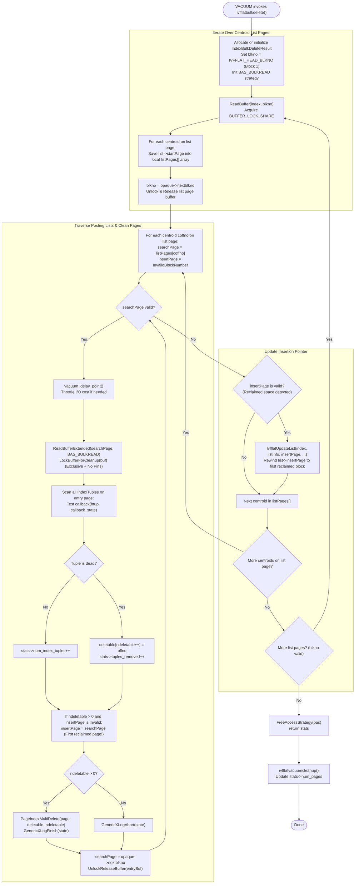

# IVFFlat VACUUM & Dead Tuple Cleanup

## Table of Contents
1. [Overview of Index Maintenance in PostgreSQL](#1-overview-of-index-maintenance-in-postgresql)
2. [End-to-End VACUUM Process Flowchart](#2-end-to-end-vacuum-process-flowchart)
3. [Bulk Deletion Mechanics (`ivfflatbulkdelete`)](#3-bulk-deletion-mechanics-ivfflatbulkdelete)
   - [Centroid List Iteration](#centroid-list-iteration)
   - [Posting List Traversal & Page Cleanup Locking](#posting-list-traversal--page-cleanup-locking)
   - [Identifying Dead Tuples via Callback](#identifying-dead-tuples-via-callback)
   - [Page Compaction via `PageIndexMultiDelete`](#page-compaction-via-pageindexmultidelete)
   - [Cost-Based Vacuum Throttling (`vacuum_delay_point`)](#cost-based-vacuum-throttling-vacuum_delay_point)
4. [Recycling Space: Resetting `insertPage`](#4-recycling-space-resetting-insertpage)
   - [Detecting Reclaimed Capacity](#detecting-reclaimed-capacity)
   - [Rewinding the Insertion Target via `IvfflatUpdateList`](#rewinding-the-insertion-target-via-ivfflatupdatelist)
   - [Concurrency Interaction with In-Flight Inserts](#concurrency-interaction-with-in-flight-inserts)
5. [Index Vacuum Cleanup (`ivfflatvacuumcleanup`)](#5-index-vacuum-cleanup-ivfflatvacuumcleanup)
6. [Post-Vacuum Index Balance & Structural Health](#6-post-vacuum-index-balance--structural-health)
   - [Centroid Permanence & Zombie Clusters](#centroid-permanence--zombie-clusters)
   - [Page Retention vs. Truncation](#page-retention-vs-truncation)
   - [Degradation of Probe Efficiency](#degradation-of-probe-efficiency)
   - [When to Execute `REINDEX`](#when-to-execute-reindex)

---

## 1. Overview of Index Maintenance in PostgreSQL

In PostgreSQL's Multi-Version Concurrency Control (MVCC) model, executing a `DELETE` or `UPDATE` statement does not physically purge the old tuple from disk. Instead, the row is marked as dead by updating its header flags (`t_xmax`). Physical reclamation of dead storage is handled asynchronously by the `VACUUM` process.

For index access methods, PostgreSQL delegates vacuuming via two mandatory callbacks in `IndexAmRoutine`:
- **`ambulkdelete` (`ivfflatbulkdelete`):** Iterates over index pages, tests index tuples against the dead heap TID map using a callback, and physically removes dead entries from index pages.
- **`amvacuumcleanup` (`ivfflatvacuumcleanup`):** Performs post-cleanup tasks, calculates final statistics, and reports the updated relation block count back to the PostgreSQL statistics collector.

Implemented in [ivfvacuum.c](file:///mnt/Data/Coding/arkivector/pgvector/src/ivfvacuum.c), IVFFlat provides an efficient, page-compacting bulk deletion routine that integrates with Generic WAL logging and PostgreSQL's buffer cleanup protocol.

---

## 2. End-to-End VACUUM Process Flowchart



---

## 3. Bulk Deletion Mechanics (`ivfflatbulkdelete`)

The core vacuum routine is defined in [ivfvacuum.c](file:///mnt/Data/Coding/arkivector/pgvector/src/ivfvacuum.c#L18-L143):

```c
IndexBulkDeleteResult *
ivfflatbulkdelete(IndexVacuumInfo *info, IndexBulkDeleteResult *stats,
                  IndexBulkDeleteCallback callback, void *callback_state)
{
    Relation               index = info->index;
    BlockNumber            blkno = IVFFLAT_HEAD_BLKNO;
    BufferAccessStrategy   bas = GetAccessStrategy(BAS_BULKREAD);

    if (stats == NULL)
        stats = palloc0_object(IndexBulkDeleteResult);

    /* Iterate over list pages */
    while (BlockNumberIsValid(blkno))
    {
        Buffer       cbuf;
        Page         cpage;
        OffsetNumber coffno;
        OffsetNumber cmaxoffno;
        BlockNumber  listPages[MaxOffsetNumber];
        ListInfo     listInfo;

        cbuf = ReadBuffer(index, blkno);
        LockBuffer(cbuf, BUFFER_LOCK_SHARE);
        cpage = BufferGetPage(cbuf);
        cmaxoffno = PageGetMaxOffsetNumber(cpage);

        for (coffno = FirstOffsetNumber; coffno <= cmaxoffno; coffno = OffsetNumberNext(coffno))
        {
            IvfflatList list = (IvfflatList) PageGetItem(cpage, PageGetItemId(cpage, coffno));
            listPages[coffno - FirstOffsetNumber] = list->startPage;
        }

        listInfo.blkno = blkno;
        blkno = IvfflatPageGetOpaque(cpage)->nextblkno;
        UnlockReleaseBuffer(cbuf);

        /* Process posting lists for all centroids on this list page */
        for (coffno = FirstOffsetNumber; coffno <= cmaxoffno; coffno = OffsetNumberNext(coffno))
        {
            BlockNumber searchPage = listPages[coffno - FirstOffsetNumber];
            BlockNumber insertPage = InvalidBlockNumber;

            while (BlockNumberIsValid(searchPage))
            {
                Buffer            buf;
                Page              page;
                GenericXLogState *state;
                OffsetNumber      offno;
                OffsetNumber      maxoffno;
                OffsetNumber      deletable[MaxOffsetNumber];
                int               ndeletable;

                vacuum_delay_point();

                buf = ReadBufferExtended(index, MAIN_FORKNUM, searchPage, RBM_NORMAL, bas);
                LockBufferForCleanup(buf);

                state = GenericXLogStart(index);
                page = GenericXLogRegisterBuffer(state, buf, 0);

                maxoffno = PageGetMaxOffsetNumber(page);
                ndeletable = 0;

                /* Identify dead index tuples */
                for (offno = FirstOffsetNumber; offno <= maxoffno; offno = OffsetNumberNext(offno))
                {
                    IndexTuple itup = (IndexTuple) PageGetItem(page, PageGetItemId(page, offno));
                    ItemPointer htup = &(itup->t_tid);

                    if (callback(htup, callback_state))
                    {
                        deletable[ndeletable++] = offno;
                        stats->tuples_removed++;
                    }
                    else
                        stats->num_index_tuples++;
                }

                /* Record first page with reclaimed free space */
                if (!BlockNumberIsValid(insertPage) && ndeletable > 0)
                    insertPage = searchPage;

                searchPage = IvfflatPageGetOpaque(page)->nextblkno;

                if (ndeletable > 0)
                {
                    PageIndexMultiDelete(page, deletable, ndeletable);
                    GenericXLogFinish(state);
                }
                else
                    GenericXLogAbort(state);

                UnlockReleaseBuffer(buf);
            }

            /* Update centroid's insertPage to point to newly reclaimed capacity */
            if (BlockNumberIsValid(insertPage))
            {
                listInfo.offno = coffno;
                IvfflatUpdateList(index, listInfo, insertPage, InvalidBlockNumber, InvalidBlockNumber, MAIN_FORKNUM);
            }
        }
    }

    FreeAccessStrategy(bas);
    return stats;
}
```

### Posting List Traversal & Page Cleanup Locking
Notice line 84:
```c
LockBufferForCleanup(buf);
```
**Why `LockBufferForCleanup` instead of `LockBuffer(..., BUFFER_LOCK_EXCLUSIVE)`?**
In PostgreSQL, an exclusive buffer lock (`BUFFER_LOCK_EXCLUSIVE`) ensures that no other backend is actively reading or writing the buffer's contents. However, an index page cannot have items physically removed if another backend currently holds a **pin** on the buffer header (e.g., a cursor holding position). 

`LockBufferForCleanup` acquires an exclusive lock **and** waits until all concurrent buffer pins drop to 1 (held only by the vacuum process itself). This satisfies PostgreSQL's strict index locking contract (`index-locking.html`).

### Page Compaction via `PageIndexMultiDelete`
When dead tuples are encountered on a page:
```c
PageIndexMultiDelete(page, deletable, ndeletable);
```
PostgreSQL's native `PageIndexMultiDelete` removes the specified line pointers from the page's `ItemIdData` array, compacts the physical items toward the high end of the page, adjusts `pd_lower` and `pd_upper`, and updates `PageGetFreeSpace(page)`. The page is compacted immediately in-place under Generic WAL logging.

### Cost-Based Vacuum Throttling (`vacuum_delay_point`)
To avoid consuming all storage I/O bandwidth during large maintenance operations, line 74 invokes:
```c
vacuum_delay_point();
```
If the cumulative I/O cost of reading and writing pages exceeds `vacuum_cost_limit`, the process voluntarily sleeps for `vacuum_cost_delay` milliseconds.

---

## 4. Recycling Space: Resetting `insertPage`

A major challenge for inverted index implementations is avoiding disk fragmentation when tuples are deleted from the middle of long posting list chains.

### Detecting Reclaimed Capacity
As `ivfflatbulkdelete` iterates through the entry pages of a posting list, it notes the **first page** where dead tuples were purged:
```c
if (!BlockNumberIsValid(insertPage) && ndeletable > 0)
    insertPage = searchPage;
```

### Rewinding the Insertion Target via `IvfflatUpdateList`
Normally, new tuples are appended to the very end of the page chain (`list->insertPage`). If 100 tuples were deleted from the 2nd page of a 10-page chain, continuing to append to page 10 would permanently waste the reclaimed space on page 2.

To prevent this, after scanning all entry pages for a cluster, VACUUM calls:
```c
if (BlockNumberIsValid(insertPage))
{
    listInfo.offno = coffno;
    IvfflatUpdateList(index, listInfo, insertPage, InvalidBlockNumber, InvalidBlockNumber, MAIN_FORKNUM);
}
```
This **rewinds** `list->insertPage` backwards to the first page that now has free space! Subsequent `INSERT` operations will immediately route to this page and fill the reclaimed slots before allocating new blocks.

### Concurrency Interaction with In-Flight Inserts
Recall the guard condition in `IvfflatUpdateList` ([ivfutils.c](file:///mnt/Data/Coding/arkivector/pgvector/src/ivfutils.c#L264)):
```c
if (!BlockNumberIsValid(originalInsertPage) || insertPage >= originalInsertPage)
{
    list->insertPage = insertPage;
    changed = true;
}
```
- During **VACUUM**, `originalInsertPage` is passed as `InvalidBlockNumber`. The check `!BlockNumberIsValid(originalInsertPage)` evaluates to `true`, allowing VACUUM to rewind `list->insertPage` backwards to an earlier block.
- During **INSERT**, `originalInsertPage` contains the block number the insert began on. If a concurrent VACUUM rewound the pointer while an insert was running, the check `insertPage >= originalInsertPage` prevents the insert from overwriting the rewound pointer with an obsolete downstream block!

---

## 5. Index Vacuum Cleanup (`ivfflatvacuumcleanup`)

Once `ivfflatbulkdelete` finishes purging dead tuples, PostgreSQL invokes `ivfflatvacuumcleanup` ([ivfvacuum.c](file:///mnt/Data/Coding/arkivector/pgvector/src/ivfvacuum.c#L149-L164)):

```c
IndexBulkDeleteResult *
ivfflatvacuumcleanup(IndexVacuumInfo *info, IndexBulkDeleteResult *stats)
{
    Relation rel = info->index;

    if (info->analyze_only)
        return stats;

    if (stats == NULL)
        return NULL;

    stats->num_pages = RelationGetNumberOfBlocks(rel);

    return stats;
}
```
If the operation was purely an `ANALYZE`, or if no bulk deletion occurred, it returns early. Otherwise, it queries `RelationGetNumberOfBlocks(rel)` and returns the total physical page count to the engine for relation sizing and cost planner statistics.

---

## 6. Post-Vacuum Index Balance & Structural Health

While VACUUM successfully frees space inside entry pages, it reveals fundamental structural characteristics of the IVFFlat design:

```
        Before Churn (Balanced)                       After Churn & VACUUM (Skewed)
+------------------------------------+         +------------------------------------+
| Centroid 1: 500 tuples (3 pages)   |         | Centroid 1: 0 tuples (1 page) [DEAD]
| Centroid 2: 480 tuples (3 pages)   |  Delete | Centroid 2: 50 tuples (1 page)     |
| Centroid 3: 520 tuples (3 pages)   |  Update | Centroid 3: 1500 tuples (9 pages)  |
| Centroid 4: 510 tuples (3 pages)   |         | Centroid 4: 450 tuples (3 pages)   |
+------------------------------------+         +------------------------------------+
Equal list sizes, optimal recall/probe.        Severe skew: Centroid 1 is empty;
                                               Centroid 3 consumes excessive I/O.
```

### Centroid Permanence & Zombie Clusters
1. **Centroids are Never Pruned:** VACUUM only removes dead items from entry pages. Centroids stored on list pages are **never deleted, merged, or adjusted**.
2. **Zombie Clusters:** If all rows belonging to a Voronoi cell are deleted, that centroid remains in the index. When queries execute, the centroid distance calculation in `GetScanLists` will still consider this centroid. If it ranks among the top `ivfflat.probes`, the query will read an empty entry list, returning 0 candidates for that probe and effectively wasting $1/P$ of its search budget!

### Page Retention vs. Truncation
In PostgreSQL, pages in an index relation cannot be easily truncated from the middle of a file. When all tuples on an entry page are deleted, the page remains part of the inverted list chain (linked via `opaque->nextblkno`) with 0 tuples until future inserts re-populate it.

### Degradation of Probe Efficiency
Over heavy update and delete workloads:
- Certain inverted lists shrink to near-zero length.
- Other inverted lists grow disproportionately large due to new inserts.
- The theoretical assumption of balanced partitions ($\frac{N}{K}$ vectors per list) breaks down.

### When to Execute `REINDEX`
VACUUM is essential for reclaiming disk space, but it **cannot fix cluster skew or centroid drift**.
A full re-index is necessary to:
1. Re-sample the current data distribution.
2. Re-run $k$-means to establish optimal Voronoi cell boundaries.
3. Eliminate zombie centroids and rebalance posting list lengths evenly across all pages.

```sql
-- Rebuilds the index concurrently without blocking concurrent SELECTs or INSERTs:
REINDEX INDEX CONCURRENTLY items_embedding_idx;
```
