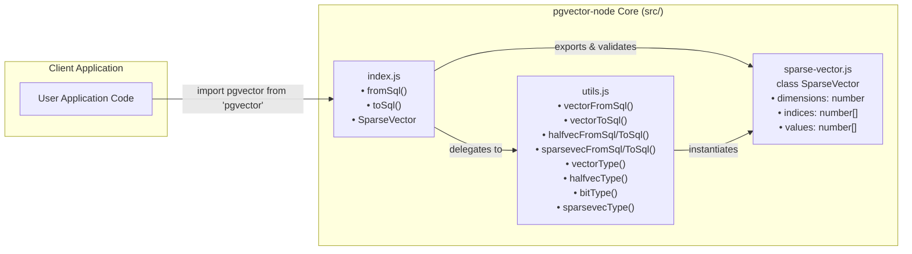
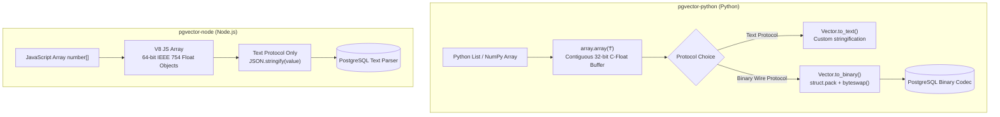

# pgvector Node.js SDK: Core Architecture & Value Types Deep Dive

> In-depth technical analysis of core utilities, polymorphic serialization/deserialization routines, the `SparseVector` data structure, memory layout comparisons, and architectural differences between `pgvector-node` and `pgvector-python`.

---

## Table of Contents

1. [Architectural Overview & Core Module Organization](#1-architectural-overview--core-module-organization)
2. [Core Serialization & Deserialization Utilities (`src/utils.js`)](#2-core-serialization--deserialization-utilities-srcutilsjs)
   - [Dense Vector Parsing: `vectorFromSql`](#dense-vector-parsing-vectorfromsql)
   - [Dense Vector Serialization: `vectorToSql`](#dense-vector-serialization-vectortosql)
   - [Half-Precision Vectors: `halfvecFromSql` & `halfvecToSql`](#half-precision-vectors-halfvecfromsql--halfvectosql)
   - [Sparse Vector Bridge: `sparsevecFromSql` & `sparsevecToSql`](#sparse-vector-bridge-sparsevecfromsql--sparsevectosql)
   - [SQL DDL Data Type Generators with Invariant Checks](#sql-ddl-data-type-generators-with-invariant-checks)
3. [Polymorphic Dispatch Architecture (`src/index.js`)](#3-polymorphic-dispatch-architecture-srcindexjs)
   - [Inbound Polymorphic Dispatch: `fromSql`](#inbound-polymorphic-dispatch-fromsql)
   - [Outbound Polymorphic Dispatch: `toSql`](#outbound-polymorphic-dispatch-tosql)
   - [Mermaid Pipeline: Serialization & Deserialization Flow](#mermaid-pipeline-serialization--deserialization-flow)
4. [The `SparseVector` Class Architecture (`src/sparse-vector.js`)](#4-the-sparsevector-class-architecture-srcsparse-vectorjs)
   - [Internal State & Memory Representation](#internal-state--memory-representation)
   - [Constructor Overloading & Polymorphic Ingestion Modes](#constructor-overloading--polymorphic-ingestion-modes)
   - [PostgreSQL 1-Based vs JavaScript 0-Based Indexing Mechanics](#postgresql-1-based-vs-javascript-0-based-indexing-mechanics)
   - [PostgreSQL Text Serialization (`toPostgres` & `toString`)](#postgresql-text-serialization-topostgres--tostring)
   - [Dense Expansion: `toArray`](#dense-expansion-toarray)
   - [Private Ingestion Parsers & Validation Invariants](#private-ingestion-parsers--validation-invariants)
5. [Comparative Analysis: Node.js SDK vs Python SDK (`pgvector-python`)](#5-comparative-analysis-nodejs-sdk-vs-python-sdk-pgvector-python)
   - [In-Memory Float Storage: IEEE 754 64-Bit Float vs 32-Bit C-Float](#in-memory-float-storage-ieee-754-64-bit-float-vs-32-bit-c-float)
   - [Serialization Mechanics: `JSON.stringify` vs Custom Stringification](#serialization-mechanics-jsonstringify-vs-custom-stringification)
   - [Wire Protocol Implementation: Text Protocol Dominance vs Native Binary Codecs](#wire-protocol-implementation-text-protocol-dominance-vs-native-binary-codecs)
   - [Architecture Comparative Matrix](#architecture-comparative-matrix)
6. [Testing Invariants, Failure Modes & Edge Cases](#6-testing-invariants-failure-modes--edge-cases)
   - [Null Handling & Type Coercion](#null-handling--type-coercion)
   - [Empty and Zero Vectors](#empty-and-zero-vectors)
   - [Future Roadmap: Planned Invariants for v0.4.0](#future-roadmap-planned-invariants-for-v040)

---

## 1. Architectural Overview & Core Module Organization

The runtime architecture of `pgvector-node` is partitioned into three foundational units located in `src/`:
1. **`src/utils.js`**: Low-level parsing routines, serialization primitives, and SQL type definition generators.
2. **`src/sparse-vector.js`**: Object-oriented encapsulation of PostgreSQL's compressed sparse vector data type (`sparsevec`).
3. **`src/index.js`**: The high-level facade exposing unified, polymorphic `fromSql` and `toSql` functions, as well as re-exporting `SparseVector`.



---

## 2. Core Serialization & Deserialization Utilities (`src/utils.js`)

`src/utils.js` provides atomic transformation functions between JavaScript runtime objects and PostgreSQL text wire strings.

### Dense Vector Parsing: `vectorFromSql`

PostgreSQL sends dense vector values (`vector` or `halfvec`) over the text wire protocol as bracketed, comma-delimited strings:
```text
"[1.2,3.4,5.6]"
```

The parsing function implementation is as follows:

```javascript
/**
 * @param {?string} value
 * @returns {?number[]}
 */
export function vectorFromSql(value) {
  if (value === null) {
    return null;
  }
  // TODO check brackets in 0.4.0
  return value.substring(1, value.length - 1).split(',').map((v) => parseFloat(v));
}
```

#### Parsing Breakdown & Algorithmic Complexity
1. **Null Check**: Returns `null` if the input is explicitly `null` (representing a SQL `NULL`).
2. **Slice Outer Delimiters**: `value.substring(1, value.length - 1)` strips the leading `[` and trailing `]`. Note that the comment `// TODO check brackets in 0.4.0` indicates that currently it does not assert that the first character is indeed `[` and the last is `]`, a strict check planned for v0.4.0.
3. **Delimiter Splitting**: `.split(',')` allocates an array of string tokens.
4. **Float Conversion**: `.map((v) => parseFloat(v))` iterates through the tokens and parses each into a standard JavaScript 64-bit double precision float.
5. **Complexity**: $\mathcal{O}(d)$ in time and $\mathcal{O}(d)$ in intermediate string and array memory allocations, where $d$ is the dimensionality of the vector.

---

### Dense Vector Serialization: `vectorToSql`

When serializing a JavaScript array of numbers into PostgreSQL's expected vector literal format, `vectorToSql` utilizes JavaScript's native JSON serialization:

```javascript
/**
 * @param {?number[]} value
 * @returns {?string}
 */
export function vectorToSql(value) {
  if (Array.isArray(value)) {
    return JSON.stringify(value.map((v) => Number(v)));
  }
  return value;
}
```

#### Serialization Mechanics & Edge Cases
1. **Idempotence and Passthrough**: If `value` is not an array (e.g. if the developer already passed a pre-formatted string like `'[1,2,3]'` or `null`), `vectorToSql` returns the input unchanged.
2. **Number Coercion**: The `.map((v) => Number(v))` step ensures that if elements inside the array were numeric strings (e.g., `["1.5", "2.0"]`), they are converted into pure JavaScript numbers before stringification.
3. **JSON Compliance**: `JSON.stringify` natively produces bracketed, comma-separated numeric lists without whitespace (e.g., `"[1,2,3]"`), which matches PostgreSQL's input format for `vector` and `halfvec` columns.

---

### Half-Precision Vectors: `halfvecFromSql` & `halfvecToSql`

PostgreSQL 16+ and `pgvector` v0.7.0+ introduced the `halfvec` data type: a 16-bit half-precision floating-point vector (IEEE 754 binary16). Over the PostgreSQL text wire protocol, `halfvec` uses the exact same string formatting as standard single-precision `vector` (e.g., `"[1.5,-2.25,0]"`).

Consequently, `src/utils.js` creates zero overhead by directly aliasing the functions:

```javascript
export { vectorFromSql as halfvecFromSql };
export { vectorToSql as halfvecToSql };
```

In the JavaScript runtime, both 32-bit single-precision floats and 16-bit half-precision floats are materialized into JavaScript's uniform 64-bit IEEE 754 double-precision representation (`number`).

---

### Sparse Vector Bridge: `sparsevecFromSql` & `sparsevecToSql`

Sparse vectors in PostgreSQL are formatted as `{index:value,index:value,...}/dimensions` using 1-based indexing:
```text
"{1:1.5,3:2.0}/6"
```

The bridge utilities in `src/utils.js` wrap the `SparseVector` class:

```javascript
/**
 * @param {?string} value
 * @returns {?SparseVector}
 */
export function sparsevecFromSql(value) {
  if (value === null) {
    return null;
  }
  return new SparseVector(value);
}

/**
 * @param {?SparseVector} value
 * @returns {?string}
 */
export function sparsevecToSql(value) {
  if (value instanceof SparseVector) {
    return value.toPostgres();
  }
  return value;
}
```

- **`sparsevecFromSql`**: Passes the raw SQL string directly to `new SparseVector(value)`, returning a fully parsed object instance.
- **`sparsevecToSql`**: If the value is an instance of `SparseVector`, it delegates to `value.toPostgres()`. If not, it passes the value through, allowing string literals to pass directly to database drivers.

---

### SQL DDL Data Type Generators with Invariant Checks

When configuring schema builders (such as Knex migrations or MikroORM column definitions), SQL type strings like `vector(1536)` or `halfvec(768)` must be constructed safely to prevent SQL injection or invalid DDL generation.

`src/utils.js` encapsulates this inside `typeWithDimensions`:

```javascript
/**
 * @param {string} name
 * @param {number | null | undefined} dimensions
 * @returns {string}
 */
function typeWithDimensions(name, dimensions) {
  if (dimensions === undefined || dimensions === null) {
    return name;
  }

  if (!Number.isInteger(dimensions)) {
    throw new Error('expected integer');
  }

  return format('%s(%d)', name, dimensions);
}
```

`typeWithDimensions` enforces two strict invariants:
1. **Dimension Optionality**: If `dimensions` is omitted, `null`, or `undefined`, it returns the base type identifier (e.g., `'vector'`). This is valid in PostgreSQL when declaring variable-dimension columns or function return types.
2. **Integer Assertion**: If `dimensions` is supplied, it **must** satisfy `Number.isInteger(dimensions)`. If a float (e.g., `1536.5`) or non-integer object is supplied, it throws `Error('expected integer')`.
3. **Safe Formatting**: Uses Node's built-in `format('%s(%d)', name, dimensions)` to format the type string.

Specialized exports expose this helper across all pgvector data types:

```javascript
export function vectorType(dimensions) {
  return typeWithDimensions('vector', dimensions);
}

export function halfvecType(dimensions) {
  return typeWithDimensions('halfvec', dimensions);
}

export function bitType(dimensions) {
  return typeWithDimensions('bit', dimensions);
}

export function sparsevecType(dimensions) {
  return typeWithDimensions('sparsevec', dimensions);
}
```

| Function Call | Output String | Notes |
| :--- | :--- | :--- |
| `vectorType(3)` | `'vector(3)'` | Standard dense vector |
| `vectorType()` / `vectorType(null)` | `'vector'` | Unbounded dimensionality |
| `halfvecType(768)` | `'halfvec(768)'` | Half-precision vector |
| `sparsevecType(10000)` | `'sparsevec(10000)'` | High-dimensional sparse vector |
| `bitType(64)` | `'bit(64)'` | Binary Hamming vector |
| `vectorType(3.14)` | **Throws Error** | Throws `'expected integer'` |

---

## 3. Polymorphic Dispatch Architecture (`src/index.js`)

The root module `src/index.js` provides polymorphic serialization (`toSql`) and deserialization (`fromSql`) routines capable of inspecting input types and routing to the appropriate parser or serializer.

```javascript
import { SparseVector } from './sparse-vector.js';
import { vectorFromSql, sparsevecFromSql, vectorToSql, sparsevecToSql } from './utils.js';

/**
 * @param {?string} value
 * @returns {number[] | SparseVector | null}
 */
function fromSql(value) {
  if (value === null) {
    return null;
  } else if (value[0] == '[') {
    return vectorFromSql(value);
  } else if (value[0] == '{') {
    return sparsevecFromSql(value);
  } else {
    throw new Error('invalid text representation');
  }
}

/**
 * @param {number[] | SparseVector | null} value
 * @returns {?string}
 */
function toSql(value) {
  if (value === null) {
    return null;
  } else if (Array.isArray(value)) {
    return vectorToSql(value);
  } else if (value instanceof SparseVector) {
    return sparsevecToSql(value);
  } else {
    throw new Error('expected array or sparse vector');
  }
}

export { fromSql, toSql, SparseVector };
export default { fromSql, toSql };
```

### Inbound Polymorphic Dispatch: `fromSql`

When reading values from drivers that do not have automatic type parsers attached (e.g. Prisma raw queries, Slonik, or manual query results), `fromSql` inspects the **first character** of the PostgreSQL text wire representation:

1. **`value === null`**: Passes through as JavaScript `null`.
2. **`value[0] == '['`**: Denotes dense vectors (`vector` or `halfvec`), which are enclosed in brackets `[...]`. Delegates to `vectorFromSql(value)` to return `number[]`.
3. **`value[0] == '{'`**: Denotes sparse vectors (`sparsevec`), which are enclosed in curly braces `{...}/dim`. Delegates to `sparsevecFromSql(value)` to return `SparseVector`.
4. **Invalid Representation**: If the string begins with any other character (or is empty `""`), it immediately throws `Error('invalid text representation')`.

### Outbound Polymorphic Dispatch: `toSql`

When writing parameters into query builder placeholders or SQL template tags, `toSql` performs runtime type discrimination:

1. **`value === null`**: Passes through as `null`.
2. **`Array.isArray(value)`**: Recognizes JavaScript dense vectors (`number[]`). Delegates to `vectorToSql(value)` which serializes to `"[x,y,z]"`.
3. **`value instanceof SparseVector`**: Recognizes sparse vector instances. Delegates to `sparsevecToSql(value)` which serializes to `"{i:v,...}/dim"`.
4. **Type Error**: If any other type is passed (such as a plain object `{}` that was not wrapped in `new SparseVector`, a number, or a boolean), it throws `Error('expected array or sparse vector')`.

### Mermaid Pipeline: Serialization & Deserialization Flow

```mermaid
flowchart TD
    subgraph Deserialization [Inbound: fromSql(value)]
        InVal[String Input] --> IsNull1{value === null?}
        IsNull1 -- Yes --> RetNull1[Return null]
        IsNull1 -- No --> CheckChar{value[0]}
        CheckChar -- "'['" --> ParseDense["vectorFromSql(value)<br/>Returns number[]"]
        CheckChar -- "'{'" --> ParseSparse["sparsevecFromSql(value)<br/>Returns SparseVector"]
        CheckChar -- Other / Empty --> Err1["Throw Error('invalid text representation')"]
    end

    subgraph Serialization [Outbound: toSql(value)]
        OutVal[Input Value] --> IsNull2{value === null?}
        IsNull2 -- Yes --> RetNull2[Return null]
        IsNull2 -- No --> CheckType{Type Check}
        CheckType -- "Array.isArray(value)" --> SerDense["vectorToSql(value)<br/>JSON.stringify -> '[1,2,3]'"]
        CheckType -- "value instanceof SparseVector" --> SerSparse["sparsevecToSql(value)<br/>value.toPostgres() -> '{1:1,...}/d'"]
        CheckType -- Other --> Err2["Throw Error('expected array or sparse vector')"]
    end
```

---

## 4. The `SparseVector` Class Architecture (`src/sparse-vector.js`)

PostgreSQL's `sparsevec` type represents high-dimensional vectors (up to 1,000 non-zero elements and 16,000 dimensions) where most elements are zero (common in BM25, SPLADE, and lexical hybrid search embeddings).

### Internal State & Memory Representation

The `SparseVector` class maintains three internal properties:

```javascript
export class SparseVector {
  /** @type {number} */
  dimensions = 0;

  /** @type {number[]} */
  indices = [];

  /** @type {number[]} */
  values = [];
  ...
}
```

- **`dimensions`**: Total dimensionality of the vector space ($N \ge 0$).
- **`indices`**: A dense JavaScript array of integers storing the **0-based** indices of all non-zero elements.
- **`values`**: A dense JavaScript array of 64-bit IEEE 754 floats storing the values corresponding to each index in `indices`.

This structure mirrors the Coordinate List (COO) sparse matrix format for a single 1D vector.

---

### Constructor Overloading & Polymorphic Ingestion Modes

The `SparseVector` constructor supports four distinct initialization patterns:

```javascript
/**
 * @overload
 * @param {string | number[]} value
 */

/**
 * @overload
 * @param {Map<number, number> | object} value
 * @param {number} dimensions
 */

/**
 * @param {string | number[] | Map<number, number> | object} value
 * @param {number} [dimensions]
 */
constructor(value, dimensions) {
  if (typeof dimensions !== 'undefined') {
    // @ts-ignore
    this.#fromMap(value, dimensions);
  } else if (typeof value === 'string') {
    this.#fromSql(value);
  } else {
    // @ts-ignore
    this.#fromDense(value);
  }
}
```

```mermaid
flowchart TD
    Constructor[new SparseVector(value, dimensions?)]
    
    Constructor --> HasDim{dimensions !== undefined?}
    HasDim -- Yes --> RouteMap["#fromMap(value, dimensions)<br/>Accepts Map or Plain Object"]
    HasDim -- No --> IsStr{typeof value === 'string'?}
    IsStr -- Yes --> RouteSql["#fromSql(value)<br/>Parses PostgreSQL '{...}/dim'"]
    IsStr -- No --> RouteDense["#fromDense(value)<br/>Compresses number[]"]
```

#### Mode 1: From PostgreSQL Text String
```javascript
const vec = new SparseVector('{1:1.5,3:2.0}/6');
```
Parses PostgreSQL's text wire format.

#### Mode 2: From Dense Array
```javascript
const vec = new SparseVector([1.5, 0, 2.0, 0, 0, 0]);
```
Compresses a zero-filled dense array. Non-zero elements are filtered, and `dimensions` is inferred from `array.length`.

#### Mode 3: From JavaScript `Map`
```javascript
const map = new Map();
map.set(0, 1.5);
map.set(2, 2.0);
const vec = new SparseVector(map, 6);
```
Explicitly ingests non-zero `[index, value]` pairs. Explicit `dimensions` parameter is mandatory.

#### Mode 4: From Plain JavaScript Object
```javascript
const vec = new SparseVector({ 0: 1.5, 2: 2.0 }, 6);
```
Ingests non-zero pairs from key-value properties. Explicit `dimensions` parameter is mandatory.

---

### PostgreSQL 1-Based vs JavaScript 0-Based Indexing Mechanics

A critical design consideration in vector database systems is index numbering:
- **PostgreSQL Wire Format**: pgvector mandates **1-based indexing** for text representations: `{1:1.5,3:2.0}/6`.
- **JavaScript Ecosystem**: JavaScript arrays, typed arrays, and objects are strictly **0-based**: `arr[0]`, `arr[2]`.

`SparseVector` guarantees that JavaScript developers interact **exclusively with 0-based indices**:

```javascript
// Input SQL: {1:1.5,3:2.0}/6  (Indices 1 and 3 in PostgreSQL)
const vec = new SparseVector('{1:1.5,3:2.0}/6');

console.log(vec.indices); 
// Outputs: [0, 2]  <-- Converted to 0-based

console.log(vec.toArray()); 
// Outputs: [1.5, 0, 2.0, 0, 0, 0]  <-- Position 0 and 2 populated
```

#### Index Conversion Implementation:
1. **Inbound Conversion (`#fromSql`)**:
   ```javascript
   const ep = element.split(':', 2);
   this.indices.push(parseInt(ep[0]) - 1); // Subtracts 1 to normalize to 0-based
   this.values.push(parseFloat(ep[1]));
   ```
2. **Outbound Conversion (`toPostgres`)**:
   ```javascript
   const elements = this.indices
     .map((index, i) => format('%i:%f', index + 1, values[i])) // Adds 1 for PostgreSQL
     .join(',');
   ```

---

### PostgreSQL Text Serialization (`toPostgres` & `toString`)

To format the sparse vector back into PostgreSQL's canonical representation, `toPostgres` iterates through `indices` and `values` using `node:util.format`:

```javascript
/**
 * @returns {string}
 */
toPostgres() {
  const values = this.values;
  const elements = this.indices.map((index, i) => format('%i:%f', index + 1, values[i])).join(',');
  return format('{%s}/%d', elements, this.dimensions);
}

/**
 * @returns {string}
 */
toString() {
  return this.toPostgres();
}
```

- `format('%i:%f', index + 1, values[i])`: Formats the integer index (1-based) and float value.
- Handles empty sparse vectors cleanly: if `indices` is empty, `elements` is `""`, generating `{}/3`.
- `toString()` is an alias of `toPostgres()`, ensuring seamless template literal interpolation (e.g. `` `${vec}` ``).

---

### Dense Expansion: `toArray`

To convert a sparse vector into a standard full-length dense JavaScript array (e.g., for passing into visualization libraries or local math routines), `toArray()` zero-fills an array of size `dimensions`:

```javascript
/**
 * @returns {number[]}
 */
toArray() {
  const arr = Array(this.dimensions).fill(0.0);
  for (const [i, index] of this.indices.entries()) {
    arr[index] = this.values[i];
  }
  return arr;
}
```

#### Step-by-Step Execution:
1. Allocates an array of length `this.dimensions` pre-populated with `0.0`.
2. Iterates over `this.indices`. For every sparse element, writes `this.values[i]` into `arr[index]`.
3. Returns a dense array of size $d$.

---

### Private Ingestion Parsers & Validation Invariants

#### 1. SQL Parser: `#fromSql`
```javascript
/**
 * @param {string} value
 */
#fromSql(value) {
  // TODO check brackets in 0.4.0
  const parts = value.split('/', 2);

  this.dimensions = parseInt(parts[1]);

  if (parts[0].length > 2) {
    const elements = parts[0].slice(1, -1).split(',');
    for (const element of elements) {
      const ep = element.split(':', 2);
      this.indices.push(parseInt(ep[0]) - 1);
      this.values.push(parseFloat(ep[1]));
    }
  }

  // TODO uncomment in 0.4.0
  // this.#validate();
}
```
*Note on Empty Vectors (v0.3.1 fix)*: In v0.3.0, `{}/3` caused an error because slicing `"{}"` yielded an empty string `""` which split into `[""]` and parsed `NaN:NaN`. Version 0.3.1 added `if (parts[0].length > 2)` to ensure that `{}` (length 2) skips element parsing, correctly yielding empty `indices` and `values`.

#### 2. Dense Array Compressor: `#fromDense`
```javascript
/**
 * @param {number[]} value
 */
#fromDense(value) {
  this.dimensions = value.length;

  for (const [i, v] of value.entries()) {
    const f = Number(v);
    if (f != 0) {
      this.indices.push(Number(i));
      this.values.push(f);
    }
  }
}
```
Iterates the dense array, coerces entries to numbers, and records indices for any non-zero value.

#### 3. Map / Object Ingestion: `#fromMap`
```javascript
/**
 * @param {Map<number, number>} map
 * @param {number} dimensions
 */
#fromMap(map, dimensions) {
  this.dimensions = Number(dimensions);

  const entries = map instanceof Map ? map.entries() : Object.entries(map);
  for (const [i, v] of entries) {
    const f = Number(v);
    if (f != 0) {
      this.indices.push(Number(i));
      this.values.push(f);
    }
  }

  // TODO uncomment in 0.4.0
  // this.#validate();
}
```
Extracts `entries` whether the input is a `Map` or a plain JavaScript object. Note that `Object.entries()` converts keys to strings, but `Number(i)` in `this.indices.push(Number(i))` casts them back to numeric indices.

#### 4. Private Validation Routine: `#validate`
```javascript
#validate() {
  if (this.dimensions < 0) {
    throw new Error('sparsevec cannot have negative dimensions');
  }

  if (this.indices.some(i => i < 0 || i >= this.dimensions)) {
    throw new Error('sparsevec index out of bounds');
  }
}
```
Currently commented out in v0.3.1 with a `TODO uncomment in 0.4.0` directive. Once activated in v0.4.0, it will enforce bounds checking against dimensions and negative indices.

---

## 5. Comparative Analysis: Node.js SDK vs Python SDK (`pgvector-python`)

While both official SDKs were authored by Andrew Kane and share design principles (zero dependencies, high performance, cross-driver support), differences arise from their respective runtime environments (V8/JavaScript vs CPython/NumPy).



### In-Memory Float Storage: IEEE 754 64-Bit Float vs 32-Bit C-Float

The fundamental difference lies in how floating-point numbers are held in client memory:

| Dimension | `pgvector-node` (JavaScript) | `pgvector-python` (Python) |
| :--- | :--- | :--- |
| **Data Type** | Standard JavaScript `number` | Python `array.array('f')` / NumPy `float32` |
| **Precision** | IEEE 754 64-bit Double Precision | IEEE 754 32-bit Single Precision |
| **Memory per Element** | 8 bytes (double) + V8 object pointer overhead | 4 bytes (contiguous C-array) |
| **Memory for 1M vectors (1536-dim)** | $\approx 12.288 \text{ GB}$ (without typed array packing) | $\approx 6.144 \text{ GB}$ (exact buffer allocation) |
| **Typed Array Usage** | Does **not** use `Float32Array` in core APIs | Uses `array('f')` internally in `Vector` class |

In `pgvector-node`, vectors are standard JavaScript arrays of `number`. JavaScript numbers in modern engines (V8, JavaScriptCore) are always 64-bit floats. In contrast, `pgvector-python` models `Vector` by wrapping `array.array('f')`, storing dense vectors as contiguous 32-bit C-floats.

---

### Serialization Mechanics: `JSON.stringify` vs Custom Stringification

#### Node.js (`vectorToSql`):
```javascript
return JSON.stringify(value.map((v) => Number(v)));
```
- Delegates directly to V8's native C++ `JSON.stringify` implementation.
- Since JSON array syntax `[1.1,2.2,3.3]` is identical to PostgreSQL vector text syntax, using `JSON.stringify` is faster in V8 than manual string formatting loops.

#### Python (`Vector.to_text`):
```python
def to_text(self) -> str:
    return f'[{",".join([str(v) for v in self._value])}]'
```
- In Python, JSON serialization would add overhead from importing the `json` module. Instead, Python SDK uses string comprehension with `.join()`.

---

### Wire Protocol Implementation: Text Protocol Dominance vs Native Binary Codecs

A major architectural distinction between the two SDKs is support for PostgreSQL's **binary wire protocol**:

#### 1. Python SDK (`pgvector-python`)
`pgvector-python` includes dedicated binary serializers and deserializers:
```python
def to_binary(self) -> bytes:
    if sys.byteorder == 'big':
        value = self._value
    else:
        value = array('f', self._value)
        value.byteswap()
    return struct.pack('>HH', len(self._value), 0) + value.tobytes()
```
Drivers such as `asyncpg` and `psycopg` (v3) transmit vectors over the network in raw binary bytes. This eliminates all float-to-string and string-to-float ASCII conversions on both client and PostgreSQL server.

#### 2. Node.js SDK (`pgvector-node`)
Node.js drivers (`pg`, `postgres`, `pg-promise`) communicate primarily over PostgreSQL's **text wire protocol**:
- There is no binary encoder/decoder in `pgvector-node`.
- Every vector sent to the database is stringified (e.g. `"[1,2,3]"`).
- Every vector returned from the database is received as an ASCII string and parsed with `parseFloat`.
- **Reason**: The Node.js database ecosystem (`node-postgres`, `postgres.js`) has traditionally emphasized the text protocol for broad compatibility and simplicity, and Node's Buffer-based custom binary type parsers require complex asynchronous catalog OID synchronization.

---

### Architecture Comparative Matrix

| Feature | `pgvector-node` (v0.3.1) | `pgvector-python` (v0.5.1) |
| :--- | :--- | :--- |
| **Language & Standard** | ECMAScript Module (ESM), Node 22+ | Python 3.8+, PEP 561 (`py.typed`) |
| **Dense Vector In-Memory Type** | `number[]` (Array of IEEE 754 64-bit doubles) | `Vector` (`array.array('f')` 32-bit floats) |
| **Half-Precision Type** | `number[]` (re-uses dense vector functions) | `HalfVector` (`array.array('H')` 16-bit uint) |
| **Sparse Vector In-Memory Type** | `SparseVector` class (COO format) | `SparseVector` class (COO format) |
| **Binary Hamming Type** | Native `string` (e.g. `'10101'`) | `Bit` class (`bytes` with bit padding) |
| **Binary Protocol Support** | ❌ None (Text protocol only) | ✅ Full (`to_binary` / `from_binary`) |
| **Serialization Method** | `JSON.stringify(value.map(Number))` | `Vector.to_text()` string comprehension |
| **Driver Registration** | `setTypeParser(oid, 'text', fn)` | Type dumpers, loaders, binary codecs |
| **Type Checking Strategy** | JSDoc + `tsc --emitDeclarationOnly` | Full static Python typings + `mypy` / `pyright` |
| **External Math Library Interop** | Native Arrays, Maps, Plain Objects | Zero-copy NumPy ndarrays & SciPy matrices |

---

## 6. Testing Invariants, Failure Modes & Edge Cases

The test suites in `tests/utils.test.js` and `tests/sparse-vector.test.js` confirm strict behavioral invariants for both utilities and classes.

### Null Handling & Type Coercion

All conversion functions treat `null` consistently:
```javascript
assert.equal(pgvector.fromSql(null), null);
assert.equal(pgvector.toSql(null), null);
assert.equal(vectorFromSql(null), null);
assert.equal(vectorToSql(null), null);
assert.equal(sparsevecFromSql(null), null);
assert.equal(sparsevecToSql(null), null);
```
Passing `null` never throws; it returns `null` to represent SQL `NULL`.

However, passing unsupported types to `toSql` throws an explicit error:
```javascript
assert.throws(() => pgvector.toSql({}), { message: 'expected array or sparse vector' });
assert.throws(() => pgvector.toSql(123), { message: 'expected array or sparse vector' });
```

And passing invalid string formats to `fromSql` throws:
```javascript
assert.throws(() => pgvector.fromSql(''), { message: 'invalid text representation' });
assert.throws(() => pgvector.fromSql('hello'), { message: 'invalid text representation' });
```

---

### Empty and Zero Vectors

#### 1. Empty Sparse Vector (`{}/dim`)
In `tests/sparse-vector.test.js`:
```javascript
test('fromSqlZero', () => {
  const vec = new SparseVector('{}/3');
  assert.deepEqual(vec.toArray(), [0, 0, 0]);
  assert.equal(vec.dimensions, 3);
  assert.deepEqual(vec.indices, []);
  assert.deepEqual(vec.values, []);
});
```
- Correctly parses into zero indices and values without NaN errors.
- `toArray()` expands to `[0, 0, 0]`.

#### 2. Filtering Zero Values in Dense and Map Ingestion
When instantiating `SparseVector` from a dense array or Map, zero values are filtered out automatically:
```javascript
const vec1 = new SparseVector([1, 0, 2, 0, 3, 0]);
assert.deepEqual(vec1.indices, [0, 2, 4]);
assert.deepEqual(vec1.values, [1, 2, 3]);

const map = new Map([[0, 1], [1, 0], [2, 2]]);
const vec2 = new SparseVector(map, 3);
assert.deepEqual(vec2.indices, [0, 2]);
assert.deepEqual(vec2.values, [1, 2]);
```

---

### Future Roadmap: Planned Invariants for v0.4.0

Code comments and disabled tests in the source indicate the following validation improvements scheduled for `pgvector-node` v0.4.0:

1. **Strict Bracket Validation**:
   - Verify leading `[` and trailing `]` in `vectorFromSql`.
   - Verify leading `{` and trailing `/` in `sparsevecFromSql`.
2. **Dimension Sign Assertion**:
   ```javascript
   // Will throw in v0.4.0:
   new SparseVector({}, -1); // Error: 'sparsevec cannot have negative dimensions'
   ```
3. **Index Bounds Checking**:
   ```javascript
   // Will throw in v0.4.0:
   new SparseVector({ '-1': 1 }, 3); // Error: 'sparsevec index out of bounds'
   new SparseVector({ 3: 1 }, 3);    // Error: 'sparsevec index out of bounds' (0-based max index is 2)
   ```
