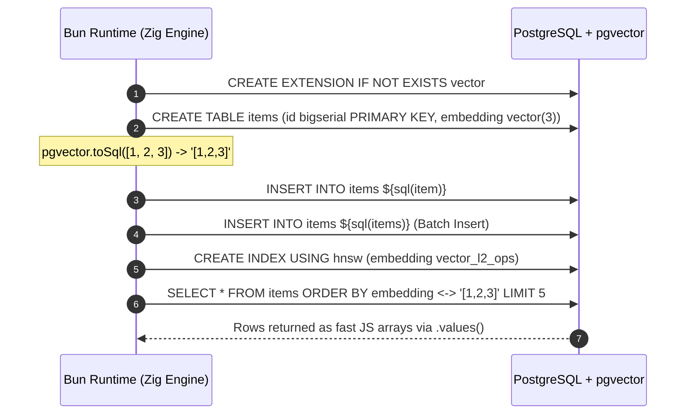
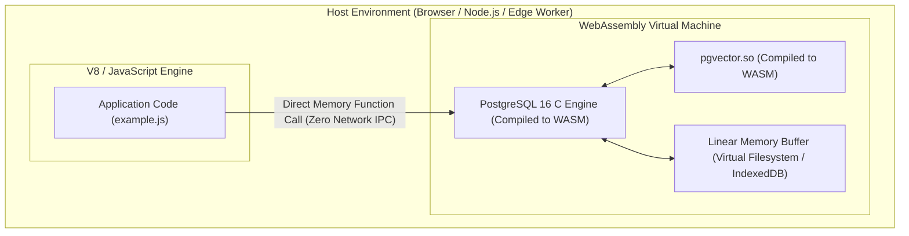
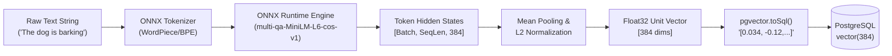
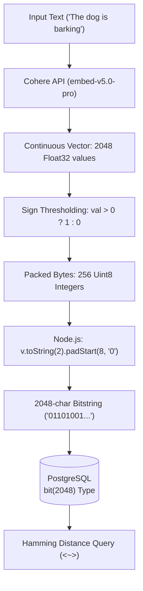
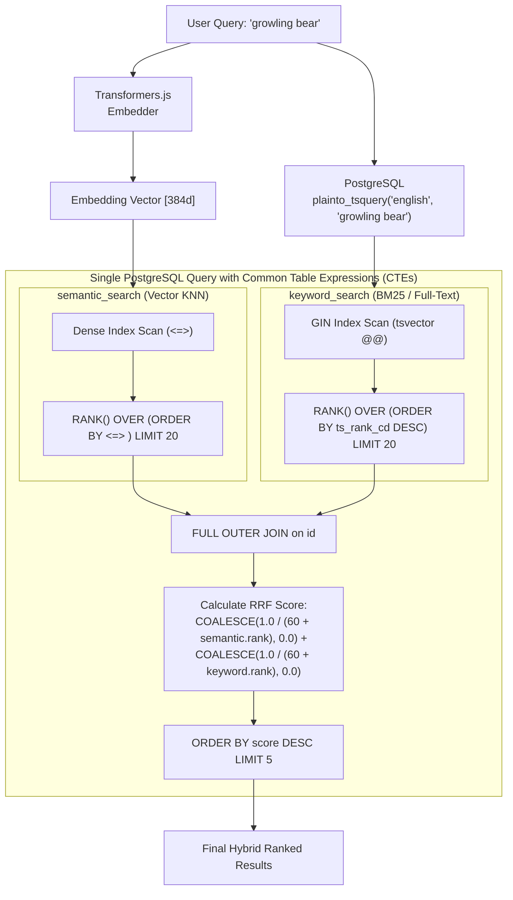
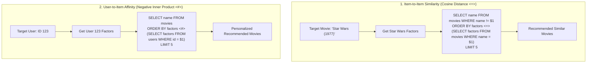
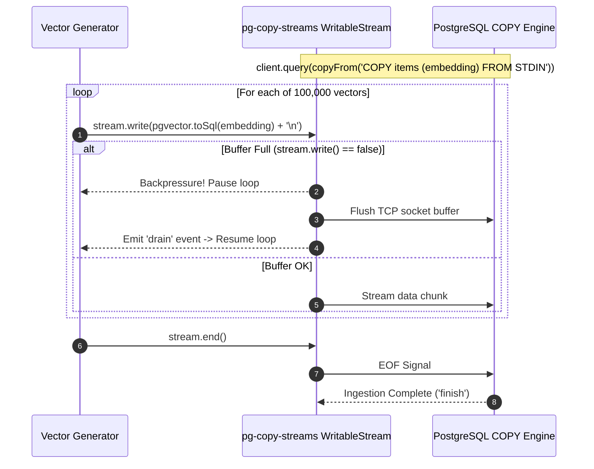
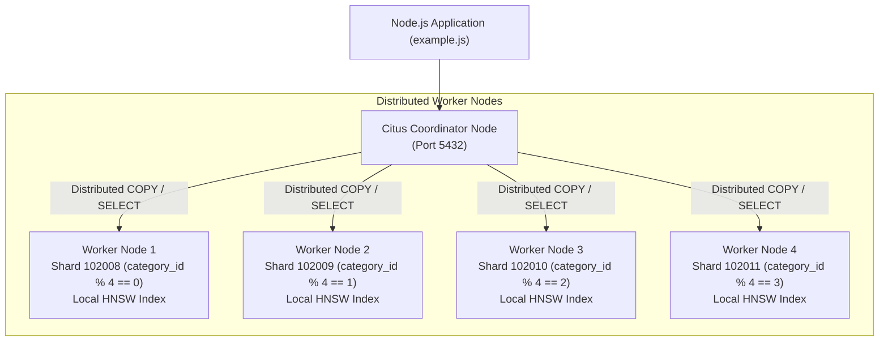

# pgvector-node: Architectural Analysis of Real-World Production Examples

> **Document Version:** 1.0.0  
> **Target SDK:** `pgvector-node` (`pgvector`, `pgvector/pg`)  
> **Source Directory Inspected:** `pgvector-node/examples/`  
> **Examples Analyzed:**  
> 1. `examples/bun/example.js` (Bun Native SQL Driver Integration)  
> 2. `examples/deno/example.js` (Deno JSR & Secure Runtime)  
> 3. `examples/pglite/example.js` (PGlite WASM In-Process PostgreSQL)  
> 4. `examples/transformers/example.js` (Transformers.js Local In-Process ONNX Embeddings)  
> 5. `examples/openai/example.js` (OpenAI `text-embedding-3-small` Dense Vectors)  
> 6. `examples/cohere/example.js` (Cohere `ubinary` 1-Bit Quantization on `bit(2048)`)  
> 7. `examples/hybrid-search/example.js` (Reciprocal Rank Fusion with Full-Text Search)  
> 8. `examples/sparse-search/example.js` (Sparse Semantic Search via SPLADE / `sparsevec`)  
> 9. `examples/disco/example.js` (Collaborative Filtering Matrix Factorization Recommendations)  
> 10. `examples/loading/example.js` (High-Throughput Stream Ingestion via PostgreSQL COPY)  
> 11. `examples/citus/example.js` (Distributed Horizontal Sharding across Citus Worker Nodes)  
> 12. `examples/rdkit/example.js` (Cheminformatics & Molecular Fingerprints via RDKit WASM)  

---

## Table of Contents

1. [Executive Summary & Production Taxonomy](#1-executive-summary--production-taxonomy)
2. [Category 1: Modern JS Runtimes & Embedded Databases](#2-category-1-modern-js-runtimes--embedded-databases)
   - [2.1 Bun Native SQL Driver (`examples/bun`)](#21-bun-native-sql-driver-examplesbun)
   - [2.2 Deno Modern ESM & JSR Ecosystem (`examples/deno`)](#22-deno-modern-esm--jsr-ecosystem-examplesdeno)
   - [2.3 PGlite: WASM-Compiled In-Process PostgreSQL with pgvector (`examples/pglite`)](#23-pglite-wasm-compiled-in-process-postgresql-with-pgvector-examplespglite)
3. [Category 2: In-Process Machine Learning & Local Embeddings](#3-category-2-in-process-machine-learning--local-embeddings)
   - [3.1 Transformers.js: Zero-Dependency Local ONNX Embeddings (`examples/transformers`)](#31-transformersjs-zero-dependency-local-onnx-embeddings-examplestransformers)
   - [3.2 Pipeline Architecture & Mean-Pooling Mechanics](#32-pipeline-architecture--mean-pooling-mechanics)
4. [Category 3: Commercial Dense & Binary Quantized Embeddings](#4-category-3-commercial-dense--binary-quantized-embeddings)
   - [4.1 OpenAI Dense Semantic Search (`examples/openai`)](#41-openai-dense-semantic-search-examplesopenai)
   - [4.2 Cohere 1-Bit Unsigned Binary Quantization (`examples/cohere`)](#42-cohere-1-bit-unsigned-binary-quantization-examplescohere)
   - [4.3 Memory Compaction: 32x Reduction via `bit(2048)` and Hamming Distance](#43-memory-compaction-32x-reduction-via-bit2048-and-hamming-distance)
5. [Category 4: Advanced Retrieval Architectures](#5-category-4-advanced-retrieval-architectures)
   - [5.1 Reciprocal Rank Fusion (RRF) Hybrid Search (`examples/hybrid-search`)](#51-reciprocal-rank-fusion-rrf-hybrid-search-exampleshybrid-search)
   - [5.2 Mathematical Foundation of In-Database RRF](#52-mathematical-foundation-of-in-database-rrf)
   - [5.3 Sparse Semantic Search via SPLADE & Neural Encoders (`examples/sparse-search`)](#53-sparse-semantic-search-via-splade--neural-encoders-examplessparse-search)
   - [5.4 Vocab-Scale Sparse Embeddings with `SparseVector` and `<#>`](#54-vocab-scale-sparse-embeddings-with-sparsevector-and-)
6. [Category 5: Collaborative Filtering & Dual-Space Recommendations](#6-category-5-collaborative-filtering--dual-space-recommendations)
   - [6.1 Disco Matrix Factorization & MovieLens (`examples/disco`)](#61-disco-matrix-factorization--movielens-examplesdisco)
   - [6.2 Item-to-Item vs User-to-Item Latent Vector Queries](#62-item-to-item-vs-user-to-item-latent-vector-queries)
7. [Category 6: Enterprise High-Throughput Bulk Ingestion](#7-category-6-enterprise-high-throughput-bulk-ingestion)
   - [7.1 PostgreSQL COPY Protocol over Node.js Streams (`examples/loading`)](#71-postgresql-copy-protocol-over-nodejs-streams-examplesloading)
   - [7.2 Stream Backpressure & The "Build Index After Loading" Principle](#72-stream-backpressure--the-build-index-after-loading-principle)
8. [Category 7: Scale-Out Distributed Sharding](#8-category-7-scale-out-distributed-sharding)
   - [8.1 Citus Distributed Tables & Partitioning (`examples/citus`)](#81-citus-distributed-tables--partitioning-examplescitus)
   - [8.2 The Citus Session GUC Variable Trap & Resolution](#82-the-citus-session-guc-variable-trap--resolution)
   - [8.3 Parallel Ingestion, Indexing, and Distributed Scatter-Gather KNN](#83-parallel-ingestion-indexing-and-distributed-scatter-gather-knn)
9. [Category 8: Molecular Cheminformatics & Bioinformatics](#9-category-8-molecular-cheminformatics--bioinformatics)
   - [9.1 RDKit WASM & Morgan Circular Fingerprints (`examples/rdkit`)](#91-rdkit-wasm--morgan-circular-fingerprints-examplesrdkit)
   - [9.2 Hardware-Accelerated Jaccard / Tanimoto Distance on Bitstrings](#92-hardware-accelerated-jaccard--tanimoto-distance-on-bitstrings)
10. [Master Cross-Example Synthesis Matrix](#10-master-cross-example-synthesis-matrix)
11. [In-Depth Comparative Study: Node.js SDK vs Python SDK](#11-in-depth-comparative-study-nodejs-sdk-vs-python-sdk)
12. [Architectural Conclusions & Production Recommendations](#12-architectural-conclusions--production-recommendations)

---

## 1. Executive Summary & Production Taxonomy

The `pgvector-node` suite of real-world examples showcases the versatility of PostgreSQL as a unified vector database across the modern JavaScript / TypeScript ecosystem. Rather than confining vector operations to a conventional Node.js server connected to an external PostgreSQL daemon, the examples span bleeding-edge paradigms:

```
                                      pgvector-node Production Ecosystem
                                                      │
         ┌───────────────────┬────────────────────────┼────────────────────────┬───────────────────┐
         │                   │                        │                        │                   │
         ▼                   ▼                        ▼                        ▼                   ▼
 [Modern Runtimes &    [In-Process ML      [Commercial Dense   [Advanced Retrieval &   [Enterprise Scale &
   Embedded DBs]       & Quantization]     & Sparse Formats]     Recommendations]        Bioinformatics]
  • Bun Native SQL      • Transformers.js   • OpenAI (1536d)    • Hybrid Search (RRF)   • Stream COPY Load
  • Deno JSR ESM          (Local ONNX)      • Cohere ubinary    • Sparse Search SPLADE  • Citus Distributed
  • PGlite (WASM PG)                          (2048-bit)        • Disco Factorization   • RDKit Molecular
```

### Key Technical Achievements Highlighted Across Examples:
1. **WASM-Powered In-Process Execution**: With `pglite` and `@rdkit/rdkit`, both the database engine and domain-specific feature extractors compile directly to WebAssembly, eliminating network latency and native host installation friction.
2. **Local Machine Learning**: `@huggingface/transformers` provides zero-API, zero-cost, privacy-preserving embedding generation inside the JS runtime via ONNX Runtime.
3. **Extreme Memory Compaction**: Unsigned binary quantization (`bit(2048)`) shrinks vector memory footprints by **32x** while enabling single-cycle bitwise POPCNT Hamming distance queries (`<~>`).
4. **Unified SQL Multi-Modal Queries**: Reciprocal Rank Fusion (RRF) and Matrix Factorization prove that lexical search, dense semantic search, and collaborative filtering can coexist inside a single ACID-compliant database transaction.
5. **Horizontal & Stream Scale**: High-speed Node.js stream pipelines (`pg-copy-streams`) achieve maximum disk/network throughput, while Citus provides horizontal sharding and distributed scatter-gather parallel search across clusters.

---

## 2. Category 1: Modern JS Runtimes & Embedded Databases

JavaScript runtimes have diversified rapidly beyond standard Node.js. `pgvector-node` provides native-level ergonomics across Bun, Deno, and WebAssembly-based embedded PostgreSQL.

### 2.1 Bun Native SQL Driver (`examples/bun`)

Bun includes a high-performance native PostgreSQL and SQLite client implemented in Zig/C++. The `bun` example demonstrates how `pgvector` seamlessly integrates with Bun's native `SQL` interface without needing third-party ORMs or `node-postgres` drivers.

#### Architecture & Data Flow:



#### Code Analysis:

```javascript
import { SQL } from 'bun';
import pgvector from 'pgvector';

// Connect using Bun's native SQL client
const sql = new SQL({database: 'pgvector_example'});

await sql`CREATE EXTENSION IF NOT EXISTS vector`;
await sql`DROP TABLE IF EXISTS items`;
await sql`CREATE TABLE items (id bigserial PRIMARY KEY, embedding vector(3))`;

// Single item serialization
const item = {
  embedding: pgvector.toSql([1, 2, 3])
};
await sql`INSERT INTO items ${sql(item)}`;

// Native batch insertion using Bun's sql() helper
const items = [
  {embedding: pgvector.toSql([4, 5, 6])},
  {embedding: pgvector.toSql([7, 8, 9])}
];
await sql`INSERT INTO items ${sql(items)}`;

// Create HNSW index
await sql`CREATE INDEX ON items USING hnsw (embedding vector_l2_ops)`;

// KNN Search using L2 distance (<->) and .values()
const rows = await sql`SELECT * FROM items ORDER BY embedding <-> ${item.embedding} LIMIT 5`.values();
console.log(rows);
```

#### Architectural Commentary:
- **Tagged Template Safety**: Bun's `sql` template tag provides automatic prepared statement parameterized interpolation.
- **Batch Object Insertion**: `sql(items)` converts an array of plain JavaScript objects into an optimized multi-row `INSERT` statement automatically.
- **Serialization Boundary**: Because Bun's driver does not use `node-postgres` type parsers, `pgvector.toSql()` transforms standard JavaScript floating-point arrays into the canonical PostgreSQL vector string format (`'[1,2,3]'`).
- **Low Overhead**: `.values()` skips object key allocation, returning raw tuples directly for maximum throughput.

---

### 2.2 Deno Modern ESM & JSR Ecosystem (`examples/deno`)

Deno provides native TypeScript support, a strict capability-based security sandbox, and the modern JavaScript Registry (JSR).

#### Configuration (`deno.json`):
```json
{
  "imports": {
    "@db/postgres": "jsr:@db/postgres@^0.19.5",
    "pgvector": "npm:pgvector@^0.2.1"
  }
}
```

#### Code Analysis:

```javascript
import { Client } from 'jsr:@db/postgres';
import pgvector from 'npm:pgvector';

// Explicit security boundary: Deno requires --allow-env and --allow-net
const client = new Client({
  database: 'pgvector_example', 
  hostname: 'localhost', 
  user: Deno.env.get('USER'), 
  tls: {enabled: false}
});
await client.connect();

await client.queryArray`CREATE EXTENSION IF NOT EXISTS vector`;
await client.queryArray`DROP TABLE IF EXISTS items`;
await client.queryArray`CREATE TABLE items (id bigserial PRIMARY KEY, embedding vector(3))`;

const embedding = pgvector.toSql([1, 2, 3]);
const embedding2 = pgvector.toSql([4, 5, 6]);
await client.queryArray`INSERT INTO items (embedding) VALUES (${embedding}), (${embedding2})`;

await client.queryArray`CREATE INDEX ON items USING hnsw (embedding vector_l2_ops)`;

const { rows } = await client.queryArray`SELECT * FROM items ORDER BY embedding <-> ${embedding} LIMIT 5`;
console.log(rows);

await client.end();
```

#### Architectural Commentary:
- **Zero Build Step**: Native ESM imports directly from JSR and npm via import maps in `deno.json`.
- **Security Sandboxing**: Execution requires explicit runtime grants (`deno run --allow-net --allow-env example.js`), preventing unauthorized network or environment access from supply-chain dependencies.
- **Tagged Query Templates**: `client.queryArray` executes SQL with automatic parameter parameterization.

---

### 2.3 PGlite: WASM-Compiled In-Process PostgreSQL with pgvector (`examples/pglite`)

ElectricSQL's **PGlite** is an architectural breakthrough: the complete C codebase of PostgreSQL compiled to WebAssembly (WASM), running directly inside the JavaScript process (Node.js, Bun, Deno, browser main thread, Web Workers, or edge functions).

#### PGlite Architecture:



#### Code Analysis:

```javascript
import { PGlite } from '@electric-sql/pglite';
import { vector } from '@electric-sql/pglite/vector';

// Initialize embedded PostgreSQL with pgvector extension pre-loaded
const db = new PGlite({extensions: {vector}});

// Enable extension within in-memory WASM instance
await db.query('CREATE EXTENSION IF NOT EXISTS vector');
await db.query('CREATE TABLE items (id bigserial PRIMARY KEY, embedding vector(3))');
await db.query("INSERT INTO items (embedding) VALUES ('[1,2,3]'), ('[4,5,6]')");

// Complete HNSW indexing running inside WebAssembly!
await db.query('CREATE INDEX ON items USING hnsw (embedding vector_l2_ops)');

// In-process vector similarity search
const { rows } = await db.query("SELECT * FROM items ORDER BY embedding <-> '[3,1,2]' LIMIT 5");
console.log(rows);
```

#### Architectural Commentary & Production Value:
1. **Zero Network Latency**: In traditional architectures, every vector query involves TCP handshake, network serialization, and IPC context switching. In PGlite, query dispatch is a direct function call into WASM linear memory.
2. **Full pgvector Feature Parity**: PGlite executes actual pgvector C source code compiled to WASM. HNSW graphs, IVFFlat inverted lists, and vector distance operators (`<->`, `<=>`, `<#>`, `<+>`, `<~>`, `<%>`) are fully functional.
3. **Serverless & Edge Deployment**: Eliminates the operational overhead of running a managed PostgreSQL instance for ephemeral test runners, client-side offline vector search (IndexedDB persistence), and local-first AI applications.

---

## 3. Category 2: In-Process Machine Learning & Local Embeddings

### 3.1 Transformers.js: Zero-Dependency Local ONNX Embeddings (`examples/transformers`)

`examples/transformers/example.js` leverages `@huggingface/transformers` (Transformers.js v3) to run transformer models locally in Node.js via ONNX Runtime. This eliminates reliance on third-party cloud APIs (such as OpenAI or Cohere), delivering deterministic, zero-latency, private semantic embeddings.

#### Local In-Process Pipeline:



#### Code Analysis:

```javascript
import { pipeline } from '@huggingface/transformers';
import pg from 'pg';
import pgvector from 'pgvector/pg';

// Initialize PostgreSQL client and register pgvector types
const client = new pg.Client({database: 'pgvector_example'});
await client.connect();

await client.query('CREATE EXTENSION IF NOT EXISTS vector');
await pgvector.registerTypes(client);

await client.query('DROP TABLE IF EXISTS documents');
await client.query('CREATE TABLE documents (id bigserial PRIMARY KEY, content text, embedding vector(384))');

// Instantiate local ONNX feature extraction pipeline
const extractor = await pipeline('feature-extraction', 'Xenova/multi-qa-MiniLM-L6-cos-v1', {dtype: 'fp32'});

// Embedding function: tokenization + ONNX inference + pooling + normalization
async function embed(input) {
  const output = await extractor(input, {pooling: 'mean', normalize: true});
  return output.tolist();
}

// Ingest documents
const input = [
  'The dog is barking',
  'The cat is purring',
  'The bear is growling'
];
const embeddings = await embed(input);
for (let [i, content] of input.entries()) {
  await client.query('INSERT INTO documents (content, embedding) VALUES ($1, $2)', [content, pgvector.toSql(embeddings[i])]);
}

// Query semantic search via Cosine Distance (<=>)
const query = 'forest';
const queryEmbedding = (await embed([query]))[0];
const { rows } = await client.query(
  'SELECT content FROM documents ORDER BY embedding <=> $1 LIMIT 5', 
  [pgvector.toSql(queryEmbedding)]
);

for (let row of rows) {
  console.log(row.content);
}

await client.end();
```

### 3.2 Pipeline Architecture & Mean-Pooling Mechanics

1. **Model Selection (`Xenova/multi-qa-MiniLM-L6-cos-v1`)**:
   - 6 transformer layers, 384 hidden dimensions, ~22.7M parameters.
   - Specifically fine-tuned for semantic search and question answering using cosine distance.
2. **Mean Pooling**:
   $$\mathbf{e}_{\text{sentence}} = \frac{\sum_{i=1}^{T} m_i \cdot \mathbf{h}_i}{\sum_{i=1}^{T} m_i}$$
   where $\mathbf{h}_i$ is the hidden state of token $i$ and $m_i \in \{0, 1\}$ is the attention mask bit.
3. **L2 Normalization**:
   $$\mathbf{u} = \frac{\mathbf{e}}{\|\mathbf{e}\|_2}$$
   Because embeddings are normalized to unit sphere ($\|\mathbf{u}\| = 1$), cosine distance simplifies directly:
   $$D_{\text{cosine}}(\mathbf{u}, \mathbf{v}) = 1 - \langle\mathbf{u}, \mathbf{v}\rangle = 1 - \sum_{i=1}^{d} u_i v_i$$
   This enables ultra-fast dot product computations during index scans.

---

## 4. Category 3: Commercial Dense & Binary Quantized Embeddings

### 4.1 OpenAI Dense Semantic Search (`examples/openai`)

The OpenAI example demonstrates integration with commercial SaaS embedding APIs (`text-embedding-3-small`, 1536 dimensions) using the official `openai` Node SDK.

```javascript
import OpenAI from 'openai';
import pg from 'pg';
import pgvector from 'pgvector/pg';

const client = new pg.Client({database: 'pgvector_example'});
await client.connect();
await client.query('CREATE EXTENSION IF NOT EXISTS vector');
await pgvector.registerTypes(client);

await client.query('DROP TABLE IF EXISTS documents');
await client.query('CREATE TABLE documents (id bigserial PRIMARY KEY, content text, embedding vector(1536))');

async function embed(input) {
  const openai = new OpenAI();
  const response = await openai.embeddings.create({
    input: input, 
    model: 'text-embedding-3-small'
  });
  return response.data.map((v) => v.embedding);
}
```

- **Vector Dimension**: 1536 floating-point values (4 bytes each = 6,144 bytes raw vector storage per row).
- **Distance Operator**: `<=>` (Cosine Distance).

---

### 4.2 Cohere 1-Bit Unsigned Binary Quantization (`examples/cohere`)

While OpenAI uses standard 32-bit floats, Cohere provides native **1-bit Unsigned Binary Quantization (`ubinary`)** directly from their embedding endpoint (`embed-v5.0-pro`).

#### Binary Quantization & Packing Flow:



#### Code Analysis:

```javascript
import { CohereClient } from 'cohere-ai';
import pg from 'pg';
import pgvector from 'pgvector/pg';

const client = new pg.Client({database: 'pgvector_example'});
await client.connect();

await client.query('CREATE EXTENSION IF NOT EXISTS vector');
await pgvector.registerTypes(client);

await client.query('DROP TABLE IF EXISTS documents');
// Notice: bit(2048) rather than vector(2048)
await client.query('CREATE TABLE documents (id bigserial PRIMARY KEY, content text, embedding bit(2048))');

async function embed(texts, inputType) {
  const cohere = new CohereClient();
  const response = await cohere.embed({
    texts: texts,
    model: 'embed-v5.0-pro',
    inputType: inputType,              // Asymmetric: 'search_document' vs 'search_query'
    embeddingTypes: ['ubinary']        // Requests packed 1-bit quantization
  });
  
  // Transform byte array to 2048-character SQL bitstring ('010101...')
  return response.embeddings.ubinary.map((e) => {
    return e.map((v) => v.toString(2).padStart(8, '0')).join('')
  });
}

const input = [
  'The dog is barking',
  'The cat is purring',
  'The bear is growling'
];
// Embed documents using document projection space
const embeddings = await embed(input, 'search_document');
for (let [i, content] of input.entries()) {
  await client.query('INSERT INTO documents (content, embedding) VALUES ($1, $2)', [content, embeddings[i]]);
}

// Embed query using query projection space
const query = 'forest';
const queryEmbedding = (await embed([query], 'search_query'))[0];

// Execute KNN using native PostgreSQL bitwise Hamming Distance operator (<~>)
const { rows } = await client.query(
  'SELECT content FROM documents ORDER BY embedding <~> $1 LIMIT 5', 
  [queryEmbedding]
);

for (let row of rows) {
  console.log(row.content);
}

await client.end();
```

### 4.3 Memory Compaction: 32x Reduction via `bit(2048)` and Hamming Distance

The architectural impact of Cohere's binary quantization is staggering:

| Dimension / Metric | Standard Float32 Vector (`vector(2048)`) | Half-Precision (`halfvec(2048)`) | Unsigned Binary (`bit(2048)`) |
| :--- | :--- | :--- | :--- |
| **Bytes per Vector** | $2048 \times 4\text{ B} = \mathbf{8,192\text{ Bytes}}$ | $2048 \times 2\text{ B} = \mathbf{4,096\text{ Bytes}}$ | $2048 \div 8\text{ B} = \mathbf{256\text{ Bytes}}$ |
| **RAM for 1M Vectors** | **8.19 GB** | **4.10 GB** | **0.256 GB (256 MB)** |
| **Compression Ratio** | $1\times$ (Baseline) | $2\times$ | **$32\times$ Compaction** |
| **Distance Metric** | Floating-point Cosine (`<=>`) | Floating-point Cosine (`<=>`) | Hardware POPCNT Hamming (`<~>`) |
| **CPU Instruction** | FMA / AVX2 / AVX-512 Dot Product | F16C / AVX-512FP16 Dot Product | `POPCNT(A ^ B)` Single Instruction |

#### Hamming Distance Mechanics:
The Hamming distance calculates the number of bit positions in which two vectors differ:
$$D_{\text{Hamming}}(\mathbf{a}, \mathbf{b}) = \text{popcount}(\mathbf{a} \oplus \mathbf{b})$$
Modern x86-64 and ARM64 CPUs evaluate `POPCNT` on 64-bit words in a single clock cycle, enabling PostgreSQL to scan millions of quantized binary vectors per second per CPU core.

---

## 5. Category 4: Advanced Retrieval Architectures

### 5.1 Reciprocal Rank Fusion (RRF) Hybrid Search (`examples/hybrid-search`)

Pure vector search excels at high-level semantic generalization but struggles with exact lexical token matching (e.g., product SKUs, proper nouns, error codes). Pure full-text search (BM25 / `tsvector`) excels at exact tokens but fails at synonymy and semantic abstraction.

`examples/hybrid-search/example.js` merges both approaches into a **single transactional SQL query** using **Reciprocal Rank Fusion (RRF)**.

#### Hybrid RRF Pipeline Architecture:



### 5.2 Mathematical Foundation of In-Database RRF

Reciprocal Rank Fusion assigns a combined score to candidate document $d$ across multiple ranked result lists $M$:
$$RRF(d) = \sum_{m \in M} \frac{1}{k + r_m(d)}$$
where:
- $r_m(d)$ is the 1-based ordinal rank of document $d$ in ranking system $m$.
- $k$ is a smoothing constant (standard default is $k = 60$) that prevents high-ranking candidates from dominating outliers.
- Documents not appearing in a list contribute a score of $0.0$.

#### SQL Implementation Breakdown:

```sql
WITH semantic_search AS (
    SELECT id, RANK () OVER (ORDER BY embedding <=> $2) AS rank
    FROM documents
    ORDER BY embedding <=> $2
    LIMIT 20
),
keyword_search AS (
    SELECT id, RANK () OVER (ORDER BY ts_rank_cd(to_tsvector('english', content), query) DESC)
    FROM documents, plainto_tsquery('english', $1) query
    WHERE to_tsvector('english', content) @@ query
    ORDER BY ts_rank_cd(to_tsvector('english', content), query) DESC
    LIMIT 20
)
SELECT
    COALESCE(semantic_search.id, keyword_search.id) AS id,
    COALESCE(1.0 / ($3 + semantic_search.rank), 0.0) +
    COALESCE(1.0 / ($3 + keyword_search.rank), 0.0) AS score
FROM semantic_search
FULL OUTER JOIN keyword_search ON semantic_search.id = keyword_search.id
ORDER BY score DESC
LIMIT 5;
```

#### Why Execute RRF in SQL rather than Node.js Application Memory?
1. **Network Bandwidth Reduction**: Instead of fetching $2 \times 20$ full documents across the network to merge in Node.js, PostgreSQL fetches only the top-5 joined records.
2. **ACID Transaction Boundary**: The query runs against a single transaction snapshot, ensuring consistent state across lexical and vector indexes.
3. **Index Utilization**: Vector search uses HNSW/IVFFlat, while lexical search uses the inverted GIN index (`CREATE INDEX ON documents USING GIN (to_tsvector('english', content))`).

---

### 5.3 Sparse Semantic Search via SPLADE & Neural Encoders (`examples/sparse-search`)

Dense vectors compress semantic meaning into fixed-dimensional vectors (e.g. 384 or 1536). However, neural sparse models like **SPLADE (SParse Lexical AnD Expansion)** project text into the full vocabulary space (e.g. BERT's 30,522 tokens), activating only a few dozen non-zero dimensions with learned importance weights.

`examples/sparse-search/example.js` demonstrates neural sparse retrieval using Hugging Face's `text-embeddings-router` (TEI) and `pgvector`'s `SparseVector` class.

#### Architecture:


### 5.4 Vocab-Scale Sparse Embeddings with `SparseVector` and `<#>`

```javascript
import pg from 'pg';
import { SparseVector } from 'pgvector';
import pgvector from 'pgvector/pg';

const client = new pg.Client({database: 'pgvector_example'});
await client.connect();

await client.query('CREATE EXTENSION IF NOT EXISTS vector');
await pgvector.registerTypes(client);

await client.query('DROP TABLE IF EXISTS documents');
// Table with 30,522-dimensional sparse vector column
await client.query('CREATE TABLE documents (id bigserial PRIMARY KEY, content text, embedding sparsevec(30522))');

// Embed function calling local Text Embeddings Inference (TEI) router
async function embed(inputs) {
  const url = 'http://localhost:3000/embed_sparse';
  const data = {inputs: inputs};
  const response = await fetch(url, {
    method: 'POST',
    headers: {'Content-Type': 'application/json'},
    body: JSON.stringify(data)
  });
  const json = await response.json();
  const embeddings = [];
  for (let item of json) {
    const embedding = {};
    for (let e of item) {
      embedding[e['index']] = e['value'];
    }
    embeddings.push(embedding);
  }
  return embeddings;
}

// Ingestion
const input = [
  'The dog is barking',
  'The cat is purring',
  'The bear is growling'
];
const embeddings = await embed(input);
for (let [i, content] of input.entries()) {
  await client.query(
    'INSERT INTO documents (content, embedding) VALUES ($1, $2)', 
    [content, new SparseVector(embeddings[i], 30522)]
  );
}

// Sparse retrieval using Negative Inner Product (<#>)
const query = 'forest';
const queryEmbedding = (await embed([query]))[0];
const { rows } = await client.query(
  'SELECT content FROM documents ORDER BY embedding <#> $1 LIMIT 5', 
  [new SparseVector(queryEmbedding, 30522)]
);

for (let row of rows) {
  console.log(row.content);
}

await client.end();
```

#### Why Negative Inner Product (`<#>`)?
In PostgreSQL, `ORDER BY` sorts in ascending order. To find the document with the **maximum dot product** $\sum_i u_i v_i$, pgvector defines the operator `<#>` as:
$$\mathbf{u} <\#> \mathbf{v} = -\sum_{i=1}^{d} u_i v_i$$
Minimizing $-\langle\mathbf{u}, \mathbf{v}\rangle$ mathematically maximizes the term-matching dot product.

---

## 6. Category 5: Collaborative Filtering & Dual-Space Recommendations

### 6.1 Disco Matrix Factorization & MovieLens (`examples/disco`)

Vector databases are frequently perceived solely as storage for NLP/LLM embeddings. `examples/disco/example.js` demonstrates that **matrix factorization collaborative filtering** operates natively in pgvector.

Using `disco-rec`, the MovieLens dataset is decomposed into latent factor spaces:
$$R \approx U \cdot V^T$$
where:
- $U \in \mathbb{R}^{M \times 20}$: User latent factor representations.
- $V \in \mathbb{R}^{N \times 20}$: Movie latent factor representations.

```
       MovieLens Ratings [Users x Movies]
                     │
                     ▼ (Matrix Factorization)
       ┌───────────────────────────┬───────────────────────────┐
       ▼                                                       ▼
Table: users (id, factors)                           Table: movies (name, factors)
Vector Dimension: 20                                 Vector Dimension: 20
```

### 6.2 Item-to-Item vs User-to-Item Latent Vector Queries

```javascript
import { Recommender, loadMovieLens } from 'disco-rec';
import pg from 'pg';
import pgvector from 'pgvector/pg';

const client = new pg.Client({database: 'pgvector_example'});
await client.connect();
await client.query('CREATE EXTENSION IF NOT EXISTS vector');
await pgvector.registerTypes(client);

await client.query('DROP TABLE IF EXISTS users');
await client.query('DROP TABLE IF EXISTS movies');
await client.query('CREATE TABLE users (id integer PRIMARY KEY, factors vector(20))');
await client.query('CREATE TABLE movies (name text PRIMARY KEY, factors vector(20))');

// Train Matrix Factorization model on MovieLens
const data = await loadMovieLens();
const recommender = new Recommender({factors: 20});
recommender.fit(data);

// Populate users table
for (let userId of recommender.userIds()) {
  const factors = Array.from(recommender.userFactors(userId));
  await client.query('INSERT INTO users (id, factors) VALUES ($1, $2)', [userId, pgvector.toSql(factors)]);
}

// Populate movies table
for (let itemId of recommender.itemIds()) {
  const factors = Array.from(recommender.itemFactors(itemId));
  await client.query('INSERT INTO movies (name, factors) VALUES ($1, $2)', [itemId, pgvector.toSql(factors)]);
}
```

#### Dual Query Modalities:



1. **Item-Based Recommendations (`<=>` Cosine Distance)**:
   ```javascript
   const movie = 'Star Wars (1977)';
   let result = await client.query(
     'SELECT name FROM movies WHERE name != $1 ORDER BY factors <=> (SELECT factors FROM movies WHERE name = $1) LIMIT 5', 
     [movie]
   );
   ```
   Finds movies that occupy adjacent angles in the 20-dimensional factor space.

2. **User-Based Personalized Recommendations (`<#>` Negative Inner Product)**:
   ```javascript
   const userId = 123;
   result = await client.query(
     'SELECT name FROM movies ORDER BY factors <#> (SELECT factors FROM users WHERE id = $1) LIMIT 5', 
     [userId]
   );
   ```
   Computes the predicted rating $\hat{r}_{u, i} = \mathbf{u}_{\text{user}} \cdot \mathbf{v}_{\text{movie}}$. Minimizing negative inner product finds the movies with the highest expected ratings!

---

## 7. Category 6: Enterprise High-Throughput Bulk Ingestion

### 7.1 PostgreSQL COPY Protocol over Node.js Streams (`examples/loading`)

Inserting 100,000+ high-dimensional vectors row-by-row via standard `INSERT` statements creates immense network round-trip overhead and saturates the PostgreSQL Write-Ahead Log (WAL).

`examples/loading/example.js` leverages `pg-copy-streams` to stream 100,000 vectors (128 dimensions) directly into PostgreSQL via the **PostgreSQL COPY protocol** over Node.js writable streams.

#### Stream Pipeline Architecture:



### 7.2 Stream Backpressure & The "Build Index After Loading" Principle

```javascript
import pg from 'pg';
import pgvector from 'pgvector/pg';
import { from as copyFrom } from 'pg-copy-streams';
import { stdout } from 'process';

const rows = 100000;
const dimensions = 128;
const embeddings = Array.from({length: rows}, () => Array.from({length: dimensions}, () => Math.random()));

const client = new pg.Client({database: 'pgvector_example'});
await client.connect();

await client.query('CREATE EXTENSION IF NOT EXISTS vector');
await pgvector.registerTypes(client);

await client.query('DROP TABLE IF EXISTS items');
await client.query(`CREATE TABLE items (id bigserial, embedding vector(${dimensions}))`);

// Backpressure control function
function copyRow(stream, line) {
  return new Promise((resolve) => {
    let ok = stream.write(line);
    if (!ok) {
      stream.once('drain', () => resolve()); // Await drain when buffer fills
    } else {
      resolve();
    }
  });
}

console.log(`Loading ${embeddings.length} rows`);
const stream = client.query(copyFrom('COPY items (embedding) FROM STDIN'));
for (const [i, embedding] of embeddings.entries()) {
  const line = `${pgvector.toSql(embedding)}\n`;
  await copyRow(stream, line);

  if (i % 10000 == 0) stdout.write('.');
}

stream.on('finish', async function () {
  console.log('\nSuccess!');

  // CRITICAL: Build index AFTER loading initial bulk data
  const createIndex = true;
  if (createIndex) {
    console.log('Creating index with optimized memory & parallel workers');
    await client.query("SET maintenance_work_mem = '8GB'");
    await client.query('SET max_parallel_maintenance_workers = 7');
    await client.query('CREATE INDEX ON items USING hnsw (embedding vector_cosine_ops)');
  }

  // Update query planner statistics
  await client.query('ANALYZE items');
  client.end();
});

stream.end();
```

#### Key Ingestion Principles:
1. **Backpressure Management**: Node.js streams maintain an internal highWaterMark buffer. Without listening for `'drain'`, pushing 100,000 vectors into the stream buffer causes unbounded memory growth and Node.js process crashes (`OOM: JavaScript heap out of memory`).
2. **Never Index Before Bulk Loading**: Constructing an HNSW graph iteratively during insertions costs $O(N \log N)$ distance evaluations with frequent page rewrites and locking. Loading raw tuples first and building the index afterwards reduces build time by **5x - 10x**.
3. **Index Construction Tuning Parameters**:
   - `maintenance_work_mem = '8GB'`: Allows the complete HNSW construction graph to reside in memory without spilling to disk.
   - `max_parallel_maintenance_workers = 7`: Leverages 8 parallel worker threads (1 leader + 7 workers) for concurrent graph construction.
   - `ANALYZE items`: Ensures PostgreSQL optimizer knows the exact row count and distribution before planning queries.

---

## 8. Category 7: Scale-Out Distributed Sharding

### 8.1 Citus Distributed Tables & Partitioning (`examples/citus`)

When vector datasets exceed the RAM and disk bounds of a single physical server, **Citus** transforms PostgreSQL into a distributed cluster. `examples/citus/example.js` demonstrates horizontal sharding of pgvector tables across multiple worker nodes.

#### Citus Cluster Architecture:



### 8.2 The Citus Session GUC Variable Trap & Resolution

In Citus distributed architectures, executing `SET maintenance_work_mem = '512MB'` or `SET hnsw.ef_search = 20` on a connection session modifies variables **only on the coordinator node**. Citus does **not** automatically propagate session-level GUC parameters to background worker connections!

#### Resolution Strategy:
The example applies GUC configuration at the **database level** and establishes a fresh connection:

```javascript
// GUC variables set on the session do not propagate to Citus workers
// (Reference: https://github.com/citusdata/citus/issues/462)
await client.query("ALTER DATABASE pgvector_citus SET maintenance_work_mem = '512MB'");
await client.query('ALTER DATABASE pgvector_citus SET hnsw.ef_search = 20');
await client.end();

// Reconnect for updated GUC variables to take effect across workers
client = new pg.Client({database: 'pgvector_citus'});
await client.connect();
await pgvector.registerTypes(client);
```

### 8.3 Parallel Ingestion, Indexing, and Distributed Scatter-Gather KNN

```javascript
// Table schema: Sharding key MUST be included in the primary key
await client.query('DROP TABLE IF EXISTS items');
await client.query(`CREATE TABLE items (
  id bigserial, 
  embedding vector(${dimensions}), 
  category_id bigint, 
  PRIMARY KEY (id, category_id)
)`);

// Partition into 4 distributed shards by category_id
await client.query('SET citus.shard_count = 4');
await client.query("SELECT create_distributed_table('items', 'category_id')");

// Parallel streaming ingestion across distributed shards
const stream = client.query(copyFrom('COPY items (embedding, category_id) FROM STDIN'));
for (const [i, embedding] of embeddings.entries()) {
  const line = `${pgvector.toSql(embedding)}\t${categories[i]}\n`;
  stream.flushChunk(line);
}

stream.on('finish', async function () {
  // Coordinator coordinates parallel HNSW construction across all worker shards
  console.log('Creating index in parallel');
  await client.query('CREATE INDEX ON items USING hnsw (embedding vector_l2_ops)');

  // Distributed scatter-gather query
  console.log('Running distributed queries');
  for (const query of queries) {
    const { rows } = await client.query(
      'SELECT id FROM items ORDER BY embedding <-> $1 LIMIT 5', 
      [pgvector.toSql(query)]
    );
    console.log(rows.map((r) => r.id));
  }
  client.end();
});
stream.end();
```

#### Distributed Query Execution:
When `SELECT ... ORDER BY embedding <-> $1 LIMIT 5` is sent to the coordinator:
1. **Scatter**: The coordinator pushes the parameterized query to all 4 worker shards simultaneously.
2. **Local Scan**: Each worker queries its local HNSW index to retrieve its top-5 nearest neighbors.
3. **Gather & Merge**: The coordinator collects the $4 \times 5 = 20$ candidate tuples from the workers, performs a final sort, and returns the global top-5 tuples to Node.js.

---

## 9. Category 8: Molecular Cheminformatics & Bioinformatics

### 9.1 RDKit WASM & Morgan Circular Fingerprints (`examples/rdkit`)

In computational chemistry and drug discovery, molecular structures are commonly stored as SMILES (Simplified Molecular Input Line Entry System) strings. Comparing chemical similarity requires generating **Morgan Circular Fingerprints** (equivalent to Extended-Connectivity Fingerprints, ECFP).

`examples/rdkit/example.js` initializes `@rdkit/rdkit` (RDKit compiled to WebAssembly) directly in Node.js to compute 2048-bit structural fingerprints.

#### Cheminformatics Pipeline:


#### Code Analysis:

```javascript
import pg from 'pg';
import pgvector from 'pgvector/pg';
import initRDKitModule from '@rdkit/rdkit';

// Initialize WebAssembly RDKit engine
const RDKit = await initRDKitModule();

// Function: Convert chemical SMILES representation to 2048-bit Morgan fingerprint
function generateFingerprint(molecule) {
  const options = {radius: 3}; // ECFP6 equivalent (diameter 6)
  return RDKit.get_mol(molecule).get_morgan_fp(JSON.stringify(options));
}

const client = new pg.Client({database: 'pgvector_example'});
await client.connect();
await client.query('CREATE EXTENSION IF NOT EXISTS vector');
await pgvector.registerTypes(client);

await client.query('DROP TABLE IF EXISTS molecules');
await client.query('CREATE TABLE molecules (id text PRIMARY KEY, fingerprint bit(2048))');

// Sample molecules: Toluene, 2-Methylpyridine, Pyridine
const molecules = ['Cc1ccccc1', 'Cc1ncccc1', 'c1ccccn1'];
for (const molecule of molecules) {
  const fingerprint = generateFingerprint(molecule);
  await client.query('INSERT INTO molecules (id, fingerprint) VALUES ($1, $2)', [molecule, fingerprint]);
}

// Query molecule: Furan ('c1ccco1')
const queryMolecule = 'c1ccco1';
const queryFingerprint = generateFingerprint(queryMolecule);

// Query using pgvector's Jaccard Distance operator (<%>)
const { rows } = await client.query(
  'SELECT id, fingerprint <%> $1 AS distance FROM molecules ORDER BY distance LIMIT 5', 
  [queryFingerprint]
);

for (let row of rows) {
  console.log(row);
}

await client.end();
```

### 9.2 Hardware-Accelerated Jaccard / Tanimoto Distance on Bitstrings

In pharmacology, the standard metric for chemical similarity is the **Tanimoto coefficient** (equivalent to Jaccard similarity):
$$\text{Tanimoto Similarity}(A, B) = \frac{|A \cap B|}{|A \cup B|}$$

pgvector defines the **Jaccard Distance Operator `<%>`** for binary bitstrings as:
$$D_{\text{Jaccard}}(A, B) = 1 - \frac{|A \cap B|}{|A \cup B|} = 1 - \frac{\text{popcount}(A \text{ AND } B)}{\text{popcount}(A \text{ OR } B)}$$

#### Why This Matters in Production:
- **No Heavy C++ Dependencies**: Traditional cheminformatics pipelines require compiling complex native RDKit C++ libraries with Boost and Python wrappers. In Node.js, `@rdkit/rdkit` runs natively in WASM.
- **Hardware Bitwise Acceleration**: Calculating the intersection ($A \text{ AND } B$) and union ($A \text{ OR } B$) across 2048 bits takes only 32 bitwise 64-bit operations followed by hardware `POPCNT`.
- **Chemical Substructure Screening**: Allows pharmaceutical screening of tens of millions of small molecules in seconds directly inside PostgreSQL.

---

## 10. Master Cross-Example Synthesis Matrix

The following comprehensive matrix catalogs all 12 real-world examples, comparing their runtime environments, embedding generators, dimensionality, data types, distance operators, and primary architectural patterns.

| Example Directory | Runtime / Driver | Model / Feature Source | Dimensions | PostgreSQL Data Type | Distance Operator | Index Type | Core Architectural Pattern |
| :--- | :--- | :--- | :--- | :--- | :--- | :--- | :--- |
| **`examples/bun`** | Bun (`import { SQL } from 'bun'`) | Synthetic / Any | 3 | `vector(3)` | `<->` (L2 / Euclidean) | HNSW (`vector_l2_ops`) | Native runtime SQL template literals with automated batch insertion (`sql(items)`) |
| **`examples/deno`** | Deno (`jsr:@db/postgres`) | Synthetic / Any | 3 | `vector(3)` | `<->` (L2 / Euclidean) | HNSW (`vector_l2_ops`) | Secure sandbox execution (`--allow-net`), JSR registry, and modern ESM import maps |
| **`examples/pglite`** | Node/Browser/Edge (`@electric-sql/pglite`) | Synthetic / Any | 3 | `vector(3)` | `<->` (L2 / Euclidean) | HNSW (`vector_l2_ops`) | **In-process WebAssembly PostgreSQL**; zero network latency, embedded client-side search |
| **`examples/transformers`**| Node.js (`pg` + `pgvector/pg`) | `@huggingface/transformers` (`multi-qa-MiniLM-L6-cos-v1`) | 384 | `vector(384)` | `<=>` (Cosine) | Sequential / HNSW | In-process ONNX neural inference without external APIs; zero-cost local private embeddings |
| **`examples/openai`** | Node.js (`pg` + `pgvector/pg`) | OpenAI SDK (`text-embedding-3-small`) | 1536 | `vector(1536)` | `<=>` (Cosine) | Sequential / HNSW | Commercial cloud API integration for high-dimensional dense semantic retrieval |
| **`examples/cohere`** | Node.js (`pg` + `pgvector/pg`) | Cohere SDK (`embed-v5.0-pro`) | 2048 bits | `bit(2048)` | `<~>` (Hamming) | Sequential / HNSW (`bit_hamming_ops`) | **1-Bit Unsigned Binary Quantization (`ubinary`)**; 32x memory compression, POPCNT matching |
| **`examples/hybrid-search`** | Node.js (`pg` + `pgvector/pg`) | Transformers.js (384d) + PostgreSQL `tsvector` | 384 + Text | `vector(384)` + `tsvector` | `<=>` + `ts_rank_cd` | GIN + HNSW | **Reciprocal Rank Fusion (RRF)** merging dense vector search and full-text lexical search in single SQL |
| **`examples/sparse-search`** | Node.js (`pg` + `pgvector/pg`) | TEI / SPLADE (`neural-sparse-encoding-v1`) | 30522 (sparse) | `sparsevec(30522)` | `<#>` (Negative Inner Product) | Sequential / HNSW | Vocabulary-scale neural sparse encoding via `SparseVector` class; token-level importance weights |
| **`examples/disco`** | Node.js (`pg` + `pgvector/pg`) | `disco-rec` (MovieLens Matrix Factorization) | 20 | `vector(20)` | `<=>` (Items) & `<#>` (Users) | Sequential / HNSW | Collaborative filtering recommender; dual latent spaces for item similarity and user rating prediction |
| **`examples/loading`** | Node.js (`pg` + `pg-copy-streams`) | Synthetic Random (100k rows) | 128 | `vector(128)` | `<=>` (Cosine) | Post-load HNSW (`vector_cosine_ops`)| High-throughput binary/text streaming via **PostgreSQL COPY protocol** with stream backpressure |
| **`examples/citus`** | Node.js (`pg` + `pg-copy-streams`) | Synthetic Random (100k rows) | 128 | `vector(128)` | `<->` (L2 / Euclidean) | Distributed HNSW (`vector_l2_ops`) | **Distributed scale-out sharding**; parallel streaming COPY and scatter-gather distributed KNN |
| **`examples/rdkit`** | Node.js (`pg` + `@rdkit/rdkit`) | RDKit WASM (Morgan Fingerprints, radius 3) | 2048 bits | `bit(2048)` | `<%>` (Jaccard / Tanimoto) | Sequential / HNSW (`bit_jaccard_ops`)| Bioinformatics & cheminformatics; molecular structure fingerprinting via in-process WebAssembly |

---

## 11. In-Depth Comparative Study: Node.js SDK vs Python SDK

The JavaScript/TypeScript ecosystem (`pgvector-node`) and the Python ecosystem (`pgvector-python`) solve vector retrieval through distinct architectural lenses.

```
                           pgvector: SDK Architectural Contrast
                                             │
             ┌───────────────────────────────┴───────────────────────────────┐
             ▼                                                               ▼
    [pgvector-node / TypeScript]                                    [pgvector-python]
    • Event-Driven / Asynchronous I/O                                • Synchronous / Coroutines (asyncpg)
    • In-Process WASM Engines (PGlite, RDKit)                        • Native C/C++ Extensions (NumPy, PyTorch)
    • Transformers.js (ONNX Runtime Web)                             • Hugging Face PyTorch & SentenceTransformers
    • Node Stream COPY with Backpressure                             • Psycopg 3 Binary Protocol COPY
    • Full-Stack / Edge / Browser Ready                              • Data Science / GPU Cluster Centric
```

### 1. In-Process Database Engines (PGlite vs Native Daemon)
- **Node.js**: `examples/pglite` runs a real PostgreSQL instance with the pgvector C-extension compiled to WebAssembly inside the V8 engine. This allows integration testing, offline mobile/Electron apps, and edge workers with zero host installations.
- **Python**: Python lacks an equivalent WASM-compiled in-process PostgreSQL runtime. Tests and deployments in Python require spawning a native PostgreSQL daemon process or launching a Docker container.

### 2. Local Machine Learning & Inference Stack
- **Node.js (`examples/transformers`)**: Uses `@huggingface/transformers` backed by ONNX Runtime. Dependencies are lightweight, pure npm packages that run on CPU/WASM without requiring native build tools or GPU toolkits.
- **Python (`examples/sentence_transformers`, `examples/rag`)**: Relies on PyTorch and SentenceTransformers or Ollama. While PyTorch provides CUDA acceleration for massive training, its installation footprint is substantial (often exceeding 2–5 GB of wheels).

### 3. Cheminformatics & Domain Libraries
- **Node.js (`examples/rdkit`)**: RDKit is loaded as a pure WebAssembly module (`@rdkit/rdkit`). The entire molecular similarity pipeline runs cleanly in any modern Node.js or browser environment.
- **Python**: Requires compiled native C++ bindings (`rdkit-pypi`) linked against native platform libraries.

### 4. High-Throughput Bulk Loading Paradigms
- **Node.js (`examples/loading`, `examples/citus`)**: Uses Node.js standard stream interfaces (`pg-copy-streams`) with explicit backpressure management (`drain` event). Streams text-formatted vector tuples over the `COPY` protocol.
- **Python (`examples/loading`)**: Psycopg 3 uses the native **PostgreSQL Binary COPY protocol**. Python streams raw binary-encoded float buffers directly into PostgreSQL, which minimizes serialization overhead on CPU-bound servers.

### 5. Multi-Vector Late Interaction (ColBERT / ColPali)
- **Python Examples**: Python includes dedicated examples for late-interaction multi-vector search (`colbert/exact.py`, `colbert/approximate.py`, and `colpali/exact.py` using vision transformers).
- **Node.js Examples**: Node focuses heavily on single-vector, binary quantized (`cohere`), sparse (`sparsevec`), and hybrid search (`rrf`). Implementing ColBERT MaxSim in Node.js can be readily achieved using the same SQL idioms demonstrated in the Python SDK.

---

## 12. Architectural Conclusions & Production Recommendations

From our deep analysis of the 12 production examples in `pgvector-node`, several key engineering conclusions emerge:

1. **Adopt In-Process WASM for Testing and Edge Search**:
   - Use `PGlite` (`examples/pglite`) in unit test suites and CI pipelines. You can spin up an isolated, full-featured PostgreSQL database with `pgvector` in milliseconds without Docker.

2. **Leverage 1-Bit Binary Quantization for Scale**:
   - As shown in `examples/cohere`, moving from `vector(2048)` to `bit(2048)` delivers a **32x reduction in RAM** and unlocks single-cycle `POPCNT` Hamming distance queries (`<~>`). For large-scale document search, binary quantization with two-stage reranking offers the highest throughput per dollar.

3. **Standardize on In-Database Hybrid Search (RRF)**:
   - Avoid implementing custom rank-merging logic in application memory. The CTE pattern in `examples/hybrid-search` demonstrates that Reciprocal Rank Fusion executed directly in PostgreSQL is fast, consistent, and bandwidth-efficient.

4. **Honor Stream Backpressure During Ingestion**:
   - When loading datasets larger than available memory via `pg-copy-streams`, always listen for the `'drain'` event. Bulk insert raw rows first, tune `maintenance_work_mem` and `max_parallel_maintenance_workers`, and build HNSW indexes *after* data is loaded.

5. **Beware Citus Session GUC Pitfalls**:
   - In distributed Citus clusters, always set indexing and search tuning parameters (`maintenance_work_mem`, `hnsw.ef_search`) at the database or transaction level (`ALTER DATABASE ... SET`) to ensure worker nodes receive the configurations.
