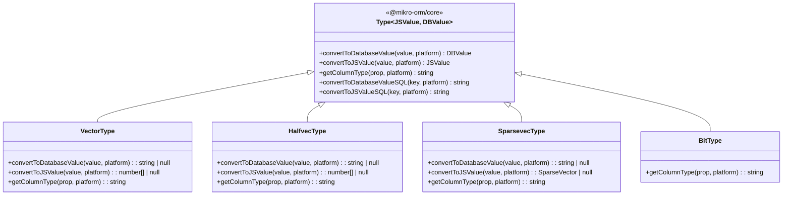
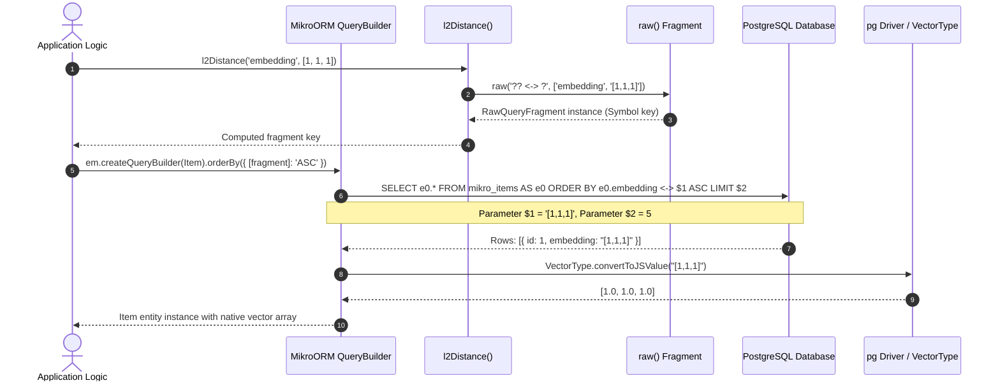

# pgvector-node: Deep Dive into MikroORM Integration Architecture

## Table of Contents
- [1. Executive Summary & Architectural Overview](#1-executive-summary--architectural-overview)
- [2. Custom Type Hierarchy in MikroORM](#2-custom-type-hierarchy-in-mikroorm)
  - [2.1 The `Type<T, J>` Subclassing Contract](#21-the-typet-j-subclassing-contract)
  - [2.2 Detailed Implementation of `VectorType`](#22-detailed-implementation-of-vectortype)
  - [2.3 Detailed Implementation of `HalfvecType`](#23-detailed-implementation-of-halfvectype)
  - [2.4 Detailed Implementation of `SparsevecType`](#24-detailed-implementation-of-sparsevectype)
  - [2.5 Detailed Implementation of `BitType`](#25-detailed-implementation-of-bittype)
  - [2.6 Runtime Value Conversion vs SQL Fragment Conversion](#26-runtime-value-conversion-vs-sql-fragment-conversion)
  - [2.7 Dimension Resolution Mechanics (`prop.dimensions ?? prop.length`)](#27-dimension-resolution-mechanics-propdimensions--proplength)
  - [2.8 TypeScript Definitions & Generic Typings](#28-typescript-definitions--generic-typings)
- [3. Entity Declaration & Schema Generation](#3-entity-declaration--schema-generation)
  - [3.1 Programmatic Definition with `EntitySchema`](#31-programmatic-definition-with-entityschema)
  - [3.2 TypeScript Decorator Syntax (`@Entity`, `@Property`)](#32-typescript-decorator-syntax-entity-property)
  - [3.3 Schema Tool & Migration DDL Emission](#33-schema-tool--migration-ddl-emission)
  - [3.4 Index Configuration for Vectors in MikroORM](#34-index-configuration-for-vectors-in-mikroorm)
- [4. Query Pipeline & Distance Operator Helpers](#4-query-pipeline--distance-operator-helpers)
  - [4.1 The MikroORM `raw()` Fragment Engine](#41-the-mikroorm-raw-fragment-engine)
  - [4.2 Parameter Placeholders: Identifiers (`??`) vs Values (`?`)](#42-parameter-placeholders-identifiers--vs-values-)
  - [4.3 The 6 Exported Distance Functions](#43-the-6-exported-distance-functions)
  - [4.4 Integrating Distance Expressions into QueryBuilder](#44-integrating-distance-expressions-into-querybuilder)
- [5. Dissection of the Test Suite (`tests/mikro-orm.test.js`)](#5-dissection-of-the-test-suite-testsmikro-ormtestjs)
  - [5.1 Setup, Configuration & Forking the Entity Manager](#51-setup-configuration--forking-the-entity-manager)
  - [5.2 Dynamic Schema Generation (`orm.schema.create()`)](#52-dynamic-schema-generation-ormschemacreate)
  - [5.3 Multi-Type Entity Creation & Persistence](#53-multi-type-entity-creation--persistence)
  - [5.4 Execution of Distance Queries Across All Metrics](#54-execution-of-distance-queries-across-all-metrics)
  - [5.5 NULL Sorting Semantics & Verification](#55-null-sorting-semantics--verification)
- [6. Architectural Diagrams](#6-architectural-diagrams)
  - [6.1 MikroORM Custom Type Architecture](#61-mikroorm-custom-type-architecture)
  - [6.2 MikroORM QueryBuilder Vector Execution Flow](#62-mikroorm-querybuilder-vector-execution-flow)
- [7. Comparative Analysis & Production Best Practices](#7-comparative-analysis--production-best-practices)

---

## 1. Executive Summary & Architectural Overview

MikroORM is a TypeScript-first Object-Relational Mapper based on Data Mapper and Unit of Work patterns. Unlike Active Record ORMs (such as Sequelize or TypeORM), MikroORM isolates database queries from entity instances through the `EntityManager` and `QueryBuilder`.

The `pgvector-node` MikroORM driver provides native integration through MikroORM's extensible `Type` class hierarchy. By exporting custom type classes (`VectorType`, `HalfvecType`, `SparsevecType`, and `BitType`) and SQL fragment generators, `pgvector-node` gives MikroORM applications:
- **Clean Entity Mapping**: Vectors are declared as standard properties and typed as `number[]`, `SparseVector`, or `string`.
- **Automated DDL Schema Generation**: Column definitions like `vector(1536)` or `halfvec(768)` are automatically generated by MikroORM's schema generator and migration diffing tools.
- **Parametrized KNN Search**: Distance functions produce symbol-keyed `RawQueryFragment` objects that seamlessly plug into MikroORM's `orderBy` QueryBuilder API while ensuring parameterized SQL generation and protection against SQL injection.

---

## 2. Custom Type Hierarchy in MikroORM

### 2.1 The `Type<T, J>` Subclassing Contract

MikroORM defines a generic base class `Type<JSValue, DBValue>` in `@mikro-orm/core`. Custom types override specific hooks to govern:
1. **Database-to-JS conversion** (`convertToJSValue` and `convertToJSValueSQL`)
2. **JS-to-Database conversion** (`convertToDatabaseValue` and `convertToDatabaseValueSQL`)
3. **Database column definition** (`getColumnType`)



### 2.2 Detailed Implementation of `VectorType`

Located in `src/mikro-orm/vector.js`:

```javascript
import { Type } from '@mikro-orm/core';
import { vectorFromSql, vectorToSql, vectorType } from '../utils.js';

export class VectorType extends Type {
  convertToDatabaseValue(value, platform) {
    if (value === null) {
      return null;
    }
    return vectorToSql(value);
  }

  convertToJSValue(value, platform) {
    return vectorFromSql(value);
  }

  getColumnType(prop, platform) {
    return vectorType(prop.dimensions ?? prop.length);
  }
}
```

Key characteristics:
- **Null Safety**: Explicitly checks `if (value === null) return null;`.
- **Database Serialization**: Calls `vectorToSql(value)`, which converts `[1, 2, 3]` into stringified JSON format `"[1,2,3]"`.
- **JS Deserialization**: Calls `vectorFromSql(value)`, which parses Postgres array syntax `"[1,2,3]"` into an array of floats `[1.0, 2.0, 3.0]`.
- **DDL Type Emission**: Invokes `vectorType(...)` to output `vector(dimensions)`.

### 2.3 Detailed Implementation of `HalfvecType`

Located in `src/mikro-orm/halfvec.js`:

```javascript
import { Type } from '@mikro-orm/core';
import { halfvecFromSql, halfvecToSql, halfvecType } from '../utils.js';

export class HalfvecType extends Type {
  convertToDatabaseValue(value, platform) {
    if (value === null) {
      return null;
    }
    return halfvecToSql(value);
  }

  convertToJSValue(value, platform) {
    return halfvecFromSql(value);
  }

  getColumnType(prop, platform) {
    return halfvecType(prop.dimensions ?? prop.length);
  }
}
```

In `src/utils.js`, `halfvecToSql` and `halfvecFromSql` are aliased directly to `vectorToSql` and `vectorFromSql`. In JavaScript, both 32-bit single-precision floats and 16-bit half-precision floats are represented as standard JavaScript `number` (IEEE 754 64-bit float). PostgreSQL performs the float16 truncation on write and conversion on read.

### 2.4 Detailed Implementation of `SparsevecType`

Located in `src/mikro-orm/sparsevec.js`:

```javascript
import { Type } from '@mikro-orm/core';
import { sparsevecFromSql, sparsevecToSql, sparsevecType } from '../utils.js';

export class SparsevecType extends Type {
  convertToDatabaseValue(value, platform) {
    if (value === null) {
      return null;
    }
    return sparsevecToSql(value);
  }

  convertToJSValue(value, platform) {
    return sparsevecFromSql(value);
  }

  getColumnType(prop, platform) {
    return sparsevecType(prop.dimensions ?? prop.length);
  }
}
```

- When saving an entity with a `SparseVector` instance, `sparsevecToSql` calls `value.toPostgres()`, generating `"{1:1,2:2}/3"`.
- On read, `sparsevecFromSql(value)` returns a new `SparseVector(value)` object, exposing methods like `.dimensions`, `.indices`, and `.values`.

### 2.5 Detailed Implementation of `BitType`

Located in `src/mikro-orm/bit.js`:

```javascript
import { Type } from '@mikro-orm/core';
import { bitType } from '../utils.js';

export class BitType extends Type {
  getColumnType(prop, platform) {
    return bitType(prop.length);
  }
}
```

`BitType` does not override `convertToDatabaseValue` or `convertToJSValue`. Because PostgreSQL's `BIT(n)` type maps naturally to a JavaScript string of `'0'`s and `'1'`s (e.g. `'101'`), MikroORM passes the string through without additional serialization. `getColumnType` formats the column definition as `bit(n)`.

### 2.6 Runtime Value Conversion vs SQL Fragment Conversion

MikroORM's `Type` interface provides two layers of conversion:
1. **Runtime conversion**:
   - `convertToDatabaseValue(value, platform)`: Transforms the JS property during parameter binding in prepared statements.
   - `convertToJSValue(value, platform)`: Transforms the raw driver response into entity properties.
2. **SQL Expression conversion**:
   - `convertToDatabaseValueSQL(key, platform)`: Wraps the SQL column during writes (defaults to `'?'` or `'cast(? as ...)'`).
   - `convertToJSValueSQL(key, platform)`: Wraps the SQL column during reads (defaults to `'??'`).

`pgvector-node` relies exclusively on **Runtime Conversion**. Because PostgreSQL accepts literal formatted strings for vector casting (e.g. `INSERT INTO ... VALUES ($1)` where `$1 = "[1,2,3]"`), runtime string formatting is sufficient. SQL-level casting (`?::vector`) is unnecessary because the driver and database perform implicit casting based on column type metadata.

### 2.7 Dimension Resolution Mechanics (`prop.dimensions ?? prop.length`)

In MikroORM property metadata, length/dimension constraints can be declared in two ways:
1. The standard MikroORM property option: `length: 3`
2. A custom domain-specific option: `dimensions: 3`

To support both conventions transparently, `getColumnType` evaluates:
```javascript
prop.dimensions ?? prop.length
```
If both are omitted, `vectorType(undefined)` returns `'vector'` (unbounded dimensions). If a valid integer is supplied, it returns `'vector(3)'`.

### 2.8 TypeScript Definitions & Generic Typings

The TypeScript definitions in `types/mikro-orm/` strictly type both the JS representation and the DB representation:

In `types/mikro-orm/vector.d.ts`:
```typescript
import { Type } from '@mikro-orm/core';
import type { Platform } from '@mikro-orm/core';

export declare class VectorType extends Type<number[] | null, string | null> {
  convertToDatabaseValue(value: number[] | null, platform: Platform): string | null;
  convertToJSValue(value: string, platform: Platform): number[] | null;
  getColumnType(prop: any, platform: Platform): string;
}
```

In `types/mikro-orm/sparsevec.d.ts`:
```typescript
import { Type } from '@mikro-orm/core';
import type { Platform } from '@mikro-orm/core';
import type { SparseVector } from '../index.js';

export declare class SparsevecType extends Type<SparseVector | null, string | null> {
  convertToDatabaseValue(value: any, platform: Platform): string | null;
  convertToJSValue(value: string, platform: Platform): SparseVector | null;
  getColumnType(prop: any, platform: Platform): string;
}
```

In `types/mikro-orm/index.d.ts`:
```typescript
export { BitType } from './bit.js';
export { HalfvecType } from './halfvec.js';
export { SparsevecType } from './sparsevec.js';
export { VectorType } from './vector.js';
export declare function l2Distance(column: any, value: any): import("@mikro-orm/core").RawQueryFragment<string> & symbol;
export declare function maxInnerProduct(column: any, value: any): import("@mikro-orm/core").RawQueryFragment<string> & symbol;
export declare function cosineDistance(column: any, value: any): import("@mikro-orm/core").RawQueryFragment<string> & symbol;
export declare function l1Distance(column: any, value: any): import("@mikro-orm/core").RawQueryFragment<string> & symbol;
export declare function hammingDistance(column: any, value: any): import("@mikro-orm/core").RawQueryFragment<string> & symbol;
export declare function jaccardDistance(column: any, value: any): import("@mikro-orm/core").RawQueryFragment<string> & symbol;
```

---

## 3. Entity Declaration & Schema Generation

### 3.1 Programmatic Definition with `EntitySchema`

For JavaScript projects or environments that avoid TypeScript experimental decorators, `EntitySchema` provides full programmatic definition:

```javascript
import { EntitySchema } from '@mikro-orm/postgresql';
import { VectorType, HalfvecType, BitType, SparsevecType } from 'pgvector/mikro-orm';

export const Item = new EntitySchema({
  name: 'Item',
  tableName: 'mikro_items',
  properties: {
    id: { type: Number, primary: true },
    embedding: { type: VectorType, length: 3, nullable: true },
    half_embedding: { type: HalfvecType, length: 3, nullable: true },
    binary_embedding: { type: BitType, length: 3, nullable: true },
    sparse_embedding: { type: SparsevecType, length: 3, nullable: true }
  }
});
```

### 3.2 TypeScript Decorator Syntax (`@Entity`, `@Property`)

In standard TypeScript MikroORM applications:

```typescript
import { Entity, PrimaryKey, Property } from '@mikro-orm/core';
import { VectorType, HalfvecType, SparsevecType, BitType } from 'pgvector/mikro-orm';
import { SparseVector } from 'pgvector';

@Entity({ tableName: 'items' })
export class Item {
  @PrimaryKey({ autoincrement: true })
  id!: number;

  @Property({ type: VectorType, length: 1536, nullable: true })
  embedding?: number[];

  @Property({ type: HalfvecType, length: 1536, nullable: true })
  halfEmbedding?: number[];

  @Property({ type: SparsevecType, length: 1536, nullable: true })
  sparseEmbedding?: SparseVector;

  @Property({ type: BitType, length: 64, nullable: true })
  binaryEmbedding?: string;
}
```

### 3.3 Schema Tool & Migration DDL Emission

When MikroORM's `SchemaGenerator` creates tables or generates migration diffs (`orm.schema.create()` or `orm.migrator.createMigration()`), it interrogates each property's `Type.getColumnType()`:

```sql
CREATE TABLE "mikro_items" (
  "id" serial PRIMARY KEY,
  "embedding" vector(3) NULL,
  "half_embedding" halfvec(3) NULL,
  "binary_embedding" bit(3) NULL,
  "sparse_embedding" sparsevec(3) NULL
);
```

Because `getColumnType` dynamically outputs the exact SQL type, MikroORM's schema comparator will not flag spurious migration diffs between the database catalog and the entity definition.

### 3.4 Index Configuration for Vectors in MikroORM

To create HNSW or IVFFlat indexes in MikroORM, use the `@Index` decorator with raw expressions:

```typescript
import { Entity, Index } from '@mikro-orm/core';

@Entity()
@Index({
  name: 'items_embedding_hnsw_idx',
  expression: 'CREATE INDEX "items_embedding_hnsw_idx" ON "items" USING hnsw ("embedding" vector_l2_ops)'
})
export class Item {
  // ...
}
```

---

## 4. Query Pipeline & Distance Operator Helpers

### 4.1 The MikroORM `raw()` Fragment Engine

In `src/mikro-orm/index.js`, distance operations are implemented via MikroORM's `raw` utility:

```javascript
import { raw } from '@mikro-orm/core';
import { toSql } from '../index.js';

function distance(op, column, value, binary) {
  return raw(`?? ${op} ?`, [column, binary ? value : toSql(value)]);
}
```

`raw()` creates a `RawQueryFragment` instance whose unique symbol can be used as a computed property key in query expressions.

### 4.2 Parameter Placeholders: Identifiers (`??`) vs Values (`?`)

MikroORM's SQL compiler interprets placeholders inside `raw(...)` using strict rules:
- `??` (Double Question Mark): Treats the corresponding parameter (`column`) as a database identifier (column or table name), properly escaping quotes according to the PostgreSQL dialect (e.g., `"embedding"` or `"table"."embedding"`).
- `?` (Single Question Mark): Treats the corresponding parameter as a literal value to be parameterized via prepared statement parameters (`$1`, `$2`).

When `value` is evaluated:
- For dense/half/sparse vectors: `toSql(value)` converts arrays or `SparseVector` instances into string format `"[1,1,1]"` or `"{1:1}/3"`.
- For binary strings: `binary ? value : ...` passes `'101'` directly as a string parameter without array conversion.

### 4.3 The 6 Exported Distance Functions

All 6 vector operators supported by `pgvector` are provided:

```javascript
export function l2Distance(column, value) {
  return distance('<->', column, value);
}

export function maxInnerProduct(column, value) {
  return distance('<#>', column, value);
}

export function cosineDistance(column, value) {
  return distance('<=>', column, value);
}

export function l1Distance(column, value) {
  return distance('<+>', column, value);
}

export function hammingDistance(column, value) {
  return distance('<~>', column, value, true);
}

export function jaccardDistance(column, value) {
  return distance('<%>', column, value, true);
}
```

### 4.4 Integrating Distance Expressions into QueryBuilder

Because MikroORM's QueryBuilder accepts raw fragments in `orderBy`, distance sorting is expressed as an object with computed property keys:

```javascript
const items = await em.createQueryBuilder(Item)
  .orderBy({
    [l2Distance('embedding', [1, 1, 1])]: 'ASC'
  })
  .limit(5)
  .getResult();
```

When compiled, MikroORM generates:
```sql
SELECT "e0".*
FROM "mikro_items" AS "e0"
ORDER BY "e0"."embedding" <-> $1 ASC
LIMIT $2;
```
Parameters: `['[1,1,1]', 5]`. This ensures the vector input is safely parameterized.

---

## 5. Dissection of the Test Suite (`tests/mikro-orm.test.js`)

### 5.1 Setup, Configuration & Forking the Entity Manager

```javascript
test('mikro-orm example', async () => {
  const Item = new EntitySchema({
    name: 'Item',
    tableName: 'mikro_items',
    properties: {
      id: { type: Number, primary: true },
      embedding: { type: VectorType, length: 3, nullable: true },
      half_embedding: { type: HalfvecType, length: 3, nullable: true },
      binary_embedding: { type: BitType, length: 3, nullable: true },
      sparse_embedding: { type: SparsevecType, length: 3, nullable: true }
    },
  });

  const orm = await MikroORM.init({
    entities: [Item],
    dbName: 'pgvector_node_test',
    user: process.env['USER']
  });
  const em = orm.em.fork();
```

> [!IMPORTANT]
> MikroORM uses request-context isolation. `orm.em.fork()` spawns an isolated `EntityManager` instance with its own Identity Map, preventing cross-test state leakage.

### 5.2 Dynamic Schema Generation (`orm.schema.create()`)

```javascript
await em.execute('CREATE EXTENSION IF NOT EXISTS vector');
await em.execute('DROP TABLE IF EXISTS mikro_items');

await orm.schema.create();
```
`orm.schema.create()` queries the metadata for `Item` and executes the generated DDL statements directly against PostgreSQL.

### 5.3 Multi-Type Entity Creation & Persistence

Entities are registered in the Unit of Work via `em.create()`:

```javascript
em.create(Item, {
  embedding: [1, 1, 1],
  half_embedding: [1, 1, 1],
  binary_embedding: '000',
  sparse_embedding: new SparseVector([1, 1, 1])
});
em.create(Item, {
  embedding: [2, 2, 2],
  half_embedding: [2, 2, 2],
  binary_embedding: '101',
  sparse_embedding: new SparseVector([2, 2, 2])
});
em.create(Item, {
  embedding: [1, 1, 2],
  half_embedding: [1, 1, 2],
  binary_embedding: '111',
  sparse_embedding: new SparseVector([1, 1, 2])
});
em.create(Item, {
  embedding: null
});
```

Because `em.createQueryBuilder` triggers an auto-flush when queries are executed, the four records are flushed and inserted into `mikro_items`.

### 5.4 Execution of Distance Queries Across All Metrics

The test suite systematically queries the data using each of the 6 distance functions:

```javascript
// 1. L2 Distance on vector
let items = await em.createQueryBuilder(Item)
  .orderBy({ [l2Distance('embedding', [1, 1, 1])]: 'ASC' })
  .limit(5)
  .getResult();
assert.deepEqual(items.map(v => v.id), [1, 3, 2, 4]);
assert.deepEqual(items[0].embedding, [1, 1, 1]);
assert.deepEqual(items[1].embedding, [1, 1, 2]);
assert.deepEqual(items[2].embedding, [2, 2, 2]);

// 2. L2 Distance on halfvec
items = await em.createQueryBuilder(Item)
  .orderBy({ [l2Distance('half_embedding', [1, 1, 1])]: 'ASC' })
  .limit(5)
  .getResult();
assert.deepEqual(items.map(v => v.id), [1, 3, 2, 4]);

// 3. L2 Distance on sparsevec
items = await em.createQueryBuilder(Item)
  .orderBy({ [l2Distance('sparse_embedding', new SparseVector([1, 1, 1]))]: 'ASC' })
  .limit(5)
  .getResult();
assert.deepEqual(items.map(v => v.id), [1, 3, 2, 4]);

// 4. Max inner product
items = await em.createQueryBuilder(Item)
  .orderBy({ [maxInnerProduct('embedding', [1, 1, 1])]: 'ASC' })
  .limit(5)
  .getResult();
assert.deepEqual(items.map(v => v.id), [2, 3, 1, 4]);

// 5. Cosine distance
items = await em.createQueryBuilder(Item)
  .orderBy({ [cosineDistance('embedding', [1, 1, 1])]: 'ASC' })
  .limit(5)
  .getResult();
assert.deepEqual(items.map(v => v.id).slice(2), [3, 4]);

// 6. L1 distance
items = await em.createQueryBuilder(Item)
  .orderBy({ [l1Distance('embedding', [1, 1, 1])]: 'ASC' })
  .limit(5)
  .getResult();
assert.deepEqual(items.map(v => v.id), [1, 3, 2, 4]);

// 7. Hamming distance on bit
items = await em.createQueryBuilder(Item)
  .orderBy({ [hammingDistance('binary_embedding', '101')]: 'ASC' })
  .limit(5)
  .getResult();
assert.deepEqual(items.map(v => v.id), [2, 3, 1, 4]);

// 8. Jaccard distance on bit
items = await em.createQueryBuilder(Item)
  .orderBy({ [jaccardDistance('binary_embedding', '101')]: 'ASC' })
  .limit(5)
  .getResult();
assert.deepEqual(items.map(v => v.id), [2, 3, 1, 4]);
```

### 5.5 NULL Sorting Semantics & Verification

Notice that for every query, the record with `embedding: null` (id: 4) is returned as the fourth result (`[1, 3, 2, 4]`). In PostgreSQL standard sorting:
```sql
ORDER BY col <-> '[...]' ASC
```
evaluates `NULL <-> '[...]'` as `NULL`. PostgreSQL's default behavior for ascending order places `NULL` values at the end (`NULLS LAST`), ensuring that null entries do not pollute top similarity results.

---

## 6. Architectural Diagrams

### 6.1 MikroORM Custom Type Architecture

```mermaid
classDiagram
    direction TB
    class Type {
        <<@mikro-orm/core>>
        +convertToDatabaseValue()
        +convertToJSValue()
        +getColumnType()
    }

    class VectorType {
        +convertToDatabaseValue(value): "[1,2,3]"
        +convertToJSValue(value): [1, 2, 3]
        +getColumnType(prop): "vector(3)"
    }

    class HalfvecType {
        +convertToDatabaseValue(value): "[1,2,3]"
        +convertToJSValue(value): [1, 2, 3]
        +getColumnType(prop): "halfvec(3)"
    }

    class SparsevecType {
        +convertToDatabaseValue(value): "{1:1}/3"
        +convertToJSValue(value): SparseVector
        +getColumnType(prop): "sparsevec(3)"
    }

    class BitType {
        +getColumnType(prop): "bit(3)"
    }

    Type <|-- VectorType
    Type <|-- HalfvecType
    Type <|-- SparsevecType
    Type <|-- BitType
```

### 6.2 MikroORM QueryBuilder Vector Execution Flow



---

## 7. Comparative Analysis & Production Best Practices

1. **Leverage Parameterized `raw()`**: Unlike Sequelize, which embeds escaped literals into SQL strings (`sequelize.literal`), MikroORM's `raw('?? <-> ?', [col, val])` passes the vector literal as a true parameterized bound variable (`$1`), maximizing database prepared-statement cache efficiency.
2. **Explicit Dimension Bounds**: Always specify `length` or `dimensions` in entity definitions (`length: 1536`). If omitted, `vector` without length will be emitted, preventing HNSW/IVFFlat indexing.
3. **Always Fork EntityManager**: Ensure every HTTP request or background job works on a forked `em` (`orm.em.fork()`) to guarantee that vector entities loaded into the identity map are isolated from other concurrent requests.
4. **Use Proper Property Keys in Queries**: When writing `l2Distance('embedding', ...)`, pass the entity's property name. MikroORM's metadata engine automatically translates property names (e.g., camelCase `halfEmbedding`) into table column names (e.g., snake_case `half_embedding`).
