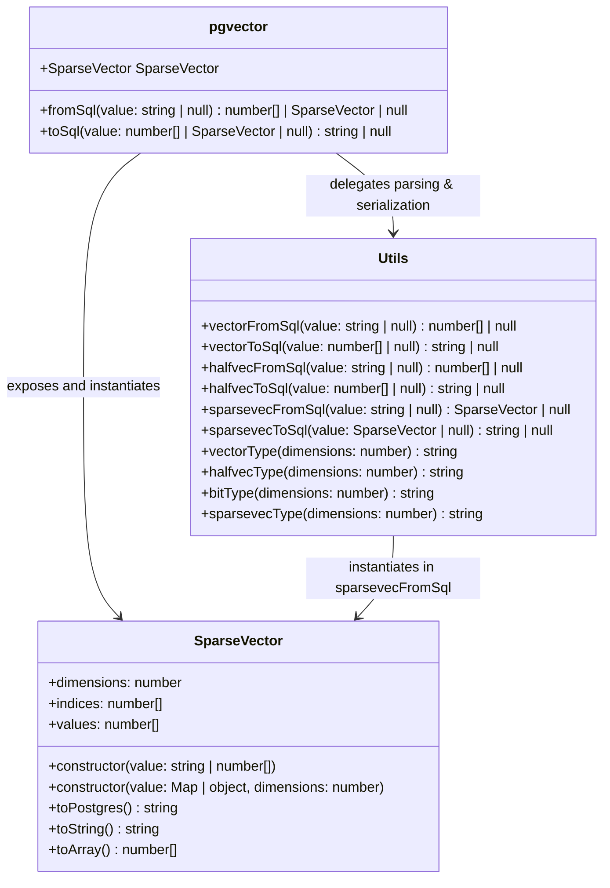
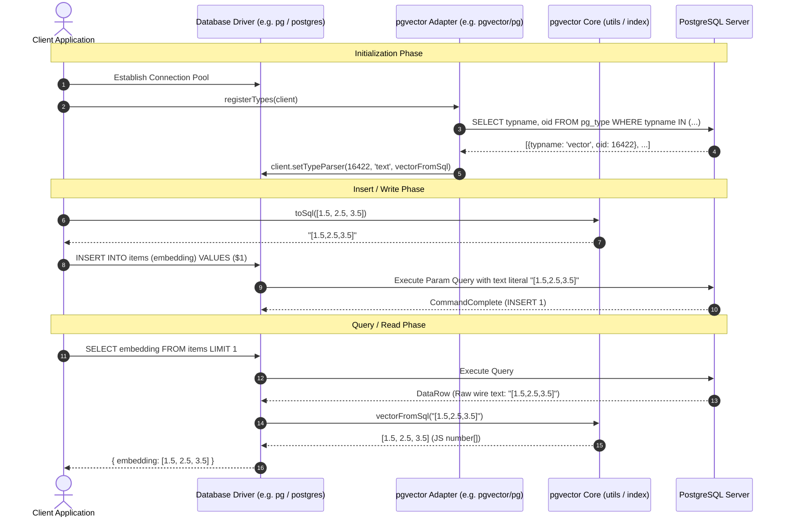

# pgvector Node.js SDK: Architecture & Package Overview

> Comprehensive architectural analysis of `pgvector-node` (v0.3.1+), its ESM-first and zero-dependency design philosophy, multi-runtime support (Node.js, Bun, Deno), TypeScript declaration architecture, subpath export strategy, and exhaustive ecosystem compatibility matrix across drivers, query builders, and ORMs.

---

## Table of Contents

1. [Executive Summary](#1-executive-summary)
2. [Package Architecture & Design Philosophy](#2-package-architecture--design-philosophy)
   - [ESM-First Module Design](#esm-first-module-design)
   - [Zero Runtime Dependencies Strategy](#zero-runtime-dependencies-strategy)
   - [Multi-Runtime Platform Support: Node.js, Bun, and Deno](#multi-runtime-platform-support-nodejs-bun-and-deno)
   - [Subpath Exports Map Architecture](#subpath-exports-map-architecture)
   - [Architectural Evolution & Release Milestones](#architectural-evolution--release-milestones)
3. [TypeScript System & Declaration Architecture](#3-typescript-system--declaration-architecture)
   - [JSDoc-Driven Implementation with Emitted Declarations](#jsdoc-driven-implementation-with-emitted-declarations)
   - [Directory Structure Mirroring (`src/` vs `types/`)](#directory-structure-mirroring-src-vs-types)
   - [Ambient Declarations & Module Augmentation](#ambient-declarations--module-augmentation)
   - [Strict Typing and Cross-Package Type Re-exports](#strict-typing-and-cross-package-type-re-exports)
4. [Full Ecosystem Compatibility Matrix](#4-full-ecosystem-compatibility-matrix)
   - [Comprehensive Framework Matrix](#comprehensive-framework-matrix)
   - [Supported Vector Data Types](#supported-vector-data-types)
   - [Supported Distance Operators](#supported-distance-operators)
   - [Index and Operator Class Support](#index-and-operator-class-support)
5. [Driver & ORM Integration Architecture](#5-driver--orm-integration-architecture)
   - [Low-Level Drivers: node-postgres (`pg`), Postgres.js, pg-promise](#low-level-drivers-node-postgres-pg-postgresjs-pg-promise)
   - [SQL Query Builders: Knex.js, Kysely, Objection.js](#sql-query-builders-knexjs-kysely-objectionjs)
   - [Modern ORMs: Sequelize, MikroORM, TypeORM, Prisma, Drizzle ORM](#modern-orms-sequelize-mikroorm-typeorm-prisma-drizzle-orm)
   - [Alternative Environments: Slonik, deno-postgres, Bun SQL](#alternative-environments-slonik-deno-postgres-bun-sql)
6. [Module Dependency & Data Flow Architecture](#6-module-dependency--data-flow-architecture)
   - [Mermaid Package Architecture Diagram](#mermaid-package-architecture-diagram)
   - [Query Execution Lifecycle Flow](#query-execution-lifecycle-flow)
7. [Distance Metrics, Operators & Index Operator Classes](#7-distance-metrics-operators--index-operator-classes)
   - [Mathematical Definitions & SQL Operators](#mathematical-definitions--sql-operators)
   - [Indexing Strategies: HNSW and IVFFlat](#indexing-strategies-hnsw-and-ivfflat)
8. [Migration & Upgrade Guide (v0.2.x to v0.3.1+)](#8-migration--upgrade-guide-v02x-to-v031)

---

## 1. Executive Summary

The `pgvector` npm package (`pgvector-node`) is the official JavaScript/TypeScript client library for the [pgvector](https://github.com/pgvector/pgvector) PostgreSQL vector similarity search extension. Designed by Andrew Kane, `pgvector-node` provides seamless serialization, parsing, schema building, and query-builder extensions for handling dense vectors (`vector`), half-precision floating-point vectors (`halfvec`), sparse vectors (`sparsevec`), and binary Hamming vectors (`bit`).

Unlike client SDKs that couple data encoding with specific database drivers or heavy numerical runtime libraries, `pgvector-node` adheres to an ultra-lean design:

- **Zero Runtime Dependencies**: The `dependencies` object in `package.json` is completely empty (`{}`). The library relies exclusively on native JavaScript primitives, standard ECMAScript features, and built-in Node.js utilities (`node:util`).
- **ESM-First Architecture**: Starting in version 0.3.0, the package transitioned to standard ECMAScript Modules (`"type": "module"`), requiring Node.js 22+ for native execution without transpilation.
- **Granular Subpath Exports**: A modular `exports` map enables fine-grained consumption for specific drivers (`pgvector/pg`, `pgvector/postgres`, `pgvector/knex`, `pgvector/kysely`, etc.) without pulling unused framework adapters into bundle or memory spaces.
- **Universal JavaScript Engine Portability**: Out of the box, `pgvector-node` runs natively on Node.js, Bun, Deno, and serverless edge runtimes (e.g. Cloudflare Workers, Vercel Functions) with zero modification.

```mermaid
flowchart TD
    subgraph Client Application Layer
        App[JavaScript / TypeScript Application]
    end

    subgraph pgvector Core ["pgvector (Core Utilities & Types)"]
        Index["index.js (Polymorphic fromSql / toSql)"]
        Utils["utils.js (vectorFromSql, vectorToSql, *Type helpers)"]
        SV["sparse-vector.js (SparseVector Class)"]
    end

    subgraph Driver & Framework Submodules ["pgvector Subpath Adapters"]
        PG["./pg (node-postgres type parser registration)"]
        PJS["./postgres (Postgres.js type serialization map)"]
        PGP["./pg-promise (pg-promise type hook)"]
        KNX["./knex (SchemaBuilder & QueryInterface extensions)"]
        KYS["./kysely (RawBuilder distance SQL expressions)"]
        OBJ["./objection (Objection.js distance helpers)"]
        SEQ["./sequelize (Custom DataTypes & distance literals)"]
        MIK["./mikro-orm (Custom Type classes & distance fragments)"]
    end

    subgraph External Native Integrations ["Ecosystem Libraries with Native pgvector Support"]
        DRZ["Drizzle ORM (native pg-core vector types)"]
        TYP["TypeORM (native vector / halfvec / bit columns)"]
        PRS["Prisma (Unsupported & raw query casting)"]
        SLK["Slonik (sql.unsafe raw parameter binding)"]
    end

    subgraph PostgreSQL Server
        DB[(PostgreSQL + pgvector extension)]
    end

    App --> Index
    Index --> Utils & SV

    App --> PG & PJS & PGP & KNX & KYS & OBJ & SEQ & MIK
    PG & PJS & PGP & KNX & KYS & OBJ & SEQ & MIK --> Index

    App --> DRZ & TYP & PRS & SLK
    DRZ & TYP & PRS & SLK -.->|Uses pgvector.toSql / SparseVector| Index

    PG & PJS & PGP & KNX & KYS & OBJ & SEQ & MIK -->|PostgreSQL Wire Protocol| DB
    DRZ & TYP & PRS & SLK -->|PostgreSQL Wire Protocol| DB
```



---

## 2. Package Architecture & Design Philosophy

### ESM-First Module Design

Modern Node.js runtime environments (Node 20+) natively support ECMAScript modules. In version 0.3.0, `pgvector-node` dropped CommonJS (`require` / `module.exports`) in favor of pure standard ECMAScript Modules (`"type": "module"`). 

The package layout in `package.json`:

```json
{
  "name": "pgvector",
  "version": "0.3.1",
  "description": "pgvector support for Node.js, Deno, and Bun (and TypeScript)",
  "homepage": "https://github.com/pgvector/pgvector-node",
  "license": "MIT",
  "author": "Andrew Kane",
  "type": "module",
  "files": [
    "src",
    "types"
  ],
  "engines": {
    "node": ">=22"
  }
}
```

Key architectural benefits of this decision:
1. **Tree-Shaking & Static Analysis**: Bundlers (Rollup, Vite, esbuild, Webpack 5) can statically trace module specifiers and eliminate unused code.
2. **Top-Level Await Compatibility**: As modern database connection handshakes (like `registerTypes(client)`) are asynchronous, ESM allows natural composition with top-level await across modern platforms.
3. **Clean Module Boundary**: No dual-package hazard (`require()` vs `import` caching distinct instances of classes), guaranteeing that `SparseVector` instances share a single prototype across the application.

### Zero Runtime Dependencies Strategy

A critical engineering tenet of `pgvector-node` is the complete absence of production dependencies:

```json
"dependencies": {}
```

All formatting and serialization tasks are handled via:
- Standard ECMAScript built-in objects: `Array`, `Map`, `Object`, `Number`, `JSON`.
- Node.js built-in module `node:util`: Specifically `format`, `deprecate`, and `inherits`.

By avoiding dependencies on large math or matrix packages (such as `mathjs` or `ndarray`), `pgvector-node` ensures:
- **Zero Supply Chain Risk**: No transitively vulnerable sub-packages or malicious dependency takeovers.
- **Microscopic Footprint**: The entire published package is under 30KB unpacked, making it ideal for edge functions, serverless lambdas, and micro-containers.
- **Fast Cold Starts**: Minimal parsing and evaluation overhead during application boot.

### Multi-Runtime Platform Support: Node.js, Bun, and Deno

Because the code uses standard JavaScript and Node-compatible built-ins (`node:util`), it runs identically across the big three JavaScript runtimes:

1. **Node.js (>=22)**:
   ```javascript
   import pgvector from 'pgvector';
   const sqlValue = pgvector.toSql([1, 2, 3]);
   ```
2. **Bun**:
   Bun provides built-in compatibility with Node.js built-ins and npm packages. It can be installed directly (`bun add pgvector`) and used with `bun:sql`:
   ```javascript
   import { SQL } from 'bun';
   import pgvector from 'pgvector';

   const sql = new SQL('postgres://localhost/mydb');
   const items = await sql`
     SELECT * FROM items 
     ORDER BY embedding <-> ${pgvector.toSql([1, 2, 3])} 
     LIMIT 5
   `;
   ```
3. **Deno**:
   Deno consumes `pgvector` directly via the `npm:` specifier:
   ```javascript
   import pgvector from 'npm:pgvector@^0.3.1';
   import { Client } from 'https://deno.land/x/postgres/mod.ts';

   const client = new Client();
   await client.connect();
   await client.queryArray`
     SELECT * FROM items 
     ORDER BY embedding <-> ${pgvector.toSql([1, 2, 3])} 
     LIMIT 5
   `;
   ```

### Subpath Exports Map Architecture

The `package.json` file uses the Node.js subpath exports map feature to expose isolated entry points for every supported database ecosystem:

```json
"exports": {
  ".": {
    "types": "./types/index.d.ts",
    "default": "./src/index.js"
  },
  "./knex": {
    "types": "./types/knex/index.d.ts",
    "default": "./src/knex/index.js"
  },
  "./kysely": {
    "types": "./types/kysely/index.d.ts",
    "default": "./src/kysely/index.js"
  },
  "./mikro-orm": {
    "types": "./types/mikro-orm/index.d.ts",
    "default": "./src/mikro-orm/index.js"
  },
  "./objection": {
    "types": "./types/objection/index.d.ts",
    "default": "./src/objection/index.js"
  },
  "./pg": {
    "types": "./types/pg/index.d.ts",
    "default": "./src/pg/index.js"
  },
  "./pg-promise": {
    "types": "./types/pg-promise/index.d.ts",
    "default": "./src/pg-promise/index.js"
  },
  "./postgres": {
    "types": "./types/postgres/index.d.ts",
    "default": "./src/postgres/index.js"
  },
  "./sequelize": {
    "types": "./types/sequelize/index.d.ts",
    "default": "./src/sequelize/index.js"
  },
  "./package.json": "./package.json"
}
```

#### Subpath Roles and Module Exports

| Subpath Export | Target File | Exported Symbols | Purpose |
| :--- | :--- | :--- | :--- |
| `pgvector` (`.`) | `src/index.js` | `fromSql`, `toSql`, `SparseVector`, `default` | Main polymorphic serialization and class root |
| `pgvector/pg` | `src/pg/index.js` | `registerType`, `registerTypes`, `toSql`, `default` | Type parser registration for `node-postgres` |
| `pgvector/postgres` | `src/postgres/index.js` | `pgvectorTypes` | Serialization & parser map for `Postgres.js` |
| `pgvector/pg-promise` | `src/pg-promise/index.js` | `registerType`, `registerTypes`, `toSql`, `default` | Re-export of `pg` adapter for `pg-promise` event hooks |
| `pgvector/knex` | `src/knex/index.js` | `fromSql`, `toSql`, `default` (plus monkeypatches) | Extends Knex `TableBuilder` and `QueryBuilder` |
| `pgvector/kysely` | `src/kysely/index.js` | `l2Distance`, `maxInnerProduct`, `cosineDistance`, `l1Distance`, `hammingDistance`, `jaccardDistance`, `fromSql`, `toSql` | Expression builder functions returning Kysely `RawBuilder` |
| `pgvector/objection` | `src/objection/index.js` | Distance functions, `fromSql`, `toSql` | Objection.js raw query helpers (imports `knex`) |
| `pgvector/sequelize` | `src/sequelize/index.js` | Distance functions, `registerType`, `registerTypes` | Extends `Sequelize.DataTypes` with `VECTOR`, `HALFVEC`, `SPARSEVEC` |
| `pgvector/mikro-orm` | `src/mikro-orm/index.js` | `VectorType`, `HalfvecType`, `SparsevecType`, `BitType`, Distance functions | Custom MikroORM `Type` implementations |

### Architectural Evolution & Release Milestones

- **v0.1.0 (2021-06-18)**: Initial release supporting `node-postgres` vector serialization and registration.
- **v0.1.3 - v0.1.5 (2023)**: Introduction of `utils` subpath, TypeScript definitions, and experimental Drizzle support.
- **v0.1.6 - v0.1.8 (2023-2024)**: Added `knex`, `kysely`, `mikro-orm`, `objection`, `pg-promise`, and Sequelize support.
- **v0.2.0 (2024-06-27)**: Massive milestone adding `halfvec` (16-bit float) and `sparsevec` support across drivers; introduced `l1Distance` (`<+>`), `hammingDistance` (`<~>`), and `jaccardDistance` (`<%>`).
- **v0.3.0 (2026-05-31)**: Major structural rewrite:
  - Full migration to ESM (`"type": "module"`).
  - Deprecation of single-type registration (`registerType` -> `registerTypes`).
  - Removal of standalone `pgvector/utils` (consolidated into root `pgvector`).
  - Minimum runtime bumped to Node.js 22+.
- **v0.3.1 (2026-11-04)**: Added dedicated `postgres` module for Postgres.js; fixed empty sparse vector parsing (`{}/dim`).

---

## 3. TypeScript System & Declaration Architecture

### JSDoc-Driven Implementation with Emitted Declarations

Rather than writing the implementation in TypeScript and transpiling down to JavaScript, `pgvector-node` uses **pure JavaScript source files with comprehensive JSDoc annotations**, paired with `tsc` in declaration-only emission mode:

```json
// tsconfig.json
{
  "include": ["src/**/*"],
  "compilerOptions": {
    "allowJs": true,
    "checkJs": true,
    "declaration": true,
    "emitDeclarationOnly": true,
    "removeComments": true,
    "rootDir": "src",
    "outDir": "types"
  }
}
```

This hybrid workflow combines maximum developer ergonomics:
1. **Zero Runtime Compilation Overhead**: Node.js and Bun can execute the source directly from disk without sourcemaps or transpile steps.
2. **Type Safety via `checkJs`**: TypeScript validates all code during `npm run check` (`tsc --project tsconfig.test.json`).
3. **Exact Typings in `types/`**: `npm run build` runs `tsc` to produce high-fidelity `.d.ts` files in the `types/` folder.

### Directory Structure Mirroring (`src/` vs `types/`)

The directory structure in `types/` exactly mirrors `src/`:

```
pgvector-node/
├── src/
│   ├── index.js
│   ├── utils.js
│   ├── sparse-vector.js
│   ├── knex/
│   │   ├── index.d.ts          <-- Ambient interface augmentations
│   │   └── index.js
│   ├── kysely/
│   │   └── index.js
│   ├── mikro-orm/
│   │   ├── bit.js
│   │   ├── halfvec.js
│   │   ├── index.js
│   │   ├── sparsevec.js
│   │   └── vector.js
│   ├── objection/
│   │   └── index.js
│   ├── pg/
│   │   └── index.js
│   ├── pg-promise/
│   │   └── index.js
│   ├── postgres/
│   │   └── index.js
│   └── sequelize/
│       ├── halfvec.js
│       ├── index.d.ts          <-- Ambient interface augmentations
│       ├── index.js
│       ├── sparsevec.js
│       └── vector.js
└── types/
    ├── index.d.ts
    ├── utils.d.ts
    ├── sparse-vector.d.ts
    ├── knex/
    │   └── index.d.ts
    ├── kysely/
    │   └── index.d.ts
    ├── mikro-orm/
    │   ├── bit.d.ts
    │   ├── halfvec.d.ts
    │   ├── index.d.ts
    │   ├── sparsevec.d.ts
    │   └── vector.d.ts
    ├── objection/
    │   └── index.d.ts
    ├── pg/
    │   └── index.d.ts
    ├── pg-promise/
    │   └── index.d.ts
    ├── postgres/
    │   └── index.d.ts
    └── sequelize/
        ├── halfvec.d.ts
        ├── index.d.ts
        ├── sparsevec.d.ts
        └── vector.d.ts
```

### Ambient Declarations & Module Augmentation

For libraries that rely on prototype extension or dynamic registries (such as Knex and Sequelize), `pgvector-node` uses TypeScript **Module Augmentation** (`declare module '...'`).

#### 1. Knex Module Augmentation (`src/knex/index.d.ts`)

```typescript
import 'knex';

declare module 'knex' {
  namespace Knex {
    // Extends knex schema table builder
    interface TableBuilder {
      vector(name: string, options: any): Knex.TableBuilder;
      halfvec(name: string, options: any): Knex.TableBuilder;
      sparsevec(name: string, options: any): Knex.TableBuilder;
    }

    // Extends knex query builder interface
    interface QueryInterface<TRecord extends {} = any, TResult = any> {
      l2Distance(column: any, value: any): Knex.QueryBuilder<TRecord, TResult>;
      maxInnerProduct(column: any, value: any): Knex.QueryBuilder<TRecord, TResult>;
      cosineDistance(column: any, value: any): Knex.QueryBuilder<TRecord, TResult>;
      l1Distance(column: any, value: any): Knex.QueryBuilder<TRecord, TResult>;
      hammingDistance(column: any, value: any): Knex.QueryBuilder<TRecord, TResult>;
      jaccardDistance(column: any, value: any): Knex.QueryBuilder<TRecord, TResult>;
    }
  }
}
```

When a user writes:
```typescript
import 'pgvector/knex';
```
The TypeScript compiler incorporates these methods into the ambient `Knex.TableBuilder` and `Knex.QueryBuilder` types.

#### 2. Sequelize Module Augmentation (`src/sequelize/index.d.ts`)

```typescript
import 'sequelize';

declare module 'sequelize' {
  namespace DataTypes {
    interface VectorDataTypeConstructor extends AbstractDataTypeConstructor {
      new (dimensions?: number): AbstractDataType;
      (dimensions?: number): AbstractDataType;
    }

    const VECTOR: VectorDataTypeConstructor;
    const HALFVEC: VectorDataTypeConstructor;
    const SPARSEVEC: VectorDataTypeConstructor;
  }
}
```

This permits direct TypeScript autocompletion on `DataTypes.VECTOR(1536)`, `DataTypes.HALFVEC(768)`, and `DataTypes.SPARSEVEC(10000)`.

### Strict Typing and Cross-Package Type Re-exports

In addition to ambient augmentations, `types/` exposes strongly-typed function signatures for query builder helpers:

```typescript
// types/kysely/index.d.ts
import { fromSql, toSql } from '../index.js';
import type { SparseVector } from '../index.js';

export declare function l2Distance(column: any, value: number[] | SparseVector | null): import("kysely").RawBuilder<unknown>;
export declare function maxInnerProduct(column: any, value: number[] | SparseVector | null): import("kysely").RawBuilder<unknown>;
export declare function cosineDistance(column: any, value: number[] | SparseVector | null): import("kysely").RawBuilder<unknown>;
export declare function l1Distance(column: any, value: number[] | SparseVector | null): import("kysely").RawBuilder<unknown>;
export declare function hammingDistance(column: any, value: string): import("kysely").RawBuilder<unknown>;
export declare function jaccardDistance(column: any, value: string): import("kysely").RawBuilder<unknown>;

export { fromSql, toSql };
```

Notice that binary operations (`hammingDistance`, `jaccardDistance`) restrict `value` to `string` (e.g. `'101010'`), while floating-point vector distances accept `number[] | SparseVector | null`.

---

## 4. Full Ecosystem Compatibility Matrix

### Comprehensive Framework Matrix

The following table summarizes all 14 supported database clients, query builders, and ORMs, detailing their integration mechanism, module location, and automatic parsing capabilities:

| Framework / Driver | Category | Subpath / Integration Mechanism | Automatic Parsing | Schema / DDL Helper | Distance Function Helpers |
| :--- | :--- | :--- | :---: | :---: | :---: |
| **`pg` (node-postgres)** | Native Driver | `import pgvector from 'pgvector/pg'` | Yes (via `client.setTypeParser`) | SQL DDL | Direct SQL operators |
| **`postgres` (Postgres.js)** | Native Driver | `import { pgvectorTypes } from 'pgvector/postgres'` | Yes (via `types` config) | SQL DDL | Direct SQL operators |
| **`pg-promise`** | Driver Wrapper | `import pgvector from 'pgvector/pg-promise'` | Yes (via `connect` event) | SQL DDL | Direct SQL operators |
| **`knex`** | Query Builder | `import 'pgvector/knex'` | Manual (`toSql`/`fromSql`) | `table.vector(name, dim)` | `knex.l2Distance(...)`, etc. |
| **`kysely`** | Query Builder | `import { l2Distance } from 'pgvector/kysely'` | Manual (`toSql`/`fromSql`) | `sql` template tag | `l2Distance(col, val)`, etc. |
| **`objection`** | ORM / Query Builder | `import { l2Distance } from 'pgvector/objection'` | Manual (`toSql`/`fromSql`) | Knex TableBuilder | `l2Distance(col, val)`, etc. |
| **`sequelize`** | Classic ORM | `import 'pgvector/sequelize'` | Yes (via custom DataType) | `DataTypes.VECTOR(dim)` | `l2Distance(col, val, seq)` |
| **`mikro-orm`** | Modern TypeScript ORM | `import { VectorType } from 'pgvector/mikro-orm'` | Yes (via custom `Type`) | `@Property({type: VectorType})` | `l2Distance(col, val)` |
| **`prisma`** | Modern ORM | `import pgvector from 'pgvector'` | Manual (`fromSql`) | `Unsupported("vector(dim)")` | Raw SQL with `::vector` |
| **`drizzle-orm`** | Modern TypeScript ORM | Native in Drizzle Core (`drizzle-orm/pg-core`) | Native (built-in) | `vector('name', {dimensions})` | `l2Distance(...)` (in `drizzle-orm`) |
| **`typeorm`** | Modern TypeScript ORM | Native in TypeORM 0.3.27+ | Native (built-in) | `@Column('vector', {length})` | QueryBuilder raw SQL |
| **`slonik`** | Raw SQL Client | `import pgvector from 'pgvector'` | Manual (`fromSql`/`toSql`) | SQL DDL | Direct SQL via `sql.unsafe` |
| **`deno-postgres`** | Deno Driver | `import pgvector from 'npm:pgvector'` | Manual (`fromSql`/`toSql`) | SQL DDL | Query template literal |
| **`bun:sql`** | Bun Native Driver | `import pgvector from 'pgvector'` | Manual (`fromSql`/`toSql`) | SQL DDL | Query template literal |

### Supported Vector Data Types

PostgreSQL's `pgvector` extension provides four primary data types. The level of support across each library in the ecosystem is mapped below:

| Framework | `vector` (float32) | `halfvec` (float16) | `sparsevec` (sparse) | `bit` (binary vector) |
| :--- | :---: | :---: | :---: | :---: |
| **`pgvector` Core** | **Full** (`number[]`) | **Full** (`number[]`) | **Full** (`SparseVector`) | **Full** (`string`) |
| **node-postgres (`pg`)** | Supported | Supported | Supported | Supported (string native) |
| **Postgres.js** | Supported | Supported | Supported | Supported (string native) |
| **pg-promise** | Supported | Supported | Supported | Supported (string native) |
| **Knex.js** | Supported (`table.vector`) | Supported (`table.halfvec`) | Supported (`table.sparsevec`) | Native Knex (`table.specificType('bit')`) |
| **Kysely** | Supported | Supported | Supported | Supported (`bit` string) |
| **Objection.js** | Supported | Supported | Supported | Supported (`bit` string) |
| **Sequelize** | Supported (`DataTypes.VECTOR`) | Supported (`DataTypes.HALFVEC`) | Supported (`DataTypes.SPARSEVEC`) | Native Sequelize (`DataTypes.STRING`) |
| **MikroORM** | Supported (`VectorType`) | Supported (`HalfvecType`) | Supported (`SparsevecType`) | Supported (`BitType`) |
| **Drizzle ORM** | Supported (`vector()`) | Supported (`halfvec()`) | Supported (`sparsevec()`) | Supported (`bit()`) |
| **TypeORM** | Supported (`'vector'`) | Supported (`'halfvec'`) | String fallback (`String`)* | Supported (`'bit'`) |
| **Prisma** | `Unsupported("vector")` | `Unsupported("halfvec")` | `Unsupported("sparsevec")` | `Unsupported("bit")` |
| **Slonik** | Supported via `toSql` | Supported via `toSql` | Supported via `toSql` | Supported (`string`) |

> *\*Note on TypeORM*: TypeORM's underlying schema engine does not yet support custom user-defined types for sparse vectors; developers store sparse vectors as strings in a text column or cast them manually.

### Supported Distance Operators

The following table demonstrates which distance operators are implemented as typed helper functions across the query builder and ORM submodules:

| Operator | Distance Metric | Description | Knex.js | Kysely | Objection.js | Sequelize | MikroORM | Drizzle ORM (native) |
| :--- | :--- | :--- | :---: | :---: | :---: | :---: | :---: | :---: |
| `<->` | **L2 Distance** | Euclidean distance ($\|\mathbf{u} - \mathbf{v}\|_2$) | `l2Distance` | `l2Distance` | `l2Distance` | `l2Distance` | `l2Distance` | `l2Distance` |
| `<#>` | **Max Inner Product** | Negative dot product ($-\mathbf{u} \cdot \mathbf{v}$) | `maxInnerProduct` | `maxInnerProduct` | `maxInnerProduct` | `maxInnerProduct` | `maxInnerProduct` | `innerProduct` |
| `<=>` | **Cosine Distance** | Angular distance ($1 - \frac{\mathbf{u}\cdot\mathbf{v}}{\|\mathbf{u}\|\|\mathbf{v}\|}$) | `cosineDistance` | `cosineDistance` | `cosineDistance` | `cosineDistance` | `cosineDistance` | `cosineDistance` |
| `<+>` | **L1 Distance** | Taxicab / Manhattan distance ($\|\mathbf{u} - \mathbf{v}\|_1$) | `l1Distance` | `l1Distance` | `l1Distance` | `l1Distance` | `l1Distance` | `l1Distance` |
| `<~>` | **Hamming Distance** | Bitwise difference count ($\sum (u_i \oplus v_i)$) | `hammingDistance` | `hammingDistance` | `hammingDistance` | `hammingDistance` | `hammingDistance` | `hammingDistance` |
| `<%>` | **Jaccard Distance** | Binary set difference ($1 - \frac{|u \cap v|}{|u \cup v|}$) | `jaccardDistance` | `jaccardDistance` | `jaccardDistance` | `jaccardDistance` | `jaccardDistance` | `jaccardDistance` |

### Index and Operator Class Support

`pgvector` relies on PostgreSQL index operator classes to build Approximate Nearest Neighbor (ANN) indexes. The SDK documentation and test suites validate both HNSW (Hierarchical Navigable Small World) and IVFFlat (Inverted File Flat) indexes:

| Metric | Operator | Dense Vector Opclass | Half-Precision Opclass | Sparse Vector Opclass | Binary Bit Opclass |
| :--- | :---: | :--- | :--- | :--- | :--- |
| **L2 Distance** | `<->` | `vector_l2_ops` | `halfvec_l2_ops` | `sparsevec_l2_ops` | N/A |
| **Inner Product** | `<#>` | `vector_ip_ops` | `halfvec_ip_ops` | `sparsevec_ip_ops` | N/A |
| **Cosine Distance** | `<=>` | `vector_cosine_ops` | `halfvec_cosine_ops` | `sparsevec_cosine_ops` | N/A |
| **L1 Distance** | `<+>` | `vector_l1_ops` | `halfvec_l1_ops` | `sparsevec_l1_ops` | N/A |
| **Hamming Distance** | `<~>` | N/A | N/A | N/A | `bit_hamming_ops` |
| **Jaccard Distance** | `<%>` | N/A | N/A | N/A | `bit_jaccard_ops` |

---

## 5. Driver & ORM Integration Architecture

### Low-Level Drivers: node-postgres (`pg`), Postgres.js, pg-promise

#### 1. node-postgres (`pgvector/pg`)

`node-postgres` maintains an internal type parser registry keyed by PostgreSQL type OIDs (Object Identifiers). Since extension type OIDs are assigned dynamically at `CREATE EXTENSION` time, `pgvector/pg` queries the database catalog:

```javascript
// src/pg/index.js
async function registerTypes(client) {
  const result = await client.query(
    'SELECT typname, oid FROM pg_type WHERE typname IN ($1, $2, $3)', 
    ['vector', 'halfvec', 'sparsevec']
  );
  const rows = result.rows;

  const vector = rows.find(v => v.typname == 'vector');
  const halfvec = rows.find(v => v.typname == 'halfvec');
  const sparsevec = rows.find(v => v.typname == 'sparsevec');

  if (!vector) {
    throw new Error('vector type not found in the database');
  }

  client.setTypeParser(vector.oid, 'text', vectorFromSql);
  if (halfvec) client.setTypeParser(halfvec.oid, 'text', halfvecFromSql);
  if (sparsevec) client.setTypeParser(sparsevec.oid, 'text', sparsevecFromSql);
}
```

Usage pattern:
```javascript
import pg from 'pg';
import pgvector from 'pgvector/pg';

const pool = new pg.Pool({
  connectionString: 'postgres://localhost/mydb'
});

// Register on every new connection
pool.on('connect', async (client) => {
  await pgvector.registerTypes(client);
});
```

#### 2. Postgres.js (`pgvector/postgres`)

`Postgres.js` uses static type definition dictionaries rather than dynamic catalog queries. Added in v0.3.1, `pgvector/postgres` exports a configuration object `pgvectorTypes`:

```javascript
// src/postgres/index.js
export const pgvectorTypes = {
  vector: {
    to: 'vector',
    from: ['vector'],
    serialize: vectorToSql,
    parse: vectorFromSql
  },
  halfvec: {
    to: 'halfvec',
    from: ['halfvec'],
    serialize: halfvecToSql,
    parse: halfvecFromSql
  },
  sparsevec: {
    to: 'sparsevec',
    from: ['sparsevec'],
    serialize: sparsevecToSql,
    parse: sparsevecFromSql
  }
};
```

Usage pattern:
```javascript
import postgres from 'postgres';
import { pgvectorTypes } from 'pgvector/postgres';

const sql = postgres({
  database: 'mydb',
  types: pgvectorTypes
});

// Automatic serialization on insert
await sql`INSERT INTO items (embedding) VALUES (${[1, 2, 3]})`;

// Automatic parsing on select -> returns JS number[]
const rows = await sql`SELECT embedding FROM items LIMIT 1`;
```

#### 3. pg-promise (`pgvector/pg-promise`)

`pg-promise` is built directly on top of `node-postgres`. The `pgvector/pg-promise` subpath simply re-exports the `pg` adapter:

```javascript
// src/pg-promise/index.js
export { default } from '../pg/index.js';
```

Usage pattern:
```javascript
import pgpromise from 'pg-promise';
import pgvector from 'pgvector/pg-promise';

const initOptions = {
  async connect(e) {
    await pgvector.registerTypes(e.client);
  }
};
const pgp = pgpromise(initOptions);
const db = pgp('postgres://localhost/mydb');
```

---

### SQL Query Builders: Knex.js, Kysely, Objection.js

#### 1. Knex.js (`pgvector/knex`)

Importing `pgvector/knex` mutates the Knex prototype via Knex's extension API:

```javascript
// src/knex/index.js
knex.TableBuilder.extend('vector', function (name, options) {
  const dimensions = options && (Number.isInteger(options) ? options : options.dimensions);
  return this.specificType(name, vectorType(dimensions));
});

knex.QueryBuilder.extend('l2Distance', function (column, value) {
  return this.client.raw('?? <-> ?', [column, toSql(value)]);
});
```

Usage pattern:
```javascript
import knex from 'knex';
import 'pgvector/knex';

const db = knex({ client: 'pg', connection: '...' });

// Table creation
await db.schema.createTable('documents', (table) => {
  table.increments('id');
  table.vector('embedding', 1536);
});

// Similarity search
const results = await db('documents')
  .orderBy(db.l2Distance('embedding', [1, 2, 3]))
  .limit(5);
```

#### 2. Kysely (`pgvector/kysely`)

Unlike Knex, Kysely is immutable and does not encourage prototype mutation. `pgvector/kysely` provides pure functions that return typed `RawBuilder` instances:

```javascript
// src/kysely/index.js
export function l2Distance(column, value) {
  return sql`${sql.ref(column)} <-> ${toSql(value)}`;
}
export function cosineDistance(column, value) {
  return sql`${sql.ref(column)} <=> ${toSql(value)}`;
}
```

Usage pattern:
```javascript
import { l2Distance } from 'pgvector/kysely';

const results = await db.selectFrom('items')
  .selectAll()
  .orderBy(l2Distance('embedding', [1, 2, 3]))
  .limit(5)
  .execute();
```

#### 3. Objection.js (`pgvector/objection`)

Objection.js is built on top of Knex. `pgvector/objection` imports `pgvector/knex` to ensure table builders are extended, and exports standalone distance helper functions wrapping Objection's `raw` utility:

```javascript
// src/objection/index.js
import { raw } from 'objection';
import '../knex/index.js';

export function l2Distance(column, value) {
  return raw('?? <-> ?', [column, toSql(value)]);
}
```

---

### Modern ORMs: Sequelize, MikroORM, TypeORM, Prisma, Drizzle ORM

#### 1. Sequelize (`pgvector/sequelize`)

Sequelize integrates via side-effect imports (`import 'pgvector/sequelize'`), which extends `Sequelize.DataTypes`:

```javascript
import 'pgvector/sequelize';
import { DataTypes, Sequelize } from 'sequelize';

const Item = sequelize.define('Item', {
  embedding: {
    type: DataTypes.VECTOR(3)
  },
  sparseEmbedding: {
    type: DataTypes.SPARSEVEC(6)
  }
});

// Distance query
import { l2Distance } from 'pgvector/sequelize';

const items = await Item.findAll({
  order: l2Distance('embedding', [1, 1, 1], sequelize),
  limit: 5
});
```

#### 2. MikroORM (`pgvector/mikro-orm`)

MikroORM uses custom `Type` classes subclassed from `@mikro-orm/core`:

```typescript
import { Entity, PrimaryKey, Property } from '@mikro-orm/core';
import { VectorType, l2Distance } from 'pgvector/mikro-orm';

@Entity()
export class Article {
  @PrimaryKey()
  id!: number;

  @Property({ type: VectorType, dimensions: 1536 })
  embedding!: number[];
}

// Query
const nearest = await em.createQueryBuilder(Article)
  .orderBy({ [l2Distance('embedding', [1, 2, 3])]: 'ASC' })
  .limit(5)
  .getResult();
```

#### 3. TypeORM (Built-in Support)

TypeORM v0.3.27+ includes built-in column types for `'vector'`, `'halfvec'`, and `'bit'`. `pgvector.toSql` is used to format parameters for query builder conditions:

```typescript
import { Entity, PrimaryGeneratedColumn, Column } from 'typeorm';
import pgvector from 'pgvector';

@Entity()
class Item {
  @PrimaryGeneratedColumn()
  id: number;

  @Column('vector', { length: 3 })
  embedding: number[];
}

const items = await itemRepo.createQueryBuilder('item')
  .orderBy('embedding <-> :vec')
  .setParameter('vec', pgvector.toSql([1, 2, 3]))
  .limit(5)
  .getMany();
```

#### 4. Prisma (Unsupported Type Mapping)

Because Prisma's PSL (Prisma Schema Language) does not natively support the vector type, vector fields are defined using the `Unsupported` keyword:

```prisma
model Item {
  id        Int                       @id @default(autoincrement())
  embedding Unsupported("vector(3)")?
}
```

Queries are written using `$executeRaw` and `$queryRaw` with explicit SQL casts (`::vector`):

```javascript
import pgvector from 'pgvector';

// Insert
const vec = pgvector.toSql([1, 2, 3]);
await prisma.$executeRaw`INSERT INTO "Item" (embedding) VALUES (${vec}::vector)`;

// Query
const items = await prisma.$queryRaw`
  SELECT id, embedding::text 
  FROM "Item" 
  ORDER BY embedding <-> ${vec}::vector 
  LIMIT 5
`;
const parsed = items.map(row => ({
  id: row.id,
  embedding: pgvector.fromSql(row.embedding)
}));
```

#### 5. Drizzle ORM (Native `drizzle-orm/pg-core`)

Drizzle ORM has comprehensive first-party vector support in its `pg-core` module. Developers use `SparseVector` directly for sparse representations:

```javascript
import { pgTable, serial, vector, halfvec, sparsevec, bit } from 'drizzle-orm/pg-core';
import { l2Distance } from 'drizzle-orm';
import { SparseVector } from 'pgvector';

export const items = pgTable('items', {
  id: serial('id').primaryKey(),
  embedding: vector('embedding', { dimensions: 3 }),
  sparseEmbedding: sparsevec('sparse_embedding', { dimensions: 6 })
});

// Insert
await db.insert(items).values({
  embedding: [1, 2, 3],
  sparseEmbedding: new SparseVector({ 0: 1, 2: 2 }, 6).toString()
});

// Query
const nearest = await db.select()
  .from(items)
  .orderBy(l2Distance(items.embedding, [1, 2, 3]))
  .limit(5);
```

---

## 6. Module Dependency & Data Flow Architecture

### Mermaid Package Architecture Diagram

The diagram below details the internal structure of `pgvector-node`, how core utilities feed into submodules, and how data moves across boundaries:



### Query Execution Lifecycle Flow



---

## 7. Distance Metrics, Operators & Index Operator Classes

### Mathematical Definitions & SQL Operators

| Distance Metric | Operator | Formula | Range | Normalization Requirement |
| :--- | :---: | :--- | :---: | :---: |
| **Euclidean / L2** | `<->` | $D_{L2}(\mathbf{u}, \mathbf{v}) = \sqrt{\sum_{i=1}^d (u_i - v_i)^2}$ | $[0, \infty)$ | None |
| **Max Inner Product** | `<#>` | $D_{IP}(\mathbf{u}, \mathbf{v}) = -(\mathbf{u} \cdot \mathbf{v}) = -\sum_{i=1}^d u_i v_i$ | $(-\infty, \infty)$ | For angular ordering, requires unit norm |
| **Cosine Distance** | `<=>` | $D_{cos}(\mathbf{u}, \mathbf{v}) = 1 - \frac{\sum u_i v_i}{\sqrt{\sum u_i^2}\sqrt{\sum v_i^2}}$ | $[0, 2]$ | None (handles length variations) |
| **Taxicab / L1** | `<+>` | $D_{L1}(\mathbf{u}, \mathbf{v}) = \sum_{i=1}^d \|u_i - v_i\|$ | $[0, \infty)$ | None |
| **Hamming Distance** | `<~>` | $D_H(\mathbf{u}, \mathbf{v}) = \text{count\_ones}(\mathbf{u} \oplus \mathbf{v})$ | $[0, d]$ | Applicable to `bit(d)` columns |
| **Jaccard Distance** | `<%>` | $D_J(\mathbf{u}, \mathbf{v}) = 1 - \frac{\|\mathbf{u} \ \& \ \mathbf{v}\|_1}{\|\mathbf{u} \ \| \ \mathbf{v}\|_1}$ | $[0, 1]$ | Applicable to `bit(d)` columns |

### Indexing Strategies: HNSW and IVFFlat

PostgreSQL requires index operator classes matching the query operator. If a query sorts with `<->`, an index defined with `vector_cosine_ops` will **not** be used.

#### HNSW (Hierarchical Navigable Small World)
HNSW constructs a multi-layer graph. It provides higher recall and faster query performance at the cost of longer build times and greater RAM consumption:

```sql
-- L2 Distance
CREATE INDEX ON items USING hnsw (embedding vector_l2_ops);

-- Cosine Distance
CREATE INDEX ON items USING hnsw (embedding vector_cosine_ops);

-- Inner Product
CREATE INDEX ON items USING hnsw (embedding vector_ip_ops);

-- L1 Distance
CREATE INDEX ON items USING hnsw (embedding vector_l1_ops);

-- Half-Precision HNSW
CREATE INDEX ON items USING hnsw (half_embedding halfvec_l2_ops);

-- Sparse Vector HNSW
CREATE INDEX ON items USING hnsw (sparse_embedding sparsevec_l2_ops);

-- Binary HNSW
CREATE INDEX ON items USING hnsw (binary_embedding bit_hamming_ops);
```

#### IVFFlat (Inverted File Flat)
IVFFlat partitions the vector space into $k$ Voronoi cells (lists). It builds quickly and consumes less memory than HNSW, but requires periodic retraining when new data is added:

```sql
-- Creates an IVFFlat index with 100 centroids
CREATE INDEX ON items USING ivfflat (embedding vector_l2_ops) WITH (lists = 100);
```

---

## 8. Migration & Upgrade Guide (v0.2.x to v0.3.1+)

### 1. Function Rename: `registerType` -> `registerTypes`

In `node-postgres` and `pg-promise`, `registerType` was renamed to `registerTypes` because it now registers three distinct types (`vector`, `halfvec`, `sparsevec`) in a single pass:

```javascript
// BEFORE (v0.2.x)
import pgvector from 'pgvector/pg';
await pgvector.registerType(client);

// AFTER (v0.3.x+)
import pgvector from 'pgvector/pg';
await pgvector.registerTypes(client);
```

### 2. Sequelize Auto-Registration via Side-Effect Import

In v0.2.x, Sequelize required passing the constructor to `registerTypes`. In v0.3.x+, registering is accomplished by importing the submodule:

```javascript
// BEFORE (v0.2.x)
import { Sequelize } from 'sequelize';
import pgvector from 'pgvector/sequelize';
pgvector.registerTypes(Sequelize);

// AFTER (v0.3.x+)
import 'pgvector/sequelize';
```

### 3. Knex & Objection Extension Method Rename

The deprecated `enableExtension` method was replaced by standard Knex `createExtensionIfNotExists`:

```javascript
// BEFORE (v0.2.x)
await knex.schema.enableExtension('vector');

// AFTER (v0.3.x+)
await knex.schema.createExtensionIfNotExists('vector');
```

### 4. Removal of `pgvector/utils` Subpath

In v0.2.x, utility methods were placed in `pgvector/utils`. In v0.3.x+, all utilities are exported directly from root:

```javascript
// BEFORE (v0.2.x)
import pgvector from 'pgvector/utils';

// AFTER (v0.3.x+)
import pgvector from 'pgvector';
```
