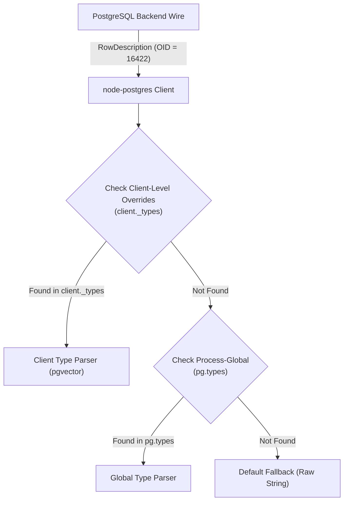
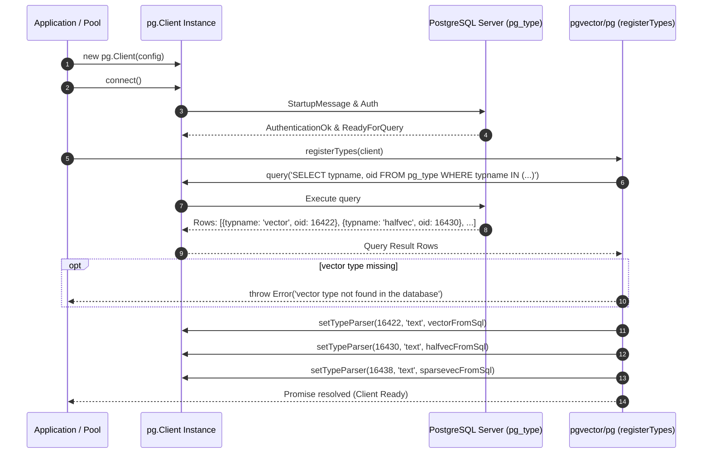
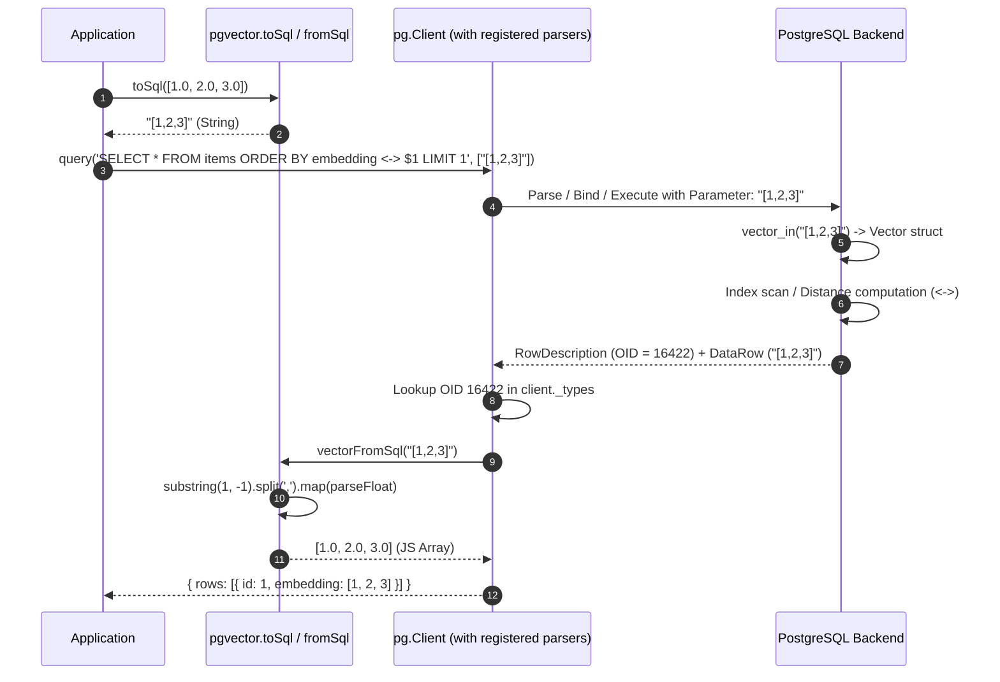

# pgvector-node: node-postgres (`pg`) Driver Deep Dive

> **Document Version:** 1.0.0  
> **Target Package:** `pgvector/pg` (`pgvector-node` v0.3.1)  
> **Driver Compatibility:** `pg` (node-postgres >= 8.6.0), `@types/pg` (>= 8.20.0)  
> **Source Files Inspected:**  
> - `pgvector-node/src/pg/index.js`  
> - `pgvector-node/types/pg/index.d.ts`  
> - `pgvector-node/src/index.js`  
> - `pgvector-node/src/utils.js`  
> - `pgvector-node/src/sparse-vector.js`  
> - `pgvector-node/tests/pg.test.js`  

---

## Table of Contents

1. [Executive Summary](#1-executive-summary)
2. [Driver Architecture & Type System Design](#2-driver-architecture--type-system-design)
   - [2.1 The node-postgres (`pg`) Runtime Architecture](#21-the-node-postgres-pg-runtime-architecture)
   - [2.2 Type Handling in `pg`: `pg-types` vs `ClientBase.prototype.setTypeParser`](#22-type-handling-in-pg-pg-types-vs-clientbaseprototypesettypeparser)
   - [2.3 Process-Global vs Client/Pool Scoped Parsers](#23-process-global-vs-clientpool-scoped-parsers)
3. [Registration Subsystem (`registerTypes`)](#3-registration-subsystem-registertypes)
   - [3.1 Function Signature & Deprecation Evolution](#31-function-signature--deprecation-evolution)
   - [3.2 Dynamic Catalog Introspection: Querying `pg_type` for OIDs](#32-dynamic-catalog-introspection-querying-pg_type-for-oids)
   - [3.3 Extension Verification & Graceful Degradation](#33-extension-verification--graceful-degradation)
   - [3.4 Connection Pool Integration (`onConnect` Lifecycle Hook)](#34-connection-pool-integration-onconnect-lifecycle-hook)
4. [Serialization & Ingestion Protocol (JavaScript → PostgreSQL)](#4-serialization--ingestion-protocol-javascript--postgresql)
   - [4.1 The Role of `pgvector.toSql(value)`](#41-the-role-of-pgvectortosqlvalue)
   - [4.2 Dense Vector Serialization (`vectorToSql`)](#42-dense-vector-serialization-vectortosql)
   - [4.3 Half-Precision Vector Serialization (`halfvecToSql`)](#43-half-precision-vector-serialization-halfvectosql)
   - [4.4 Sparse Vector Wire Protocol (`sparsevecToSql` & `SparseVector.toPostgres`)](#44-sparse-vector-wire-protocol-sparsevectosql--sparsevectortopostgres)
   - [4.5 Binary Vector Protocol (`bit`)](#45-binary-vector-protocol-bit)
   - [4.6 The Malformed Literal Problem: Why Direct JS Array Binding Fails](#46-the-malformed-literal-problem-why-direct-js-array-binding-fails)
5. [Deserialization & Egress Protocol (PostgreSQL → JavaScript)](#5-deserialization--egress-protocol-postgresql--javascript)
   - [5.1 Text Wire Protocol Parsing](#51-text-wire-protocol-parsing)
   - [5.2 `vectorFromSql` & `halfvecFromSql`: Substring Slicing and Tokenization](#52-vectorfromsql--halfvecfromsql-substring-slicing-and-tokenization)
   - [5.3 `sparsevecFromSql`: Coordinate Slicing and Dimension Reconstruction](#53-sparsevecfromsql-coordinate-slicing-and-dimension-reconstruction)
   - [5.4 Null Handling & Boundary Conditions](#54-null-handling--boundary-conditions)
6. [Architectural Sequence Diagrams](#6-architectural-sequence-diagrams)
   - [6.1 Connection Initialization & Dynamic Type Registration](#61-connection-initialization--dynamic-type-registration)
   - [6.2 End-to-End Query Execution & Roundtrip](#62-end-to-end-query-execution--roundtrip)
7. [Line-by-Line Source Code Walkthrough](#7-line-by-line-source-code-walkthrough)
   - [7.1 Dissecting `src/pg/index.js`](#71-dissecting-srcpgindexjs)
   - [7.2 Type Definitions Analysis (`types/pg/index.d.ts`)](#72-type-definitions-analysis-typespgindexdts)
8. [Test Suite In-Depth Analysis (`tests/pg.test.js`)](#8-test-suite-in-depth-analysis-testspgtestjs)
   - [8.1 Single Client Workflow: Multi-Type Insert & L2 Nearest Neighbors](#81-single-client-workflow-multi-type-insert--l2-nearest-neighbors)
   - [8.2 Connection Pool Workflow: `onConnect` Hook & HNSW Indexing](#82-connection-pool-workflow-onconnect-hook--hnsw-indexing)
   - [8.3 Index Creation & Vector Operator Classes](#83-index-creation--vector-operator-classes)
9. [Cross-Language & Architectural Comparison](#9-cross-language--architectural-comparison)
   - [9.1 `pg` (Node.js) vs `psycopg2` / `psycopg3` (Python)](#91-pg-nodejs-vs-psycopg2--psycopg3-python)
   - [9.2 Feature & Mechanical Comparison Matrix](#92-feature--mechanical-comparison-matrix)
10. [Production Best Practices & Caveats](#10-production-best-practices--caveats)
    - [10.1 Prepared Statements and Parameter Typings](#101-prepared-statements-and-parameter-typings)
    - [10.2 Multitenancy & Schema Search Paths](#102-multitenancy--schema-search-paths)
    - [10.3 Performance Considerations: Memory Allocations and String Parsing](#103-performance-considerations-memory-allocations-and-string-parsing)

---

## 1. Executive Summary

The `pgvector/pg` module provides vector extension integration for `node-postgres` (`pg`), the foundational, non-blocking PostgreSQL client library for Node.js. Unlike higher-level query builders or ORMs, `node-postgres` communicates directly with PostgreSQL using the frontend/backend protocol v3.0, relying on parameterized queries (`$1, $2, ...`) and dynamic Object Identifier (OID) type parsers.

In `pgvector-node`, integration with `pg` is implemented with minimal overhead and zero C++ native dependencies:
- **Dynamic OID Discovery:** Because PostgreSQL extensions are assigned arbitrary OIDs at installation time (`>= 16384`), `registerTypes(client)` queries `pg_type` over the active connection to resolve the exact OIDs for `vector`, `halfvec`, and `sparsevec`.
- **Client-Scoped Type Parsing:** Parsers are registered via `client.setTypeParser(oid, 'text', parser)`, binding custom deserializers to the specific client instance without polluting process-global state.
- **Explicit Parameter Serialization:** Because `node-postgres` natively serializes JavaScript arrays (`[1, 2, 3]`) as PostgreSQL arrays (`'{1,2,3}'`), which causes a syntax error when bound to vector columns, developers must invoke `pgvector.toSql(vector)` to produce PostgreSQL-compliant vector literal strings (`'[1,2,3]'`).
- **Comprehensive Vector Family Support:** Handles standard 32-bit floating point vectors (`vector`), 16-bit half-precision vectors (`halfvec`), sparse vectors (`sparsevec`), and native PostgreSQL bit strings (`bit`).

---

## 2. Driver Architecture & Type System Design

### 2.1 The node-postgres (`pg`) Runtime Architecture

`node-postgres` operates as a layered network state machine:
1. **Socket Layer:** Manages TCP sockets or UNIX domain sockets to the PostgreSQL postmaster.
2. **Protocol Stream Parser:** Parses incoming backend wire messages (`AuthenticationOk`, `ParameterStatus`, `ReadyForQuery`, `RowDescription`, `DataRow`).
3. **Query Pipeline:** Issues queries via the PostgreSQL Simple Query Protocol (`Query` message) or the Extended Query Protocol (`Parse`, `Bind`, `Describe`, `Execute`, `Sync`).
4. **Data Row Demuxer & Type Casting:** When a `DataRow` message is received, each column buffer is matched against its corresponding field definition in `RowDescription`. The `RowDescription` message contains the PostgreSQL `dataTypeID` (the type OID) and `dataTypeFormat` (0 for text format, 1 for binary format).

### 2.2 Type Handling in `pg`: `pg-types` vs `ClientBase.prototype.setTypeParser`

`node-postgres` delegates row value parsing to the `pg-types` library. Under standard configuration:
- Built-in PostgreSQL types (e.g., `INT4` OID 23, `VARCHAR` OID 1043, `JSON` OID 114) have hardcoded default parsers registered in `pg-types`.
- When custom types or extension types are introduced, `pg-types` provides two registration scopes:



1. **Global Registry (`pg.types.setTypeParser`):** Mutates the global parser dictionary within the `pg-types` singleton. Any connection spawned in the Node.js process inherits these parsers.
2. **Client-Instance Registry (`client.setTypeParser`):** Every `Client` (derived from `ClientBase`) maintains its own `_types` instance of `TypeOverrides`. Invoking `client.setTypeParser(oid, format, parser)` adds a parser specifically to `client._types`, shadowing or augmenting global parsers without affecting other clients.

### 2.3 Process-Global vs Client/Pool Scoped Parsers

`pgvector-node` explicitly opts for **client-instance registration** (`client.setTypeParser`) rather than global registration. 

#### Advantages of Client-Scoped Registration
- **Multi-Database Isolation:** In multi-tenant systems or applications connecting to multiple PostgreSQL databases from the same Node.js runtime, the OID of `vector` may differ across databases (e.g., OID 16422 in Database A, OID 16480 in Database B). A global `pg.types.setTypeParser` would bind to a single OID, corrupting type resolution for one of the databases.
- **Controlled Lifecycle:** Connections only pay the parsing overhead if they explicitly opt into the vector type.
- **Safe Hot-Reloading:** If extensions are dropped or re-created, individual connection pools can refresh their cached OIDs without restarting the Node.js process.

---

## 3. Registration Subsystem (`registerTypes`)

The registration logic is encapsulated in `src/pg/index.js` under the `registerTypes` function.

### 3.1 Function Signature & Deprecation Evolution

```typescript
declare function registerTypes(client: ClientBase): Promise<void>;
declare const registerType: typeof registerTypes;
```

In earlier versions of `pgvector-node` (v0.1.x), the function was named `registerType(client)`. With the introduction of `halfvec` and `sparsevec` in `pgvector` 0.7.0+, the function was renamed to `registerTypes(client)` to reflect that it registers the entire family of vector types in a single pass. 

`src/pg/index.js` preserves backward compatibility via Node.js's standard `node:util` deprecation wrapper:
```javascript
import { deprecate } from 'node:util';
const registerType = deprecate(registerTypes, 'registerType() is deprecated. Use registerTypes() instead.');
```

### 3.2 Dynamic Catalog Introspection: Querying `pg_type` for OIDs

When `await registerTypes(client)` is executed, it runs an introspective catalog query:

```javascript
const result = await client.query(
  'SELECT typname, oid FROM pg_type WHERE typname IN ($1, $2, $3)', 
  ['vector', 'halfvec', 'sparsevec']
);
const rows = result.rows;
```

#### Why Dynamic Introspection is Mandatory
PostgreSQL core reserves OIDs 1 through 9999 for bootstrap types (`src/include/catalog/unused_oids`). When a PostgreSQL extension creates a user-defined type (UDT) via `CREATE EXTENSION vector`, PostgreSQL assigns the next available 32-bit unsigned integer from the database's local OID generator counter. 

Consequently, the OID of `vector` cannot be statically predicted at compile time. It depends entirely on:
1. The installation order of extensions.
2. Previous table and object creation history in that database cluster.

### 3.3 Extension Verification & Graceful Degradation

After querying `pg_type`, `registerTypes` inspects the returned rows:

```javascript
const vector = rows.find((v) => v.typname == 'vector');
const halfvec = rows.find((v) => v.typname == 'halfvec');
const sparsevec = rows.find((v) => v.typname == 'sparsevec');

if (!vector) {
  throw new Error('vector type not found in the database');
}

client.setTypeParser(vector.oid, 'text', function (value) {
  return vectorFromSql(value);
});

if (halfvec) {
  client.setTypeParser(halfvec.oid, 'text', function (value) {
    return halfvecFromSql(value);
  });
}

if (sparsevec) {
  client.setTypeParser(sparsevec.oid, 'text', function (value) {
    return sparsevecFromSql(value);
  });
}
```

Key architectural aspects:
- **Hard Requirement on `vector`:** If `vector` is not returned, the function immediately throws `Error('vector type not found in the database')`. This protects against silent deserialization failures where vectors would otherwise be returned as unparsed raw strings.
- **Conditional Registration for Modern Types:** `halfvec` and `sparsevec` are wrapped in conditional guards (`if (halfvec)`, `if (sparsevec)`). If an application connects to a PostgreSQL instance running an older version of `pgvector` (e.g., v0.4.0 where `halfvec` and `sparsevec` did not exist), `registerTypes` succeeds gracefully without throwing errors.

### 3.4 Connection Pool Integration (`onConnect` Lifecycle Hook)

Because `registerTypes` modifies the individual `client` instance, each pooled connection must be initialized upon allocation. `node-postgres` supports the `onConnect` callback in `pg.PoolConfig`:

```javascript
import pg from 'pg';
import pgvector from 'pgvector/pg';

const pool = new pg.Pool({
  connectionString: process.env.DATABASE_URL,
  max: 20,
  idleTimeoutMillis: 30000,
  // Executed every time a new physical TCP connection is established
  onConnect: async (client) => {
    await pgvector.registerTypes(client);
  }
});
```

When a pooled connection is checked out (`pool.query` or `await pool.connect()`), it already has its `_types` dictionary populated with the vector parsers.

---

## 4. Serialization & Ingestion Protocol (JavaScript → PostgreSQL)

### 4.1 The Role of `pgvector.toSql(value)`

When issuing parameterized queries in `node-postgres`:
```javascript
await client.query('INSERT INTO items (embedding) VALUES ($1)', [params]);
```

`node-postgres` evaluates the JavaScript types of the elements in the `params` array. Unlike Python drivers that provide type adapter registries (e.g. `register_adapter` in `psycopg2`), `node-postgres` does not expose an extensible parameter serializer for user types. 

Therefore, `pgvector-node` exposes a universal serialization helper:
```javascript
import pgvector from 'pgvector/pg';

const sqlParam = pgvector.toSql([1.0, 2.0, 3.0]);
```

### 4.2 Dense Vector Serialization (`vectorToSql`)

In `src/utils.js`, dense vectors are serialized as follows:

```javascript
export function vectorToSql(value) {
  if (Array.isArray(value)) {
    return JSON.stringify(value.map((v) => Number(v)));
  }
  return value;
}
```

1. **Numeric Coercion:** Every item in the array is coerced via `Number(v)`. This handles cases where strings, BigInts, or custom numeric objects are passed.
2. **JSON Stringification:** `JSON.stringify([1, 2, 3])` yields the string `"[1,2,3]"`.
3. **Format Alignment:** In PostgreSQL, the text input format for `vector` expects brackets containing comma-separated numbers: `'[1,2,3]'`. `JSON.stringify` on a numeric array produces an identical ASCII representation, avoiding custom string concatenation loops.

### 4.3 Half-Precision Vector Serialization (`halfvecToSql`)

In `src/utils.js`:
```javascript
export { vectorToSql as halfvecToSql };
```
Because PostgreSQL's `halfvec` input function (`halfvec_in`) accepts the exact same string syntax `[x1,x2,...]` as `vector_in`, `halfvecToSql` is an alias of `vectorToSql`. The PostgreSQL backend parses the ASCII float representations and converts each element to a 16-bit IEEE 754 half-precision float (`half float` / `fp16`).

### 4.4 Sparse Vector Wire Protocol (`sparsevecToSql` & `SparseVector.toPostgres`)

Sparse vectors represent high-dimensional embeddings where the vast majority of values are zero (e.g., BM25 or SPLADE sparse vectors).

In `src/sparse-vector.js`:
```javascript
export class SparseVector {
  dimensions = 0;
  indices = []; // 0-based index in JS
  values = [];

  toPostgres() {
    const values = this.values;
    const elements = this.indices
      .map((index, i) => format('%i:%f', index + 1, values[i]))
      .join(',');
    return format('{%s}/%d', elements, this.dimensions);
  }
}
```

#### Wire Format Mechanics
- **1-Based Indexing:** PostgreSQL sparse vector literals follow the format `'{index:value,...}/dimensions'`, where `index` is 1-based (standard PostgreSQL array indexing convention). `toPostgres()` adds `+ 1` to each 0-based JS index.
- **Example:** A 10,000-dimensional vector with non-zero values at index 4 (value 0.5) and index 99 (value 1.2) serializes to:
  `'{5:0.500000,100:1.200000}/10000'`

In `src/utils.js`:
```javascript
export function sparsevecToSql(value) {
  if (value instanceof SparseVector) {
    return value.toPostgres();
  }
  return value;
}
```

### 4.5 Binary Vector Protocol (`bit`)

`pgvector` supports Hamming distance searches on binary vectors using PostgreSQL's native `bit(n)` and `varbit` types.
- Binary vectors do not require `toSql` transformation.
- They are passed directly as standard strings of `0`s and `1`s (e.g., `'10100110'`).

### 4.6 The Malformed Literal Problem: Why Direct JS Array Binding Fails

A critical pitfall in `node-postgres` occurs if a developer attempts to pass a raw JavaScript array directly into a vector query:

```javascript
// BUG: Will fail with database error
await client.query('INSERT INTO items (embedding) VALUES ($1)', [[1, 2, 3]]);
```

#### Root Cause Breakdown
1. When `node-postgres` processes a JavaScript `Array`, its internal parameter serializer (`prepareValue` in `pg/lib/utils.js`) defaults to formatting the array as a native PostgreSQL array literal.
2. It wraps elements in curly braces: `'{1,2,3}'`.
3. When PostgreSQL receives `'{1,2,3}'` for a column defined as `vector(3)`, the PostgreSQL vector input function (`vector_in`) inspects the first character.
4. `vector_in` expects `'['`. Finding `'{'`, it immediately raises:
   ```
   ERROR: malformed vector literal: "{1,2,3}"
   DETAIL: Vector contents must start with "[".
   ```
5. By calling `pgvector.toSql([1, 2, 3])`, the parameter becomes the string `"[1,2,3]"`. When PostgreSQL parses the parameter, it correctly interprets it as a valid vector literal.

---

## 5. Deserialization & Egress Protocol (PostgreSQL → JavaScript)

### 5.1 Text Wire Protocol Parsing

In `node-postgres`, query execution requests results in **text format** (`dataTypeFormat = 0`). When a row arrives, the raw ASCII string received over the socket is dispatched to the type parser registered via `client.setTypeParser(oid, 'text', parser)`.

### 5.2 `vectorFromSql` & `halfvecFromSql`: Substring Slicing and Tokenization

In `src/utils.js`:
```javascript
export function vectorFromSql(value) {
  if (value === null) {
    return null;
  }
  return value.substring(1, value.length - 1).split(',').map((v) => parseFloat(v));
}

export { vectorFromSql as halfvecFromSql };
```

#### Parsing Breakdown
1. **Bracket Stripping:** `value.substring(1, value.length - 1)` strips the leading `'['` and trailing `']'`.
2. **Token Splitting:** `.split(',')` produces an array of string tokens representing floating-point numbers.
3. **Float Parsing:** `.map((v) => parseFloat(v))` converts each ASCII representation to an IEEE 754 double-precision number (`number`).
4. **Halfvec Parity:** For `halfvec`, the database emits the same bracketed comma-delimited string `[0.1,0.2,...]`. Even though stored as 16-bit floats in PostgreSQL, JavaScript represents them as standard 64-bit IEEE 754 floats (`number[]`).

### 5.3 `sparsevecFromSql`: Coordinate Slicing and Dimension Reconstruction

When a `sparsevec` column is fetched, the text parser invokes `sparsevecFromSql(value)`:

```javascript
export function sparsevecFromSql(value) {
  if (value === null) {
    return null;
  }
  return new SparseVector(value);
}
```

The constructor of `SparseVector` invokes the private `#fromSql(value)` method:

```javascript
#fromSql(value) {
  const parts = value.split('/', 2);
  this.dimensions = parseInt(parts[1]);

  if (parts[0].length > 2) {
    const elements = parts[0].slice(1, -1).split(',');
    for (const element of elements) {
      const ep = element.split(':', 2);
      this.indices.push(parseInt(ep[0]) - 1);
      this.values.push(parseFloat(ep[1]));
    }
  }
}
```

1. **Dimension Extraction:** Splits at `'/'` to isolate the total dimension count (`parseInt(parts[1])`).
2. **Coordinate Extraction:** Slices off the surrounding `{` and `}`.
3. **Index Adjustment:** Each coordinate `index:value` has its 1-based PostgreSQL index parsed and decremented by 1 (`parseInt(ep[0]) - 1`) to match 0-based JavaScript array indexing conventions.
4. **Object Encapsulation:** Returns a rich `SparseVector` instance supporting `.toArray()`, `.dimensions`, `.indices`, and `.values`.

### 5.4 Null Handling & Boundary Conditions

- **SQL NULLs:** `node-postgres` intercepts SQL `NULL` at the wire protocol level (`DataRow` column length = -1). If a field is `NULL`, `node-postgres` returns JavaScript `null` directly, without calling the registered type parser.
- **Defensive Parser Guard:** If `value === null` is passed into `vectorFromSql` or `sparsevecFromSql`, both functions explicitly guard and return `null`.
- **Empty Vectors:** Empty vectors `[]` (0 dimensions) yield empty JavaScript arrays `[]`.

---

## 6. Architectural Sequence Diagrams

### 6.1 Connection Initialization & Dynamic Type Registration



### 6.2 End-to-End Query Execution & Roundtrip



---

## 7. Line-by-Line Source Code Walkthrough

### 7.1 Dissecting `src/pg/index.js`

Below is the complete annotated source code of `src/pg/index.js`:

```javascript
// Line 1-3: Module imports
import { deprecate } from 'node:util';
import { toSql } from '../index.js';
import { vectorFromSql, halfvecFromSql, sparsevecFromSql } from '../utils.js';

// Line 5: TypeScript import type annotation for JSDoc typechecking
/** @import { ClientBase } from 'pg' */

/**
 * Registers vector parsers on the specified pg Client or ClientBase instance.
 * @param {ClientBase} client
 */
async function registerTypes(client) {
  // Line 11-12: Introspect PostgreSQL catalog for all 3 vector types using parameterized IN query
  const result = await client.query(
    'SELECT typname, oid FROM pg_type WHERE typname IN ($1, $2, $3)', 
    ['vector', 'halfvec', 'sparsevec']
  );
  const rows = result.rows;

  // Line 14-16: Locate row entries for each type
  const vector = rows.find(/** @type {(v: any) => any} */ (v) => v.typname == 'vector');
  const halfvec = rows.find(/** @type {(v: any) => any} */ (v) => v.typname == 'halfvec');
  const sparsevec = rows.find(/** @type {(v: any) => any} */ (v) => v.typname == 'sparsevec');

  // Line 18-20: Ensure extension is installed; fail fast if vector is missing
  if (!vector) {
    throw new Error('vector type not found in the database');
  }

  // Line 22-24: Bind 'vector' text parser to client's internal TypeOverrides instance
  client.setTypeParser(vector.oid, 'text', /** @type {(value: any) => any} */ function (value) {
    return vectorFromSql(value);
  });

  // Line 26-30: Conditionally bind 'halfvec' parser if present in pg_type
  if (halfvec) {
    client.setTypeParser(halfvec.oid, 'text', /** @type {(value: any) => any} */ function (value) {
      return halfvecFromSql(value);
    });
  }

  // Line 32-36: Conditionally bind 'sparsevec' parser if present in pg_type
  if (sparsevec) {
    client.setTypeParser(sparsevec.oid, 'text', /** @type {(value: any) => any} */ function (value) {
      return sparsevecFromSql(value);
    });
  }
}

// Line 39: Expose deprecated singular 'registerType' with deprecation warning
const registerType = deprecate(
  registerTypes, 
  'registerType() is deprecated. Use registerTypes() instead.'
);

// Line 41-43: Named and default exports
export { registerType, registerTypes, toSql };
export default { registerType, registerTypes, toSql };
```

### 7.2 Type Definitions Analysis (`types/pg/index.d.ts`)

```typescript
import { toSql } from '../index.js';
import type { ClientBase } from 'pg';

declare function registerTypes(client: ClientBase): Promise<void>;
declare const registerType: typeof registerTypes;

export { registerType, registerTypes, toSql };
declare const _default: {
    registerType: typeof registerTypes;
    registerTypes: typeof registerTypes;
    toSql: typeof toSql;
};
export default _default;
```

#### TypeScript Typing Details
- `ClientBase`: Accepting `ClientBase` allows both `pg.Client` and `pg.PoolClient` (the client returned by `pool.connect()`) to be passed to `registerTypes`.
- Re-exports `toSql`: Ensures developers can import `{ registerTypes, toSql } from 'pgvector/pg'` in a single import statement.

---

## 8. Test Suite In-Depth Analysis (`tests/pg.test.js`)

The test file `tests/pg.test.js` covers two primary operational models: direct standalone client and pooled connections.

### 8.1 Single Client Workflow: Multi-Type Insert & L2 Nearest Neighbors

Lines 7–35 test the full lifecycle of vector operations on a standalone `pg.Client`:

```javascript
test('pg example', async () => {
  const client = new pg.Client({database: 'pgvector_node_test'});
  await client.connect();

  await client.query('CREATE EXTENSION IF NOT EXISTS vector');
  await pgvector.registerTypes(client);

  await client.query('DROP TABLE IF EXISTS pg_items');
  await client.query(`
    CREATE TABLE pg_items (
      id serial PRIMARY KEY, 
      embedding vector(3), 
      half_embedding halfvec(3), 
      binary_embedding bit(3), 
      sparse_embedding sparsevec(3)
    )
  `);

  const params = [
    pgvector.toSql([1, 1, 1]), pgvector.toSql([1, 1, 1]), '000', new SparseVector([1, 1, 1]),
    pgvector.toSql([2, 2, 2]), pgvector.toSql([2, 2, 2]), '101', new SparseVector([2, 2, 2]),
    pgvector.toSql([1, 1, 2]), pgvector.toSql([1, 1, 2]), '111', new SparseVector([1, 1, 2]),
    null, null, null, null
  ];
  await client.query(`
    INSERT INTO pg_items (
      embedding, half_embedding, binary_embedding, sparse_embedding
    ) VALUES 
      ($1, $2, $3, $4), 
      ($5, $6, $7, $8), 
      ($9, $10, $11, $12), 
      ($13, $14, $15, $16)
  `, params);

  const { rows } = await client.query(
    'SELECT * FROM pg_items ORDER BY embedding <-> $1 LIMIT 5', 
    [pgvector.toSql([1, 1, 1])]
  );
  assert.deepEqual(rows.map(v => v.id), [1, 3, 2, 4]);
  assert.deepEqual(rows[0].embedding, [1, 1, 1]);
  assert.deepEqual(rows[0].half_embedding, [1, 1, 1]);
  assert.deepEqual(rows[0].binary_embedding, '000');
  assert.deepEqual(rows[0].sparse_embedding.toArray(), [1, 1, 1]);

  await client.query('CREATE INDEX ON pg_items USING hnsw (embedding vector_l2_ops)');
  await client.end();
});
```

#### Observations from Test 1
1. **Multi-Row Insert Structure:** Demonstrates insertion of 4 rows, including an all-NULL row (`null, null, null, null`), verifying that `NULL` values pass through without type conversion errors.
2. **SparseVector Parameter Passing:** Note that `new SparseVector([1, 1, 1])` is passed directly in `params`. Because `SparseVector` implements `.toPostgres()` and `.toString()`, `node-postgres` calls `.toString()` automatically during stringification, but using `pgvector.toSql(sparseVec)` is also valid.
3. **Ordering Logic:** Queries use the L2 distance operator (`<->`). The distance from `[1, 1, 1]` to:
   - Row 1 `[1, 1, 1]` is $0.0$.
   - Row 3 `[1, 1, 2]` is $\sqrt{(1-1)^2 + (1-1)^2 + (2-1)^2} = 1.0$.
   - Row 2 `[2, 2, 2]` is $\sqrt{(2-1)^2 + (2-1)^2 + (2-1)^2} = \sqrt{3} \approx 1.732$.
   - Row 4 `NULL` is sorted last.
   Resulting order of IDs is precisely `[1, 3, 2, 4]`.

### 8.2 Connection Pool Workflow: `onConnect` Hook & HNSW Indexing

Lines 37–66 test the connection pool pattern:

```javascript
test('pool', async () => {
  const pool = new pg.Pool({
    database: 'pgvector_node_test',
    onConnect: async (client) => {
      await client.query('CREATE EXTENSION IF NOT EXISTS vector');
      await pgvector.registerTypes(client);
    }
  });

  await pool.query('DROP TABLE IF EXISTS pg_items');
  await pool.query('CREATE TABLE pg_items (id serial PRIMARY KEY, embedding vector(3))');

  const params = [
    pgvector.toSql([1, 1, 1]),
    pgvector.toSql([2, 2, 2]),
    pgvector.toSql([1, 1, 2]),
    null
  ];
  await pool.query('INSERT INTO pg_items (embedding) VALUES ($1), ($2), ($3), ($4)', params);

  const { rows } = await pool.query(
    'SELECT * FROM pg_items ORDER BY embedding <-> $1 LIMIT 5', 
    [pgvector.toSql([1, 1, 1])]
  );
  assert.deepEqual(rows.map(v => v.id), [1, 3, 2, 4]);
  assert.deepEqual(rows[0].embedding, [1, 1, 1]);
  assert.deepEqual(rows[1].embedding, [1, 1, 2]);
  assert.deepEqual(rows[2].embedding, [2, 2, 2]);

  await pool.query('CREATE INDEX ON pg_items USING hnsw (embedding vector_l2_ops)');
  await pool.end();
});
```

#### Observations from Test 2
- Proves that `pool.query(...)` executes seamlessly when type registration is hooked into `onConnect`.
- Verifies that subsequent connections in the pool maintain the registered parsers.

### 8.3 Index Creation & Vector Operator Classes

Both tests culminate in the creation of an HNSW index:
```sql
CREATE INDEX ON pg_items USING hnsw (embedding vector_l2_ops);
```

In PostgreSQL, index creation requires specifying the operator class matching the query operator:
| Operator | Distance Metric | Index Operator Class |
|---|---|---|
| `<->` | Euclidean (L2) distance | `vector_l2_ops`, `halfvec_l2_ops`, `sparsevec_l2_ops` |
| `<#>` | Negative inner product | `vector_ip_ops`, `halfvec_ip_ops`, `sparsevec_ip_ops` |
| `<=>` | Cosine distance | `vector_cosine_ops`, `halfvec_cosine_ops`, `sparsevec_cosine_ops` |
| `<+>` | L1 (Taxicab / Manhattan) | `vector_l1_ops`, `halfvec_l1_ops`, `sparsevec_l1_ops` |
| `<~>` | Hamming distance (bit/binary) | `bit_hamming_ops`, `halfvec_hamming_ops` |
| `<%>` | Jaccard distance (bit/binary) | `bit_jaccard_ops` |

---

## 9. Cross-Language & Architectural Comparison

### 9.1 `pg` (Node.js) vs `psycopg2` / `psycopg3` (Python)

Comparing `pgvector/pg` to Python's PostgreSQL adapters reveals significant design contrasts:

#### 1. Ingress Parameter Serialization
- **Python (`psycopg2` / `psycopg`):** Uses an adaptation registry (`register_adapter` in `psycopg2`, `AdaptersMap.register_dumper` in `psycopg3`). Because Python maintains an extensible parameter dispatcher keyed by Python types (`type(obj)`), passing a raw `numpy.ndarray` or `list` automatically invokes the vector serializer without user intervention.
- **Node.js (`node-postgres`):** `node-postgres` lacks an extensible type dumper registry for parameters. JS arrays are unconditionally treated as PostgreSQL array literals. Hence, `pgvector-node` must require the explicit invocation of `pgvector.toSql(arr)`.

#### 2. Egress Result Deserialization
- **Python (`psycopg2`):** `new_type(oids, name, cast_function)` and `register_type(caster, scope)` allow connection, cursor, or global registration.
- **Python (`psycopg` v3):** Employs `AdaptersMap` with loader classes that support both text and binary formats.
- **Node.js (`node-postgres`):** `client.setTypeParser(oid, 'text', parser)` operates strictly on text wire representations, mapping directly to JavaScript's dynamic typing.

### 9.2 Feature & Mechanical Comparison Matrix

| Feature / Mechanism | `pgvector/pg` (node-postgres) | `pgvector.psycopg2` (Python) | `pgvector.psycopg` (Python v3) |
|---|---|---|---|
| **Underlying Driver Base** | Pure JS (or optional `pg-native`) | C Extension (`libpq`) | C Extension or Pure Python (`libpq`) |
| **Catalog Query Strategy** | `SELECT typname, oid FROM pg_type WHERE typname IN ($1, $2, $3)` | `SELECT to_regtype('vector'), ...` | `SELECT to_regtype('vector'), ...` |
| **Registration Scope** | Per-Client (`client.setTypeParser`) | Scoped or Global (`globally=True/False`) | Per-Connection or Process-Global `adapters` |
| **Automatic Input Adaptation** | ❌ Manual `pgvector.toSql(...)` required | ✅ Automatic via `ISQLQuote` adapter | ✅ Automatic via `Dumper` registration |
| **Wire Protocol Format** | Text protocol only (`'text'`) | Text protocol (`PQexecParams`) | Text and Binary (`format=1`) protocols |
| **Array Type Support** | ❌ Scalar only (`vector`, `halfvec`, `sparsevec`) | ✅ Fully registers array companion types (`vector[]`) | ✅ Fully registers array companion types |
| **Missing Type Tolerance** | Throws if `vector` missing; gracefully skips `halfvec`/`sparsevec` | Throws if `vector` missing; conditionally handles sub-types | Throws if `vector` missing; conditionally handles sub-types |
| **Pool Lifecycle Hook** | `new pg.Pool({ onConnect: async (c) => ... })` | Manual hook in connection pool checkout | `ConnectionPool(configure=...)` hook |

---

## 10. Production Best Practices & Caveats

### 10.1 Prepared Statements and Parameter Typings

When executing prepared statements with named queries in `node-postgres`:
```javascript
const query = {
  name: 'find-nearest-items',
  text: 'SELECT id FROM pg_items ORDER BY embedding <-> $1 LIMIT $2',
  values: [pgvector.toSql(queryVector), 10]
};
const res = await client.query(query);
```
PostgreSQL's query planner infers the parameter type of `$1` from the `<->` operator signature (`vector <-> vector`). Because `toSql()` yields a standard string, PostgreSQL's parser transparently executes the type coercion via `vector_in`.

### 10.2 Multitenancy & Schema Search Paths

If `pgvector` is installed in a non-standard schema (e.g., `CREATE EXTENSION vector SCHEMA extensions;`), querying `pg_type` via:
```sql
SELECT typname, oid FROM pg_type WHERE typname IN ('vector', 'halfvec', 'sparsevec')
```
remains completely valid because `pg_type.typname` stores unqualified type names, independent of their enclosing namespace (`pg_namespace`). The type parser correctly resolves the OID regardless of schema placement.

### 10.3 Performance Considerations: Memory Allocations and String Parsing

Because `node-postgres` currently operates in text mode for custom types:
1. Every vector returned from PostgreSQL is transmitted across the wire as an ASCII string (e.g., `"[0.123456,0.987654,...]"`).
2. `vectorFromSql` performs string allocation, comma tokenization via `.split(',')`, and individual float parsing via `parseFloat`.
3. For large result sets (e.g., fetching 10,000 vectors of 1,536 dimensions each), text splitting generates millions of transient string tokens, putting pressure on V8's garbage collector.
4. **Optimization Guideline:** When querying high-dimensional vectors in performance-critical loops, avoid selecting the raw vector column (`SELECT *`) unless the vector values are actively needed by the application layer. Instead, project only identifiers and distance metrics:
   ```sql
   SELECT id, embedding <-> $1 AS distance 
   FROM pg_items 
   ORDER BY distance 
   LIMIT 10;
   ```
