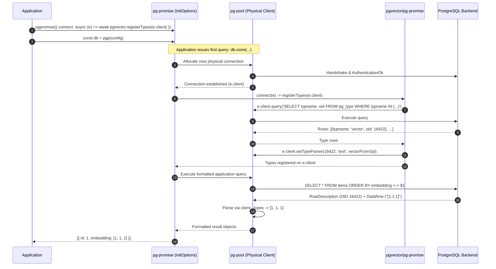
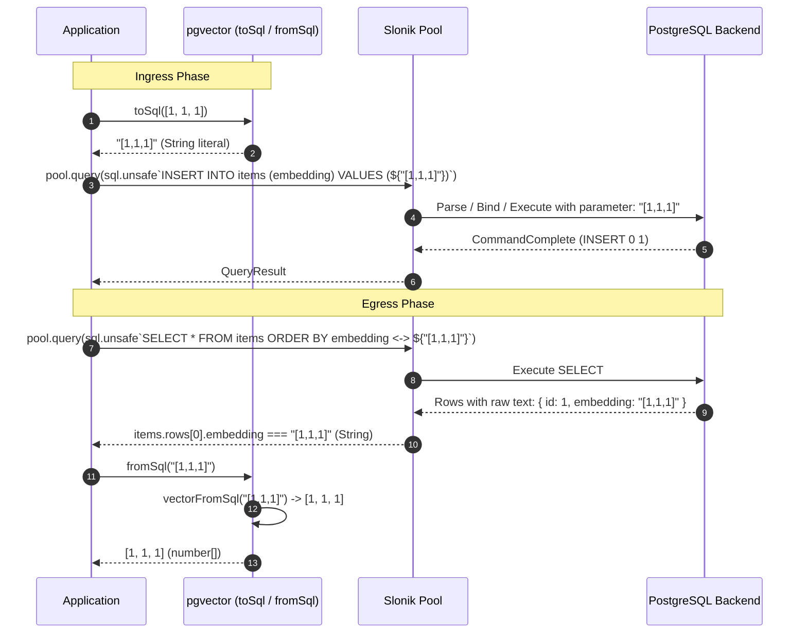

# pgvector-node: pg-promise and Slonik Drivers Deep Dive

> **Document Version:** 1.0.0  
> **Target SDK Modules:** `pgvector/pg-promise`, `pgvector` core (`pgvector-node` v0.3.1)  
> **Driver Compatibility:** `pg-promise` (>= 12.3.0), `slonik` (>= 49.0.0)  
> **Source Files Inspected:**  
> - `pgvector-node/src/pg-promise/index.js`  
> - `pgvector-node/types/pg-promise/index.d.ts`  
> - `pgvector-node/src/pg/index.js`  
> - `pgvector-node/src/index.js`  
> - `pgvector-node/src/utils.js`  
> - `pgvector-node/src/sparse-vector.js`  
> - `pgvector-node/tests/pg-promise.test.js`  
> - `pgvector-node/tests/slonik.test.js`  

---

## Table of Contents

1. [Executive Summary](#1-executive-summary)
2. [pg-promise Architectural Foundation & Integration](#2-pg-promise-architectural-foundation--integration)
   - [2.1 The pg-promise Philosophy: Promise Abstraction over node-postgres](#21-the-pg-promise-philosophy-promise-abstraction-over-node-postgres)
   - [2.2 Client Lifecycle & Connection Event Architecture](#22-client-lifecycle--connection-event-architecture)
   - [2.3 The `src/pg-promise/index.js` Re-export Architecture](#23-the-srcpg-promiseindexjs-re-export-architecture)
   - [2.4 The `connect` Event Hook Protocol: Attaching Types to Physical Clients](#24-the-connect-event-hook-protocol-attaching-types-to-physical-clients)
3. [Slonik Architectural Foundation & Integration](#3-slonik-architectural-foundation--integration)
   - [3.1 The Slonik Philosophy: Strict Type Safety & Explicit Type Assertions](#31-the-slonik-philosophy-strict-type-safety--explicit-type-assertions)
   - [3.2 Why There is No `src/slonik/index.js` in pgvector-node](#32-why-there-is-no-srcslonikindexjs-in-pgvector-node)
   - [3.3 Slonik's Rejection of Implicit Type Coercions](#33-sloniks-rejection-of-implicit-type-coercions)
   - [3.4 The Explicit `toSql` / `fromSql` Pattern in Slonik](#34-the-explicit-tosql--fromsql-pattern-in-slonik)
   - [3.5 Advanced Slonik Integration: Custom Type Parsers via `createTypeParserPreset` & Zod](#35-advanced-slonik-integration-custom-type-parsers-via-createtypeparserpreset--zod)
4. [Ingestion & Serialization Protocols Compared](#4-ingestion--serialization-protocols-compared)
   - [4.1 pg-promise Parameter Ingestion (`$1` and Named Formatting)](#41-pg-promise-parameter-ingestion-1-and-named-formatting)
   - [4.2 Slonik Ingestion with `sql.unsafe` and `sql.fragment`](#42-slonik-ingestion-with-sqlunsafe-and-sqlfragment)
   - [4.3 Dense, Half, Sparse, and Bit Vectors Across Both Drivers](#43-dense-half-sparse-and-bit-vectors-across-both-drivers)
5. [Egress & Deserialization Protocols Compared](#5-egress--deserialization-protocols-compared)
   - [5.1 pg-promise Automated Egress Parsing via `client.setTypeParser`](#51-pg-promise-automated-egress-parsing-via-clientsettypeparser)
   - [5.2 Slonik Egress via Explicit `pgvector.fromSql`](#52-slonik-egress-via-explicit-pgvectorfromsql)
   - [5.3 Structural Comparison of Return Types](#53-structural-comparison-of-return-types)
6. [Architectural Sequence Diagrams](#6-architectural-sequence-diagrams)
   - [6.1 pg-promise Connection Hook & Dynamic Type Binding](#61-pg-promise-connection-hook--dynamic-type-binding)
   - [6.2 Slonik Explicit Ingestion & Egress Execution Lifecycle](#62-slonik-explicit-ingestion--egress-execution-lifecycle)
7. [Test Suite In-Depth Analysis](#7-test-suite-in-depth-analysis)
   - [7.1 Dissecting `tests/pg-promise.test.js`](#71-dissecting-testspg-promisetestjs)
   - [7.2 Dissecting `tests/slonik.test.js`](#72-dissecting-testssloniktestjs)
8. [Comprehensive Comparison Matrix: `pg` vs `postgres.js` vs `pg-promise` vs `slonik`](#8-comprehensive-comparison-matrix-pg-vs-postgresjs-vs-pg-promise-vs-slonik)
9. [Production Implementation Patterns & Best Practices](#9-production-implementation-patterns--best-practices)
   - [9.1 pg-promise Production Architecture (Task & Transaction Handlers)](#91-pg-promise-production-architecture-task--transaction-handlers)
   - [9.2 Slonik Production Architecture (Type-Safe Zod Schemas for Vectors)](#92-slonik-production-architecture-type-safe-zod-schemas-for-vectors)
   - [9.3 Error Handling & Common Failure Modes](#93-error-handling--common-failure-modes)

---

## 1. Executive Summary

In the Node.js PostgreSQL ecosystem, `pg-promise` and `Slonik` represent two contrasting schools of thought regarding query building, connection management, and type safety:
- **`pg-promise`** (by Vitaly Tomilov) wraps `node-postgres` (`pg`) in an expressive, Promise-based abstraction with advanced SQL formatting engines, connection lifecycle event hooks, and dedicated transaction primitives (`tx`, `task`).
- **`Slonik`** (by Gajus Kuizinas) is an uncompromising, security-first PostgreSQL client designed to prevent SQL injection and enforce database engineering discipline by completely disabling dynamic string concatenation and enforcing explicit runtime schema validation.

Because of these differing designs, `pgvector-node` addresses each driver uniquely:
1. For **`pg-promise`**, `pgvector-node` ships a dedicated module (`pgvector/pg-promise`) that re-exports the `node-postgres` type registration engine, hooking directly into `pg-promise`'s `connect` event callback.
2. For **`Slonik`**, `pgvector-node` provides **no dedicated module**; instead, it relies on Slonik's explicit data boundary philosophy, using `pgvector.toSql` on write queries and `pgvector.fromSql` on read queries, or alternatively configuring Slonik's `createTypeParserPreset`.

---

## 2. pg-promise Architectural Foundation & Integration

### 2.1 The pg-promise Philosophy: Promise Abstraction over node-postgres

`pg-promise` is architected directly atop `node-postgres` (`pg` and `pg-pool`). While `pg` exposes low-level event emitters and callback-oriented querying, `pg-promise`:
- Replaces raw callbacks with a clean Promise-based API.
- Implements strict query result method semantics (`none`, `one`, `oneOrNone`, `many`, `manyOrNone`, `any`).
- Manages an internal connection pool with lifecycle event hooks.
- Uses a high-performance custom query formatting engine that interpolates parameters before delegating to `node-postgres`.

### 2.2 Client Lifecycle & Connection Event Architecture

`pg-promise` initializes via a two-stage factory pattern:
1. **Library Initialization (`pgpromise(initOptions)`):** Configures global library options, event handlers, and extensions.
2. **Database Instance Creation (`pgp(connectionConfig)`):** Creates a database instance representing the connection pool.

When `pg-promise` allocates a new physical TCP connection from its underlying `pg-pool`, it triggers the `connect` event hook specified in `initOptions`:

```typescript
type ConnectEvent = {
  client: pg.Client; // The underlying node-postgres Client instance
  dc: any;           // Database Context
  useCount: number;  // Number of times this connection has been used
};
```

### 2.3 The `src/pg-promise/index.js` Re-export Architecture

The entirety of `pgvector-node`'s `pg-promise` implementation in `src/pg-promise/index.js` is a single line:

```javascript
export { default } from '../pg/index.js';
```

And in `types/pg-promise/index.d.ts`:
```typescript
export { default } from '../pg/index.js';
```

#### Why Re-exporting `../pg/index.js` Works Seamlessly
Because `pg-promise` uses `node-postgres` `pg.Client` instances under the hood, the type registration logic for `pg-promise` is **100% identical** to that of `node-postgres`. 

The exported object contains:
- `registerTypes(client)`: Introspects `pg_type` and attaches vector parsers to `client`.
- `registerType(client)`: Deprecated alias for `registerTypes`.
- `toSql(value)`: Formats JavaScript arrays and `SparseVector` objects into PostgreSQL vector literals.

### 2.4 The `connect` Event Hook Protocol: Attaching Types to Physical Clients

Because physical connections in `pg-promise` are created lazily by the connection pool, type parsers must be attached when a new physical connection is established:

```javascript
import pgpromise from 'pg-promise';
import pgvector from 'pgvector/pg-promise';

const initOptions = {
  async connect(e) {
    // e.client is the newly created pg.Client
    await pgvector.registerTypes(e.client);
  }
};

const pgp = pgpromise(initOptions);
const db = pgp({ database: 'my_vector_db' });
```

Whenever a new client connection is established, `pgvector.registerTypes(e.client)` queries `pg_type` and calls `e.client.setTypeParser(...)`. All subsequent queries executed on that connection automatically deserialize vectors.

---

## 3. Slonik Architectural Foundation & Integration

### 3.1 The Slonik Philosophy: Strict Type Safety & Explicit Type Assertions

`Slonik` is built on principles designed to eliminate vulnerabilities and implicit type bugs:
1. **No Raw String Queries:** Queries must use `sql` tagged template literals (or `sql.unsafe` for raw dynamic fragments).
2. **Disabled Implicit Coercions:** Slonik disables `pg-types` default parsers to ensure that data is not implicitly coerced into unexpected JavaScript types without schema validation.
3. **Mandatory Runtime Validation:** Slonik strongly encourages runtime schema validation (e.g. Zod) on all query result rows.

### 3.2 Why There is No `src/slonik/index.js` in pgvector-node

A key observation when examining `pgvector-node` is that while directories exist for `pg`, `postgres`, `pg-promise`, `knex`, `kysely`, `mikro-orm`, `objection`, and `sequelize`, there is **no `src/slonik/index.js`**.

#### The Rationale
Slonik explicitly rejects the pattern of mutating client-level parser dictionaries or relying on third-party libraries to monkey-patch connection internals. Slonik's architecture dictates that:
1. Input values should be explicitly formatted or validated at the application boundary.
2. Result values should be decoded either via explicit transformation functions (`pgvector.fromSql`) or via user-configured type parser presets defined during pool creation.

### 3.3 Slonik's Rejection of Implicit Type Coercions

By default, Slonik overrides the underlying `node-postgres` type parsers so that numbers, dates, and custom types are returned as **strings** unless a specific type parser is explicitly registered in Slonik's `createTypeParserPreset()`. 

This prevents precision loss on types like `NUMERIC` or `INT8` (which exceed JavaScript's `Number.MAX_SAFE_INTEGER`). When vector columns are returned without a custom Slonik type parser, Slonik returns them as their raw PostgreSQL text representations (e.g. `"[1,1,1]"` or `"{1:1}/3"`).

### 3.4 The Explicit `toSql` / `fromSql` Pattern in Slonik

In `tests/slonik.test.js`, `pgvector` integrates with Slonik using pure data transformations:

```javascript
import pgvector, { SparseVector } from 'pgvector';
import { createPool, sql } from 'slonik';

const pool = await createPool('postgres://localhost/pgvector_node_test');

// Ingress: Explicit conversion to SQL vector literal string
const embedding = pgvector.toSql([1, 1, 1]);
const sparseVec = pgvector.toSql(new SparseVector([1, 1, 1]));

await pool.query(sql.unsafe`
  INSERT INTO slonik_items (embedding, sparse_embedding) 
  VALUES (${embedding}, ${sparseVec})
`);

// Egress: Explicit conversion from SQL vector text representation
const result = await pool.query(sql.unsafe`
  SELECT * FROM slonik_items ORDER BY embedding <-> ${embedding} LIMIT 1
`);

const parsedEmbedding = pgvector.fromSql(result.rows[0].embedding);
// parsedEmbedding is now: [1, 1, 1] (number[])
```

### 3.5 Advanced Slonik Integration: Custom Type Parsers via `createTypeParserPreset` & Zod

While `tests/slonik.test.js` demonstrates manual conversion, production applications using Slonik can automate vector deserialization by registering custom type parsers at pool creation:

```typescript
import { createPool, createTypeParserPreset, sql } from 'slonik';
import pgvector from 'pgvector';
import { z } from 'zod';

// Factory configuration for Slonik with pgvector auto-parsing
export async function createVectorPool(connectionUri: string) {
  const typeParsers = [
    ...createTypeParserPreset(),
    {
      name: 'vector',
      parse: (value: string) => pgvector.fromSql(value) as number[],
    },
    {
      name: 'halfvec',
      parse: (value: string) => pgvector.fromSql(value) as number[],
    },
    {
      name: 'sparsevec',
      parse: (value: string) => pgvector.fromSql(value) as pgvector.SparseVector,
    }
  ];

  return createPool(connectionUri, { typeParsers });
}

// Runtime type validation using Zod schemas
const DocumentRowSchema = z.object({
  id: z.number(),
  title: z.string(),
  embedding: z.array(z.number())
});

export async function getSimilarDocuments(pool: any, targetVector: number[]) {
  const vectorLiteral = pgvector.toSql(targetVector);

  return pool.many(sql.type(DocumentRowSchema)`
    SELECT id, title, embedding 
    FROM documents 
    ORDER BY embedding <-> ${vectorLiteral} 
    LIMIT 5
  `);
}
```

---

## 4. Ingestion & Serialization Protocols Compared

### 4.1 pg-promise Parameter Ingestion (`$1` and Named Formatting)

`pg-promise` supports both indexed `$1, $2` parameters and named formatting objects `${embedding}`:

```javascript
// Indexed parameters
await db.none('INSERT INTO items (embedding) VALUES ($1)', [pgvector.toSql([1, 2, 3])]);

// Named parameter formatting
await db.none('INSERT INTO items (embedding) VALUES (${embedding})', {
  embedding: pgvector.toSql([1, 2, 3])
});
```

Because `pg-promise` formats SQL queries before delegating them to `node-postgres`, passing `pgvector.toSql([1, 2, 3])` places the string `"[1,2,3]"` safely into the parameter array.

### 4.2 Slonik Ingestion with `sql.unsafe` and `sql.fragment`

In Slonik, all queries must be built using tagged template literals:

```javascript
// Using sql.unsafe (used in pgvector tests for rapid DDL & dynamic test tables)
const embedding = pgvector.toSql([1, 1, 1]);
await pool.query(sql.unsafe`
  INSERT INTO slonik_items (embedding) VALUES (${embedding})
`);

// Recommended production pattern using standard sql and typed parameters
const vectorFragment = pgvector.toSql([1, 1, 1]);
await pool.query(sql.type(z.object({ id: z.number() }))`
  INSERT INTO slonik_items (embedding) VALUES (${vectorFragment})
  RETURNING id
`);
```

### 4.3 Dense, Half, Sparse, and Bit Vectors Across Both Drivers

| Vector Type | Ingestion Transformation | Wire Value | Database Target Type |
|---|---|---|---|
| **Dense Vector** | `pgvector.toSql([1, 2, 3])` | `"[1,2,3]"` | `vector(3)` |
| **Half-Precision Vector** | `pgvector.toSql([1, 2, 3])` | `"[1,2,3]"` | `halfvec(3)` |
| **Sparse Vector** | `pgvector.toSql(new SparseVector([1, 2, 3]))` | `"{1:1,2:2,3:3}/3"` | `sparsevec(3)` |
| **Binary Vector** | Direct bitstring `'101'` | `'101'` | `bit(3)` |

---

## 5. Egress & Deserialization Protocols Compared

### 5.1 pg-promise Automated Egress Parsing via `client.setTypeParser`

In `pg-promise`, because `registerTypes(e.client)` has run on the physical connection, deserialization is fully automatic:
- `db.any(...)` or `db.one(...)` returns objects where vector fields are already JavaScript `number[]` arrays or `SparseVector` instances.
- The developer does not need to call `fromSql` manually.

### 5.2 Slonik Egress via Explicit `pgvector.fromSql`

In standard Slonik setups:
- Queries return vector fields as raw PostgreSQL text strings: `"[1,1,1]"` or `"{1:1,2:1,3:1}/3"`.
- The developer manually calls `pgvector.fromSql(row.embedding)`.
- Inside `src/index.js`, `fromSql` inspects the initial character of the string:
  - If `value[0] === '['` -> delegates to `vectorFromSql(value)` -> returns `number[]`.
  - If `value[0] === '{'` -> delegates to `sparsevecFromSql(value)` -> returns `SparseVector`.
  - If `value === null` -> returns `null`.
  - Otherwise -> throws `Error('invalid text representation')`.

### 5.3 Structural Comparison of Return Types

```typescript
// pg-promise: Automatic output types
const row = await db.one('SELECT embedding, sparse_embedding FROM items WHERE id = 1');
console.log(row.embedding);        // [1, 1, 1] (Array of numbers)
console.log(row.sparse_embedding); // SparseVector { dimensions: 3, indices: [0, 1, 2], values: [1, 1, 1] }

// Slonik: Raw string by default unless fromSql or typeParsers are used
const slonikRow = await pool.one(sql.unsafe`SELECT embedding FROM items WHERE id = 1`);
console.log(slonikRow.embedding);  // "[1,1,1]" (string)
console.log(pgvector.fromSql(slonikRow.embedding)); // [1, 1, 1] (number[])
```

---

## 6. Architectural Sequence Diagrams

### 6.1 pg-promise Connection Hook & Dynamic Type Binding



### 6.2 Slonik Explicit Ingestion & Egress Execution Lifecycle



---

## 7. Test Suite In-Depth Analysis

### 7.1 Dissecting `tests/pg-promise.test.js`

Below is the complete walkthrough of `tests/pg-promise.test.js`:

```javascript
import assert from 'node:assert';
import test from 'node:test';
import pgpromise from 'pg-promise';
import pgvector from 'pgvector/pg-promise';
import { SparseVector } from 'pgvector';

test('pg-promise example', async () => {
  // Line 8-12: Configure initialization options with connect hook
  const initOptions = {
    /** @type {(e: any) => Promise<void>} */ async connect(e) {
      await pgvector.registerTypes(e.client);
    }
  };
  const pgp = pgpromise(initOptions);
  const db = pgp({database: 'pgvector_node_test'});

  // Line 16-18: Schema preparation using db.none()
  await db.none('CREATE EXTENSION IF NOT EXISTS vector');
  await db.none('DROP TABLE IF EXISTS pg_promise_items');
  await db.none(`
    CREATE TABLE pg_promise_items (
      id serial PRIMARY KEY, 
      embedding vector(3), 
      half_embedding halfvec(3), 
      binary_embedding bit(3), 
      sparse_embedding sparsevec(3)
    )
  `);

  // Line 20-25: Multi-row parameters array formatted via pgvector.toSql()
  const params = [
    pgvector.toSql([1, 1, 1]), pgvector.toSql([1, 1, 1]), '000', new SparseVector([1, 1, 1]),
    pgvector.toSql([2, 2, 2]), pgvector.toSql([2, 2, 2]), '101', new SparseVector([2, 2, 2]),
    pgvector.toSql([1, 1, 2]), pgvector.toSql([1, 1, 2]), '111', new SparseVector([1, 1, 2]),
    null, null, null, null
  ];

  // Line 26: Insert 4 rows using db.none()
  await db.none(`
    INSERT INTO pg_promise_items (
      embedding, half_embedding, binary_embedding, sparse_embedding
    ) VALUES 
      ($1, $2, $3, $4), 
      ($5, $6, $7, $8), 
      ($9, $10, $11, $12), 
      ($13, $14, $15, $16)
  `, params);

  // Line 28: Nearest neighbors query using db.any() with Euclidean distance (<->)
  const items = await db.any(
    'SELECT * FROM pg_promise_items ORDER BY embedding <-> $1 LIMIT 5', 
    [pgvector.toSql([1, 1, 1])]
  );

  // Line 29-33: Assertions verifying automatic type parsing
  assert.deepEqual(items.map(v => v.id), [1, 3, 2, 4]);
  assert.deepEqual(items[0].embedding, [1, 1, 1]);
  assert.deepEqual(items[0].half_embedding, [1, 1, 1]);
  assert.equal(items[0].binary_embedding, '000');
  assert.deepEqual(items[0].sparse_embedding, new SparseVector([1, 1, 1]));

  // Line 35: HNSW index creation
  await db.none('CREATE INDEX ON pg_promise_items USING hnsw (embedding vector_l2_ops)');

  // Line 37: Shutdown pg-promise pool
  await pgp.end();
});
```

#### Key Technical Highlights
- `db.none`: Used for operations expected to return zero rows (`CREATE`, `INSERT`, `DROP`).
- `db.any`: Used for queries returning zero or more rows (`SELECT`).
- Automatic equality checking: `assert.deepEqual(items[0].sparse_embedding, new SparseVector([1, 1, 1]))` verifies that the `SparseVector` returned by the parser has identical dimension, index, and value properties to a newly constructed instance.

### 7.2 Dissecting `tests/slonik.test.js`

Below is the complete walkthrough of `tests/slonik.test.js`:

```javascript
import assert from 'node:assert';
import test from 'node:test';
import pgvector from 'pgvector';
import { SparseVector } from 'pgvector';
import { createPool, sql } from 'slonik';

test('slonik example', async () => {
  // Line 8: Initialize Slonik pool
  const pool = await createPool('postgres://localhost/pgvector_node_test');

  // Line 10-12: Schema setup using sql.unsafe
  await pool.query(sql.unsafe`CREATE EXTENSION IF NOT EXISTS vector`);
  await pool.query(sql.unsafe`DROP TABLE IF EXISTS slonik_items`);
  await pool.query(sql.unsafe`
    CREATE TABLE slonik_items (
      id serial PRIMARY KEY, 
      embedding vector(3), 
      half_embedding halfvec(3), 
      binary_embedding bit(3), 
      sparse_embedding sparsevec(3)
    )
  `);

  // Line 14-25: Manual toSql conversion for all vector variables
  const embedding1 = pgvector.toSql([1, 1, 1]);
  const embedding2 = pgvector.toSql([2, 2, 2]);
  const embedding3 = pgvector.toSql([1, 1, 2]);
  const halfEmbedding1 = pgvector.toSql([1, 1, 1]);
  const halfEmbedding2 = pgvector.toSql([2, 2, 2]);
  const halfEmbedding3 = pgvector.toSql([1, 1, 2]);
  const binaryEmbedding1 = '000';
  const binaryEmbedding2 = '101';
  const binaryEmbedding3 = '111';
  const sparseEmbedding1 = pgvector.toSql(new SparseVector([1, 1, 1]));
  const sparseEmbedding2 = pgvector.toSql(new SparseVector([2, 2, 2]));
  const sparseEmbedding3 = pgvector.toSql(new SparseVector([1, 1, 2]));

  // Line 26: Insert records using tagged template expressions
  await pool.query(sql.unsafe`
    INSERT INTO slonik_items (
      embedding, half_embedding, binary_embedding, sparse_embedding
    ) VALUES 
      (${embedding1}, ${halfEmbedding1}, ${binaryEmbedding1}, ${sparseEmbedding1}), 
      (${embedding2}, ${halfEmbedding2}, ${binaryEmbedding2}, ${sparseEmbedding2}), 
      (${embedding3}, ${halfEmbedding3}, ${binaryEmbedding3}, ${sparseEmbedding3})
  `);

  // Line 28-29: Nearest neighbors similarity search
  const embedding = pgvector.toSql([1, 1, 1]);
  const items = await pool.query(sql.unsafe`
    SELECT * FROM slonik_items ORDER BY embedding <-> ${embedding} LIMIT 5
  `);

  // Line 30-34: Assertions using explicit pgvector.fromSql()
  assert.deepEqual(items.rows.map(v => v.id), [1, 3, 2]);
  assert.deepEqual(pgvector.fromSql(items.rows[0].embedding), [1, 1, 1]);
  assert.deepEqual(pgvector.fromSql(items.rows[0].half_embedding), [1, 1, 1]);
  assert.equal(items.rows[0].binary_embedding, '000');
  assert.deepEqual(pgvector.fromSql(items.rows[0].sparse_embedding), new SparseVector([1, 1, 1]));

  // Line 36-38: HNSW indexing and pool teardown
  await pool.query(sql.unsafe`CREATE INDEX ON slonik_items USING hnsw (embedding vector_l2_ops)`);
  await pool.end();
});
```

#### Key Technical Highlights
- `sql.unsafe`: Enables executing dynamically formed SQL strings while still escaping interpolated `${...}` variables.
- Direct invocation of `pgvector.fromSql`: Explicitly converts raw database strings into `number[]` and `SparseVector` objects.
- Verification of polymorphic `fromSql`: Note how `pgvector.fromSql` transparently parses `embedding` (`'['` prefix -> array) and `sparse_embedding` (`'{'` prefix -> `SparseVector`) using the single polymorphic function.

---

## 8. Comprehensive Comparison Matrix: `pg` vs `postgres.js` vs `pg-promise` vs `slonik`

The following matrix compares all four low-level Node.js drivers supported by `pgvector-node`:

| Architectural Dimension | `node-postgres` (`pg`) | `postgres.js` (`postgres`) | `pg-promise` (`pg-promise`) | `Slonik` (`slonik`) |
|---|---|---|---|---|
| **Underlying Engine** | Pure JS / optional C++ | Pure JS (Modern ES6) | `node-postgres` (`pg`) | `node-postgres` (`pg`) |
| **Primary Query Interface** | String + array (`$1`) | Tagged Template (`sql`...``) | String + array / named (`$1`) | Tagged Template (`sql`...``) |
| **Vector Module Import** | `import pgvector from 'pgvector/pg'` | `import { pgvectorTypes } from 'pgvector/postgres'` | `import pgvector from 'pgvector/pg-promise'` | `import pgvector from 'pgvector'` (Core) |
| **Dedicated Driver Submodule** | ✅ `src/pg/index.js` | ✅ `src/postgres/index.js` | ✅ `src/pg-promise/index.js` | ❌ None (Uses core utils) |
| **Registration Hook Location** | `pool.onConnect` | `postgres({ types })` | `initOptions.connect` | `createPool({ typeParsers })` |
| **Ingress Serialization** | Explicit `pgvector.toSql()` | Automatic via `types` | Explicit `pgvector.toSql()` | Explicit `pgvector.toSql()` |
| **Egress Deserialization** | Automatic via `setTypeParser` | Automatic via `types.parse` | Automatic via `setTypeParser` | Explicit `fromSql()` or type parser |
| **Requires Catalog Query** | Yes (`SELECT typname, oid...`) | Yes (handled by driver) | Yes (`SELECT typname, oid...`) | Optional (manual preset) |
| **Reconnection on Setup** | No | Yes (if extension newly created) | No | No |
| **Runtime Schema Validation** | Manual / External | Manual / External | Manual / External | Built-in first-class (Zod) |
| **TypeScript Type Definitions** | `types/pg/index.d.ts` | `types/postgres/index.d.ts` | `types/pg-promise/index.d.ts` | `types/index.d.ts` (Core) |

---

## 9. Production Implementation Patterns & Best Practices

### 9.1 pg-promise Production Architecture (Task & Transaction Handlers)

In production `pg-promise` applications, queries are typically grouped into tasks and transactions:

```typescript
import pgpromise from 'pg-promise';
import pgvector from 'pgvector/pg-promise';

const initOptions: pgpromise.IInitOptions = {
  capSQL: true, // Capitalize SQL queries automatically
  async connect(e) {
    await pgvector.registerTypes(e.client);
  }
};

const pgp = pgpromise(initOptions);
const db = pgp(process.env.DATABASE_URL!);

// Vector search wrapped in an isolated read-only task
export async function searchArticles(queryVector: number[], matchLimit = 10) {
  return db.task('search-articles', async (t) => {
    // Optionally adjust HNSW exploration parameters within the task
    await t.none('SET LOCAL hnsw.ef_search = 100');

    return t.any(`
      SELECT id, title, embedding <-> $1 AS distance
      FROM articles
      ORDER BY distance
      LIMIT $2
    `, [pgvector.toSql(queryVector), matchLimit]);
  });
}
```

### 9.2 Slonik Production Architecture (Type-Safe Zod Schemas for Vectors)

For robust Slonik architectures, encapsulate `toSql` and `fromSql` within reusable Zod transforms:

```typescript
import { createPool, sql } from 'slonik';
import pgvector, { SparseVector } from 'pgvector';
import { z } from 'zod';

// Reusable Zod schema that automatically decodes vector text from DB
export const VectorType = z.string().transform((val) => pgvector.fromSql(val) as number[]);

export const ItemSchema = z.object({
  id: z.number(),
  embedding: VectorType,
  category: z.string()
});

export type Item = z.infer<typeof ItemSchema>;

export async function findSimilarItems(pool: any, targetVector: number[]): Promise<Item[]> {
  const serialized = pgvector.toSql(targetVector);

  const result = await pool.query(sql.type(ItemSchema)`
    SELECT id, embedding, category
    FROM slonik_items
    ORDER BY embedding <-> ${serialized}
    LIMIT 10
  `);

  // result.rows are fully typed and embedding is parsed into number[]
  return [...result.rows];
}
```

### 9.3 Error Handling & Common Failure Modes

1. **Extension Missing Error in `pg-promise`:**
   If `registerTypes(e.client)` runs before `CREATE EXTENSION vector` has executed, it throws:
   `Error: vector type not found in the database`.
   Always run migrations or database setup scripts prior to initializing the connection pool.

2. **Curly Braces vs Brackets in Slonik:**
   If a developer mistakenly passes a raw array into Slonik without `pgvector.toSql`:
   ```javascript
   // WRONG:
   await pool.query(sql.unsafe`INSERT INTO items (embedding) VALUES (${[1, 2, 3]})`);
   ```
   Slonik's parameter serializer treats the array as an array of primitives, generating PostgreSQL array syntax `'{1,2,3}'`. PostgreSQL will reject it with:
   `ERROR: malformed vector literal: "{1,2,3}"`.
   Always ensure `pgvector.toSql(...)` is called when interpolating into Slonik templates.
