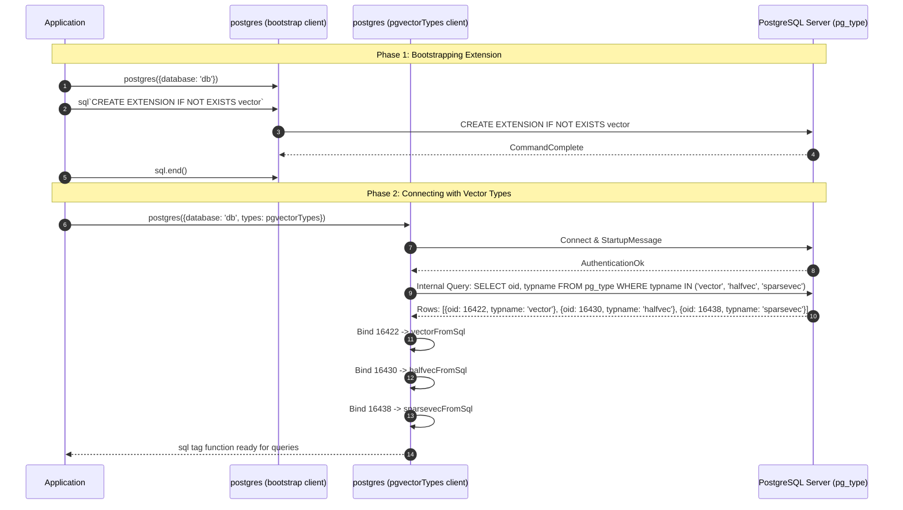
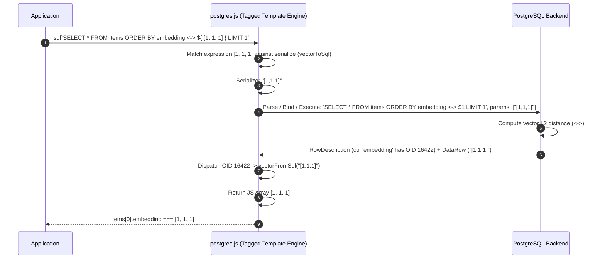

# pgvector-node: postgres.js Driver Deep Dive

> **Document Version:** 1.0.0  
> **Target Package:** `pgvector/postgres` (`pgvector-node` v0.3.1)  
> **Driver Compatibility:** `postgres` (postgres.js >= 4.0.0), `porsager/postgres`  
> **Source Files Inspected:**  
> - `pgvector-node/src/postgres/index.js`  
> - `pgvector-node/types/postgres/index.d.ts`  
> - `pgvector-node/src/utils.js`  
> - `pgvector-node/src/sparse-vector.js`  
> - `pgvector-node/tests/postgres.test.js`  

---

## Table of Contents

1. [Executive Summary](#1-executive-summary)
2. [Driver Architecture & Tagged Template Philosophy](#2-driver-architecture--tagged-template-philosophy)
   - [2.1 The postgres.js Paradigm: Tagged Template Literals as Queries](#21-the-postgresjs-paradigm-tagged-template-literals-as-queries)
   - [2.2 Connection Pooling & Socket Pipeline Architecture](#22-connection-pooling--socket-pipeline-architecture)
   - [2.3 The Type Definition Subsystem in postgres.js](#23-the-type-definition-subsystem-in-postgresjs)
3. [Custom Type Implementation (`pgvectorTypes`)](#3-custom-type-implementation-pgvectortypes)
   - [3.1 The Custom Type Specification Protocol (`to`, `from`, `serialize`, `parse`)](#31-the-custom-type-specification-protocol-to-from-serialize-parse)
   - [3.2 Type Object Breakdown (`vector`, `halfvec`, `sparsevec`)](#32-type-object-breakdown-vector-halfvec-sparsevec)
   - [3.3 OID Resolution Internals: Automatic Name-to-OID Introspection](#33-oid-resolution-internals-automatic-name-to-oid-introspection)
   - [3.4 The Extension Reconnection Requirement](#34-the-extension-reconnection-requirement)
4. [Ingestion & Serialization Pipeline](#4-ingestion--serialization-pipeline)
   - [4.1 Tagged Template Parameter Interpolation](#41-tagged-template-parameter-interpolation)
   - [4.2 Automatic Serialization: Arrays to Vector Literals](#42-automatic-serialization-arrays-to-vector-literals)
   - [4.3 Bulk Ingestion via `sql(items, ...columns)` Helper](#43-bulk-ingestion-via-sqlitems-columns-helper)
   - [4.4 Sparse Vector & Binary Vector Serialization](#44-sparse-vector--binary-vector-serialization)
5. [Egress & Deserialization Pipeline](#5-egress--deserialization-pipeline)
   - [5.1 Automatic Type Parser Triggering on Wire Egress](#51-automatic-type-parser-triggering-on-wire-egress)
   - [5.2 Transparent JS Array & SparseVector Reconstruction](#52-transparent-js-array--sparsevector-reconstruction)
   - [5.3 Superior Ergonomics vs node-postgres](#53-superior-ergonomics-vs-node-postgres)
6. [Architectural Sequence Diagrams](#6-architectural-sequence-diagrams)
   - [6.1 Handshake, Dynamic OID Discovery & Reconnection](#61-handshake-dynamic-oid-discovery--reconnection)
   - [6.2 Tagged Template Query Roundtrip](#62-tagged-template-query-roundtrip)
7. [Line-by-Line Source Code Walkthrough](#7-line-by-line-source-code-walkthrough)
   - [7.1 Dissecting `src/postgres/index.js`](#71-dissecting-srcpostgresindexjs)
   - [7.2 Type Definitions Analysis (`types/postgres/index.d.ts`)](#72-type-definitions-analysis-typespostgresindexdts)
8. [Test Suite In-Depth Analysis (`tests/postgres.test.js`)](#8-test-suite-in-depth-analysis-testspostgrestestjs)
   - [8.1 Initialization & Extension Creation Cycle](#81-initialization--extension-creation-cycle)
   - [8.2 Bulk Insert via Postgres Helper Expression](#82-bulk-insert-via-postgres-helper-expression)
   - [8.3 Vector Similarity Search via Tagged Template (`<->`)](#83-vector-similarity-search-via-tagged-template--)
   - [8.4 Result Verification & HNSW Indexing](#84-result-verification--hnsw-indexing)
9. [Deep Comparative Analysis: `postgres.js` vs `asyncpg` (Python)](#9-deep-comparative-analysis-postgresjs-vs-asyncpg-python)
   - [9.1 Architectural Philosophy: Tagged Templates vs Prepared Binary Codecs](#91-architectural-philosophy-tagged-templates-vs-prepared-binary-codecs)
   - [9.2 Serialization Mechanics: Text Formatting vs Native IEEE 754 Binary Protocol](#92-serialization-mechanics-text-formatting-vs-native-ieee-754-binary-protocol)
   - [9.3 Performance, Ergonomics & Safety Matrix](#93-performance-ergonomics--safety-matrix)
10. [Production Best Practices & Caveats](#10-production-best-practices--caveats)
    - [10.1 Managing the Connection Lifecycle with Pre-existing Extensions](#101-managing-the-connection-lifecycle-with-pre-existing-extensions)
    - [10.2 Cursor and Streaming Vector Queries](#102-cursor-and-streaming-vector-queries)
    - [10.3 High-Throughput Batch Inserts and Memory Management](#103-high-throughput-batch-inserts-and-memory-management)

---

## 1. Executive Summary

`postgres.js` (maintained by Rasmus Porsager) is widely recognized as the fastest and most ergonomically modern PostgreSQL client for Node.js, Deno, and Bun. By building natively on ES6 **tagged template literals** (``sql`SELECT ...` ``), `postgres.js` eliminates positional parameter counting (`$1, $2`), manual parameter array management, and SQL injection risks.

The `pgvector/postgres` integration provides a declarative binding mechanism for `postgres.js`:
- **Declarative Type Configuration:** Instead of requiring manual catalog querying or imperative parser attachment functions, `pgvector/postgres` exports a static `pgvectorTypes` configuration object.
- **Factory-Level Registration:** The types are registered once during connection factory creation: `postgres({ types: pgvectorTypes })`.
- **Automatic Driver-Managed OID Resolution:** `postgres.js` reads the type names (`from: ['vector']`) and queries PostgreSQL's catalog automatically during initial connection negotiation.
- **Transparent Bi-directional Serialization:** JavaScript arrays (`[1, 2, 3]`) and `SparseVector` instances are automatically serialized on ingress and deserialized on egress without requiring developers to manually call `toSql()` or `fromSql()`.

---

## 2. Driver Architecture & Tagged Template Philosophy

### 2.1 The postgres.js Paradigm: Tagged Template Literals as Queries

Traditional database drivers force a separation between SQL text and parameter values:
```javascript
// Traditional pg: Error-prone index tracking and separate array
client.query('SELECT * FROM items WHERE category = $1 AND embedding <-> $2 < $3', [cat, emb, dist]);
```

In contrast, `postgres.js` uses ES6 tagged template literals:
```javascript
// postgres.js: Inlined expressions with automatic parameter extraction
await sql`SELECT * FROM items WHERE category = ${cat} AND embedding <-> ${emb} < ${dist}`;
```

Under the hood:
1. The JavaScript runtime passes the static string fragments and dynamic expression values to the `sql` tag function.
2. `postgres.js` compiles the static string fragments into a parameterized query containing PostgreSQL `$1, $2, ...` placeholders.
3. The dynamic expressions `${cat}`, `${emb}`, and `${dist}` are placed in a bind parameters buffer.
4. Each bind parameter is matched against custom serializers defined in the connection options.

### 2.2 Connection Pooling & Socket Pipeline Architecture

`postgres.js` is built from the ground up without legacy `libpq` dependencies:
- **Pipelining by Default:** Utilizes PostgreSQL protocol pipelining to send multiple commands over the wire without waiting for previous responses, eliminating network round-trip overhead.
- **Zero-Dependency Core:** Implements the PostgreSQL frontend/backend protocol in clean, modern V8 JavaScript.
- **Unified Client and Pool:** In `postgres.js`, the `sql` function is itself a connection pool. There is no distinction between a "Client" and a "Pool" object.

### 2.3 The Type Definition Subsystem in postgres.js

`postgres.js` exposes an advanced custom type system configured via the `types` option. Each entry in `types` specifies how a particular PostgreSQL data type should be serialized when sent to the server, and how it should be deserialized when received.

---

## 3. Custom Type Implementation (`pgvectorTypes`)

The complete implementation of `pgvector/postgres` in `src/postgres/index.js` consists of the `pgvectorTypes` dictionary.

### 3.1 The Custom Type Specification Protocol (`to`, `from`, `serialize`, `parse`)

A custom type in `postgres.js` is defined by four core properties:
- `to`: The type OID or type name used by `postgres.js` when sending typed parameters to PostgreSQL.
- `from`: An array of type OIDs or type names that this parser handles when reading columns from PostgreSQL result rows.
- `serialize`: A function `(value: any) => string` that converts JavaScript values into their PostgreSQL wire representation.
- `parse`: A function `(raw: string) => any` that converts PostgreSQL wire text into JavaScript objects.

### 3.2 Type Object Breakdown (`vector`, `halfvec`, `sparsevec`)

In `src/postgres/index.js`:

```javascript
import { 
  vectorFromSql, vectorToSql, 
  halfvecFromSql, halfvecToSql, 
  sparsevecFromSql, sparsevecToSql 
} from '../utils.js';

export const pgvectorTypes = {
  vector: {
    to: 'vector',
    from: ['vector'],
    serialize: vectorToSql,
    parse: vectorFromSql
  },
  halfvec: {
    to: 'halfvec',
    from: ['halfvec'],
    serialize: halfvecToSql,
    parse: halfvecFromSql
  },
  sparsevec: {
    to: 'sparsevec',
    from: ['sparsevec'],
    serialize: sparsevecToSql,
    parse: sparsevecFromSql
  }
};
```

#### Detailed Breakdown of Entries
1. **`vector`:**
   - `to: 'vector'`: Identifies the PostgreSQL type name.
   - `from: ['vector']`: Instructs `postgres.js` to route all result columns whose type resolves to `'vector'` through `vectorFromSql`.
   - `serialize: vectorToSql`: Maps JavaScript `number[]` to `"[1,2,3]"`.
   - `parse: vectorFromSql`: Maps `"[1,2,3]"` back to JavaScript `number[]`.
2. **`halfvec`:**
   - Same structural interface as `vector`, mapping 16-bit half-precision float vectors to/from JavaScript floating point arrays.
3. **`sparsevec`:**
   - `serialize: sparsevecToSql`: Converts `SparseVector` instances to `"{1:1,2:2}/3"`.
   - `parse: sparsevecFromSql`: Parses PostgreSQL coordinate strings into `SparseVector` instances.

### 3.3 OID Resolution Internals: Automatic Name-to-OID Introspection

Unlike `node-postgres`, which requires the application or library to execute an explicit SQL query (`SELECT typname, oid FROM pg_type...`), `postgres.js` **natively automates OID resolution**:

1. During connection establishment, `postgres.js` inspects all keys in the `options.types` object.
2. If any `from` entry is a string (e.g., `'vector'`) rather than an integer OID, `postgres.js` generates and executes an internal catalog lookup query against `pg_type`.
3. It maps the returned numeric OIDs directly to the configured `parse` functions in its internal type dispatch table.

### 3.4 The Extension Reconnection Requirement

Because `postgres.js` performs OID resolution during the initial connection handshake, a critical timing rule applies when bootstrapping new databases:

```javascript
// Step 1: Connect without types to create the extension
let sql = postgres({database: 'pgvector_node_test'});
await sql`CREATE EXTENSION IF NOT EXISTS vector`;
await sql.end();

// Step 2: Reconnect with pgvectorTypes enabled
sql = postgres({database: 'pgvector_node_test', types: pgvectorTypes});
```

#### Why Reconnection is Mandatory
If `postgres({ types: pgvectorTypes })` is initialized **before** `CREATE EXTENSION IF NOT EXISTS vector` runs:
1. `postgres.js` queries `pg_type` during connection startup.
2. Because the extension is not yet installed, `pg_type` does not contain the type name `'vector'`.
3. `postgres.js` logs a notice or fails to resolve the OID, skipping registration for the custom type.
4. Subsequent vector queries will return unparsed strings rather than JavaScript arrays.
5. Closing the initial bootstrap client (`await sql.end()`) and creating a new instance ensures `postgres.js` introspects `pg_type` *after* the extension catalog entries exist.

---

## 4. Ingestion & Serialization Pipeline

### 4.1 Tagged Template Parameter Interpolation

When passing a vector parameter into a query in `postgres.js`:

```javascript
const embedding = [1, 2, 3];
const results = await sql`
  SELECT * FROM postgres_items 
  ORDER BY embedding <-> ${ embedding } 
  LIMIT 5
`;
```

1. The expression `${ embedding }` is identified by `postgres.js`.
2. Because `types: pgvectorTypes` is registered, when `embedding` is serialized into the PostgreSQL protocol buffer, `postgres.js` checks the registered type serializers.
3. If the column or operator expects a `vector`, `vectorToSql(embedding)` formats the array into `"[1,2,3]"`.

### 4.2 Automatic Serialization: Arrays to Vector Literals

In `node-postgres`, developers must write:
```javascript
// node-postgres requires manual serialization:
[pgvector.toSql([1, 1, 1])]
```

In `postgres.js`, thanks to `serialize: vectorToSql`, developers can pass pure JavaScript data structures:
```javascript
// postgres.js: Natural JavaScript arrays
const newItems = [
  { embedding: [1, 1, 1], half_embedding: [1, 1, 1], binary_embedding: '000', sparse_embedding: new SparseVector([1, 1, 1]) },
  { embedding: [2, 2, 2], half_embedding: [2, 2, 2], binary_embedding: '101', sparse_embedding: new SparseVector([2, 2, 2]) }
];
```

### 4.3 Bulk Ingestion via `sql(items, ...columns)` Helper

`postgres.js` includes a powerful helper for generating multi-row `INSERT` statements:

```javascript
await sql`
  INSERT INTO postgres_items ${ 
    sql(newItems, 'embedding', 'half_embedding', 'binary_embedding', 'sparse_embedding') 
  }
`;
```

#### How the Helper Works with pgvector
1. The helper `sql(newItems, 'col1', 'col2', ...)` iterates through each object in `newItems`.
2. It generates the SQL column clause `("embedding", "half_embedding", "binary_embedding", "sparse_embedding") VALUES (...)`.
3. For each property:
   - `embedding`: calls `vectorToSql([1, 1, 1])` -> `"[1,1,1]"`.
   - `half_embedding`: calls `halfvecToSql([1, 1, 1])` -> `"[1,1,1]"`.
   - `binary_embedding`: leaves `'000'` as a bit string literal.
   - `sparse_embedding`: calls `sparsevecToSql(sparseVec)` -> `"{1:1,2:1,3:1}/3"`.
4. The entire multi-row batch is emitted as a single efficient parameterized `INSERT` statement.

### 4.4 Sparse Vector & Binary Vector Serialization

- **`SparseVector`:** Passing a `SparseVector` instance into `${ sparseVec }` triggers `sparsevecToSql`, which invokes `sparseVec.toPostgres()`, generating the required coordinate format `'{1:1.0,2:2.0}/3'`.
- **Binary Vectors:** Native PostgreSQL `bit` columns are passed directly as bit strings (`'000'`, `'101'`).

---

## 5. Egress & Deserialization Pipeline

### 5.1 Automatic Type Parser Triggering on Wire Egress

When PostgreSQL responds to a query:
1. PostgreSQL emits a `RowDescription` packet containing the column names and their type OIDs.
2. `postgres.js` compares each column's OID against its internal parser map.
3. If the OID matches the OID resolved for `vector`, it calls `vectorFromSql(rawString)`.
4. If it matches `halfvec`, it calls `halfvecFromSql(rawString)`.
5. If it matches `sparsevec`, it calls `sparsevecFromSql(rawString)`.

### 5.2 Transparent JS Array & SparseVector Reconstruction

When the query resolves:
```javascript
const items = await sql`SELECT * FROM postgres_items LIMIT 1`;
```
- `items[0].embedding` is an authentic JavaScript array of numbers: `[1, 1, 1]`.
- `items[0].half_embedding` is `[1, 1, 1]`.
- `items[0].binary_embedding` is `'000'`.
- `items[0].sparse_embedding` is an instance of `SparseVector` with `.toArray()` returning `[1, 1, 1]`.

### 5.3 Superior Ergonomics vs node-postgres

| Aspect | `node-postgres` (`pg`) | `postgres.js` (`postgres`) |
|---|---|---|
| **Query Syntax** | `client.query('... $1', [pgvector.toSql(v)])` | ``sql`... ${v}``` |
| **Type Setup** | Imperative `await pgvector.registerTypes(client)` | Declarative `postgres({ types: pgvectorTypes })` |
| **Ingress Serialization** | Explicit manual call to `pgvector.toSql()` | Automatic via `serialize` configuration |
| **Multi-Row Insert** | Manual string templating and flat parameter arrays | Native `sql(array, ...keys)` helper |
| **Connection Pooling** | Separate `pg.Pool` class requiring `onConnect` | Built-in pool in the `sql` tagged function |

---

## 6. Architectural Sequence Diagrams

### 6.1 Handshake, Dynamic OID Discovery & Reconnection



### 6.2 Tagged Template Query Roundtrip



---

## 7. Line-by-Line Source Code Walkthrough

### 7.1 Dissecting `src/postgres/index.js`

Below is the complete source code of `src/postgres/index.js`:

```javascript
// Line 1: Import type conversion utility functions
import { 
  vectorFromSql, vectorToSql, 
  halfvecFromSql, halfvecToSql, 
  sparsevecFromSql, sparsevecToSql 
} from '../utils.js';

// Line 3: Export static type configuration dictionary
export const pgvectorTypes = {
  // Line 4-9: 32-bit floating point dense vector definition
  vector: {
    to: 'vector',         // Target type identifier for parameters
    from: ['vector'],     // Source type name for result column matching
    serialize: vectorToSql, // Formats JS number[] into "[1,2,3]"
    parse: vectorFromSql  // Parses "[1,2,3]" into JS number[]
  },
  // Line 10-15: 16-bit half-precision float vector definition
  halfvec: {
    to: 'halfvec',        // Target type identifier
    from: ['halfvec'],    // Source type name
    serialize: halfvecToSql, // Formats JS number[] into "[1,2,3]"
    parse: halfvecFromSql // Parses "[1,2,3]" into JS number[]
  },
  // Line 16-21: Sparse vector definition
  sparsevec: {
    to: 'sparsevec',      // Target type identifier
    from: ['sparsevec'],  // Source type name
    serialize: sparsevecToSql, // Formats SparseVector into "{1:1,...}/d"
    parse: sparsevecFromSql    // Parses "{1:1,...}/d" into SparseVector
  }
};
```

### 7.2 Type Definitions Analysis (`types/postgres/index.d.ts`)

```typescript
import { vectorFromSql, vectorToSql, sparsevecFromSql, sparsevecToSql } from '../utils.js';

export declare const pgvectorTypes: {
    vector: {
        to: string;
        from: string[];
        serialize: typeof vectorToSql;
        parse: typeof vectorFromSql;
    };
    halfvec: {
        to: string;
        from: string[];
        serialize: typeof vectorToSql;
        parse: typeof vectorFromSql;
    };
    sparsevec: {
        to: string;
        from: string[];
        serialize: typeof sparsevecToSql;
        parse: typeof sparsevecFromSql;
    };
};
```

#### TypeScript Typing Details
- Strongly types each of the three vector definitions.
- Guarantees compatibility with the `postgres.Options<{ ... }>` type definition in `@types/postgres` or `postgres/types`.

---

## 8. Test Suite In-Depth Analysis (`tests/postgres.test.js`)

The test suite in `tests/postgres.test.js` demonstrates the complete setup, bulk insertion, query execution, and indexing with `postgres.js`:

### 8.1 Initialization & Extension Creation Cycle

Lines 8–13 demonstrate the two-phase connection pattern required when creating extensions programmatically:

```javascript
test('postgres example', async () => {
  let sql = postgres({database: 'pgvector_node_test', onnotice: function () { }});
  await sql`CREATE EXTENSION IF NOT EXISTS vector`;
  await sql.end();

  // need to reconnect after the extension has been created
  sql = postgres({database: 'pgvector_node_test', types: pgvectorTypes, onnotice: function () { }});
```

- Initial `sql` instance connects without `types` to execute `CREATE EXTENSION IF NOT EXISTS vector`.
- `await sql.end()` cleanly closes the bootstrap connection pool.
- Second `sql` instance is created with `types: pgvectorTypes`, triggering the driver's internal catalog query to bind the vector OIDs.

### 8.2 Bulk Insert via Postgres Helper Expression

Lines 18–23 demonstrate multi-row insertion:

```javascript
  await sql`DROP TABLE IF EXISTS postgres_items`;
  await sql`CREATE TABLE postgres_items (
    id serial PRIMARY KEY, 
    embedding vector(3), 
    half_embedding halfvec(3), 
    binary_embedding bit(3), 
    sparse_embedding sparsevec(3)
  )`;

  const newItems = [
    {embedding: [1, 1, 1], half_embedding: [1, 1, 1], binary_embedding: '000', sparse_embedding: new SparseVector([1, 1, 1])},
    {embedding: [2, 2, 2], half_embedding: [2, 2, 2], binary_embedding: '101', sparse_embedding: new SparseVector([2, 2, 2])},
    {embedding: [1, 1, 2], half_embedding: [1, 1, 2], binary_embedding: '111', sparse_embedding: new SparseVector([1, 1, 2])}
  ];
  await sql`INSERT INTO postgres_items ${ 
    sql(newItems, 'embedding', 'half_embedding', 'binary_embedding', 'sparse_embedding') 
  }`;
```

Notice that `newItems` contains raw JavaScript arrays `[1, 1, 1]` for both `embedding` and `half_embedding`. No manual `pgvector.toSql(...)` is necessary.

### 8.3 Vector Similarity Search via Tagged Template (`<->`)

Lines 25–27 perform the similarity search:

```javascript
  const embedding = [1, 1, 1];
  const items = await sql`
    SELECT * FROM postgres_items 
    ORDER BY embedding <-> ${ embedding } 
    LIMIT 5
  `;
```

- `${ embedding }` is interpolated directly into the `<->` expression.
- `ORDER BY embedding <-> $1` calculates Euclidean distances:
  - Row 1 `[1, 1, 1]` -> distance 0.0.
  - Row 3 `[1, 1, 2]` -> distance 1.0.
  - Row 2 `[2, 2, 2]` -> distance $\sqrt{3} \approx 1.732$.
- The query results are sorted as `[1, 3, 2]`.

### 8.4 Result Verification & HNSW Indexing

Lines 27–35 assert the deserialized output types:

```javascript
  assert.deepEqual(items.map(v => v.id), [1, 3, 2]);
  assert.deepEqual(items[0].embedding, [1, 1, 1]);
  assert.deepEqual(items[0].half_embedding, [1, 1, 1]);
  assert.equal(items[0].binary_embedding, '000');
  assert.deepEqual(items[0].sparse_embedding.toArray(), [1, 1, 1]);

  await sql`CREATE INDEX ON postgres_items USING hnsw (embedding vector_l2_ops)`;
  await sql.end();
```

- Confirms that `items[0].embedding` and `items[0].half_embedding` are real JavaScript `number[]` arrays.
- Confirms that `items[0].sparse_embedding` is an instance of `SparseVector` whose `.toArray()` method yields `[1, 1, 1]`.
- Creates an HNSW index with `vector_l2_ops` operator class.
- Cleans up with `await sql.end()`.

---

## 9. Deep Comparative Analysis: `postgres.js` vs `asyncpg` (Python)

`postgres.js` in Node.js and `asyncpg` in Python occupy similar philosophical niches: both are pure, non-`libpq`, asynchronous, high-performance PostgreSQL drivers designed for modern runtimes. However, their internal approaches to custom data types differ substantially.

### 9.1 Architectural Philosophy: Tagged Templates vs Prepared Binary Codecs

- **`postgres.js` (JavaScript):**
  - Uses ES6 tagged template literals to seamlessly unite SQL query text and parameters.
  - Custom types are declared statically at client instantiation.
  - OID lookup is handled implicitly by the driver during startup.
  - Deserialization operates primarily over PostgreSQL's **text protocol**, converting ASCII string representations into JavaScript objects.
- **`asyncpg` (Python):**
  - Uses standard parameterized queries with positional `$1, $2` syntax.
  - Codecs are registered via an explicit asynchronous call: `await conn.set_type_codec(...)`.
  - Operates almost exclusively over PostgreSQL's **binary wire protocol** (`format='binary'`), passing raw byte buffers between PostgreSQL and Python.

### 9.2 Serialization Mechanics: Text Formatting vs Native IEEE 754 Binary Protocol

#### `postgres.js` Wire Serialization
```
[1.5, 2.5] (JS Array)
  ──(JSON.stringify)──> "[1.5,2.5]" (ASCII Text)
  ──(TCP Socket)──────> PostgreSQL (vector_in parses ASCII text)
```
- Pros: Simple, highly resilient, zero binary byte-packing complexity.
- Cons: Extra CPU overhead in JSON/ASCII formatting and parsing floating-point numbers on both client and server.

#### `asyncpg` Wire Serialization
```
[1.5, 2.5] (Python list / NumPy float32)
  ──(struct.pack)─────> [0x00, 0x02, 0x00, 0x00, 0x3F, 0xC0, 0x00, 0x00, 0x40, 0x20, 0x00, 0x00] (Raw Bytes)
  ──(TCP Socket)──────> PostgreSQL (vector_recv reads raw IEEE 754 bytes directly)
```
- Pros: Maximum possible throughput; no ASCII conversion overhead; direct memory mapping to NumPy float buffers.
- Cons: Requires strict binary protocol compatibility and endianness handling.

### 9.3 Performance, Ergonomics & Safety Matrix

| Evaluation Criteria | `postgres.js` (`pgvector/postgres`) | `asyncpg` (`pgvector.asyncpg`) |
|---|---|---|
| **Language Runtime** | Node.js / Bun / Deno (V8 Engine) | Python (Asyncio / Cython) |
| **Query Ergonomics** | Tagged template literals (``sql`...` ``) | Positional parameters (`conn.fetch('... $1', v)`) |
| **SQL Injection Safety** | Structural guarantee via tagged templates | Parameter binding via Extended Protocol |
| **Type Registration Method** | Static options object (`types: pgvectorTypes`) | Dynamic async call (`conn.set_type_codec(...)`) |
| **Catalog Introspection** | Automatic by driver on startup | Automatic by driver via type name |
| **Wire Protocol Format** | Text protocol | Binary protocol |
| **Ingress Parameter Mapping** | Transparent via `serialize: vectorToSql` | Transparent via lambda / `Vector.to_binary` |
| **Egress Return Type** | JavaScript `number[]` / `SparseVector` | Python `Vector` / `HalfVector` / `SparseVector` |
| **NumPy Direct Memory Support** | ❌ None (Standard JS arrays) | ✅ Zero-copy / NumPy ndarray bindings |
| **Reconnection Requirement** | Yes (if extension is created at runtime) | No (can call `set_type_codec` anytime) |

---

## 10. Production Best Practices & Caveats

### 10.1 Managing the Connection Lifecycle with Pre-existing Extensions

In production deployments, the PostgreSQL database should already have `CREATE EXTENSION vector` executed during migration scripts before the application boots:
```javascript
import postgres from 'postgres';
import { pgvectorTypes } from 'pgvector/postgres';

// Single production client instance: extension already exists in DB
export const sql = postgres(process.env.DATABASE_URL, {
  types: pgvectorTypes,
  max: 25,
  idle_timeout: 20,
  connect_timeout: 10
});
```
When the extension is pre-installed, no reconnection cycle is needed; `postgres.js` successfully discovers all vector OIDs on its initial connection.

### 10.2 Cursor and Streaming Vector Queries

When iterating over hundreds of thousands of vectors (e.g., during background clustering or export jobs), loading all rows into memory causes high V8 heap consumption. `postgres.js` provides cursor streaming:

```javascript
// Stream 1,000 vectors at a time
const cursor = sql`
  SELECT id, embedding FROM large_vector_dataset
`.cursor(1000);

for await (const rows of cursor) {
  for (const row of rows) {
    // row.embedding is automatically parsed into a number[]
    processVector(row.id, row.embedding);
  }
}
```

### 10.3 High-Throughput Batch Inserts and Memory Management

For bulk embedding ingestion, combine `postgres.js`'s bulk helper with chunking:

```javascript
const BATCH_SIZE = 500;

for (let i = 0; i < records.length; i += BATCH_SIZE) {
  const batch = records.slice(i, i + BATCH_SIZE);
  await sql`
    INSERT INTO documents ${ sql(batch, 'title', 'embedding') }
  `;
}
```
Batching 500 to 1,000 items per `INSERT` maximizes PostgreSQL transaction throughput while keeping JavaScript memory footprints minimal.
