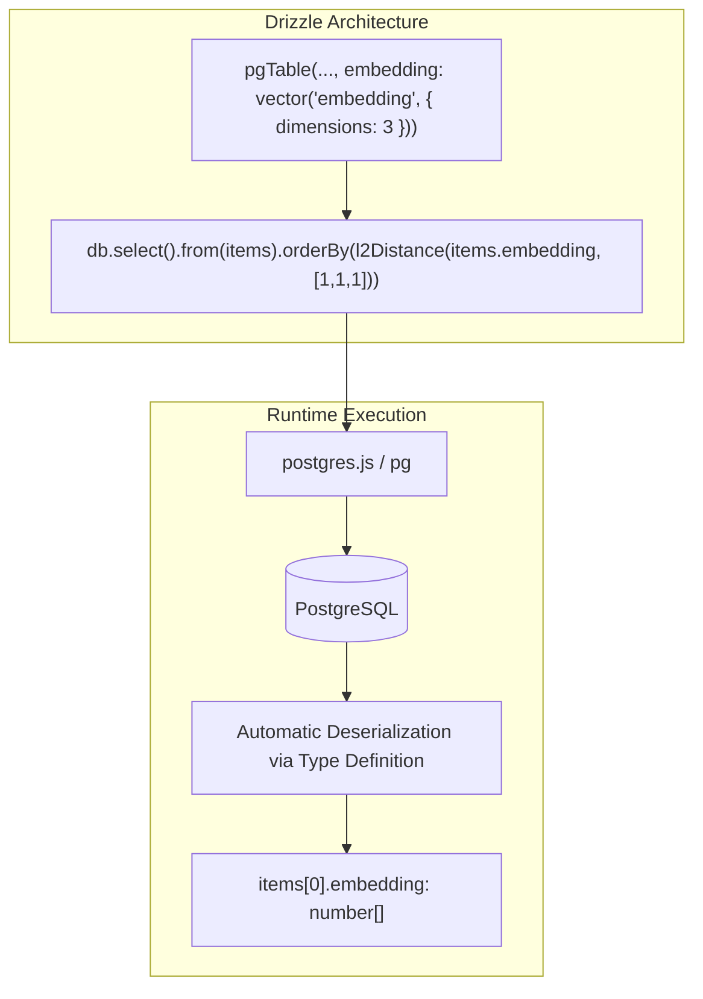
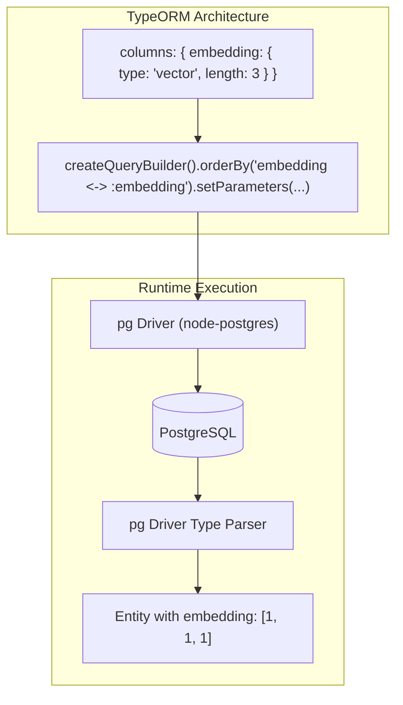

# pgvector-node: Prisma, Drizzle ORM, and TypeORM Integration Architecture

## Table of Contents
- [1. Executive Summary](#1-executive-summary)
- [2. Prisma Integration Deep Dive](#2-prisma-integration-deep-dive)
  - [2.1 Schema Definition & The `Unsupported` Type Trap](#21-schema-definition--the-unsupported-type-trap)
  - [2.2 Configuration & Database Migration Setup](#22-configuration--database-migration-setup)
  - [2.3 Client Generation & Type Erasure Mechanics](#23-client-generation--type-erasure-mechanics)
  - [2.4 Data Manipulation via `$executeRaw` and `$queryRaw`](#24-data-manipulation-via-executeraw-and-queryraw)
  - [2.5 Bit Vectors: The Exception to the Rule](#25-bit-vectors-the-exception-to-the-rule)
  - [2.6 Test Dissection: `tests/prisma.test.js`](#26-test-dissection-testsprismatestjs)
- [3. Drizzle ORM Integration Deep Dive](#3-drizzle-orm-integration-deep-dive)
  - [3.1 Native pg-core Type Ecosystem](#31-native-pg-core-type-ecosystem)
  - [3.2 Custom Vector Types via `customType` Helper](#32-custom-vector-types-via-customtype-helper)
  - [3.3 Built-in Distance Functions & SQL Template Engine](#33-built-in-distance-functions--sql-template-engine)
  - [3.4 Execution Pipeline & Query Construction](#34-execution-pipeline--query-construction)
  - [3.5 Test Dissection: `tests/drizzle-orm.test.js`](#35-test-dissection-testsdrizzle-ormtestjs)
- [4. TypeORM Integration Deep Dive](#4-typeorm-integration-deep-dive)
  - [4.1 Column Definitions (`'vector'`, `'halfvec'`, `'bit'`)](#41-column-definitions-vector-halfvec-bit)
  - [4.2 Custom Type Limitations & The Sparse Vector Problem (Issue #10056)](#42-custom-type-limitations--the-sparse-vector-problem-issue-10056)
  - [4.3 Entity Schema vs Decorator Mapping](#43-entity-schema-vs-decorator-mapping)
  - [4.4 QueryBuilder Integration with Distance Parameters](#44-querybuilder-integration-with-distance-parameters)
  - [4.5 Test Dissection: `tests/typeorm.test.js`](#45-test-dissection-teststypeormtestjs)
- [5. Architectural Diagrams & Query Lifecycles](#5-architectural-diagrams--query-lifecycles)
  - [5.1 Prisma Raw Query vs Client Pipeline](#51-prisma-raw-query-vs-client-pipeline)
  - [5.2 Drizzle ORM Type-Safe Execution Pipeline](#52-drizzle-orm-type-safe-execution-pipeline)
  - [5.3 TypeORM QueryBuilder Execution Pipeline](#53-typeorm-querybuilder-execution-pipeline)
- [6. Comprehensive 10-Point Cross-ORM Comparison Matrix](#6-comprehensive-10-point-cross-orm-comparison-matrix)
- [7. Production Guidance & Architectural Recommendations](#7-production-guidance--architectural-recommendations)

---

## 1. Executive Summary

Node.js and TypeScript ORMs adopt divergent philosophies toward database extensions and vector data types:

1. **Prisma**: Operates with a closed, statically-checked schema specification language (PSL). Because vectors are not native PSL primitives, Prisma models them as `Unsupported("vector(n)")`, stripping them from the generated client model and requiring `$queryRaw` and `$executeRaw` for all vector writes and similarity searches.
2. **Drizzle ORM**: Features first-class native support for `pgvector` inside `drizzle-orm/pg-core` (`vector`, `halfvec`, `sparsevec`, `bit`) alongside built-in SQL operator functions (`l2Distance`, `cosineDistance`, etc.), offering complete compile-time type safety and query builder ergonomics.
3. **TypeORM**: Supports string-based column types (`type: 'vector'`) leveraging underlying PostgreSQL drivers (`pg`), but lacks custom type extensibility for types like `sparsevec`, requiring fallback to `type: String` and raw QueryBuilder SQL expressions (`.orderBy('embedding <-> :embedding')`).

---

## 2. Prisma Integration Deep Dive

### 2.1 Schema Definition & The `Unsupported` Type Trap

Prisma enforces a proprietary modeling language (`schema.prisma`). In `prisma/schema.prisma`:

```prisma
generator client {
  provider        = "prisma-client"
  output          = "./generated"
  generatedFileExtension = "mts"
  importFileExtension = "mts"
  previewFeatures = ["postgresqlExtensions"]
}

datasource db {
  provider   = "postgresql"
  extensions = [vector]
}

model Item {
  id               Int                       @id @default(autoincrement())
  embedding        Unsupported("vector(3)")?
  half_embedding   Unsupported("halfvec(3)")?
  binary_embedding String?                   @db.Bit(3)
  sparse_embedding Unsupported("sparsevec(3)")?

  @@map("prisma_items")
}
```

Key observations:
- **`postgresqlExtensions` preview feature**: Allows declaring `extensions = [vector]` in the `datasource` block, instructing Prisma Migrate to recognize the PostgreSQL extension.
- **The `Unsupported(...)` wrapper**: Tells Prisma that the column exists in PostgreSQL DDL, but Prisma's type engine cannot generate TypeScript types or CRUD operations for it.

### 2.2 Configuration & Database Migration Setup

In `prisma.config.js`:
```javascript
import { defineConfig, env } from 'prisma/config';

export default defineConfig({
  schema: 'prisma/schema.prisma',
  migrations: {
    path: 'prisma/migrations',
  },
  datasource: {
    url: 'postgresql://runner@localhost/pgvector_node_test',
  },
});
```

Because Prisma Migrate cannot introspect or manage complex properties of `Unsupported` types automatically, the initial migration `prisma/migrations/0_init/migration.sql` must explicitly define the tables:

```sql
-- CreateExtension
CREATE EXTENSION IF NOT EXISTS "vector";

-- CreateTable
CREATE TABLE "prisma_items" (
    "id" SERIAL NOT NULL,
    "embedding" vector(3),
    "half_embedding" halfvec(3),
    "binary_embedding" BIT(3),
    "sparse_embedding" sparsevec(3),

    CONSTRAINT "prisma_items_pkey" PRIMARY KEY ("id")
);
```

### 2.3 Client Generation & Type Erasure Mechanics

When `prisma generate` runs:
1. `id` is typed as `number`.
2. `binary_embedding` is typed as `string | null` (mapped via `@db.Bit(3)`).
3. `embedding`, `half_embedding`, and `sparse_embedding` are **completely omitted** from:
   - `Item` entity interface
   - `ItemCreateInput`
   - `ItemUpdateInput`
   - `ItemWhereInput`

Attempting to run:
```typescript
// Compilation Error: Object literal may only specify known properties,
// and 'embedding' does not exist in type 'ItemCreateInput'.
await prisma.item.create({
  data: { embedding: [1, 1, 1] }
});
```
results in immediate TypeScript compilation failure.

### 2.4 Data Manipulation via `$executeRaw` and `$queryRaw`

Because standard client methods cannot reference unsupported columns, writes must use `$executeRaw` and queries must use `$queryRaw`:

#### Inserting Vectors
```typescript
const embedding1 = pgvector.toSql([1, 1, 1]);
const embedding2 = pgvector.toSql([2, 2, 2]);
const embedding3 = pgvector.toSql([1, 1, 2]);

await prisma.$executeRaw`
  INSERT INTO prisma_items (embedding) 
  VALUES (${embedding1}::vector), (${embedding2}::vector), (${embedding3}::vector)
`;
```
Notice the explicit PostgreSQL cast `${embedding1}::vector`. Without `::vector`, PostgreSQL cannot infer the parameter type from a generic string parameter.

#### Performing Distance Queries
```typescript
const embedding = pgvector.toSql([1, 1, 1]);

/** @type {(Item & {embedding: string})[]} */
const items = await prisma.$queryRaw`
  SELECT id, embedding::text 
  FROM prisma_items 
  ORDER BY embedding <-> ${embedding}::vector 
  LIMIT 5
`;

// Manual deserialization using pgvector
const vectorResult = pgvector.fromSql(items[0].embedding); // returns [1, 1, 1]
```
Notice:
1. `embedding::text` is required in the `SELECT` clause to prevent driver deserialization errors.
2. The distance operator `<->` sorts by L2 distance against `${embedding}::vector`.
3. Results must be manually parsed using `pgvector.fromSql()`.

### 2.5 Bit Vectors: The Exception to the Rule

Unlike `vector`, `halfvec`, and `sparsevec`, PostgreSQL's `BIT(n)` type is recognized by Prisma via `@db.Bit(3)`.

This enables high-level CRUD for insertions:
```typescript
await prisma.item.createMany({
  data: [
    { binary_embedding: '000' },
    { binary_embedding: '101' },
    { binary_embedding: '111' }
  ]
});
```
However, distance-based ordering still cannot use Prisma's `orderBy` API (which only supports `asc` and `desc` on columns), requiring raw SQL:
```typescript
const embedding = '101';
const items = await prisma.$queryRaw`
  SELECT id, binary_embedding::text 
  FROM prisma_items 
  ORDER BY binary_embedding <~> ${embedding}::varbit 
  LIMIT 5
`;
```

### 2.6 Test Dissection: `tests/prisma.test.js`

The test file `tests/prisma.test.js` exercises all four types with Prisma Client and `@prisma/adapter-pg`:

- **Dense Vectors (`vector`)**: Inserts `[1, 1, 1]`, `[2, 2, 2]`, `[1, 1, 2]`. Queries with `<->`, asserting IDs `[1, 3, 2]` and verifying `pgvector.fromSql(items[0].embedding)` equals `[1, 1, 1]`.
- **Half-precision Vectors (`halfvec`)**: Inserts half-precision floats using `${pgvector.toSql(...)}::halfvec`. Queries using `ORDER BY half_embedding <-> ${embedding}::halfvec`.
- **Binary Bit Vectors (`bit`)**: Creates records via `prisma.item.createMany()`. Queries with Hamming distance operator `<~>` and `${embedding}::varbit` cast.
- **Sparse Vectors (`sparsevec`)**: Inserts `new SparseVector([1, 1, 1])` using `${pgvector.toSql(...)}::sparsevec`. Queries using `<->` and deserializes with `pgvector.fromSql()`.

---

## 3. Drizzle ORM Integration Deep Dive

### 3.1 Native pg-core Type Ecosystem

Unlike Prisma, Drizzle ORM embraces PostgreSQL-specific extensions directly within `drizzle-orm/pg-core`:

```typescript
import { pgTable, serial, vector, halfvec, bit, sparsevec } from 'drizzle-orm/pg-core';

export const items = pgTable('drizzle_items', {
  id: serial('id').primaryKey(),
  embedding: vector('embedding', { dimensions: 3 }),
  halfEmbedding: halfvec('half_embedding', { dimensions: 3 }),
  binaryEmbedding: bit('binary_embedding', { dimensions: 3 }),
  sparseEmbedding: sparsevec('sparse_embedding', { dimensions: 3 })
});
```

Every column is strongly typed:
- `embedding` accepts `number[]`
- `halfEmbedding` accepts `number[]`
- `binaryEmbedding` accepts `string`
- `sparseEmbedding` accepts `string` (formatted as sparse vector string)

### 3.2 Custom Vector Types via `customType` Helper

Before Drizzle introduced built-in `vector` types, developers implemented vector support via Drizzle's `customType` helper:

```typescript
import { customType } from 'drizzle-orm/pg-core';
import pgvector from 'pgvector';

export const customVector = customType<{
  data: number[];
  driverData: string;
  config: { dimensions?: number };
}>({
  dataType(config) {
    return config?.dimensions ? `vector(${config.dimensions})` : 'vector';
  },
  toDriver(value: number[]): string {
    return pgvector.toSql(value)!;
  },
  fromDriver(value: string): number[] {
    return pgvector.fromSql(value) as number[];
  }
});
```

This pattern illustrates how Drizzle delegates serialization (`toDriver`) and deserialization (`fromDriver`) to `pgvector`, which is the exact mechanism standard `drizzle-orm/pg-core` utilizes internally.

### 3.3 Built-in Distance Functions & SQL Template Engine

Drizzle provides native vector distance functions exported directly from `drizzle-orm`:

```typescript
import {
  l2Distance,
  innerProduct,
  cosineDistance,
  l1Distance,
  hammingDistance,
  jaccardDistance
} from 'drizzle-orm';
```

These functions accept a Drizzle column reference and a query vector (array, string, or SQL expression). Alternatively, Drizzle's `sql` tagged template literal allows constructing arbitrary operator queries:

```typescript
import { sql } from 'drizzle-orm';
import pgvector from 'pgvector';

// Using built-in helper
db.select().from(items).orderBy(l2Distance(items.embedding, [1, 1, 1]));

// Using raw SQL template tag
db.select().from(items).orderBy(sql`${items.embedding} <-> ${pgvector.toSql([1, 1, 1])}`);
```

### 3.4 Execution Pipeline & Query Construction

Drizzle builds a unified AST that integrates seamlessly with PostgreSQL drivers (`postgres.js`, `node-postgres`, or `@neondatabase/serverless`):

```javascript
const newItems = [
  {
    embedding: [1, 1, 1],
    halfEmbedding: [1, 1, 1],
    binaryEmbedding: '000',
    sparseEmbedding: (new SparseVector([1, 1, 1])).toString()
  },
  {
    embedding: [2, 2, 2],
    halfEmbedding: [2, 2, 2],
    binaryEmbedding: '101',
    sparseEmbedding: (new SparseVector([2, 2, 2])).toString()
  },
  {
    embedding: [1, 1, 2],
    halfEmbedding: [1, 1, 2],
    binaryEmbedding: '111',
    sparseEmbedding: (new SparseVector([1, 1, 2])).toString()
  },
  { embedding: null }
];

await db.insert(items).values(newItems);
```

### 3.5 Test Dissection: `tests/drizzle-orm.test.js`

The test suite in `tests/drizzle-orm.test.js` executes with `postgres.js`:

```javascript
// L2 distance on vector
let allItems = await db.select()
  .from(items)
  .orderBy(l2Distance(items.embedding, [1, 1, 1]))
  .limit(5);
assert.deepEqual(allItems.map(v => v.id), [1, 3, 2, 4]);
assert.deepEqual(allItems[0].embedding, [1, 1, 1]);

// L2 distance on halfvec
allItems = await db.select()
  .from(items)
  .orderBy(l2Distance(items.halfEmbedding, [1, 1, 1]))
  .limit(5);
assert.deepEqual(allItems.map(v => v.id), [1, 3, 2, 4]);

// L2 distance on sparsevec
allItems = await db.select()
  .from(items)
  .orderBy(l2Distance(items.sparseEmbedding, (new SparseVector([1, 1, 1])).toString()))
  .limit(5);
assert.deepEqual(allItems.map(v => v.id), [1, 3, 2, 4]);

// Max inner product
allItems = await db.select()
  .from(items)
  .orderBy(innerProduct(items.embedding, [1, 1, 1]))
  .limit(5);
assert.deepEqual(allItems.map(v => v.id), [2, 3, 1, 4]);

// Cosine distance
allItems = await db.select()
  .from(items)
  .orderBy(cosineDistance(items.embedding, [1, 1, 1]))
  .limit(5);
assert.deepEqual(allItems.map(v => v.id).slice(2), [3, 4]);

// L1 distance
allItems = await db.select()
  .from(items)
  .orderBy(l1Distance(items.embedding, [1, 1, 1]))
  .limit(5);
assert.deepEqual(allItems.map(v => v.id), [1, 3, 2, 4]);

// Hamming distance
allItems = await db.select()
  .from(items)
  .orderBy(hammingDistance(items.binaryEmbedding, '101'))
  .limit(5);
assert.deepEqual(allItems.map(v => v.id), [2, 3, 1, 4]);

// Jaccard distance
allItems = await db.select()
  .from(items)
  .orderBy(jaccardDistance(items.binaryEmbedding, '101'))
  .limit(5);
assert.deepEqual(allItems.map(v => v.id), [2, 3, 1, 4]);
```
Results verify that all 6 distance operators function out-of-the-box in Drizzle with full type safety and automatic deserialization of `embedding` into `[1, 1, 1]`.

---

## 4. TypeORM Integration Deep Dive

### 4.1 Column Definitions (`'vector'`, `'halfvec'`, `'bit'`)

TypeORM supports specifying arbitrary column type strings, which it passes to PostgreSQL's query compiler:

```typescript
import { EntitySchema } from 'typeorm';

export const Item = new EntitySchema({
  name: 'Item',
  tableName: 'typeorm_items',
  columns: {
    id: {
      type: Number,
      primary: true,
      generated: true
    },
    embedding: {
      type: 'vector',
      length: 3
    },
    half_embedding: {
      type: 'halfvec',
      length: 3
    },
    binary_embedding: {
      type: 'bit',
      length: 3
    },
    sparse_embedding: {
      type: String
    }
  }
});
```

When generating DDL, TypeORM combines `type` and `length` to produce `vector(3)`, `halfvec(3)`, and `bit(3)`.

### 4.2 Custom Type Limitations & The Sparse Vector Problem (Issue #10056)

TypeORM has a known architectural limitation regarding non-standard PostgreSQL data types: [TypeORM Issue #10056](https://github.com/typeorm/typeorm/issues/10056).

Unlike `vector` or `bit`, PostgreSQL does not support standard length modifiers on certain custom types, and TypeORM's schema comparator fails if a type is unrecognized in its hardcoded dialect mapping. For `sparsevec`, TypeORM cannot generate or parse the type natively. As documented in `tests/typeorm.test.js`:

```javascript
// custom types not supported
// https://github.com/typeorm/typeorm/issues/10056
sparse_embedding: {
  type: String
}
```
Consequently:
- The database table must be created with explicit DDL:
  ```sql
  CREATE TABLE typeorm_items (
    id bigserial PRIMARY KEY, 
    embedding vector(3), 
    half_embedding halfvec(3), 
    binary_embedding bit(3), 
    sparse_embedding sparsevec(3)
  );
  ```
- Reads and writes of `sparse_embedding` are treated as raw strings (`"{1:1.0,2:2.0}/3"`), requiring manual conversion via `(new SparseVector(...)).toString()`.

### 4.3 Entity Schema vs Decorator Mapping

In TypeScript TypeORM projects using class decorators:

```typescript
import { Entity, PrimaryGeneratedColumn, Column } from 'typeorm';

@Entity('typeorm_items')
export class Item {
  @PrimaryGeneratedColumn('increment')
  id!: number;

  @Column('vector', { length: 3, nullable: true })
  embedding?: number[];

  @Column('halfvec', { length: 3, nullable: true })
  half_embedding?: number[];

  @Column('bit', { length: 3, nullable: true })
  binary_embedding?: string;

  @Column('text', { nullable: true })
  sparse_embedding?: string;
}
```

### 4.4 QueryBuilder Integration with Distance Parameters

TypeORM does not provide vector distance helpers. To execute a KNN search, developers formulate raw SQL clauses within the QueryBuilder and pass serialized vector parameters:

```javascript
const items = await itemRepository
  .createQueryBuilder('item')
  .orderBy('embedding <-> :embedding')
  .setParameters({
    embedding: pgvector.toSql([1, 1, 1])
  })
  .limit(5)
  .getMany();
```

When evaluated, TypeORM emits:
```sql
SELECT item.* 
FROM typeorm_items item 
ORDER BY embedding <-> $1 
LIMIT 5
```
Parameters: `['[1,1,1]']`.

### 4.5 Test Dissection: `tests/typeorm.test.js`

In `tests/typeorm.test.js`:
1. Connection initialized with `new DataSource({ type: 'postgres', ... })`.
2. Manual DDL initializes the table:
   ```javascript
   await AppDataSource.query('CREATE EXTENSION IF NOT EXISTS vector');
   await AppDataSource.query('DROP TABLE IF EXISTS typeorm_items');
   await AppDataSource.query('CREATE TABLE typeorm_items (id bigserial PRIMARY KEY, embedding vector(3), half_embedding halfvec(3), binary_embedding bit(3), sparse_embedding sparsevec(3))');
   ```
3. Records are persisted via `repository.save()`:
   ```javascript
   await itemRepository.save({
     embedding: [1, 1, 1],
     half_embedding: [1, 1, 1],
     binary_embedding: '000',
     sparse_embedding: new SparseVector([1, 1, 1])
   });
   ```
4. Querying via QueryBuilder:
   ```javascript
   const items = await itemRepository
     .createQueryBuilder('item')
     .orderBy('embedding <-> :embedding')
     .setParameters({embedding: pgvector.toSql([1, 1, 1])})
     .limit(5)
     .getMany();

   assert.deepEqual(items.map(v => v.id), [1, 3, 2]);
   assert.deepEqual(items[0].embedding, [1, 1, 1]);
   assert.deepEqual(items[0].half_embedding, [1, 1, 1]);
   assert.equal(items[0].binary_embedding, '000');
   assert.deepEqual(items[0].sparse_embedding, (new SparseVector([1, 1, 1])).toString());
   ```

---

## 5. Architectural Diagrams & Query Lifecycles

### 5.1 Prisma Raw Query vs Client Pipeline

```mermaid
flowchart TD
    subgraph Prisma Architecture
        Schema[schema.prisma: Unsupported('vector(3)')] --> Generator[Prisma Client Generator]
        Generator --> Erased[Type Omitted from Generated Client]
    end

    subgraph Runtime Execution
        RawSQL["prisma.$queryRaw`SELECT ... ORDER BY col <-> ${toSql(v)}::vector`"]
        RawSQL --> Engine[Prisma Query Engine Binary]
        Engine --> Postgres[(PostgreSQL)]
        Postgres --> StringData["Tuple: { embedding: '[1,1,1]' }"]
        StringData --> FromSql["pgvector.fromSql()"]
        FromSql --> JSArray["[1.0, 1.0, 1.0]"]
    end
```

### 5.2 Drizzle ORM Type-Safe Execution Pipeline



### 5.3 TypeORM QueryBuilder Execution Pipeline



---

## 6. Comprehensive 10-Point Cross-ORM Comparison Matrix

The table below contrasts all five major Node.js/TypeScript ORM integrations across 10 critical vector capabilities:

| # | Evaluation Dimension | Sequelize (`pgvector/sequelize`) | MikroORM (`pgvector/mikro-orm`) | Prisma Client | Drizzle ORM | TypeORM |
| :-: | :--- | :--- | :--- | :--- | :--- | :--- |
| **1** | **Schema Definition Mechanism** | `DataTypes.VECTOR(dim)` augmented to dialect | Subclassed `VectorType` (`Type<T, J>`) | `Unsupported("vector(n)")` | Native `vector('col', { dimensions })` | String column type (`type: 'vector'`) |
| **2** | **Dimension Validation** | Strict: throws `expected integer` in `toSql()` | Strict: evaluates `prop.dimensions ?? prop.length` | DDL-only via raw migration script | Strict compile-time and runtime config | Passed as `length` to DDL generator |
| **3** | **Serialization to SQL** | Automatic via `_stringify` calling `vectorToSql()` | Automatic via `convertToDatabaseValue()` | **Manual**: requires `pgvector.toSql()` + SQL cast | Automatic via `toDriver()` | Automatic for `vector`; manual string for `sparsevec` |
| **4** | **Deserialization from SQL** | Automatic via `static parse()` calling `vectorFromSql()`| Automatic via `convertToJSValue()` | **Manual**: requires `pgvector.fromSql()` | Automatic via `fromDriver()` | Driver-level parsing via `pg` catalog |
| **5** | **Distance Query Ergonomics** | Native helpers: `l2Distance('col', val, seq)` | Native helpers via `raw()`: `l2Distance('col', val)` | **Raw SQL Only**: `$queryRaw` with template literal | Native functions (`l2Distance`) + `sql` tag | Raw string expression with `:param` binding |
| **6** | **Index Definition (HNSW / IVFFlat)** | Native in model: `using: 'hnsw'`, `operator: ...` | Via `@Index({ expression: ... })` | Raw SQL in migration file only | Native DDL via `index().using('hnsw', ...)` | Raw SQL query or migration script |
| **7** | **Halfvec (fp16) Support** | First-class (`DataTypes.HALFVEC`) | First-class (`HalfvecType`) | `Unsupported("halfvec(n)")` | First-class (`halfvec(...)`) | String type (`type: 'halfvec'`) |
| **8** | **Sparsevec Support** | First-class (`DataTypes.SPARSEVEC`) | First-class (`SparsevecType`) | `Unsupported("sparsevec(n)")` | First-class (`sparsevec(...)`) | **Unsupported**: requires `type: String` fallback |
| **9** | **Bit / Binary Vector Support** | Native `'BIT(n)'` + `hammingDistance` | First-class (`BitType`) + `hammingDistance` | Supported via `@db.Bit(n)` | First-class (`bit(...)`) + `hammingDistance` | String type (`type: 'bit'`) |
| **10**| **TypeScript Safety & Client Ergonomics** | Ambient module augmentation (`index.d.ts`) | Fully generic `Type<number[], string>` | **Zero**: fields erased from generated client | Full end-to-end type inference | Entity property types with manual annotations |

---

## 7. Production Guidance & Architectural Recommendations

1. **For TypeScript-First Greenfield Projects**:
   - **Recommendation**: Choose **Drizzle ORM** or **MikroORM**.
   - *Rationale*: Both offer end-to-end TypeScript compilation guarantees, automatic serialization/deserialization, parameter-safe query builder methods, and native HNSW index generation.

2. **For Prisma Codebases**:
   - Understand that Prisma's PSL represents vectors as `Unsupported`. Isolate vector operations inside dedicated repository service methods that wrap `$queryRaw` and `$executeRaw`, ensuring all callers receive parsed `number[]` arrays rather than exposing raw SQL strings across the codebase.

3. **For TypeORM Applications**:
   - Use `vector` and `halfvec` with `length: dim`. If sparse vectors are required, implement a TypeORM `ValueTransformer` to convert between `SparseVector` and PostgreSQL sparse string format automatically:
     ```typescript
     @Column('text', {
       transformer: {
         to: (value?: SparseVector) => value ? value.toPostgres() : null,
         from: (value?: string) => value ? new SparseVector(value) : null
       }
     })
     sparseEmbedding?: SparseVector;
     ```

4. **For Sequelize Applications**:
   - Import `'pgvector/sequelize'` once at application startup. Utilize `l2Distance(sequelize.literal('"Model".col'), target, sequelize)` whenever joins or aliased queries are executed to prevent ambiguous column reference exceptions in PostgreSQL.
