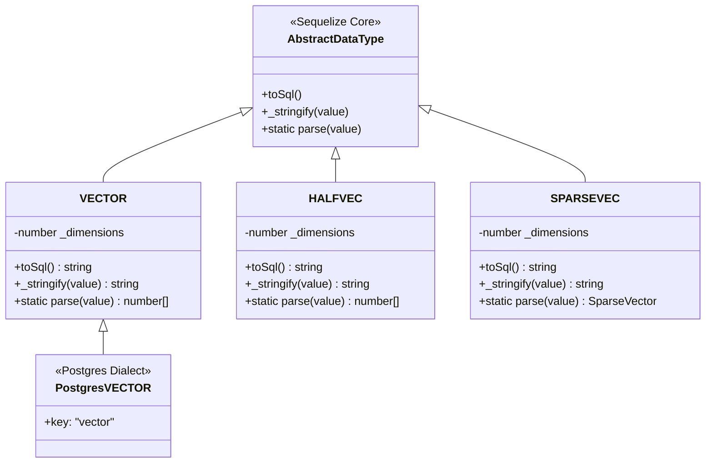
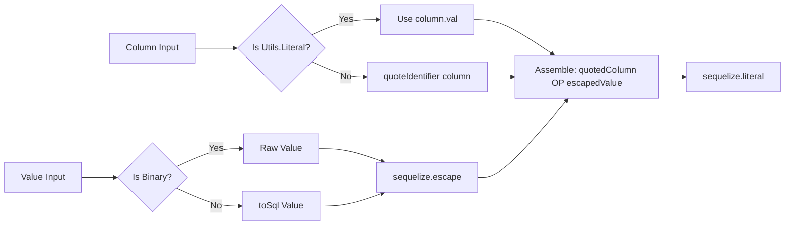
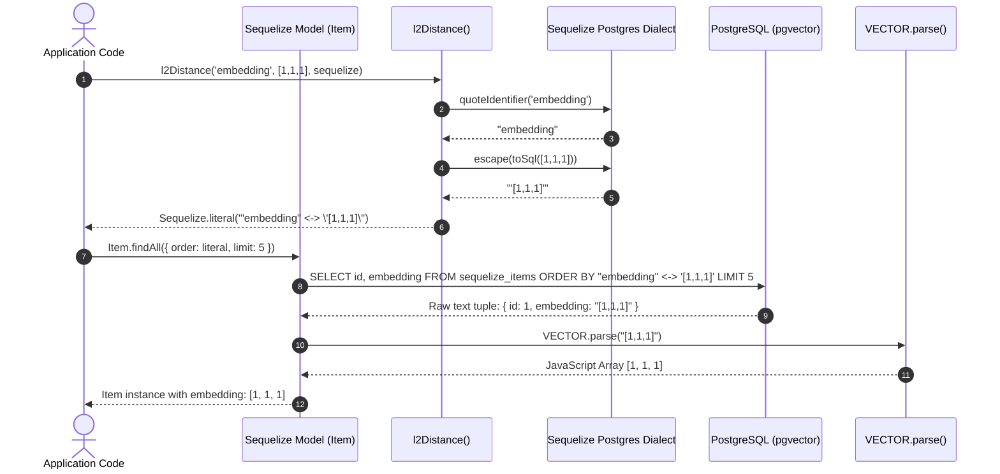

# pgvector-node: Deep Dive into Sequelize Integration Architecture

## Table of Contents
- [1. Executive Summary & Architectural Overview](#1-executive-summary--architectural-overview)
- [2. Custom DataTypes Architecture](#2-custom-datatypes-architecture)
  - [2.1 The Registration Evolution: `registerType` to Side-Effect Import](#21-the-registration-evolution-registertype-to-side-effect-import)
  - [2.2 Dialect Augmentation & Prototype Plumbing](#22-dialect-augmentation--prototype-plumbing)
  - [2.3 Implementation of `VECTOR`, `HALFVEC`, and `SPARSEVEC`](#23-implementation-of-vector-halfvec-and-sparsevec)
  - [2.4 Invocation Metaprogramming with `Utils.classToInvokable`](#24-invocation-metaprogramming-with-utilsclasstoinvokable)
  - [2.5 Value Serialization & Deserialization Lifecycle](#25-value-serialization--deserialization-lifecycle)
  - [2.6 TypeScript Declaration Augmentation](#26-typescript-declaration-augmentation)
- [3. Model Definition & Schema Generation](#3-model-definition--schema-generation)
  - [3.1 Declaring Model Attributes](#31-declaring-model-attributes)
  - [3.2 Dimension Validation Mechanics](#32-dimension-validation-mechanics)
  - [3.3 Index Definitions: HNSW & IVFFlat Operator Classes](#33-index-definitions-hnsw--ivfflat-operator-classes)
  - [3.4 Migration Hooks (`Sequelize.VECTOR ??= DataTypes.VECTOR`)](#34-migration-hooks-sequelizevector--datatypesvector)
- [4. Query Pipeline & Distance Operator Helpers](#4-query-pipeline--distance-operator-helpers)
  - [4.1 The Core `distance()` Generator](#41-the-core-distance-generator)
  - [4.2 Safe Identifier Quoting & Literal Passthrough](#42-safe-identifier-quoting--literal-passthrough)
  - [4.3 Escaping, Sanitization, and Binary Handling](#43-escaping-sanitization-and-binary-handling)
  - [4.4 The 6 Mathematical Distance Functions](#44-the-6-mathematical-distance-functions)
  - [4.5 Query Ordering & Result Parsing](#45-query-ordering--result-parsing)
- [5. Dissection of the Test Suite (`tests/sequelize.test.js`)](#5-dissection-of-the-test-suite-testssequelizetestjs)
  - [5.1 Connection Lifecycle & Postgres Type Cache Refresh](#51-connection-lifecycle--postgres-type-cache-refresh)
  - [5.2 Model Sync & DDL Execution](#52-model-sync--ddl-execution)
  - [5.3 Record Insertion Across Vector Types](#53-record-insertion-across-vector-types)
  - [5.4 Verification of All Distance Metrics](#54-verification-of-all-distance-metrics)
  - [5.5 NULL Handling & Edge Cases](#55-null-handling--edge-cases)
  - [5.6 Error Handling & Type Safety Constraints](#56-error-handling--type-safety-constraints)
- [6. Architectural Diagrams](#6-architectural-diagrams)
  - [6.1 Type Hierarchy & Class Relationship Diagram](#61-type-hierarchy--class-relationship-diagram)
  - [6.2 End-to-End Query & Deserialization Pipeline](#62-end-to-end-query--deserialization-pipeline)
- [7. Best Practices & Production Guidelines](#7-best-practices--production-guidelines)

---

## 1. Executive Summary & Architectural Overview

The `pgvector-node` integration with Sequelize provides first-class support for storing, indexing, and querying vector embeddings within PostgreSQL. Rather than requiring raw SQL strings or un-typed blobs, `pgvector-node` embeds vector support directly into Sequelize's type system (`Sequelize.DataTypes`) and query generation runtime (`Sequelize.Utils`).

The integration addresses three major challenges:
1. **Dialect Type Registration**: Injecting custom PostgreSQL data types (`vector`, `halfvec`, `sparsevec`) into Sequelize's internal abstract type hierarchy and PostgreSQL-specific dialect mapping.
2. **Bi-directional Data Transformation**: Seamlessly encoding JavaScript `number[]` arrays or `SparseVector` objects into PostgreSQL vector syntax (e.g. `[1.0, 2.0, 3.0]` or `"{1:1.2,3:4.5}/1000"`), and decoding them back into JavaScript representations on retrieval.
3. **Distance Calculation in Query Builder**: Providing SQL operator generators (`<->`, `<#>`, `<=>`, `<+>`, `<~>`, `<%>`) that generate parameter-safe `Sequelize.literal()` expressions compatible with `Model.findAll({ order: ... })`.

---

## 2. Custom DataTypes Architecture

Sequelize manages data types through a dual-layer hierarchy: generic abstract types residing under `DataTypes.*`, and dialect-specific implementations residing under `DataTypes.<dialect>.*` (e.g., `DataTypes.postgres.*`).



### 2.1 The Registration Evolution: `registerType` to Side-Effect Import

In earlier releases of `pgvector-node`, developers had to explicitly invoke a registration function:
```javascript
// Deprecated legacy approach
import { registerType } from 'pgvector/sequelize';
registerType(Sequelize);
```

In modern versions, this is superseded by ES Module side-effect imports:
```javascript
import 'pgvector/sequelize';
```

In `src/sequelize/index.js`, the legacy functions are preserved purely for backward compatibility using Node's standard `deprecate` utility:
```javascript
import { deprecate } from 'node:util';
import './halfvec.js';
import './sparsevec.js';
import './vector.js';

const registerType = deprecate(
  (Sequelize) => {},
  "registerType() is deprecated. Use import 'pgvector/sequelize' instead."
);
const registerTypes = deprecate(
  (Sequelize) => {},
  "registerTypes() is deprecated. Use import 'pgvector/sequelize' instead."
);
```
When `import 'pgvector/sequelize'` is evaluated, the child modules (`./vector.js`, `./halfvec.js`, `./sparsevec.js`) execute immediately, mutating the global `Sequelize.DataTypes` registry before any model definition occurs.

### 2.2 Dialect Augmentation & Prototype Plumbing

For a custom data type to function within Sequelize across schema generation, model validation, and query execution, it must be registered in both the generic `DataTypes` and dialect-specific `DataTypes.postgres` namespaces.

Examining `src/sequelize/vector.js`:
```javascript
import { inherits } from 'node:util';
import { Sequelize, DataTypes, Utils } from 'sequelize';
import { vectorType, vectorToSql, vectorFromSql } from '../utils.js';

const PgTypes = DataTypes.postgres;
const ABSTRACT = DataTypes.ABSTRACT.prototype.constructor;

class VECTOR extends ABSTRACT {
  constructor(dimensions) {
    super();
    this._dimensions = dimensions;
  }

  toSql() {
    return vectorType(this._dimensions).toUpperCase();
  }

  _stringify(value) {
    return vectorToSql(value);
  }

  static parse(value) {
    return vectorFromSql(value);
  }
}

VECTOR.prototype.key = VECTOR.key = 'vector';
```

Key architectural mechanics:
1. **Extracting `ABSTRACT`**: `const ABSTRACT = DataTypes.ABSTRACT.prototype.constructor;` retrieves the base constructor function of Sequelize's abstract types.
2. **Setting the Type Key**: Both `VECTOR.key` and `VECTOR.prototype.key` are assigned `'vector'`. Sequelize relies on `key` to identify the datatype family.
3. **Registering PostgreSQL Dialect Constructor**:
   ```javascript
   PgTypes.VECTOR = function VECTOR() {
     if (!(this instanceof PgTypes.VECTOR)) {
       return new PgTypes.VECTOR();
     }
     DataTypes.VECTOR.apply(this, arguments);
   };
   inherits(PgTypes.VECTOR, DataTypes.VECTOR);
   PgTypes.VECTOR.parse = DataTypes.VECTOR.parse;
   PgTypes.VECTOR.types = { postgres: ['vector'] };
   PgTypes.VECTOR.key = 'vector';
   ```
   Sequelize's PostgreSQL dialect uses `PgTypes.VECTOR.types.postgres` to match column types reported by PostgreSQL `pg_type` catalog queries.

### 2.3 Implementation of `VECTOR`, `HALFVEC`, and `SPARSEVEC`

All three vector variants follow this symmetrical architectural pattern:

| Custom Type | Source File | Underlying PostgreSQL Type | Serialization Method | Parsing Method | Target JS Object |
| :--- | :--- | :--- | :--- | :--- | :--- |
| `DataTypes.VECTOR` | `src/sequelize/vector.js` | `vector(n)` or `vector` | `vectorToSql(value)` | `vectorFromSql(value)` | `number[]` |
| `DataTypes.HALFVEC` | `src/sequelize/halfvec.js` | `halfvec(n)` or `halfvec` | `halfvecToSql(value)` | `halfvecFromSql(value)` | `number[]` (16-bit float) |
| `DataTypes.SPARSEVEC`| `src/sequelize/sparsevec.js` | `sparsevec(n)` or `sparsevec` | `sparsevecToSql(value)` | `sparsevecFromSql(value)` | `SparseVector` instance |

#### Sparse Vector Serialization
In `SPARSEVEC`:
```javascript
class SPARSEVEC extends ABSTRACT {
  constructor(dimensions) {
    super();
    this._dimensions = dimensions;
  }

  toSql() {
    return sparsevecType(this._dimensions).toUpperCase();
  }

  _stringify(value) {
    return sparsevecToSql(value);
  }

  static parse(value) {
    return sparsevecFromSql(value);
  }
}
```
If `value` is an instance of `SparseVector`, `sparsevecToSql` invokes `value.toPostgres()`, generating the PostgreSQL string format `{indices}/dimensions` (e.g., `"{1:1.0,2:2.0}/3"`).

### 2.4 Invocation Metaprogramming with `Utils.classToInvokable`

In Sequelize, developers can declare data types either as classes or invoked functions:
```javascript
type: DataTypes.VECTOR(3)
// or
type: DataTypes.VECTOR
```
To enable this dual call syntax, `pgvector-node` uses Sequelize's internal utility:
```javascript
DataTypes.VECTOR = Utils.classToInvokable(VECTOR);
DataTypes.HALFVEC = Utils.classToInvokable(HALFVEC);
DataTypes.SPARSEVEC = Utils.classToInvokable(SPARSEVEC);
```
`Utils.classToInvokable` wraps the constructor in a proxy function that checks whether it was invoked with `new`. If called without `new` (as `DataTypes.VECTOR(3)`), it constructs and returns an instance of `VECTOR`.

### 2.5 Value Serialization & Deserialization Lifecycle

When Sequelize performs an insert or update:
1. `Model.create()` or `Model.save()` passes the attribute value through the dialect's query generator.
2. The dialect identifies `attribute.type._stringify(value)` and converts JavaScript values into SQL string literals.
3. For dense vectors, `vectorToSql(value)` executes `JSON.stringify(value.map((v) => Number(v)))`, emitting formatted brackets `"[1,2,3]"`.
4. When reading from the database, the Postgres client (`pg`) returns the raw string `"[1,2,3]"`. The static method `VECTOR.parse(value)` executes `vectorFromSql(value)`:
   ```javascript
   export function vectorFromSql(value) {
     if (value === null) return null;
     return value.substring(1, value.length - 1).split(',').map((v) => parseFloat(v));
   }
   ```
   This converts the Postgres string directly into a native JavaScript `number[]` array.

### 2.6 TypeScript Declaration Augmentation

To ensure full static type safety in TypeScript projects, `pgvector-node` uses module augmentation.

In `src/sequelize/index.d.ts`:
```typescript
import 'sequelize';

declare module 'sequelize' {
  namespace DataTypes {
    interface VectorDataTypeConstructor extends AbstractDataTypeConstructor {
      new (dimensions?: number): AbstractDataType;
      (dimensions?: number): AbstractDataType;
    }

    const VECTOR: VectorDataTypeConstructor;
    const HALFVEC: VectorDataTypeConstructor;
    const SPARSEVEC: VectorDataTypeConstructor;
  }
}
```
And in `types/sequelize/index.d.ts`:
```typescript
/// <reference path="../../src/sequelize/index.d.ts" preserve="true" />
import { Utils } from 'sequelize';
import type { Sequelize } from 'sequelize';

export declare function l2Distance(column: any, value: any, sequelize: Sequelize): Utils.Literal;
export declare function maxInnerProduct(column: any, value: any, sequelize: Sequelize): Utils.Literal;
export declare function cosineDistance(column: any, value: any, sequelize: Sequelize): Utils.Literal;
export declare function l1Distance(column: any, value: any, sequelize: Sequelize): Utils.Literal;
export declare function hammingDistance(column: any, value: string, sequelize: Sequelize): Utils.Literal;
export declare function jaccardDistance(column: any, value: string, sequelize: Sequelize): Utils.Literal;
```
This guarantees autocomplete and compile-time validation for `DataTypes.VECTOR(3)` and the distance functions.

---

## 3. Model Definition & Schema Generation

### 3.1 Declaring Model Attributes

Below is the standard model definition pattern demonstrating all supported vector types alongside native types:

```javascript
import { Sequelize, DataTypes } from 'sequelize';
import 'pgvector/sequelize';
import { SparseVector } from 'pgvector';

const Item = sequelize.define('Item', {
  id: {
    type: DataTypes.INTEGER,
    autoIncrement: true,
    primaryKey: true
  },
  // 3-dimensional single-precision float vector
  embedding: {
    type: DataTypes.VECTOR(3),
    allowNull: true
  },
  // 3-dimensional half-precision (16-bit float) vector
  half_embedding: {
    type: DataTypes.HALFVEC(3),
    allowNull: true
  },
  // 3-bit binary vector (native PostgreSQL BIT)
  binary_embedding: {
    type: 'BIT(3)',
    allowNull: true
  },
  // 3-dimensional sparse vector
  sparse_embedding: {
    type: DataTypes.SPARSEVEC(3),
    allowNull: true
  }
}, {
  tableName: 'sequelize_items'
});
```

### 3.2 Dimension Validation Mechanics

The `toSql()` method on each vector type invokes `typeWithDimensions(name, dimensions)` from `src/utils.js`:

```javascript
function typeWithDimensions(name, dimensions) {
  if (dimensions === undefined || dimensions === null) {
    return name;
  }
  if (!Number.isInteger(dimensions)) {
    throw new Error('expected integer');
  }
  return format('%s(%d)', name, dimensions);
}
```

This enforces strict validation during DDL generation:
- `DataTypes.VECTOR(3).toSql()` yields `"VECTOR(3)"`.
- `DataTypes.VECTOR().toSql()` yields `"VECTOR"` (unconstrained dimensions).
- `DataTypes.VECTOR('bad').toSql()` throws `Error: expected integer`.

### 3.3 Index Definitions: HNSW & IVFFlat Operator Classes

PostgreSQL's `pgvector` requires specific indexing methods (`hnsw` or `ivfflat`) coupled with index operator classes matching the query distance metric. Sequelize models allow specifying `using` and `operator` on indexes:

```javascript
const Item = sequelize.define('Item', {
  embedding: {
    type: DataTypes.VECTOR(3)
  }
}, {
  tableName: 'sequelize_items',
  indexes: [
    // HNSW index for L2 (Euclidean) distance
    {
      fields: ['embedding'],
      using: 'hnsw',
      operator: 'vector_l2_ops'
    },
    // Alternative: HNSW index for Cosine distance
    {
      fields: ['embedding'],
      using: 'hnsw',
      operator: 'vector_cosine_ops'
    },
    // Alternative: IVFFlat index for Inner Product
    {
      fields: ['embedding'],
      using: 'ivfflat',
      operator: 'vector_ip_ops'
    }
  ]
});
```

Sequelize emits the corresponding PostgreSQL DDL:
```sql
CREATE INDEX ON "sequelize_items" USING hnsw ("embedding" vector_l2_ops);
```

#### Operator Class Reference Table

| Distance Metric | Vector Type (`vector`) | Half-Vector (`halfvec`) | Sparse Vector (`sparsevec`) | Bit String (`bit`) |
| :--- | :--- | :--- | :--- | :--- |
| **L2 Distance** (`<->`) | `vector_l2_ops` | `halfvec_l2_ops` | `sparsevec_l2_ops` | N/A |
| **Inner Product** (`<#>`) | `vector_ip_ops` | `halfvec_ip_ops` | `sparsevec_ip_ops` | N/A |
| **Cosine Distance** (`<=>`)| `vector_cosine_ops` | `halfvec_cosine_ops`| `sparsevec_cosine_ops` | N/A |
| **L1 (Manhattan)** (`<+>`) | `vector_l1_ops` | `halfvec_l1_ops` | `sparsevec_l1_ops` | N/A |
| **Hamming Distance** (`<~>`) | N/A | N/A | N/A | `bit_hamming_ops` |
| **Jaccard Distance** (`<%>`) | N/A | N/A | N/A | `bit_jaccard_ops` |

### 3.4 Migration Hooks (`Sequelize.VECTOR ??= DataTypes.VECTOR`)

Sequelize CLI migrations often reference `Sequelize.DataTypes.VECTOR` or directly `Sequelize.VECTOR`. To ensure compatibility across Sequelize migration scripts, `src/sequelize/vector.js`, `halfvec.js`, and `sparsevec.js` append:

```javascript
// for migrations
Sequelize.VECTOR ??= DataTypes.VECTOR;
Sequelize.HALFVEC ??= DataTypes.HALFVEC;
Sequelize.SPARSEVEC ??= DataTypes.SPARSEVEC;
```

This allows migration scripts written as:
```javascript
module.exports = {
  up: async (queryInterface, Sequelize) => {
    await queryInterface.addColumn('items', 'embedding', {
      type: Sequelize.VECTOR(3)
    });
  }
};
```
to work reliably without throwing undefined attribute errors.

---

## 4. Query Pipeline & Distance Operator Helpers

### 4.1 The Core `distance()` Generator

In vector search, sorting by distance is performed in the `ORDER BY` clause using PostgreSQL custom operators.

In `src/sequelize/index.js`, `distance` constructs a sanitized `Sequelize.literal`:

```javascript
function distance(op, column, value, sequelize, binary) {
  const quotedColumn = column instanceof Utils.Literal
    ? column.val
    : sequelize.dialect.queryGenerator.quoteIdentifier(column);
  const escapedValue = sequelize.escape(binary ? value : toSql(value));
  return sequelize.literal(`${quotedColumn} ${op} ${escapedValue}`);
}
```



### 4.2 Safe Identifier Quoting & Literal Passthrough

The `distance` helper provides two modes for the `column` argument:
1. **Plain string column name**: `l2Distance('embedding', ...)`
   - Passes through `sequelize.dialect.queryGenerator.quoteIdentifier('embedding')`.
   - Produces `"embedding"`, preventing SQL injection and handling reserved column names.
2. **Table-qualified literal**: `maxInnerProduct(sequelize.literal('"Item".embedding'), ...)`
   - Checks `column instanceof Utils.Literal`.
   - Extracts `column.val` directly (`"Item".embedding`), bypassing double-quoting which would otherwise produce `"""Item"".embedding"`.

### 4.3 Escaping, Sanitization, and Binary Handling

The value parameter is escaped through Sequelize's dialect escaper:
- **Dense/Sparse vectors (`binary = false`)**: The value is serialized via `toSql(value)` into `"[1,1,1]"` or `"{1:1,2:2}/3"`, then passed to `sequelize.escape(...)`, generating `'[1,1,1]'`.
- **Binary bit strings (`binary = true`)**: The string (e.g. `'101'`) is not passed through `toSql()` (which would fail because `'101'` is not an array or `SparseVector`), but passed directly to `sequelize.escape('101')`.

### 4.4 The 6 Mathematical Distance Functions

`pgvector-node` exposes 6 specialized distance functions:

```javascript
export function l2Distance(column, value, sequelize) {
  return distance('<->', column, value, sequelize);
}

export function maxInnerProduct(column, value, sequelize) {
  return distance('<#>', column, value, sequelize);
}

export function cosineDistance(column, value, sequelize) {
  return distance('<=>', column, value, sequelize);
}

export function l1Distance(column, value, sequelize) {
  return distance('<+>', column, value, sequelize);
}

export function hammingDistance(column, value, sequelize) {
  return distance('<~>', column, value, sequelize, true);
}

export function jaccardDistance(column, value, sequelize) {
  return distance('<%>', column, value, sequelize, true);
}
```

### 4.5 Query Ordering & Result Parsing

To perform approximate or exact nearest neighbor search, pass the helper directly to the `order` property of `findAll`:

```javascript
const items = await Item.findAll({
  order: l2Distance('embedding', [1, 1, 1], sequelize),
  limit: 5
});
```

Sequelize compiles this into:
```sql
SELECT "id", "embedding", "half_embedding", "binary_embedding", "sparse_embedding", "createdAt", "updatedAt"
FROM "sequelize_items" AS "Item"
ORDER BY "embedding" <-> '[1,1,1]'
LIMIT 5;
```

---

## 5. Dissection of the Test Suite (`tests/sequelize.test.js`)

The test suite in `tests/sequelize.test.js` covers real database interactions, confirming the mechanics described above.

### 5.1 Connection Lifecycle & Postgres Type Cache Refresh

```javascript
test('sequelize example', async () => {
  let sequelize = new Sequelize('postgres://localhost/pgvector_node_test', {
    logging: false
  });
  await sequelize.query('CREATE EXTENSION IF NOT EXISTS vector');
  sequelize.close();

  // need to reconnect after the extension has been created
  sequelize = new Sequelize('postgres://localhost/pgvector_node_test', {
    logging: false
  });
```

> [!NOTE]
> When `CREATE EXTENSION vector` runs, PostgreSQL registers new OIDs in `pg_type`. The underlying `node-postgres` driver caches type parsers upon initial connection. Closing and re-instantiating `Sequelize` forces `node-postgres` to re-query `pg_type`, ensuring that subsequent vector queries correctly invoke the registered parsers.

### 5.2 Model Sync & DDL Execution

```javascript
const Item = sequelize.define('Item', {
  embedding: { type: DataTypes.VECTOR(3) },
  half_embedding: { type: DataTypes.HALFVEC(3) },
  binary_embedding: { type: 'BIT(3)' },
  sparse_embedding: { type: DataTypes.SPARSEVEC(3) }
}, {
  modelName: 'Item',
  tableName: 'sequelize_items',
  indexes: [
    {
      fields: ['embedding'],
      using: 'hnsw',
      operator: 'vector_l2_ops'
    }
  ]
});

await Item.sync({ force: true });
```
Executing `sync({ force: true })` drops the existing table, creates `sequelize_items` with columns `vector(3)`, `halfvec(3)`, `bit(3)`, and `sparsevec(3)`, and constructs the HNSW index with `vector_l2_ops`.

### 5.3 Record Insertion Across Vector Types

Three populated records and one null record are inserted:

```javascript
await Item.create({
  embedding: [1, 1, 1],
  half_embedding: [1, 1, 1],
  binary_embedding: '000',
  sparse_embedding: new SparseVector([1, 1, 1])
});
await Item.create({
  embedding: [2, 2, 2],
  half_embedding: [2, 2, 2],
  binary_embedding: '101',
  sparse_embedding: new SparseVector([2, 2, 2])
});
await Item.create({
  embedding: [1, 1, 2],
  half_embedding: [1, 1, 2],
  binary_embedding: '111',
  sparse_embedding: new SparseVector([1, 1, 2])
});
await Item.create({}); // Record with all vector fields NULL (id: 4)
```

### 5.4 Verification of All Distance Metrics

The test runs KNN searches for all 6 metrics against target vectors:

1. **L2 Distance (`<->`) on `embedding`**:
   - Query: target `[1, 1, 1]`
   - Distances: Item 1 (`0`), Item 3 (`1`), Item 2 (`√3 ≈ 1.732`)
   - Asserted order: IDs `[1, 3, 2]`
   - Result vector: `items[0].embedding` is decoded as native `[1, 1, 1]`.

2. **L2 Distance on `half_embedding`**:
   - Query: `order: l2Distance('half_embedding', [1, 1, 1], sequelize)`
   - Asserted order: IDs `[1, 3, 2]`.

3. **L2 Distance on `sparse_embedding`**:
   - Query: `order: l2Distance('sparse_embedding', new SparseVector([1, 1, 1]), sequelize)`
   - Asserted order: IDs `[1, 3, 2]`.

4. **Max Inner Product (`<#>`) with Literal Table Qualification**:
   - Query: `order: maxInnerProduct(sequelize.literal('"Item".embedding'), [1, 1, 1], sequelize)`
   - PostgreSQL inner product returns negative value:
     - Item 2: `-(2*1 + 2*1 + 2*1) = -6`
     - Item 3: `-(1*1 + 1*1 + 2*1) = -4`
     - Item 1: `-(1*1 + 1*1 + 1*1) = -3`
     - Item 4 (NULL): sorts last
   - Asserted order: IDs `[2, 3, 1, 4]`.

5. **Cosine Distance (`<=>`)**:
   - Query: `order: cosineDistance('embedding', [1, 1, 1], sequelize)`
   - Items 1 and 2 are parallel to `[1, 1, 1]` (cosine distance `0`).
   - Sliced assertion: `assert.deepEqual(items.map(v => v.id).slice(2), [3, 4])`.

6. **L1 Manhattan Distance (`<+>`)**:
   - Query: `order: l1Distance('embedding', [1, 1, 1], sequelize)`
   - Distances: Item 1 (`0`), Item 3 (`1`), Item 2 (`3`), Item 4 (`NULL`)
   - Asserted order: IDs `[1, 3, 2, 4]`.

7. **Hamming Distance (`<~>`) on Bit**:
   - Target `'101'`:
     - Item 2 (`'101'`): distance `0`
     - Item 3 (`'111'`): distance `1`
     - Item 1 (`'000'`): distance `2`
     - Item 4 (`NULL`): sorts last
   - Asserted order: IDs `[2, 3, 1, 4]`.

8. **Jaccard Distance (`<%>`) on Bit**:
   - Target `'101'`:
     - Asserted order: IDs `[2, 3, 1, 4]`.

### 5.5 NULL Handling & Edge Cases

When record 4 is created with empty fields (`await Item.create({})`), all vector columns are set to SQL `NULL`. In PostgreSQL, `NULL` values sort last in default ascending order (`ORDER BY ... ASC`). All distance helper queries in `tests/sequelize.test.js` place ID 4 at the end of the returned array.

### 5.6 Error Handling & Type Safety Constraints

The test suite tests invalid values and dimension specifications:
```javascript
// Test 1: Invalid input syntax caught by PostgreSQL engine
await assert.rejects(
  Item.create({ embedding: 'bad' }),
  { message: /invalid input syntax for type vector/ }
);

// Test 2: Dimension formatting
assert.equal(DataTypes.VECTOR(3).toSql(), 'VECTOR(3)');
assert.equal(DataTypes.VECTOR().toSql(), 'VECTOR');

// Test 3: Bad dimension parameter
assert.throws(() => {
  DataTypes.VECTOR('bad').toSql();
}, { message: 'expected integer' });
```

---

## 6. Architectural Diagrams

### 6.1 Type Hierarchy & Class Relationship Diagram

```mermaid
classDiagram
    direction TB
    class Sequelize {
        +static DataTypes
        +static VECTOR
        +static HALFVEC
        +static SPARSEVEC
        +escape(value)
        +literal(sql)
    }

    class DataTypes {
        +ABSTRACT
        +postgres
        +VECTOR
        +HALFVEC
        +SPARSEVEC
    }

    class ABSTRACT {
        +toSql()
        +_stringify(val)
        +static parse(val)
    }

    class VECTOR {
        -_dimensions: number
        +toSql(): string
        +_stringify(val): string
        +static parse(val): number[]
    }

    class PgTypesVECTOR {
        +key: "vector"
        +types: {postgres: ['vector']}
    }

    Sequelize o-- DataTypes : contains
    DataTypes o-- ABSTRACT : base
    ABSTRACT <|-- VECTOR : inherits
    VECTOR <|-- PgTypesVECTOR : inherits via util.inherits
    DataTypes o-- VECTOR : classToInvokable
    DataTypes o-- PgTypesVECTOR : registered on postgres dialect
```

### 6.2 End-to-End Query & Deserialization Pipeline



---

## 7. Best Practices & Production Guidelines

1. **Always Reconnect After Creating Extension**: When bootstrapping schemas via `sequelize.query('CREATE EXTENSION IF NOT EXISTS vector')`, always close or re-instantiate the Sequelize client connection pool to flush stale type catalogs.
2. **Use Table-Qualified Literals for Joins**: If performing vector ordering across table joins, avoid ambiguous column errors by wrapping qualified column names in `sequelize.literal()`:
   ```javascript
   order: l2Distance(sequelize.literal('"Item"."embedding"'), queryVector, sequelize)
   ```
3. **Always Declare Index Operator Classes**: Never create a vector index without specifying the operator class (`vector_l2_ops`, `vector_cosine_ops`, or `vector_ip_ops`). Without an operator class, PostgreSQL will fail to leverage HNSW or IVFFlat indexes when evaluating distance operators.
4. **Dimension Consistency**: Always specify explicit dimensions (e.g., `DataTypes.VECTOR(1536)`) in production schemas. Omission allows unconstrained vectors, which prevent building HNSW or IVFFlat indexes in PostgreSQL.
