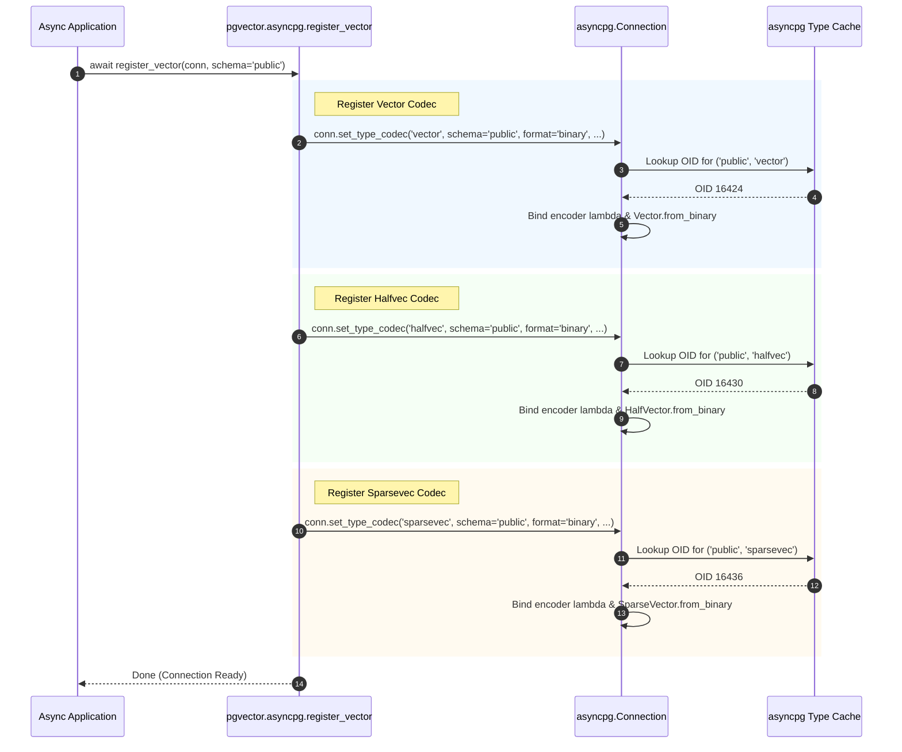
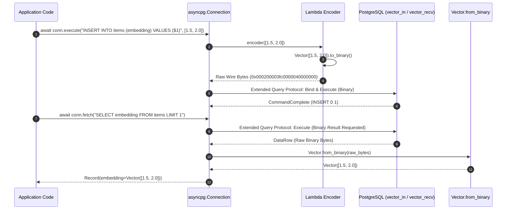

# pgvector-python: asyncpg Driver Adapter Deep Dive

> **Document Version:** 1.0.0  
> **Target SDK:** `pgvector-python` (`pgvector.asyncpg`)  
> **Driver Compatibility:** `asyncpg` (>= 0.28)  
> **Source Files Inspected:**  
> - `pgvector/asyncpg/__init__.py`  
> - `pgvector/asyncpg/register.py`  
> - `tests/test_asyncpg.py`  

---

## Table of Contents

1. [Executive Summary](#1-executive-summary)
2. [Driver Architecture & Design Philosophy](#2-driver-architecture--design-philosophy)
   - [2.1 Asyncpg: High-Performance Pure-Python & Cython Architecture](#21-asyncpg-high-performance-pure-python--cython-architecture)
   - [2.2 Type Codec Subsystem (`set_type_codec`)](#22-type-codec-subsystem-set_type_codec)
   - [2.3 Exclusivity of the Binary Protocol](#23-exclusivity-of-the-binary-protocol)
3. [Registration Subsystem](#3-registration-subsystem)
   - [3.1 Function Signature and Schema Parameter](#31-function-signature-and-schema-parameter)
   - [3.2 Driver-Managed Introspection](#32-driver-managed-introspection)
   - [3.3 Graceful Degradation for Version Drift (`unknown type`)](#33-graceful-degradation-for-version-drift-unknown-type)
4. [Encoding Protocol (Python → PostgreSQL)](#4-encoding-protocol-python--postgresql)
   - [4.1 The Lambda Normalization Strategy](#41-the-lambda-normalization-strategy)
   - [4.2 Binary Wire Serialization](#42-binary-wire-serialization)
   - [4.3 Transparent Duck Typing (Lists, NumPy, Tuples)](#43-transparent-duck-typing-lists-numpy-tuples)
5. [Decoding Protocol (PostgreSQL → Python)](#5-decoding-protocol-postgresql--python)
   - [5.1 Direct Binary Wire Unpacking (`Vector.from_binary`)](#51-direct-binary-wire-unpacking-vectorfrom_binary)
   - [5.2 Endianness and Memory Views](#52-endianness-and-memory-views)
   - [5.3 Array Support Out of the Box (`vector[]`)](#53-array-support-out-of-the-box-vector)
6. [Architectural Sequence Diagrams](#6-architectural-sequence-diagrams)
   - [6.1 Codec Registration Sequence](#61-codec-registration-sequence)
   - [6.2 Asynchronous Binary Execution Sequence](#62-asynchronous-binary-execution-sequence)
7. [Production Nuances, Pooling & Edge Cases](#7-production-nuances-pooling--edge-cases)
   - [7.1 Connection Pool Initialization (`init` Hook)](#71-connection-pool-initialization-init-hook)
   - [7.2 Custom Schema Deployment (`schema='custom_schema'`)](#72-custom-schema-deployment-schemaschemacustom_schema)
   - [7.3 Bit Vector Handling (`asyncpg.BitString`)](#73-bit-vector-handling-asyncpgbitstring)
8. [Cross-Adapter Comparison Matrix](#8-cross-adapter-comparison-matrix)
9. [Usage Guide](#9-usage-guide)
   - [9.1 Single Connection Example](#91-single-connection-example)
   - [9.2 High-Throughput Connection Pool Example](#92-high-throughput-connection-pool-example)
10. [Annotated Source Code](#10-annotated-source-code)

---

## 1. Executive Summary

`asyncpg` is the premier asynchronous PostgreSQL client library for Python. Unlike `psycopg2` or `psycopg`, `asyncpg` does not use PostgreSQL's C library (`libpq`). Instead, it is written from scratch in Cython and Python, implementing the PostgreSQL frontend/backend protocol directly over TCP/UNIX domain sockets with an uncompromising focus on raw performance.

The `pgvector.asyncpg` adapter reflects this design:
- **Pure Binary Wire Protocol:** By registering type codecs with `format='binary'`, it completely bypasses text parsing and string allocations for vector transfers.
- **Minimal Code Footprint:** The entire adapter consists of only 32 lines of code in `register.py`, relying on `conn.set_type_codec`.
- **Universal Duck Typing:** Employs polymorphic lambda encoders that effortlessly accept `Vector`, `HalfVector`, `SparseVector`, raw Python `list[float]`, or `numpy.ndarray`.
- **Automatic Array Resolution:** `asyncpg` automatically synthesizes array codecs (`vector[]`) once the base scalar codec is registered.
- **Connection-Bound State:** Codecs are configured per connection, requiring integration into pool lifecycle hooks (`init`).

---

## 2. Driver Architecture & Design Philosophy

### 2.1 Asyncpg: High-Performance Pure-Python & Cython Architecture

`asyncpg` achieves industry-leading throughput because:
1. It bypasses `libpq` completely, avoiding the overhead of C function calls across the Python/C boundary and intermediate buffer copying.
2. It mandates the **Extended Query Protocol** (`Parse`, `Bind`, `Describe`, `Execute`, `Sync`) for all parametrized queries.
3. It defaults to the **binary wire format** for standard and user-defined data types. In binary mode, PostgreSQL sends and receives numeric and float values in their raw IEEE 754 binary encodings.

### 2.2 Type Codec Subsystem (`set_type_codec`)

`asyncpg` manages types via `Connection.set_type_codec()`:

```python
await conn.set_type_codec(
    typename,
    schema='public',
    encoder=callable,
    decoder=callable,
    format='binary' | 'text'
)
```

When `set_type_codec` is called:
- `asyncpg` inspects its internal type registry (which it populates upon connection startup by querying PostgreSQL catalogs).
- It locates the OID corresponding to `(schema, typename)`.
- It associates the provided `encoder` and `decoder` with that OID in its connection-local codec dictionary.

### 2.3 Exclusivity of the Binary Protocol

While `asyncpg` allows `format='text'`, `pgvector.asyncpg` specifies `format='binary'` exclusively. This avoids:
1. Formatting floating-point numbers into decimal strings in Python (`1.5000000238418579`).
2. Transmitting lengthy text strings over the network socket.
3. Parsing string representations in PostgreSQL backend C code (`vector_in`).
Instead, `Vector.to_binary()` produces binary buffers directly ingested by `vector_recv` in PostgreSQL.

---

## 3. Registration Subsystem

### 3.1 Function Signature and Schema Parameter

The registration interface in `pgvector/asyncpg/register.py`:

```python
async def register_vector(conn: Connection, /, *, schema: str = 'public') -> None:
```

- `conn`: An active `asyncpg.Connection` instance.
- `schema`: The database schema where the `vector` extension is installed (default: `'public'`).

Because PostgreSQL allows extensions to be created in non-default schemas (e.g. `CREATE EXTENSION vector SCHEMA extensions;`), providing the `schema` keyword parameter is critical for multitenant or hardened database topologies.

### 3.2 Driver-Managed Introspection

Unlike `psycopg2` and `pg8000`, which manually execute SQL statements like:
```sql
SELECT typname, oid FROM pg_type WHERE oid IN (to_regtype('vector'), ...)
```
`pgvector.asyncpg` does **not** execute any explicit SQL query!

`conn.set_type_codec` consults `asyncpg`'s own internal type cache. If `asyncpg` has not yet introspected the requested type, it automatically runs an internal catalog query behind the scenes to fetch the type's OID, array OID, and composite attributes.

### 3.3 Graceful Degradation for Version Drift (`unknown type`)

In `register.py`, `halfvec` and `sparsevec` are wrapped in a protective `try...except` block:

```python
try:
    await conn.set_type_codec(
        'halfvec',
        schema=schema,
        encoder=lambda v: (v if isinstance(v, HalfVector) else HalfVector(v)).to_binary(),
        decoder=HalfVector.from_binary,
        format='binary'
    )

    await conn.set_type_codec(
        'sparsevec',
        schema=schema,
        encoder=lambda v: (v if isinstance(v, SparseVector) else SparseVector(v)).to_binary(),
        decoder=SparseVector.from_binary,
        format='binary'
    )
except ValueError as e:
    if not str(e).startswith('unknown type:'):
        raise e
```

#### Why This Is Critical:
`halfvec` and `sparsevec` were added in pgvector 0.7.0. If an application connects to a PostgreSQL instance running pgvector 0.5.0 or 0.6.0:
- `set_type_codec('vector')` succeeds.
- `set_type_codec('halfvec')` raises `ValueError: unknown type: public.halfvec`.
The adapter catches this specific error and silently ignores it, providing seamless backward compatibility across different PostgreSQL cluster versions!

---

## 4. Encoding Protocol (Python → PostgreSQL)

### 4.1 The Lambda Normalization Strategy

The encoder registered with `set_type_codec` is:

```python
encoder = lambda v: (v if isinstance(v, Vector) else Vector(v)).to_binary()
```

This compact lambda achieves significant ergonomic flexibility:
1. If the user passes an instance of `pgvector.Vector`, it bypasses re-initialization and directly calls `.to_binary()`.
2. If the user passes a Python `list[float]` (e.g., `[1.0, 2.0, 3.0]`), `Vector([1.0, 2.0, 3.0])` is called, creating a typed `array('f')`.
3. If the user passes a 1D `numpy.ndarray`, `Vector(np_arr)` handles NumPy binary buffer extraction.
4. It outputs raw bytes formatted for the PostgreSQL wire.

### 4.2 Binary Wire Serialization

The wire representation produced by `to_binary()` is:

$$\text{Wire Buffer} = [\text{dim (2 bytes, uint16)}] + [\text{unused (2 bytes, uint16)}] + [\text{values } (4 \times \text{dim bytes, IEEE 754 single float})]$$

All fields are in network byte order (Big-Endian).

```python
# pgvector/vector.py
def to_binary(self) -> bytes:
    if sys.byteorder == 'big':
        value = self._value
    else:
        value = array('f', self._value)
        value.byteswap()
    return struct.pack('>HH', len(value), 0) + memoryview(value)
```

### 4.3 Transparent Duck Typing (Lists, NumPy, Tuples)

As verified in `tests/test_asyncpg.py`:

```python
embedding1 = Vector([1.5, 2, 3])
embedding2 = [4.5, 5, 6]
embedding3 = np.array([7.5, 8, 9])

await conn.execute(
    'INSERT INTO asyncpg_items (embedding) VALUES ($1), ($2), ($3)', 
    embedding1, embedding2, embedding3
)
```

All three parameters are encoded into identical binary packets over the wire. The application code is free to work with standard Python lists or NumPy arrays without manual wrapper construction.

---

## 5. Decoding Protocol (PostgreSQL → Python)

### 5.1 Direct Binary Wire Unpacking (`Vector.from_binary`)

When PostgreSQL transmits a vector in a result tuple, `asyncpg` invokes `Vector.from_binary(bytes)`:

```python
@classmethod
def from_binary(cls, value: bytes | bytearray | memoryview, /) -> Vector:
    dim, unused = struct.unpack_from('>hh', value)
    data = memoryview(value)[4:]

    if len(data) != 4 * dim:
        raise ValueError('invalid length')

    if unused != 0:
        raise ValueError('expected unused to be 0')

    arr = array('f')
    arr.frombytes(data)
    if sys.byteorder != 'big':
        arr.byteswap()

    vec = cls.__new__(cls)
    vec._value = arr
    return vec
```

### 5.2 Endianness and Memory Views

1. **Zero-Copy Slicing:** Uses `memoryview(value)[4:]` to slice the float payloads without copying underlying memory.
2. **Fast Array Ingestion:** Uses Python's native C implementation `arr.frombytes(data)` to populate an `array('f')`.
3. **In-Place Byteswapping:** If the client host is little-endian (e.g. x86_64, aarch64), `arr.byteswap()` performs SIMD-optimized in-place endianness conversion.
4. **Bypass Constructor:** Bypasses `__init__` via `cls.__new__(cls)` for optimal parsing performance.

### 5.3 Array Support Out of the Box (`vector[]`)

In `asyncpg`, arrays are first-class citizens. When `vector` is registered via `set_type_codec`, `asyncpg` automatically recognizes `vector[]` (PostgreSQL type `_vector`):
- To encode a list of vectors (`$1::vector[]`), `asyncpg` automatically iterates over the list and invokes the scalar vector binary encoder for each element.
- When selecting `vector[]`, `asyncpg` parses the PostgreSQL array envelope and dispatches each element's bytes to `Vector.from_binary`.

---

## 6. Architectural Sequence Diagrams

### 6.1 Codec Registration Sequence



### 6.2 Asynchronous Binary Execution Sequence



---

## 7. Production Nuances, Pooling & Edge Cases

### 7.1 Connection Pool Initialization (`init` Hook)

Because `set_type_codec` modifies connection-local state, registering on one connection does not affect others. When using `asyncpg.create_pool()`, the `init` parameter must be used to ensure every pooled connection has the vector codec registered upon creation:

```python
import asyncpg
from pgvector.asyncpg import register_vector

async def init_connection(conn: asyncpg.Connection) -> None:
    await register_vector(conn)

pool = await asyncpg.create_pool(
    database="pgvector_python_test",
    init=init_connection,
    min_size=5,
    max_size=20
)
```

### 7.2 Custom Schema Deployment (`schema='custom_schema'`)

If the pgvector extension was created inside a designated schema (for instance, `CREATE EXTENSION vector SCHEMA extensions`), `register_vector` must be instructed to look there:

```python
await register_vector(conn, schema='extensions')
```

If the schema is omitted, `asyncpg` defaults to `'public'`, and will raise:
`ValueError: unknown type: 'public.vector'`.

### 7.3 Bit Vector Handling (`asyncpg.BitString`)

For binary vector representations using PostgreSQL's native `bit(n)` type, `pgvector.asyncpg` does not register a custom codec. Instead, developers use `asyncpg.BitString`:

```python
import asyncpg

# Inserting a bit vector
embedding = asyncpg.BitString('101001')
await conn.execute("INSERT INTO items (bin_embedding) VALUES ($1)", embedding)

# Querying bit vector
row = await conn.fetchrow("SELECT bin_embedding FROM items LIMIT 1")
bit_str = row['bin_embedding'].as_string()  # '101001'
int_val = row['bin_embedding'].to_int()     # 41
```

---

## 8. Cross-Adapter Comparison Matrix

| Feature | `psycopg2` | `psycopg` (v3) | `asyncpg` | `pg8000` |
| :--- | :--- | :--- | :--- | :--- |
| **Driver Engine** | C / `libpq` | C / `libpq` or pure Python | Cython / Async socket | Pure Python |
| **Async Support** | Cooperative / Coroutine (via select) | Native `asyncio` (`AsyncConnection`) | Native `asyncio` | None (Sync only) |
| **Registration Call** | `register_vector(conn_or_curs, globally=False)` | `register_vector(conn)` / `register_vector_async(conn)` | `await register_vector(conn, schema='public')` | `register_vector(conn)` |
| **OID Discovery** | SQL `to_regtype(...)` in `pg_type` | `TypeInfo.fetch(conn, 'vector')` | None (handled by internal asyncpg type cache) | SQL `to_regtype(...)` in `pg_type` |
| **Wire Protocol (Egress)** | Client-side text substitution (`getquoted`) | Both Text & High-speed Binary | Binary protocol exclusively | Text substitution |
| **Wire Protocol (Ingress)** | Text parsing via `new_type` | Text & Binary Loaders | Binary decoding (`from_binary`) | Text parsing via `from_text` |
| **Array Support** | Explicit `new_array_type` | Automatic via `info.register(context)` | Automatic via base codec | Not registered |
| **NumPy Support** | Adapter for `np.ndarray` registered if installed | Dumper registered for `'numpy.ndarray'` string | Duck-typed in lambda `Vector(v)` | Adapter for `np.ndarray` registered if installed |
| **COPY Support** | Standard text COPY | Text & Binary COPY (`copy.set_types`) | High-speed binary COPY | Basic |

---

## 9. Usage Guide

### 9.1 Single Connection Example

```python
import asyncio
import asyncpg
from pgvector.asyncpg import register_vector
from pgvector import Vector

async def main():
    conn = await asyncpg.connect(database="pgvector_python_test")
    try:
        await conn.execute("CREATE EXTENSION IF NOT EXISTS vector")
        await register_vector(conn)

        await conn.execute("CREATE TABLE IF NOT EXISTS items (id bigserial PRIMARY KEY, embedding vector(3))")

        # Pass Python list directly!
        await conn.execute("INSERT INTO items (embedding) VALUES ($1)", [1.0, 2.0, 3.0])

        # Query using cosine distance (<=>)
        query = [1.0, 2.0, 3.0]
        row = await conn.fetchrow(
            "SELECT id, embedding, embedding <=> $1 AS distance FROM items ORDER BY distance LIMIT 1",
            query
        )
        print("Nearest vector:", row['embedding'])
    finally:
        await conn.close()

asyncio.run(main())
```

### 9.2 High-Throughput Connection Pool Example

```python
import asyncio
import asyncpg
from pgvector.asyncpg import register_vector
from pgvector import Vector
import numpy as np

async def run_pool():
    async def init(conn):
        await register_vector(conn)

    pool = await asyncpg.create_pool(database="pgvector_python_test", init=init, min_size=5, max_size=20)

    async def worker(task_id: int):
        async with pool.acquire() as conn:
            vec = np.random.rand(3).astype(np.float32)
            await conn.execute("INSERT INTO items (embedding) VALUES ($1)", vec)

    # Launch 50 concurrent writes
    await asyncio.gather(*(worker(i) for i in range(50)))
    await pool.close()

asyncio.run(run_pool())
```

---

## 10. Annotated Source Code

### `pgvector/asyncpg/register.py`

```python
from asyncpg import Connection
from .. import Vector, HalfVector, SparseVector


async def register_vector(conn: Connection, /, *, schema: str = 'public') -> None:
    # 1. Register vector type codec with pure binary protocol
    await conn.set_type_codec(
        'vector',
        schema=schema,
        # Duck-typed lambda accepts Vector, list[float], or ndarray
        encoder=lambda v: (v if isinstance(v, Vector) else Vector(v)).to_binary(),
        decoder=Vector.from_binary,
        format='binary'
    )

    # 2. Conditionally register halfvec and sparsevec, handling older pgvector versions
    try:
        await conn.set_type_codec(
            'halfvec',
            schema=schema,
            encoder=lambda v: (v if isinstance(v, HalfVector) else HalfVector(v)).to_binary(),
            decoder=HalfVector.from_binary,
            format='binary'
        )

        await conn.set_type_codec(
            'sparsevec',
            schema=schema,
            encoder=lambda v: (v if isinstance(v, SparseVector) else SparseVector(v)).to_binary(),
            decoder=SparseVector.from_binary,
            format='binary'
        )
    except ValueError as e:
        # Gracefully handle cluster with pgvector < 0.7.0 installed
        if not str(e).startswith('unknown type:'):
            raise e
```
