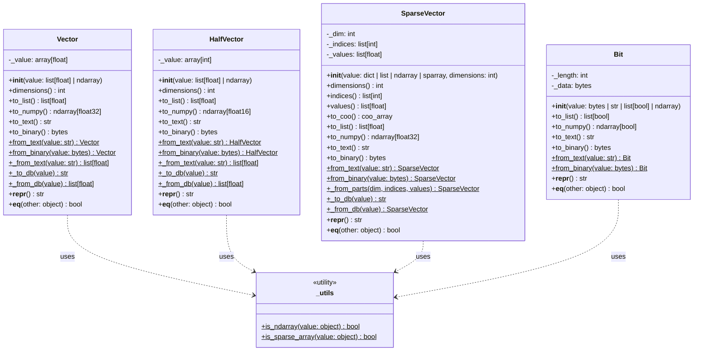

# pgvector Python SDK: Core Types Deep Dive

> In-depth architectural analysis, binary protocol specifications, memory layouts, and implementation breakdown of the fundamental types in `pgvector-python`: `Vector`, `HalfVector`, `SparseVector`, `Bit`, and `_utils.py`.

---

## Table of Contents
1. [Core Type System Architecture](#1-core-type-system-architecture)
   - [Type System Hierarchy & Design Goals](#type-system-hierarchy--design-goals)
   - [Mermaid Class Diagram](#mermaid-class-diagram)
   - [Memory & Storage Comparative Matrix](#memory--storage-comparative-matrix)
2. [The Vector Class (`vector.py`)](#2-the-vector-class-vectorpy)
   - [Internal Storage Architecture (`array.array('f')`)](#internal-storage-architecture-arrayarrayf)
   - [Constructor Specification & Polymorphic Ingestion](#constructor-specification--polymorphic-ingestion)
   - [NumPy Interoperability & Zero-Copy Ingestion](#numpy-interoperability--zero-copy-ingestion)
   - [PostgreSQL Text Protocol Serialization (`to_text`, `from_text`)](#postgresql-text-protocol-serialization-to_text-from_text)
   - [PostgreSQL Binary Protocol (`to_binary`, `from_binary`)](#postgresql-binary-protocol-to_binary-from_binary)
   - [ORM/DB Optimizations: `_to_db` & `_from_db`](#ormdb-optimizations-_to_db--_from_db)
   - [Validation, Equality & Dunder Protocols](#validation-equality--dunder-protocols)
   - [Annotated Source Code Walkthrough](#annotated-source-code-walkthrough-vectorpy)
3. [The HalfVector Class (`halfvec.py`)](#3-the-halfvector-class-halfvecpy)
   - [The Python fp16 Dilemma: Why `array.array('H')`?](#the-python-fp16-dilemma-why-arrayarrayh)
   - [Constructor & IEEE 754 Half-Precision Encoding](#constructor--ieee-754-half-precision-encoding)
   - [Text Protocol Serialization & Unpacking](#text-protocol-serialization--unpacking)
   - [Binary Protocol Specification (fp16 Payload Layout)](#binary-protocol-specification-fp16-payload-layout)
   - [Equality Semantics: Bitwise vs Floating-Point](#equality-semantics-bitwise-vs-floating-point)
   - [Annotated Source Code Walkthrough](#annotated-source-code-walkthrough-halfvecpy)
4. [The SparseVector Class (`sparsevec.py`)](#4-the-sparsevector-class-sparsevecpy)
   - [PostgreSQL Sparse Vector Mechanics & 1-Based Indexing](#postgresql-sparse-vector-mechanics--1-based-indexing)
   - [Internal Representation (`_dim`, `_indices`, `_values`)](#internal-representation-_dim-_indices-_values)
   - [Constructor Ingestion Modes & Sentinel Pattern](#constructor-ingestion-modes--sentinel-pattern)
   - [SciPy Sparse Ingestion & Canonicalization](#scipy-sparse-ingestion--canonicalization)
   - [Text Protocol Serialization (`{index:value,...}/dim`)](#text-protocol-serialization-indexvaluedim)
   - [Binary Protocol Specification (Header, Indices, Values)](#binary-protocol-specification-header-indices-values)
   - [Conversion Methods (`to_coo()`, `to_list()`, `to_numpy()`)](#conversion-methods-to_coo-to_list-to_numpy)
   - [Annotated Source Code Walkthrough](#annotated-source-code-walkthrough-sparsevecpy)
5. [The Bit Class (`bit.py`)](#5-the-bit-class-bitpy)
   - [PostgreSQL `bit` / `varbit` Semantics in Python](#postgresql-bit--varbit-semantics-in-python)
   - [Internal Storage (`_length`, `_data: bytes`)](#internal-storage-_length-_data-bytes)
   - [Constructor Polymorphism & Bit Padding Mechanics](#constructor-polymorphism--bit-padding-mechanics)
   - [Text Protocol Serialization](#text-protocol-serialization)
   - [Binary Protocol Specification (Bit Count Header + Packed Bytes)](#binary-protocol-specification-bit-count-header--packed-bytes)
   - [NumPy `packbits` / `unpackbits` Interop](#numpy-packbits--unpackbits-interop)
   - [Annotated Source Code Walkthrough](#annotated-source-code-walkthrough-bitpy)
6. [Shared Utilities & Infrastructure (`_utils.py`)](#6-shared-utilities--infrastructure-_utilspy)
   - [Zero-Dependency Dynamic Introspection (`sys.modules`)](#zero-dependency-dynamic-introspection-sysmodules)
   - [Conditional Static Typing with `TYPE_CHECKING`](#conditional-static-typing-with-type_checking)
7. [Validation, Error Handling & Protocol Invariant Audits](#7-validation-error-handling--protocol-invariant-audits)
   - [Wire Protocol Header Validation](#wire-protocol-header-validation)
   - [Validation Audit Table](#validation-audit-table)

---

## 1. Core Type System Architecture

### Type System Hierarchy & Design Goals

The `pgvector` Python SDK models PostgreSQL's 4 vector data types into distinct, purpose-built Python classes:
- **`Vector`**: Represents 32-bit single-precision floating-point dense vectors (SQL type: `vector`).
- **`HalfVector`**: Represents 16-bit half-precision floating-point dense vectors (SQL type: `halfvec`).
- **`SparseVector`**: Represents compressed sparse vectors containing only non-zero dimensions (SQL type: `sparsevec`).
- **`Bit`**: Represents fixed or variable-length binary strings/vectors (SQL type: `bit` / `varbit`).

Each class adheres to a uniform API convention:
1. **Positional-Only Ingestion**: All constructor arguments enforce positional-only syntax (`/`) for performance and API cleanliness.
2. **Standard Conversions**: Every class provides `.to_list()`, `.to_numpy()`, `.to_text()`, and `.to_binary()`.
3. **Class Factory Ingestion**: Every class provides `.from_text(str)` and `.from_binary(bytes | bytearray | memoryview)`.
4. **ORM Hooks**: The numeric classes implement classmethods `_to_db()` and `_from_db()` for efficient database driver serialization without unnecessary Python object allocations.

### Mermaid Class Diagram



### Memory & Storage Comparative Matrix

| Type | Python Storage Backing | In-Memory Element Width | Wire Binary Header | Wire Binary Payload | Text Representation |
|---|---|---|---|---|---|
| **`Vector`** | `array.array('f')` | 4 bytes (IEEE 754 float32) | 4 bytes (`>hh` / `>HH`) | $4 \times \text{dim}$ bytes | `[1.0,2.0,3.0]` |
| **`HalfVector`** | `array.array('H')` | 2 bytes (IEEE 754 float16 bits) | 4 bytes (`>hh` / `>HH`) | $2 \times \text{dim}$ bytes | `[1.0,2.0,3.0]` |
| **`SparseVector`** | `list[int]` + `list[float]` | 8 bytes per non-zero entry | 12 bytes (`>iii`) | $4 \times \text{nnz} + 4 \times \text{nnz}$ bytes | `{1:1.5,3:2.0}/6` |
| **`Bit`** | `bytes` | 1 bit (packed 8 bits/byte) | 4 bytes (`>i`) | $\lceil \text{length} / 8 \rceil$ bytes | `10100110` |

---

## 2. The Vector Class (`vector.py`)

The `Vector` class is the primary representation for standard 32-bit floating-point embeddings.

### Internal Storage Architecture (`array.array('f')`)
Instead of keeping a Python list of float objects (which allocates an entire `PyObject` of 24 bytes per element on 64-bit CPython), `Vector` stores elements inside a Python standard library `array.array('f')`.
- Type code `'f'` represents a contiguous array of C `float` primitives (32 bits / 4 bytes each).
- For a 1536-dimensional vector:
  - Python `list[float]`: $\approx 1536 \times 24 \text{ bytes (floats)} + 1536 \times 8 \text{ bytes (pointers)} \approx 49\text{ KB}$.
  - `array.array('f')`: $1536 \times 4 \text{ bytes} \approx 6.1\text{ KB}$ (an **8x memory reduction**).
- Zero-copy buffer protocol operations and direct memory copying (`frombytes`, `tobytes`, `memoryview`) become possible.

### Constructor Specification & Polymorphic Ingestion
```python
def __init__(self, value: list[float] | ndarray, /) -> None:
```
The constructor accepts two input formats:
1. **Plain Python `list[float]`**:
   ```python
   try:
       self._value = array('f', value)
   except TypeError:
       raise ValueError('expected list[float]')
   ```
   If any element is not a valid number (e.g., strings, nested lists, `None`), `array('f', value)` raises `TypeError`, which is caught and transformed into `ValueError('expected list[float]')`.
2. **NumPy 1D Array (`ndarray`)**:
   Enforces `value.ndim == 1`. It casts the array to C-contiguous `float32` and loads its raw bytes into the `array('f')` instance:
   ```python
   arr = array('f')
   arr.frombytes(value.astype(np.float32, order='C', copy=False).data.cast('B'))
   self._value = arr
   ```
   `copy=False` ensures that if the input is already a C-contiguous `float32` array, no copy occurs during `astype`.

### NumPy Interoperability & Zero-Copy Ingestion
The method `to_numpy()` uses NumPy's buffer protocol interface `np.frombuffer`:
```python
def to_numpy(self) -> np.ndarray[tuple[int, ...], np.dtype[np.float32]]:
    import numpy as np
    return np.frombuffer(self._value, dtype=np.float32)
```
> [!IMPORTANT]
> `np.frombuffer` creates a 1D NumPy ndarray that **shares the underlying memory buffer** of `self._value`. This is a zero-copy operation: no floating point values are copied or transformed.

### PostgreSQL Text Protocol Serialization (`to_text`, `from_text`)
PostgreSQL's text input format for vectors is comma-delimited values wrapped in square brackets: `[1.0,2.0,3.0]`.

```python
def to_text(self) -> str:
    return f'[{",".join([str(v) for v in self._value])}]'

@classmethod
def from_text(cls, value: str, /) -> Vector:
    return cls(cls._from_text(value))

@classmethod
def _from_text(cls, value: str, /) -> list[float]:
    if len(value) == 2: # '[]'
        return []
    return [float(v) for v in value[1:-1].split(',')]
```
`_from_text` strips the bounding `[` and `]` via slice `value[1:-1]`, splits on `,`, and parses each substring with `float()`.

### PostgreSQL Binary Protocol (`to_binary`, `from_binary`)

PostgreSQL's internal binary representation for `vector` (`Vector` struct in C) consists of:
1. `uint16 dim`: Vector dimensionality (number of float32 elements).
2. `uint16 unused`: 2-byte reserved padding (must be 0).
3. Payload: `dim * 4` bytes of IEEE 754 32-bit floating point numbers in **network byte order (big-endian)**.

```
0                   1                   2                   3
0 1 2 3 4 5 6 7 8 9 0 1 2 3 4 5 6 7 8 9 0 1 2 3 4 5 6 7 8 9 0 1
+-+-+-+-+-+-+-+-+-+-+-+-+-+-+-+-+-+-+-+-+-+-+-+-+-+-+-+-+-+-+-+-+
|          dim (uint16)         |         unused (uint16)       |
+-+-+-+-+-+-+-+-+-+-+-+-+-+-+-+-+-+-+-+-+-+-+-+-+-+-+-+-+-+-+-+-+
|                        float[0] (float32)                     |
+-+-+-+-+-+-+-+-+-+-+-+-+-+-+-+-+-+-+-+-+-+-+-+-+-+-+-+-+-+-+-+-+
|                        float[1] (float32)                     |
+-+-+-+-+-+-+-+-+-+-+-+-+-+-+-+-+-+-+-+-+-+-+-+-+-+-+-+-+-+-+-+-+
|                              ...                              |
+-+-+-+-+-+-+-+-+-+-+-+-+-+-+-+-+-+-+-+-+-+-+-+-+-+-+-+-+-+-+-+-+
|                        float[dim-1] (float32)                 |
+-+-+-+-+-+-+-+-+-+-+-+-+-+-+-+-+-+-+-+-+-+-+-+-+-+-+-+-+-+-+-+-+
```

#### Serialization (`to_binary`):
```python
def to_binary(self) -> bytes:
    if sys.byteorder == 'big':
        value = self._value
    else:
        value = array('f', self._value)
        value.byteswap()
    return struct.pack('>HH', len(value), 0) + memoryview(value)
```
- On little-endian architectures (x86_64, aarch64), it calls `value.byteswap()` on a duplicate array to swap all 4-byte floats into big-endian.
- Packs the 4-byte header `>HH` (`dim`, `0`).
- Appends `memoryview(value)` to form the complete binary wire payload.

#### Deserialization (`from_binary`):
```python
@classmethod
def from_binary(cls, value: bytes | bytearray | memoryview, /) -> Vector:
    dim, unused = struct.unpack_from('>hh', value)
    data = memoryview(value)[4:]

    if len(data) != 4 * dim:
        raise ValueError('invalid length')

    if unused != 0:
        raise ValueError('expected unused to be 0')

    arr = array('f')
    arr.frombytes(data)
    if sys.byteorder != 'big':
        arr.byteswap()

    vec = cls.__new__(cls)
    vec._value = arr
    return vec
```
> [!TIP]
> Notice the usage of `cls.__new__(cls)` on line 83. It completely bypasses calling `__init__`, avoiding unnecessary list conversions or type inspections. The internal `arr` is injected directly into `vec._value`.

### ORM/DB Optimizations: `_to_db` & `_from_db`
SQLAlchemy and Peewee do not always instantiate a full `Vector` object for every row. To avoid the overhead of constructing intermediate `Vector` instances when binding parameters or reading query results, `vector.py` provides optimized classmethods:

```python
@classmethod
def _to_db(cls, value: list[float] | ndarray | Vector | None, /) -> str | None:
    if value is None:
        return value

    # fewer allocations for lists
    if isinstance(value, list):
        return f'[{",".join([str(float(v)) for v in value])}]'  # type: ignore

    if not isinstance(value, Vector):
        value = cls(value)

    return value.to_text()

@classmethod
def _from_db(cls, value: str | Vector | None, /) -> list[float] | None:
    if value is None:
        return value

    if isinstance(value, Vector):
        return value.to_list()

    return cls._from_text(value)
```
If the user passes a raw Python `list` to SQLAlchemy, `_to_db` formats it into `"[1.0,2.0,3.0]"` directly with zero intermediate object allocation.

### Validation, Equality & Dunder Protocols
- **`dimensions()`**: Returns `len(self._value)`.
- **`__repr__()` / `__str__()`**: Returns `f'Vector({self.to_list()})'`.
- **`__eq__()`**: Compares `self._value == other._value`. Since `array.array` implements element-wise equality, `Vector([1.0, 2.0]) == Vector([1.0, 2.0])` evaluates in C speed. Handles `-0.0 == 0.0` correctly per IEEE 754 equality rules.

### Annotated Source Code Walkthrough (`vector.py`)

```python
# pgvector/vector.py
from __future__ import annotations
from array import array
import struct
import sys
from typing import TYPE_CHECKING
from ._utils import is_ndarray, ndarray

if TYPE_CHECKING:
    import numpy as np


class Vector:
    # Contiguous C-float buffer backing storage
    _value: array[float]

    def __init__(self, value: list[float] | ndarray, /) -> None:
        if isinstance(value, list):
            try:
                # Direct conversion from list to float array
                self._value = array('f', value)
            except TypeError:
                raise ValueError('expected list[float]')
        elif is_ndarray(value):
            import numpy as np

            # Validate dimensionality
            if value.ndim != 1:
                raise ValueError('expected ndim to be 1')

            # Load C-contiguous bytes directly into array
            arr = array('f')
            arr.frombytes(value.astype(np.float32, order='C', copy=False).data.cast('B'))
            self._value = arr
        else:
            raise ValueError('expected list or ndarray')

    def __repr__(self) -> str:
        return f'Vector({self.to_list()})'

    def __eq__(self, other: object, /) -> bool:
        if not isinstance(other, self.__class__):
            return NotImplemented
        return self._value == other._value

    def dimensions(self) -> int:
        return len(self._value)

    def to_list(self) -> list[float]:
        return self._value.tolist()

    def to_numpy(self) -> np.ndarray[tuple[int, ...], np.dtype[np.float32]]:
        import numpy as np
        # Zero-copy view into array buffer
        return np.frombuffer(self._value, dtype=np.float32)

    def to_text(self) -> str:
        return f'[{",".join([str(v) for v in self._value])}]'

    def to_binary(self) -> bytes:
        if sys.byteorder == 'big':
            value = self._value
        else:
            value = array('f', self._value)
            value.byteswap()
        # Header: uint16 dim, uint16 unused (0)
        return struct.pack('>HH', len(value), 0) + memoryview(value)

    @classmethod
    def from_text(cls, value: str, /) -> Vector:
        return cls(cls._from_text(value))

    @classmethod
    def from_binary(cls, value: bytes | bytearray | memoryview, /) -> Vector:
        dim, unused = struct.unpack_from('>hh', value)
        data = memoryview(value)[4:]

        if len(data) != 4 * dim:
            raise ValueError('invalid length')

        if unused != 0:
            raise ValueError('expected unused to be 0')

        arr = array('f')
        arr.frombytes(data)
        if sys.byteorder != 'big':
            arr.byteswap()

        # Fast instance creation bypassing __init__
        vec = cls.__new__(cls)
        vec._value = arr
        return vec

    @classmethod
    def _from_text(cls, value: str, /) -> list[float]:
        if len(value) == 2:
            return []
        return [float(v) for v in value[1:-1].split(',')]

    @classmethod
    def _to_db(cls, value: list[float] | ndarray | Vector | None, /) -> str | None:
        if value is None:
            return value

        # Direct string serialization for raw lists
        if isinstance(value, list):
            return f'[{",".join([str(float(v)) for v in value])}]'  # type: ignore

        if not isinstance(value, Vector):
            value = cls(value)

        return value.to_text()

    @classmethod
    def _from_db(cls, value: str | Vector | None, /) -> list[float] | None:
        if value is None:
            return value

        if isinstance(value, Vector):
            return value.to_list()

        return cls._from_text(value)
```

---

## 3. The HalfVector Class (`halfvec.py`)

The `HalfVector` class supports 16-bit half-precision floating point embeddings (`halfvec` in PostgreSQL), halving storage footprint and memory bandwidth during indexing and search.

### The Python fp16 Dilemma: Why `array.array('H')`?
Python's standard library `array` module provides type codes for integers (`'b'`, `'B'`, `'h'`, `'H'`, `'i'`, `'I'`), single-precision float (`'f'`), and double-precision float (`'d'`). **It does not support float16.**

NumPy supports `np.float16`, but `pgvector` has a zero-mandatory-dependency mandate.

`halfvec.py` solves this elegantly by storing half-floats as **unsigned 16-bit integers (`array('H')`)**:
```python
class HalfVector:
    _value: array[int]  # uses uint16 since no float16
```
Each 16-bit unsigned integer holds the exact 16-bit IEEE 754 binary representation of a half-precision float (1 sign bit, 5 exponent bits, 10 mantissa bits).

### Constructor & IEEE 754 Half-Precision Encoding
Python's standard library `struct` module natively supports 16-bit IEEE 754 floats via format code `'e'`:
```python
dim = len(value)
self._value = array('H', struct.pack(f'{dim}e', *value))
```
- `struct.pack(f'{dim}e', *value)` packs $N$ Python floats into $2N$ raw bytes using standard IEEE 754 half-precision float encoding.
- `array('H', ...)` reads those raw bytes directly into an array of unsigned 16-bit integers.

For NumPy inputs, `HalfVector` casts to `np.float16` and reads the byte buffer:
```python
arr = array('H')
arr.frombytes(value.astype(np.float16, order='C', copy=False).data.cast('B'))
self._value = arr
```

### Text Protocol Serialization & Unpacking
When converting to text or a Python list, the uint16 values are unpacked back into standard Python floats using `struct.unpack(f'{dim}e', self._value)`:
```python
def to_list(self) -> list[float]:
    dim = len(self._value)
    return list(struct.unpack(f'{dim}e', self._value))

def to_text(self) -> str:
    return f'[{",".join([str(v) for v in self.to_list()])}]'
```

### Binary Protocol Specification (fp16 Payload Layout)
Like `Vector`, `HalfVector` binary format uses a 4-byte header:
1. `uint16 dim`: Vector dimensionality.
2. `uint16 unused`: 2-byte reserved padding (must be 0).
3. Payload: `dim * 2` bytes of 16-bit floats in big-endian byte order.

```
0                   1                   2                   3
0 1 2 3 4 5 6 7 8 9 0 1 2 3 4 5 6 7 8 9 0 1 2 3 4 5 6 7 8 9 0 1
+-+-+-+-+-+-+-+-+-+-+-+-+-+-+-+-+-+-+-+-+-+-+-+-+-+-+-+-+-+-+-+-+
|          dim (uint16)         |         unused (uint16)       |
+-+-+-+-+-+-+-+-+-+-+-+-+-+-+-+-+-+-+-+-+-+-+-+-+-+-+-+-+-+-+-+-+
|       half[0] (fp16)          |       half[1] (fp16)          |
+-+-+-+-+-+-+-+-+-+-+-+-+-+-+-+-+-+-+-+-+-+-+-+-+-+-+-+-+-+-+-+-+
|                              ...                              |
+-+-+-+-+-+-+-+-+-+-+-+-+-+-+-+-+-+-+-+-+-+-+-+-+-+-+-+-+-+-+-+-+
|      half[dim-2] (fp16)       |      half[dim-1] (fp16)       |
+-+-+-+-+-+-+-+-+-+-+-+-+-+-+-+-+-+-+-+-+-+-+-+-+-+-+-+-+-+-+-+-+
```

```python
def to_binary(self) -> bytes:
    if sys.byteorder == 'big':
        value = self._value
    else:
        value = array('H', self._value)
        value.byteswap()
    return struct.pack('>HH', len(value), 0) + memoryview(value)

@classmethod
def from_binary(cls, value: bytes | bytearray | memoryview, /) -> HalfVector:
    dim, unused = struct.unpack_from('>hh', value)
    data = memoryview(value)[4:]

    if len(data) != 2 * dim:  # 2 bytes per dimension (fp16)
        raise ValueError('invalid length')

    if unused != 0:
        raise ValueError('expected unused to be 0')

    arr = array('H')
    arr.frombytes(data)
    if sys.byteorder != 'big':
        arr.byteswap()

    vec = cls.__new__(cls)
    vec._value = arr
    return vec
```

### Equality Semantics: Bitwise vs Floating-Point
In `Vector`, `__eq__` compares `self._value == other._value` directly on `array('f')`.
In `HalfVector`, `_value` contains raw uint16 integers. Directly comparing `_value` would fail for cases like signed zeros (`0.0` vs `-0.0` have bit patterns `0x0000` and `0x8000`, yet $0.0 == -0.0$ in IEEE 754).
Therefore, `HalfVector` explicitly unpacks to float lists for comparison:
```python
def __eq__(self, other: object, /) -> bool:
    if not isinstance(other, self.__class__):
        return NotImplemented
    return self.to_list() == other.to_list()
```

### Annotated Source Code Walkthrough (`halfvec.py`)

```python
# pgvector/halfvec.py
from __future__ import annotations
from array import array
import struct
import sys
from typing import TYPE_CHECKING
from ._utils import is_ndarray, ndarray

if TYPE_CHECKING:
    import numpy as np


class HalfVector:
    # Backing store is uint16 array (format code 'H')
    _value: array[int]

    def __init__(self, value: list[float] | ndarray, /) -> None:
        if isinstance(value, list):
            dim = len(value)
            try:
                # Packs floats using struct format 'e' (fp16)
                self._value = array('H', struct.pack(f'{dim}e', *value))
            except struct.error:
                raise ValueError('expected list[float]')
        elif is_ndarray(value):
            import numpy as np

            if value.ndim != 1:
                raise ValueError('expected ndim to be 1')

            # Cast to np.float16 and ingest bytes
            arr = array('H')
            arr.frombytes(value.astype(np.float16, order='C', copy=False).data.cast('B'))
            self._value = arr
        else:
            raise ValueError('expected list or ndarray')

    def __repr__(self) -> str:
        return f'HalfVector({self.to_list()})'

    def __eq__(self, other: object, /) -> bool:
        if not isinstance(other, self.__class__):
            return NotImplemented
        return self.to_list() == other.to_list()

    def dimensions(self) -> int:
        return len(self._value)

    def to_list(self) -> list[float]:
        dim = len(self._value)
        # Unpacks raw uint16 bits into Python floats
        return list(struct.unpack(f'{dim}e', self._value))

    def to_numpy(self) -> np.ndarray[tuple[int, ...], np.dtype[np.float16]]:
        import numpy as np
        # Zero-copy view with dtype=np.float16
        return np.frombuffer(self._value, dtype=np.float16)

    def to_text(self) -> str:
        return f'[{",".join([str(v) for v in self.to_list()])}]'

    def to_binary(self) -> bytes:
        if sys.byteorder == 'big':
            value = self._value
        else:
            value = array('H', self._value)
            value.byteswap()
        return struct.pack('>HH', len(value), 0) + memoryview(value)

    @classmethod
    def from_text(cls, value: str, /) -> HalfVector:
        return cls(cls._from_text(value))

    @classmethod
    def from_binary(cls, value: bytes | bytearray | memoryview, /) -> HalfVector:
        dim, unused = struct.unpack_from('>hh', value)
        data = memoryview(value)[4:]

        if len(data) != 2 * dim:
            raise ValueError('invalid length')

        if unused != 0:
            raise ValueError('expected unused to be 0')

        arr = array('H')
        arr.frombytes(data)
        if sys.byteorder != 'big':
            arr.byteswap()

        vec = cls.__new__(cls)
        vec._value = arr
        return vec

    @classmethod
    def _from_text(cls, value: str, /) -> list[float]:
        if len(value) == 2:
            return []
        return [float(v) for v in value[1:-1].split(',')]

    @classmethod
    def _to_db(cls, value: list[float] | ndarray | HalfVector | None, /) -> str | None:
        if value is None:
            return value

        if isinstance(value, list):
            return f'[{",".join([str(float(v)) for v in value])}]'  # type: ignore

        if not isinstance(value, HalfVector):
            value = cls(value)

        return value.to_text()

    @classmethod
    def _from_db(cls, value: str | HalfVector | None, /) -> list[float] | None:
        if value is None:
            return value

        if isinstance(value, HalfVector):
            return value.to_list()

        return cls._from_text(value)
```

---

## 4. The SparseVector Class (`sparsevec.py`)

The `SparseVector` class represents high-dimensional sparse vectors (e.g. SPLADE, BM25 learned sparse embeddings) where only a fraction of dimensions are non-zero.

### PostgreSQL Sparse Vector Mechanics & 1-Based Indexing
In PostgreSQL's `sparsevec` C extension:
- Text representation uses **1-based index numbers**: `{1:1.5,3:2.0,5:3.0}/6`.
  - `{elements}/dim` specifies non-zero pairs and total dimensionality.
  - The index `1` refers to Python index `0`.
- In contrast, Python application APIs and SciPy indexing are **0-based**.
`SparseVector` transparently converts between Python 0-based indices and PostgreSQL 1-based indices during text protocol serialization:
```python
elements = ','.join([f'{int(i) + 1}:{float(v)}' for i, v in zip(self._indices, self._values)])
return f'{{{elements}}}/{int(self._dim)}'
```

### Internal Representation (`_dim`, `_indices`, `_values`)
A `SparseVector` instance holds:
- `_dim: int`: Total dimensionality of the vector space.
- `_indices: list[int]`: Sorted list of 0-based integer indices of non-zero entries.
- `_values: list[float]`: Floating point values corresponding to `_indices`.

Zero entries are completely filtered out during initialization:
```python
elements = [(i, v) for i, v in d.items() if v != 0]
elements.sort()
```

### Constructor Ingestion Modes & Sentinel Pattern
`SparseVector` supports multiple distinct initialization signatures:

1. **Dictionary + Dimensionality**:
   ```python
   vec = SparseVector({0: 1.0, 2: 2.0, 4: 3.0}, 6)
   ```
2. **Dense Python List**:
   ```python
   vec = SparseVector([1.0, 0.0, 2.0, 0.0, 3.0, 0.0])
   ```
3. **Dense 1D NumPy Array**:
   ```python
   vec = SparseVector(np.array([1.0, 0.0, 2.0, 0.0, 3.0, 0.0]))
   ```
4. **SciPy Sparse Array / Matrix** (`coo_array`, `csr_matrix`, etc.):
   ```python
   vec = SparseVector(coo_array(([1, 2, 3], ([0, 2, 4],)), shape=(6,)))
   ```

To differentiate signatures without optional defaults causing ambiguous type signatures, `sparsevec.py` employs the **Sentinel Pattern**:
```python
class Sentinel:
    pass

NO_DEFAULT: Final[Sentinel] = Sentinel()

class SparseVector:
    @overload
    def __init__(self, value: dict[int, float], dimensions: int, /) -> None: ...

    @overload
    def __init__(self, value: list[float] | ndarray | sparray | spmatrix, /) -> None: ...

    def __init__(
        self,
        value: dict[int, float] | list[float] | ndarray | sparray | spmatrix,
        dimensions: int | Sentinel = NO_DEFAULT,
        /
    ) -> None:
        if is_sparse_array(value):
            if dimensions is not NO_DEFAULT:
                raise ValueError('extra argument')
            self._from_sparse(value)
        elif isinstance(value, dict):
            if dimensions is NO_DEFAULT:
                raise ValueError('missing dimensions')
            self._from_dict(value, dimensions)
        else:
            if dimensions is not NO_DEFAULT:
                raise ValueError('extra argument')
            self._from_dense(value)
```

### SciPy Sparse Ingestion & Canonicalization
In `_from_sparse()`, `SparseVector` handles both 1D and 2D sparse structures (`(dim,)` or `(1, dim)`).
It accounts for SciPy matrix duplicate indices using `sum_duplicates()`:

```python
def _from_sparse(self, arr: sparray | spmatrix, /) -> None:
    value: coo_array | coo_matrix = arr.tocoo(copy=False)

    # has_canonical_format added in scipy 1.12+
    if not hasattr(value, 'has_canonical_format') or not value.has_canonical_format:
        value = value.copy()
        value.sum_duplicates()

    shape = cast(tuple[int, ...], value.shape)
    if len(shape) == 1:
        self._dim = shape[0]
    elif len(shape) == 2 and shape[0] == 1:
        self._dim = shape[1]
    else:
        raise ValueError('expected ndim to be 1')

    if hasattr(value, 'coords'):
        # scipy 1.13+ API
        indices = value.coords[-1].tolist()
    else:
        # legacy scipy API
        indices = value.col.tolist()

    elements = [(i, v) for i, v in zip(indices, value.data) if v != 0]

    if not hasattr(value, 'has_canonical_format') or not value.has_canonical_format:
        elements.sort()

    self._indices = [v[0] for v in elements]
    self._values = [float(v[1]) for v in elements]
```

### Binary Protocol Specification (Header, Indices, Values)
PostgreSQL's binary format for `sparsevec` is structured as:
1. `int32 dim`: Total vector dimensions.
2. `int32 nnz`: Number of non-zero elements.
3. `int32 unused`: Reserved (must be 0).
4. `nnz * 4` bytes: Array of 32-bit signed integers (0-based indices).
5. `nnz * 4` bytes: Array of 32-bit IEEE 754 floats (values).

Total wire binary size = $12 + 8 \times \text{nnz}$ bytes.

```
0                   1                   2                   3
0 1 2 3 4 5 6 7 8 9 0 1 2 3 4 5 6 7 8 9 0 1 2 3 4 5 6 7 8 9 0 1
+-+-+-+-+-+-+-+-+-+-+-+-+-+-+-+-+-+-+-+-+-+-+-+-+-+-+-+-+-+-+-+-+
|                           dim (int32)                         |
+-+-+-+-+-+-+-+-+-+-+-+-+-+-+-+-+-+-+-+-+-+-+-+-+-+-+-+-+-+-+-+-+
|                           nnz (int32)                         |
+-+-+-+-+-+-+-+-+-+-+-+-+-+-+-+-+-+-+-+-+-+-+-+-+-+-+-+-+-+-+-+-+
|                          unused (int32)                       |
+-+-+-+-+-+-+-+-+-+-+-+-+-+-+-+-+-+-+-+-+-+-+-+-+-+-+-+-+-+-+-+-+
|                        indices[0] (int32)                     |
+-+-+-+-+-+-+-+-+-+-+-+-+-+-+-+-+-+-+-+-+-+-+-+-+-+-+-+-+-+-+-+-+
|                              ...                              |
+-+-+-+-+-+-+-+-+-+-+-+-+-+-+-+-+-+-+-+-+-+-+-+-+-+-+-+-+-+-+-+-+
|                       indices[nnz-1] (int32)                  |
+-+-+-+-+-+-+-+-+-+-+-+-+-+-+-+-+-+-+-+-+-+-+-+-+-+-+-+-+-+-+-+-+
|                        values[0] (float32)                    |
+-+-+-+-+-+-+-+-+-+-+-+-+-+-+-+-+-+-+-+-+-+-+-+-+-+-+-+-+-+-+-+-+
|                              ...                              |
+-+-+-+-+-+-+-+-+-+-+-+-+-+-+-+-+-+-+-+-+-+-+-+-+-+-+-+-+-+-+-+-+
|                       values[nnz-1] (float32)                 |
+-+-+-+-+-+-+-+-+-+-+-+-+-+-+-+-+-+-+-+-+-+-+-+-+-+-+-+-+-+-+-+-+
```

```python
def to_binary(self) -> bytes:
    nnz = len(self._indices)
    return pack(f'>iii{nnz}i{nnz}f', self._dim, nnz, 0, *self._indices, *self._values)

@classmethod
def from_binary(cls, value: bytes | bytearray | memoryview, /) -> SparseVector:
    dim, nnz, unused = unpack_from('>iii', value)

    if len(value) != 12 + 8 * nnz:
        raise ValueError('invalid length')

    if unused != 0:
        raise ValueError('expected unused to be 0')

    indices = list(unpack_from(f'>{nnz}i', value, 12))
    values = list(unpack_from(f'>{nnz}f', value, 12 + nnz * 4))
    return cls._from_parts(dim, indices, values)
```

### Conversion Methods (`to_coo()`, `to_list()`, `to_numpy()`)
- **`to_coo()`**: Generates a SciPy `coo_array` with shape `(1, dim)`:
  ```python
  def to_coo(self) -> coo_array:
      from scipy.sparse import coo_array
      coords = ([0] * len(self._indices), self._indices)
      return coo_array((self._values, coords), shape=(1, self._dim))
  ```
- **`to_list()`**: Reconstructs dense Python list with zeros:
  ```python
  def to_list(self) -> list[float]:
      vec = [0.0] * self._dim
      for i, v in zip(self._indices, self._values):
          vec[i] = v
      return vec
  ```
- **`to_numpy()`**: Reconstructs dense NumPy `float32` array initialized with zeros:
  ```python
  def to_numpy(self) -> np.ndarray[tuple[int, ...], np.dtype[np.float32]]:
      import numpy as np
      vec = np.zeros(self._dim, dtype=np.float32)
      for i, v in zip(self._indices, self._values):
          vec[i] = v
      return vec
  ```

### Annotated Source Code Walkthrough (`sparsevec.py`)

```python
# pgvector/sparsevec.py
from __future__ import annotations
from struct import pack, unpack_from
from typing import TYPE_CHECKING, Final, cast, overload
from ._utils import is_sparse_array, ndarray

if TYPE_CHECKING:
    import numpy as np
    from scipy.sparse import sparray, spmatrix, coo_array, coo_matrix


class Sentinel:
    pass

# Unique sentinel singleton for parameter defaults
NO_DEFAULT: Final[Sentinel] = Sentinel()


class SparseVector:
    _dim: int
    _indices: list[int]
    _values: list[float]

    @overload
    def __init__(self, value: dict[int, float], dimensions: int, /) -> None: ...

    @overload
    def __init__(self, value: list[float] | ndarray | sparray | spmatrix, /) -> None: ...

    def __init__(
        self,
        value: dict[int, float] | list[float] | ndarray | sparray | spmatrix,
        dimensions: int | Sentinel = NO_DEFAULT,
        /
    ) -> None:
        if is_sparse_array(value):
            if dimensions is not NO_DEFAULT:
                raise ValueError('extra argument')
            self._from_sparse(value)  # type: ignore
        elif isinstance(value, dict):
            if dimensions is NO_DEFAULT:
                raise ValueError('missing dimensions')
            self._from_dict(value, dimensions)  # type: ignore
        else:
            if dimensions is not NO_DEFAULT:
                raise ValueError('extra argument')
            self._from_dense(value)  # type: ignore

    def __repr__(self) -> str:
        elements = dict(zip(self._indices, self._values))
        return f'SparseVector({elements}, {self._dim})'

    def __eq__(self, other: object, /) -> bool:
        if not isinstance(other, self.__class__):
            return NotImplemented
        return self._dim == other._dim and self._indices == other._indices and self._values == other._values

    def dimensions(self) -> int:
        return self._dim

    def indices(self) -> list[int]:
        return self._indices

    def values(self) -> list[float]:
        return self._values

    def to_coo(self) -> coo_array:
        from scipy.sparse import coo_array
        coords = ([0] * len(self._indices), self._indices)
        return coo_array((self._values, coords), shape=(1, self._dim))

    def to_list(self) -> list[float]:
        vec = [0.0] * self._dim
        for i, v in zip(self._indices, self._values):
            vec[i] = v
        return vec

    def to_numpy(self) -> np.ndarray[tuple[int, ...], np.dtype[np.float32]]:
        import numpy as np
        vec = np.zeros(self._dim, dtype=np.float32)
        for i, v in zip(self._indices, self._values):
            vec[i] = v
        return vec

    def to_text(self) -> str:
        # 1-based indexing for PostgreSQL text output
        elements = ','.join([f'{int(i) + 1}:{float(v)}' for i, v in zip(self._indices, self._values)])
        return f'{{{elements}}}/{int(self._dim)}'

    def to_binary(self) -> bytes:
        nnz = len(self._indices)
        return pack(f'>iii{nnz}i{nnz}f', self._dim, nnz, 0, *self._indices, *self._values)

    def _from_dict(self, d: dict[int, float], dim: int) -> None:
        # Filter non-zero and sort
        elements = [(i, v) for i, v in d.items() if v != 0]
        elements.sort()

        self._dim = int(dim)
        self._indices = [int(v[0]) for v in elements]
        self._values = [float(v[1]) for v in elements]

    def _from_sparse(self, arr: sparray | spmatrix, /) -> None:
        value: coo_array | coo_matrix = arr.tocoo(copy=False)  # type: ignore

        if not hasattr(value, 'has_canonical_format') or not value.has_canonical_format:
            value = value.copy()
            value.sum_duplicates()

        shape = cast(tuple[int, ...], value.shape)
        if len(shape) == 1:
            self._dim = shape[0]
        elif len(shape) == 2 and shape[0] == 1:
            self._dim = shape[1]
        else:
            raise ValueError('expected ndim to be 1')

        if hasattr(value, 'coords'):
            indices = value.coords[-1].tolist()
        else:
            indices = value.col.tolist()

        elements = [(i, v) for i, v in zip(indices, value.data) if v != 0]

        if not hasattr(value, 'has_canonical_format') or not value.has_canonical_format:
            elements.sort()

        self._indices = [v[0] for v in elements]
        self._values = [float(v[1]) for v in elements]

    def _from_dense(self, value: list[float] | ndarray, /) -> None:
        self._dim = len(value)
        self._indices = []
        self._values = []
        for i, v in enumerate(value):
            v = float(v)
            if v != 0:
                self._indices.append(i)
                self._values.append(v)

    def _validate(self) -> None:
        if self._dim < 0:
            raise ValueError('sparsevec cannot have negative dimensions')

        if any(i < 0 or i >= self._dim for i in self._indices):
            raise ValueError('sparsevec index out of bounds')

    def _validate_sorted(self) -> None:
        for i in range(len(self._indices) - 1):
            if self._indices[i] >= self._indices[i + 1]:
                raise ValueError('sparsevec indices must be in ascending order')

    @classmethod
    def from_text(cls, value: str, /) -> SparseVector:
        elements, dim = value.split('/', 2)
        indices: list[int] = []
        values: list[float] = []
        if len(elements) > 2:
            for e in elements[1:-1].split(','):
                i, v = e.split(':', 2)
                # Convert 1-based SQL index back to 0-based Python index
                indices.append(int(i) - 1)
                values.append(float(v))
        return cls._from_parts(int(dim), indices, values)

    @classmethod
    def from_binary(cls, value: bytes | bytearray | memoryview, /) -> SparseVector:
        dim, nnz, unused = unpack_from('>iii', value)

        if len(value) != 12 + 8 * nnz:
            raise ValueError('invalid length')

        if unused != 0:
            raise ValueError('expected unused to be 0')

        indices = list(unpack_from(f'>{nnz}i', value, 12))
        values = list(unpack_from(f'>{nnz}f', value, 12 + nnz * 4))
        return cls._from_parts(dim, indices, values)

    @classmethod
    def _from_parts(cls, dim: int, indices: list[int], values: list[float], /) -> SparseVector:
        vec = cls.__new__(cls)
        vec._dim = dim
        vec._indices = indices
        vec._values = values
        return vec

    @classmethod
    def _to_db(cls, value: list[float] | ndarray | sparray | spmatrix | SparseVector | None, /) -> str | None:
        if value is None:
            return value

        if not isinstance(value, SparseVector):
            value = cls(value)

        return value.to_text()

    @classmethod
    def _from_db(cls, value: str | SparseVector | None, /) -> SparseVector | None:
        if value is None or isinstance(value, SparseVector):
            return value

        return cls.from_text(value)
```

---

## 5. The Bit Class (`bit.py`)

The `Bit` class provides client-side support for PostgreSQL's native `bit` and `varbit` types, increasingly utilized for binary embeddings and 1-bit binary quantization (e.g., Cohere binary embeddings).

### PostgreSQL `bit` / `varbit` Semantics in Python
In PostgreSQL:
- A `bit(n)` type stores an exact bit sequence of length $n$.
- Distance calculations use the `<~>` (Hamming distance) and `<%>` (Jaccard distance) operators.
- Text format is an ASCII sequence of `'0'` and `'1'`, such as `'101100'`.
- Binary wire format consists of a 4-byte big-endian bit length header followed by the bit bytes padded to the nearest byte boundary.

### Internal Storage (`_length`, `_data: bytes`)
The `Bit` class represents bitstrings using two attributes:
- `_length: int`: Total number of bits (not bytes).
- `_data: bytes`: Contiguous byte string containing the packed bits.

Bits are packed in **big-endian bit order** within each byte (most significant bit first).

### Constructor Polymorphism & Bit Padding Mechanics
`Bit.__init__` accepts 4 input types:

1. **Raw `bytes`**:
   Assumes every byte represents 8 valid bits:
   ```python
   self._length = 8 * len(value)
   self._data = value
   ```
2. **Bitstring (`str`)**:
   Validates that all characters are `'0'` or `'1'`. If `length % 8 != 0`, trailing zeros are appended to pad to an 8-bit byte boundary:
   ```python
   length = len(value)
   if length % 8 != 0:
       value += '0' * (8 - (length % 8))

   self._length = length
   if length > 0:
       self._data = int(value, 2).to_bytes(len(value) // 8, byteorder='big')
   else:
       self._data = b''
   ```
3. **List of booleans (`list[bool]`)**:
   Converts booleans to `'1'`/`'0'` bitstrings and processes through the string packing logic:
   ```python
   bits = {True: '1', False: '0'}
   value = ''.join([bits[v] for v in value])
   ```
4. **NumPy Boolean / Uint8 1D Array**:
   Validates `ndim == 1` and `dtype == np.bool_` (or `np.uint8` with elements $\le 1$). Uses `np.packbits` for C-speed packing:
   ```python
   self._length = len(value)
   self._data = np.packbits(value).tobytes()
   ```

### Text Protocol Serialization
```python
def to_text(self) -> str:
    return ''.join(format(v, '08b') for v in self._data)[:self._length]

@classmethod
def from_text(cls, value: str, /) -> Bit:
    return cls(str(value))
```
`format(v, '08b')` formats each byte as an 8-character binary string with leading zeros. The slice `[:self._length]` discards any padding bits appended to the final byte.

### Binary Protocol Specification (Bit Count Header + Packed Bytes)
PostgreSQL's binary format for `varbit_send` / `varbit_recv`:
1. `int32 length`: Total bit length (number of bits).
2. Payload: $\lceil \text{length} / 8 \rceil$ bytes of packed binary data.

```
0                   1                   2                   3
0 1 2 3 4 5 6 7 8 9 0 1 2 3 4 5 6 7 8 9 0 1 2 3 4 5 6 7 8 9 0 1
+-+-+-+-+-+-+-+-+-+-+-+-+-+-+-+-+-+-+-+-+-+-+-+-+-+-+-+-+-+-+-+-+
|                      length in bits (int32)                   |
+-+-+-+-+-+-+-+-+-+-+-+-+-+-+-+-+-+-+-+-+-+-+-+-+-+-+-+-+-+-+-+-+
|    byte[0]    |    byte[1]    |      ...      |byte[(len+7)/8]|
+-+-+-+-+-+-+-+-+-+-+-+-+-+-+-+-+-+-+-+-+-+-+-+-+-+-+-+-+-+-+-+-+
```

```python
def to_binary(self) -> bytes:
    return pack('>i', self._length) + self._data

@classmethod
def from_binary(cls, value: bytes | bytearray | memoryview, /) -> Bit:
    length, = unpack_from('>i', value)
    data = memoryview(value)[4:].tobytes()

    if length < 0 or len(data) != (length + 7) // 8:
        raise ValueError('invalid length')

    bit = cls.__new__(cls)
    bit._length = length
    bit._data = data
    return bit
```
The formula `(length + 7) // 8` validates that the payload contains exactly the expected ceiling number of bytes for the given bit count.

### NumPy `packbits` / `unpackbits` Interop
```python
def to_numpy(self) -> np.ndarray[tuple[int, ...], np.dtype[np.bool_]]:
    import numpy as np
    return np.unpackbits(np.frombuffer(self._data, dtype=np.uint8), count=self._length).astype(bool)
```
`np.unpackbits` with parameter `count=self._length` unpacks the byte buffer directly into a 1D boolean array while discarding trailing padding bits.

### Annotated Source Code Walkthrough (`bit.py`)

```python
# pgvector/bit.py
from __future__ import annotations
from struct import pack, unpack_from
from typing import TYPE_CHECKING
from ._utils import is_ndarray

if TYPE_CHECKING:
    import numpy as np


class Bit:
    _length: int
    _data: bytes

    def __init__(
        self,
        value: bytes | str | list[bool] | np.ndarray[tuple[int, ...], np.dtype[np.bool_ | np.uint8]],
        /
    ) -> None:
        if isinstance(value, bytes):
            self._length = 8 * len(value)
            self._data = value
        elif isinstance(value, (list, str)):
            if isinstance(value, list):
                bits = {True: '1', False: '0'}
                try:
                    value = ''.join([bits[v] for v in value])
                except (KeyError, TypeError):
                    raise ValueError('expected list[bool]')
            elif not set(value).issubset({'0', '1'}):
                raise ValueError('expected bit string')

            length = len(value)
            # Pad string to multiple of 8
            if length % 8 != 0:
                value += '0' * (8 - (length % 8))

            self._length = length
            if length > 0:
                # Pack string of bits into big-endian bytes
                self._data = int(value, 2).to_bytes(len(value) // 8, byteorder='big')
            else:
                self._data = b''
        elif is_ndarray(value):
            import numpy as np

            if value.dtype != np.bool_:
                if value.dtype != np.uint8 or np.any(value > 1):
                    raise ValueError('expected elements to be boolean')
                value = value.astype(bool)

            if value.ndim != 1:
                raise ValueError('expected ndim to be 1')

            self._length = len(value)
            self._data = np.packbits(value).tobytes()  # type: ignore
        else:
            raise ValueError('expected bytes, str, list, or ndarray')

    def __repr__(self) -> str:
        return f'Bit({self.to_text()})'

    def __eq__(self, other: object, /) -> bool:
        if not isinstance(other, self.__class__):
            return NotImplemented
        return self._length == other._length and self._data == other._data

    def to_list(self) -> list[bool]:
        return [v != '0' for v in self.to_text()]

    def to_numpy(self) -> np.ndarray[tuple[int, ...], np.dtype[np.bool_]]:
        import numpy as np
        return np.unpackbits(np.frombuffer(self._data, dtype=np.uint8), count=self._length).astype(bool)

    def to_text(self) -> str:
        return ''.join(format(v, '08b') for v in self._data)[:self._length]

    def to_binary(self) -> bytes:
        return pack('>i', self._length) + self._data

    @classmethod
    def from_text(cls, value: str, /) -> Bit:
        return cls(str(value))

    @classmethod
    def from_binary(cls, value: bytes | bytearray | memoryview, /) -> Bit:
        length, = unpack_from('>i', value)
        data = memoryview(value)[4:].tobytes()

        if length < 0 or len(data) != (length + 7) // 8:
            raise ValueError('invalid length')

        bit = cls.__new__(cls)
        bit._length = length
        bit._data = data
        return bit
```

---

## 6. Shared Utilities & Infrastructure (`_utils.py`)

The `pgvector/_utils.py` module encapsulates dynamic reflection helpers and type system scaffolding.

### Zero-Dependency Dynamic Introspection (`sys.modules`)
Rather than relying on `try...except ImportError` blocks (which attempt module resolution and can trigger heavy import cycles or unwanted side effects), `_utils.py` checks `sys.modules`:

```python
def is_ndarray(value: object, /) -> bool:
    if (numpy := sys.modules.get('numpy')):
        return isinstance(value, numpy.ndarray)
    return False

def is_sparse_array(value: object, /) -> bool:
    if (sparse := sys.modules.get('scipy.sparse')):
        return isinstance(value, (sparse.sparray, sparse.spmatrix))
    return False
```
- If an application never uses NumPy, `sys.modules.get('numpy')` returns `None`.
- `isinstance(value, numpy.ndarray)` is evaluated only if NumPy has already been imported into the Python runtime process.
- `is_sparse_array` supports both modern SciPy 1.8+ `sparray` and legacy `spmatrix`.

### Conditional Static Typing with `TYPE_CHECKING`
To satisfy strict type checkers (Mypy, Pyright) without importing NumPy at runtime:
```python
if TYPE_CHECKING:
    import numpy as np

    ndarray: TypeAlias = np.ndarray[tuple[int, ...], np.dtype[np.floating]]
else:
    ndarray = None
```
- During static typing runs, `ndarray` represents a generic floating-point NumPy array.
- At runtime, `ndarray` is simply `None`.

---

## 7. Validation, Error Handling & Protocol Invariant Audits

### Wire Protocol Header Validation
Each type strictly verifies wire format invariants upon `from_binary`:

1. **`Vector.from_binary`**:
   - `dim, unused = struct.unpack_from('>hh', value)`
   - Buffer size check: `len(data) == 4 * dim`. Prevents truncated buffers or malicious packet buffer overruns.
   - Reserved field check: `unused == 0`. Ensures compatibility with future extensions to pgvector C wire format.
2. **`HalfVector.from_binary`**:
   - `dim, unused = struct.unpack_from('>hh', value)`
   - Buffer size check: `len(data) == 2 * dim`.
   - Reserved field check: `unused == 0`.
3. **`SparseVector.from_binary`**:
   - `dim, nnz, unused = unpack_from('>iii', value)`
   - Buffer size check: `len(value) == 12 + 8 * nnz`.
   - Reserved field check: `unused == 0`.
4. **`Bit.from_binary`**:
   - `length, = unpack_from('>i', value)`
   - Boundary checks: `length >= 0` and `len(data) == (length + 7) // 8`.

### Validation Audit Table

| Class | Invariant Checked | Method | Raised Error | Error Message |
|---|---|---|---|---|
| `Vector` | Non-numeric list items | `__init__` | `ValueError` | `'expected list[float]'` |
| `Vector` | NumPy array `ndim != 1` | `__init__` | `ValueError` | `'expected ndim to be 1'` |
| `Vector` | Unsupported input type | `__init__` | `ValueError` | `'expected list or ndarray'` |
| `Vector` | Truncated/extra binary payload | `from_binary` | `ValueError` | `'invalid length'` |
| `Vector` | Non-zero unused header | `from_binary` | `ValueError` | `'expected unused to be 0'` |
| `HalfVector` | Non-numeric list items | `__init__` | `ValueError` | `'expected list[float]'` |
| `HalfVector` | NumPy array `ndim != 1` | `__init__` | `ValueError` | `'expected ndim to be 1'` |
| `HalfVector` | Truncated/extra binary payload | `from_binary` | `ValueError` | `'invalid length'` |
| `SparseVector` | Missing dimensions on dict | `__init__` | `ValueError` | `'missing dimensions'` |
| `SparseVector` | Extra dimensions on array/list | `__init__` | `ValueError` | `'extra argument'` |
| `SparseVector` | SciPy matrix `ndim != 1` | `_from_sparse` | `ValueError` | `'expected ndim to be 1'` |
| `SparseVector` | Truncated/extra binary payload | `from_binary` | `ValueError` | `'invalid length'` |
| `Bit` | List containing non-boolean | `__init__` | `ValueError` | `'expected list[bool]'` |
| `Bit` | String with non-`0`/`1` chars | `__init__` | `ValueError` | `'expected bit string'` |
| `Bit` | NumPy array with non-boolean uint8 | `__init__` | `ValueError` | `'expected elements to be boolean'` |
| `Bit` | Binary payload mismatch | `from_binary` | `ValueError` | `'invalid length'` |
