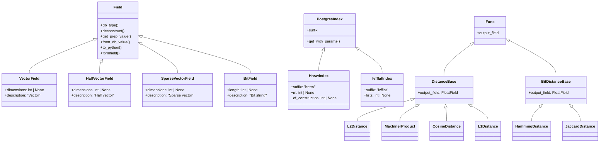
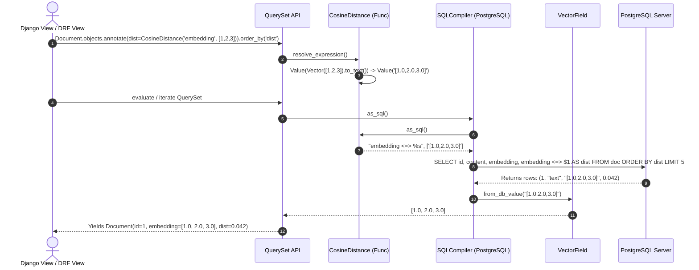

# pgvector-python: Django Integration Deep Dive

> **Document Version:** 1.0.0  
> **Target SDK:** `pgvector-python` (`pgvector.django`)  
> **Framework Compatibility:** Django 4.2 LTS, 5.0+, 6.0+  
> **Driver Compatibility:** `django.db.backends.postgresql` (`psycopg` v3, `psycopg2`)  
> **Source Files Inspected:**  
> - `pgvector/django/__init__.py`  
> - `pgvector/django/vector.py`  
> - `pgvector/django/halfvec.py`  
> - `pgvector/django/sparsevec.py`  
> - `pgvector/django/bit.py`  
> - `pgvector/django/indexes.py`  
> - `pgvector/django/functions.py`  
> - `pgvector/django/extensions.py`  
> - `tests/test_django.py`  

---

## Table of Contents

1. [Executive Summary](#1-executive-summary)
2. [Django ORM Architecture & Vector Integration](#2-django-orm-architecture--vector-integration)
   - [2.1 Custom Model Fields Lifecycle](#21-custom-model-fields-lifecycle)
   - [2.2 PostgreSQL Backend Extension Boundary](#22-postgresql-backend-extension-boundary)
   - [2.3 Class Hierarchy Overview](#23-class-hierarchy-overview)
3. [Field Type Implementations](#3-field-type-implementations)
   - [3.1 VectorField](#31-vectorfield)
   - [3.2 HalfVectorField](#32-halfvectorfield)
   - [3.3 SparseVectorField](#33-sparsevectorfield)
   - [3.4 BitField](#34-bitfield)
   - [3.5 Method Contracts: `db_type`, `from_db_value`, `to_python`, `get_prep_value`](#35-method-contracts-db_type-from_db_value-to_python-get_prep_value)
   - [3.6 Migration Deconstruction (`deconstruct`)](#36-migration-deconstruction-deconstruct)
   - [3.7 Form Fields, Widgets & Admin Integration](#37-form-fields-widgets--admin-integration)
4. [Custom Index Subsystem (`indexes.py`)](#4-custom-index-subsystem-indexespy)
   - [4.1 PostgresIndex Foundation](#41-postgresindex-foundation)
   - [4.2 HnswIndex](#42-hnswindex)
   - [4.3 IvfflatIndex](#43-ivfflatindex)
   - [4.4 Operator Classes (`opclasses`)](#44-operator-classes-opclasses)
   - [4.5 Functional / Expression Indexing with `OpClass` and `Cast`](#45-functional--expression-indexing-with-opclass-and-cast)
5. [Distance Functions & Query Expressions (`functions.py`)](#5-distance-functions--query-expressions-functionspy)
   - [5.1 Django `Func` Subclassing Architecture](#51-django-func-subclassing-architecture)
   - [5.2 DistanceBase and Infix Operator Joining](#52-distancebase-and-infix-operator-joining)
   - [5.3 Percent Sign Escaping (`<%%>`) for Jaccard Distance](#53-percent-sign-escaping--for-jaccard-distance)
   - [5.4 Unhashable Argument Prevention in `_constructor_args`](#54-unhashable-argument-prevention-in-_constructor_args)
   - [5.5 Concrete Distance Functions Matrix](#55-concrete-distance-functions-matrix)
6. [Database Migrations & Extensions (`extensions.py`)](#6-database-migrations--extensions-extensionspy)
   - [6.1 The `VectorExtension` Migration Operation](#61-the-vectorextension-migration-operation)
   - [6.2 Django 6+ Version Compatibility Mechanism](#62-django-6-version-compatibility-mechanism)
   - [6.3 Typical Migration Script Blueprint](#63-typical-migration-script-blueprint)
7. [Query Patterns & Real-World Usage](#7-query-patterns--real-world-usage)
   - [7.1 Nearest Neighbor Search (`annotate` + `order_by`)](#71-nearest-neighbor-search-annotate--order_by)
   - [7.2 Distance Filtering via QuerySet `alias()`](#72-distance-filtering-via-queryset-alias)
   - [7.3 Aggregations (`Avg`, `Sum`)](#73-aggregations-avg-sum)
   - [7.4 Multi-Vector Arrays (`ArrayField(VectorField(...))`)](#74-multi-vector-arrays-arrayfieldvectorfield)
   - [7.5 On-the-Fly Casting of Array and Decimal Columns](#75-on-the-fly-casting-of-array-and-decimal-columns)
   - [7.6 Django REST Framework & Model Serializers](#76-django-rest-framework--model-serializers)
8. [Architectural Diagrams](#8-architectural-diagrams)

---

## 1. Executive Summary

`pgvector.django` integrates vector storage, distance metrics, and approximate nearest neighbor (ANN) indexing directly into the Django Object-Relational Mapper (ORM).

By adhering to Django's standard extension APIs (`django.db.models.Field`, `django.contrib.postgres.indexes.PostgresIndex`, `django.db.models.Func`, and `django.contrib.postgres.operations.CreateExtension`), `pgvector-python` provides:
- **First-Class Fields:** `VectorField`, `HalfVectorField`, `SparseVectorField`, and `BitField` handle DDL typing, migration serialization, and bi-directional Python/PostgreSQL conversions.
- **Migration-Aware Indexes:** `HnswIndex` and `IvfflatIndex` integrate with Django's migration engine (`makemigrations` and `migrate`), serializing configuration parameters (`m`, `ef_construction`, `lists`, `opclasses`) into migration files.
- **ORM Expressions:** Distance functions (`L2Distance`, `MaxInnerProduct`, `CosineDistance`, `L1Distance`, `HammingDistance`, `JaccardDistance`) compile into PostgreSQL infix operators (`<->`, `<#>`, `<=>`, `<+>`, `<~>`, `<%>`), participating naturally in `annotate()`, `filter()`, `alias()`, and `order_by()`.
- **Automatic Extension Activation:** `VectorExtension` provides an idempotent migration operation (`CREATE EXTENSION IF NOT EXISTS vector`).
- **Full Django Ecosystem Compatibility:** Supports Django Admin, `ModelForm`, validation via `full_clean()`, fixture serialization (`json`, `xml`), and `ArrayField` nesting.

---

## 2. Django ORM Architecture & Vector Integration

### 2.1 Custom Model Fields Lifecycle

In Django, custom database types extend `django.db.models.Field`. When a field is instantiated on a model:
1. **Model Definition:** Django inspects field attributes and dimensions during model class construction.
2. **Migration Serialization:** `deconstruct()` serializes field arguments into executable Python statements stored in `migrations/*.py`.
3. **DDL Generation:** `db_type(connection)` queries the field to emit the SQL column type (`vector(1536)`).
4. **DML Value Preparation:** `get_prep_value(value)` formats Python values (lists, NumPy arrays, `SparseVector`) into database-compatible strings before SQL parameter binding.
5. **DML Value Deserialization:** `from_db_value(value, expression, connection)` converts raw PostgreSQL wire data back into clean Python lists or vector objects when records are loaded into model instances.

```
+------------------------------------------------------------------------------------+
|                                    Django Model                                    |
+------------------------------------------------------------------------------------+
       |                                      |                                  |
 [makemigrations]                        [save() / INSERT]                 [QuerySet / SELECT]
       |                                      |                                  |
       v                                      v                                  v
+-------------------+              +----------------------+             +--------------------+
|   deconstruct()   |              |  get_prep_value()    |             |  from_db_value()   |
|   db_type()       |              |  Vector._to_db()     |             |  Vector._from_db() |
+-------------------+              +----------------------+             +--------------------+
       |                                      |                                  |
       v                                      v                                  v
migrations.CreateModel(...)           SQL Parameter Binding               Model.embedding =
 "vector(1536)"                        "'[0.1, 0.2, 0.3]'"                 [0.1, 0.2, 0.3]
```

### 2.2 PostgreSQL Backend Extension Boundary

`pgvector.django` builds on top of `django.contrib.postgres`. It requires `'django.contrib.postgres'` in `INSTALLED_APPS` whenever operator classes (`OpClass`) or PostgreSQL-specific index facilities are configured.

### 2.3 Class Hierarchy Overview



---

## 3. Field Type Implementations

### 3.1 VectorField

Defined in `pgvector/django/vector.py`:

```python
class VectorField(Field):
    description = 'Vector'
    empty_strings_allowed = False

    def __init__(self, *args: Any, dimensions: int | None = None, **kwargs: Any) -> None:
        self.dimensions = dimensions
        super().__init__(*args, **kwargs)

    def db_type(self, connection: Any) -> str:
        if self.dimensions is None:
            return 'vector'
        return 'vector(%d)' % self.dimensions
```

- Accepts `dimensions=None` for unconstrained dimension vector columns, or `dimensions=N` (e.g., 1536) for fixed-length vector columns.
- Disallows empty strings (`empty_strings_allowed = False`) to prevent inserting `""` into PostgreSQL vector columns.

### 3.2 HalfVectorField

Defined in `pgvector/django/halfvec.py`:

```python
class HalfVectorField(Field):
    description = 'Half vector'
    empty_strings_allowed = False

    def __init__(self, *args: Any, dimensions: int | None = None, **kwargs: Any) -> None:
        self.dimensions = dimensions
        super().__init__(*args, **kwargs)

    def db_type(self, connection: Any) -> str:
        if self.dimensions is None:
            return 'halfvec'
        return 'halfvec(%d)' % self.dimensions
```

- Emits `halfvec` or `halfvec(dimensions)` in PostgreSQL DDL.
- Interacts with `HalfVector._to_db` and `HalfVector._from_db`, supporting 16-bit float arrays.

### 3.3 SparseVectorField

Defined in `pgvector/django/sparsevec.py`:

```python
class SparseVectorField(Field):
    description = 'Sparse vector'
    empty_strings_allowed = False

    def __init__(self, *args: Any, dimensions: int | None = None, **kwargs: Any):
        self.dimensions = dimensions
        super().__init__(*args, **kwargs)

    def db_type(self, connection: Any) -> str:
        if self.dimensions is None:
            return 'sparsevec'
        return 'sparsevec(%d)' % self.dimensions

    def from_db_value(self, value: Any, expression: Any, connection: Any) -> SparseVector | None:
        return SparseVector._from_db(value)

    def to_python(self, value: Any) -> SparseVector | None:
        return SparseVector._from_db(value)
```

- Returns instances of `pgvector.SparseVector` upon retrieval.

### 3.4 BitField

Defined in `pgvector/django/bit.py`:

```python
class BitField(Field):
    description = 'Bit string'

    def __init__(self, *args: Any, length: int | None = None, **kwargs: Any) -> None:
        self.length = length
        super().__init__(*args, **kwargs)

    def db_type(self, connection: Any) -> str:
        if self.length is None:
            return 'bit'
        return 'bit(%d)' % self.length
```

- Generates PostgreSQL native `bit` or `bit(length)` columns for binary quantized vectors.

### 3.5 Method Contracts: `db_type`, `from_db_value`, `to_python`, `get_prep_value`

Each field adheres to Django's value conversion lifecycle:

| Lifecycle Method | Direction | Implementation in `VectorField` | Purpose |
|---|---|---|---|
| `db_type(conn)` | Schema | `'vector(%d)' % self.dimensions` | Generates column DDL for table creation |
| `get_prep_value(val)` | Python $\rightarrow$ DB | `Vector._to_db(val)` | Converts list/array/vector to string `"[1,2,3]"` for SQL bind parameter |
| `from_db_value(val, ...)` | DB $\rightarrow$ Python | `Vector._from_db(val)` | Converts database wire string to `list[float]` when loading models |
| `to_python(val)` | Any $\rightarrow$ Python | Passes `list` or converts via `Vector._from_db(val)` | Standardizes deserialization during forms, model cleaning, and fixtures |
| `value_to_string(obj)` | Model $\rightarrow$ String | `self.get_prep_value(self.value_from_object(obj))` | Serializes value for Django `dumpdata` (JSON/XML serializers) |

### 3.6 Migration Deconstruction (`deconstruct`)

Django's migration framework reconstructs field definitions by invoking `deconstruct()`:

```python
def deconstruct(self) -> tuple[Any, Any, Any, Any]:
    name, path, args, kwargs = super().deconstruct()
    if self.dimensions is not None:
        kwargs['dimensions'] = self.dimensions
    return name, path, args, kwargs
```

This ensures `makemigrations` preserves the `dimensions` (or `length` for `BitField`) argument when generating migration operations:

```python
# Generated migration file
migrations.AddField(
    model_name='item',
    name='embedding',
    field=pgvector.django.VectorField(dimensions=1536, null=True, blank=True),
),
```

### 3.7 Form Fields, Widgets & Admin Integration

To allow vector fields to appear in Django Admin and `ModelForm` instances without crashing, each field defines a corresponding formfield and widget:

```python
# VectorFormField accepts text representation in forms and parses empty strings to None
class VectorFormField(forms.CharField):
    def to_python(self, value: Any) -> Any:
        if isinstance(value, str) and value == '':
            return None
        return super().to_python(value)

# SparseVectorWidget formats SparseVector into text string '{1:1,2:2}/3'
class SparseVectorWidget(forms.TextInput):
    def format_value(self, value: Any) -> Any:
        if isinstance(value, SparseVector):
            value = value.to_text()
        return super().format_value(value)
```

In the Django Admin or custom forms:
- An instance loaded into a form renders as an editable string: `value="[1.0, 2.0, 3.0]"`
- Saving with `''` converts to `None` if `null=True, blank=True`.

---

## 4. Custom Index Subsystem (`indexes.py`)

### 4.1 PostgresIndex Foundation

PostgreSQL-specific indexes in Django extend `django.contrib.postgres.indexes.PostgresIndex`. `PostgresIndex` manages:
- Parameter storage and serialization in migrations.
- Appending storage parameters to the `WITH (...)` clause.
- Linking operator classes via `opclasses`.

### 4.2 HnswIndex

Defined in `pgvector/django/indexes.py`:

```python
class HnswIndex(PostgresIndex):
    suffix = 'hnsw'

    def __init__(self, *expressions: Any, m: int | None = None, ef_construction: int | None = None, **kwargs: Any) -> None:
        self.m = m
        self.ef_construction = ef_construction
        super().__init__(*expressions, **kwargs)

    def deconstruct(self) -> tuple[Any, Any, Any]:
        path, args, kwargs = super().deconstruct()
        if self.m is not None:
            kwargs['m'] = self.m
        if self.ef_construction is not None:
            kwargs['ef_construction'] = self.ef_construction
        return path, args, kwargs

    def get_with_params(self) -> list[str]:
        with_params = []
        if self.m is not None:
            with_params.append('m = %d' % self.m)
        if self.ef_construction is not None:
            with_params.append('ef_construction = %d' % self.ef_construction)
        return with_params
```

- **`suffix = 'hnsw'`**: Appended to auto-generated index names.
- **`get_with_params()`**: Emits `WITH (m = 16, ef_construction = 64)` during index creation.

### 4.3 IvfflatIndex

Defined in `pgvector/django/indexes.py`:

```python
class IvfflatIndex(PostgresIndex):
    suffix = 'ivfflat'

    def __init__(self, *expressions: Any, lists: int | None = None, **kwargs: Any) -> None:
        self.lists = lists
        super().__init__(*expressions, **kwargs)

    def deconstruct(self) -> tuple[Any, Any, Any]:
        path, args, kwargs = super().deconstruct()
        if self.lists is not None:
            kwargs['lists'] = self.lists
        return path, args, kwargs

    def get_with_params(self) -> list[str]:
        with_params = []
        if self.lists is not None:
            with_params.append('lists = %d' % self.lists)
        return with_params
```

- **`get_with_params()`**: Emits `WITH (lists = 100)`.

### 4.4 Operator Classes (`opclasses`)

Vector indexes require an operator class matching the search distance metric. In Django models, specify `opclasses`:

```python
class Item(models.Model):
    embedding = VectorField(dimensions=1536)

    class Meta:
        indexes = [
            HnswIndex(
                name='item_vector_cosine_hnsw_idx',
                fields=['embedding'],
                m=16,
                ef_construction=64,
                opclasses=['vector_cosine_ops']
            ),
            IvfflatIndex(
                name='item_vector_l2_ivfflat_idx',
                fields=['embedding'],
                lists=100,
                opclasses=['vector_l2_ops']
            )
        ]
```

### 4.5 Functional / Expression Indexing with `OpClass` and `Cast`

Django supports indexing SQL expressions using `OpClass` from `django.contrib.postgres.indexes` and `Cast` from `django.db.models.functions`.

#### Half-Precision Indexing on Full-Precision Column
Build an index on halfvec representations to conserve memory:

```python
from django.contrib.postgres.indexes import OpClass
from django.db.models.functions import Cast
from pgvector.django import HnswIndex, HalfVectorField

class Item(models.Model):
    embedding = VectorField(dimensions=1536)

    class Meta:
        indexes = [
            HnswIndex(
                OpClass(Cast('embedding', HalfVectorField(dimensions=1536)), name='halfvec_l2_ops'),
                name='item_halfvec_hnsw_idx',
                m=16,
                ef_construction=64
            )
        ]
```

---

## 5. Distance Functions & Query Expressions (`functions.py`)

### 5.1 Django `Func` Subclassing Architecture

Django provides `django.db.models.Func` to represent database functions and expressions. Normally, `Func` compiles to prefix function call syntax: `FUNCTION_NAME(arg1, arg2)`.

However, PostgreSQL vector operators are infix operators (`col <-> query`). `pgvector.django` achieves infix compilation by configuring:
- `function = ''` (empty function name)
- `arg_joiner = ' <-> '` (the operator acting as the joiner between operands)

### 5.2 DistanceBase and Infix Operator Joining

Defined in `pgvector/django/functions.py`:

```python
class DistanceBase(Func):
    output_field = FloatField()

    def __init__(self, expression: Any, vector: Any, /, **extra: Any) -> None:
        if not hasattr(vector, 'resolve_expression'):
            if isinstance(vector, (Vector, HalfVector, SparseVector)):
                vector = Value(vector.to_text())
            elif vector is not None:
                vector = Value(Vector(vector).to_text())

            # prevent error with unhashable types
            self._constructor_args = ((expression, vector), extra)

        super().__init__(expression, vector, **extra)
```

1. **`resolve_expression` Check:** If `vector` is a model field expression (e.g., `F('other_embedding')`), it is passed through as an expression node.
2. **Value Wrapping:** If `vector` is a Python list or array, it is converted to text representation and wrapped in Django's `Value(...)` expression node.
3. **`output_field = FloatField()`:** Informs Django that distance calculations evaluate to floating-point numbers, enabling mathematical ordering, filtering, and aggregation.

### 5.3 Percent Sign Escaping (`<%%>`) for Jaccard Distance

In Python and Django database backends, `%` is the format placeholder character. PostgreSQL's Jaccard distance operator for bit strings is `<%>`.

In `pgvector/django/functions.py`:

```python
class JaccardDistance(BitDistanceBase):
    function = ''
    arg_joiner = ' <%%> '
```

By specifying `' <%%> '`, Django's query formatting string compiler correctly escapes the percent signs into a single `<%>` operator when preparing the raw SQL string.

### 5.4 Unhashable Argument Prevention in `_constructor_args`

Django caches and compares query expressions using `self._constructor_args`. When a Python `list` is passed directly as an argument, Django attempts to hash it, resulting in `TypeError: unhashable type: 'list'`.

By wrapping the vector into `Value(Vector(vector).to_text())` and setting:
```python
self._constructor_args = ((expression, vector), extra)
```
the constructor stores an immutable string-backed `Value` object, preventing unhashable type exceptions during QuerySet cloning and compilation.

### 5.5 Concrete Distance Functions Matrix

| Class Name | PostgreSQL Operator | Metric | Applicable Fields |
|---|---|---|---|
| `L2Distance` | `<->` | Euclidean / L2 Distance | `VectorField`, `HalfVectorField`, `SparseVectorField` |
| `MaxInnerProduct` | `<#>` | Negative Inner Product | `VectorField`, `HalfVectorField`, `SparseVectorField` |
| `CosineDistance` | `<=>` | Cosine Distance | `VectorField`, `HalfVectorField`, `SparseVectorField` |
| `L1Distance` | `<+>` | Taxicab / Manhattan | `VectorField`, `HalfVectorField`, `SparseVectorField` |
| `HammingDistance` | `<~>` | Hamming Distance | `BitField` |
| `JaccardDistance` | `<%>` | Jaccard Distance | `BitField` |

---

## 6. Database Migrations & Extensions (`extensions.py`)

### 6.1 The `VectorExtension` Migration Operation

Defined in `pgvector/django/extensions.py`:

```python
class VectorExtension(CreateExtension):
    def __init__(self, hints: Any = None) -> None:
        if VERSION[0] >= 6:
            super().__init__('vector', hints=hints)
        else:
            self.name = 'vector'
```

Extends `django.contrib.postgres.operations.CreateExtension`. When `python manage.py migrate` runs, it executes:
```sql
CREATE EXTENSION IF NOT EXISTS vector;
```

### 6.2 Django 6+ Version Compatibility Mechanism

In Django 6.0+, `CreateExtension.__init__` accepts `hints` for schema validation and planning. In Django 5.x and 4.x, `CreateExtension.__init__` takes only the extension name. The conditional inspection:
```python
if VERSION[0] >= 6:
    super().__init__('vector', hints=hints)
else:
    self.name = 'vector'
```
ensures zero deprecation warnings across current and future Django releases.

### 6.3 Typical Migration Script Blueprint

A complete initial migration script created via `VectorExtension` and `HnswIndex`:

```python
from django.db import migrations, models
import pgvector.django

class Migration(migrations.Migration):
    initial = True

    dependencies = [
        ('django.contrib.postgres', '__first__'),
    ]

    operations = [
        # Step 1: Install vector extension in Postgres
        pgvector.django.VectorExtension(),

        # Step 2: Create model table
        migrations.CreateModel(
            name='Document',
            fields=[
                ('id', models.BigAutoField(auto_created=True, primary_key=True, serialize=False)),
                ('content', models.TextField()),
                ('embedding', pgvector.django.VectorField(dimensions=1536, null=True, blank=True)),
            ],
        ),

        # Step 3: Create HNSW index
        migrations.AddIndex(
            model_name='document',
            index=pgvector.django.HnswIndex(
                fields=['embedding'],
                name='doc_embedding_hnsw_idx',
                m=16,
                ef_construction=64,
                opclasses=['vector_cosine_ops']
            ),
        ),
    ]
```

---

## 7. Query Patterns & Real-World Usage

### 7.1 Nearest Neighbor Search (`annotate` + `order_by`)

The canonical pattern for similarity retrieval in Django:

```python
from pgvector.django import CosineDistance

query_vector = [0.12, 0.45, -0.78, ...] # 1536 dimensions

# Retrieve 5 nearest documents with annotated distance
documents = (
    Document.objects
    .annotate(distance=CosineDistance('embedding', query_vector))
    .order_by('distance')[:5]
)

for doc in documents:
    print(f"Doc {doc.id}: Score {doc.distance:.4f} | {doc.content[:50]}")
```

### 7.2 Distance Filtering via QuerySet `alias()`

When filtering by distance without including the distance column in the final SQL `SELECT` payload (reducing network transfer):

```python
from pgvector.django import L2Distance

distance_expr = L2Distance('embedding', query_vector)

# alias() computes expression in WHERE and ORDER BY without projecting into SELECT
nearby_items = (
    Item.objects
    .alias(distance=distance_expr)
    .filter(distance__lt=1.0)
    .order_by('distance')
)
```

### 7.3 Aggregations (`Avg`, `Sum`)

pgvector registers PostgreSQL aggregate functions that operate natively with Django's `Avg` and `Sum`:

```python
from django.db.models import Avg, Sum

# Computes centroid vector of all articles in category
centroid = Article.objects.filter(category='tech').aggregate(Avg('embedding'))['embedding__avg']
# Returns list[float]: [0.23, 0.41, ...]

# Element-wise sum of sparse vectors
sparse_sum = Article.objects.aggregate(Sum('sparse_embedding'))['sparse_embedding__sum']
```

### 7.4 Multi-Vector Arrays (`ArrayField(VectorField(...))`)

For token-level embeddings (such as ColBERT) or document section representations:

```python
from django.contrib.postgres.fields import ArrayField
from pgvector.django import VectorField

class ColBertDocument(models.Model):
    title = models.CharField(max_length=255)
    token_embeddings = ArrayField(
        VectorField(dimensions=128),
        null=True,
        blank=True
    )
```

### 7.5 On-the-Fly Casting of Array and Decimal Columns

If vector representations are stored in existing `ArrayField(FloatField())` or `DecimalField` columns, they can be cast into `VectorField()` dynamically in queries:

```python
from django.db.models.functions import Cast
from pgvector.django import L2Distance, VectorField

# Cast float array to vector on-the-fly and search
distance = L2Distance(Cast('double_embedding', VectorField(dimensions=3)), [1.0, 1.0, 1.0])
results = Item.objects.annotate(distance=distance).order_by(distance)[:5]
```

### 7.6 Django REST Framework & Model Serializers

Because `VectorField.to_python` and `VectorField.from_db_value` both emit standard Python lists (`list[float]`), Django REST Framework serializers serialize and deserialize vector fields as standard JSON arrays:

```python
from rest_framework import serializers

class DocumentSerializer(serializers.ModelSerializer):
    class Meta:
        model = Document
        fields = ['id', 'content', 'embedding']
        # embedding automatically serializes as: [0.1, 0.2, 0.3, ...]
```

---

## 8. Architectural Diagrams

### 8.1 Django Query Compilation & Execution Cycle


