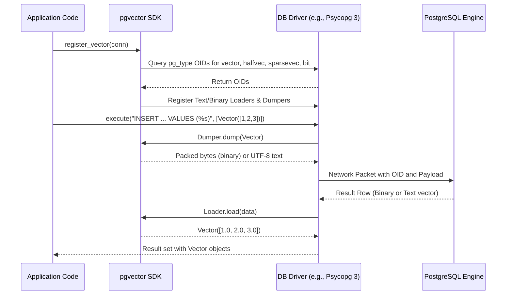

# pgvector Python SDK: Architecture & Package Overview

> Comprehensive architectural analysis of `pgvector-python` (version 0.5.1+), its design philosophy, zero-dependency core, module organization, static typing architecture, adapter integration model, and installation mechanisms.

---

## Table of Contents
1. [Executive Summary](#1-executive-summary)
2. [Design Philosophy & Architectural Goals](#2-design-philosophy--architectural-goals)
   - [The Problem Space](#the-problem-space)
   - [Zero-Dependency Core Strategy](#zero-dependency-core-strategy)
   - [Lazy Dynamic Interoperability](#lazy-dynamic-interoperability)
   - [Dual Protocol Architecture: Binary vs Text](#dual-protocol-architecture-binary-vs-text)
3. [Package Structure & Module Hierarchy](#3-package-structure--module-hierarchy)
   - [Source Tree Layout](#source-tree-layout)
   - [Subpackage Roles and Responsibilities](#subpackage-roles-and-responsibilities)
4. [Package Export Strategy](#4-package-export-strategy)
   - [Root Namespace Hygiene (`pgvector/__init__.py`)](#root-namespace-hygiene-pgvector__init__py)
   - [Submodule Isolation & Import Cost Minimization](#submodule-isolation--import-cost-minimization)
5. [Dependencies & Build System Configuration](#5-dependencies--build-system-configuration)
   - [Build Backend & pyproject.toml](#build-backend--pyprojecttoml)
   - [Runtime Dependency Specification](#runtime-dependency-specification)
   - [Dependency Groups & Optional Ecosystems](#dependency-groups--optional-ecosystems)
   - [Python Runtime Version Boundaries](#python-runtime-version-boundaries)
6. [Type System & Static Verification (`py.typed`)](#6-type-system--static-verification-pytyped)
   - [PEP 561 Inline Type Marker](#pep-561-inline-type-marker)
   - [Type Checking Pipeline: Mypy, Pyright, Ty, and Pyrefly](#type-checking-pipeline-mypy-pyright-ty-and-pyrefly)
   - [Conditional Typing Constructs & TypeAlias Patterns](#conditional-typing-constructs--typealias-patterns)
7. [Database Drivers & ORMs Support Matrix](#7-database-drivers--orms-support-matrix)
   - [Comprehensive Compatibility Matrix](#comprehensive-compatibility-matrix)
   - [Distance Metrics & Operator Mappings](#distance-metrics--operator-mappings)
   - [Index Construction & Vector Operations](#index-construction--vector-operations)
8. [Driver Registration & Protocol Adaptation Architecture](#8-driver-registration--protocol-adaptation-architecture)
   - [Low-Level Drivers: Psycopg 3, Psycopg 2, asyncpg, pg8000](#low-level-drivers-psycopg-3-psycopg-2-asyncpg-pg8000)
   - [High-Level ORMs: SQLAlchemy, Django, Peewee, SQLModel](#high-level-orms-sqlalchemy-django-peewee-sqlmodel)
9. [Installation Options & Practical Workflows](#9-installation-options--practical-workflows)

---

## 1. Executive Summary

The `pgvector-python` package is the official Python client library for the [pgvector](https://github.com/pgvector/pgvector) PostgreSQL extension. It bridges the gap between Python numerical/vector representations (Python lists, NumPy 1D arrays, SciPy sparse matrices, raw bitstrings) and PostgreSQL native geometric vector types (`vector`, `halfvec`, `sparsevec`, `bit`).

Unlike bulky machine learning data loaders or framework-heavy database plugins, `pgvector-python` is engineered as a **micro-library with zero mandatory runtime dependencies**. It relies exclusively on Python standard library modules (`array`, `struct`, `sys`, `typing`) to achieve high-performance binary packing and text serialization, while providing lazy, opt-in integration layers for every major PostgreSQL driver (Psycopg 3, Psycopg 2, asyncpg, pg8000) and ORM (SQLAlchemy, SQLModel, Django ORM, Peewee).

```mermaid
flowchart TD
    subgraph User Application & ML Ecosystem
        ML[Python Lists / NumPy / SciPy / Bitstrings]
    end

    subgraph pgvector Core Package [pgvector Core (Zero Dependencies)]
        V[Vector (32-bit float)]
        HV[HalfVector (16-bit float)]
        SV[SparseVector (dim, indices, values)]
        B[Bit (bitstring)]
        UT[_utils.py (Lazy reflection)]
    end

    subgraph Driver Adapters [pgvector Submodules]
        P3[pgvector.psycopg (Text + Binary Dumpers/Loaders)]
        P2[pgvector.psycopg2 (Text Adapters + Casters)]
        APG[pgvector.asyncpg (Binary Codecs)]
        P8[pgvector.pg8000 (In/Out Adapters)]
    end

    subgraph ORM Integrations [pgvector Submodules]
        SA[pgvector.sqlalchemy / SQLModel (VECTOR, HALFVEC, SPARSEVEC, BIT)]
        DJ[pgvector.django (VectorField, Indexes, Lookups)]
        PW[pgvector.peewee (VectorField, Distance Expressions)]
    end

    subgraph PostgreSQL Database
        PG[(PostgreSQL with pgvector extension)]
    end

    ML --> V & HV & SV & B
    V & HV & SV & B --> P3 & P2 & APG & P8
    V & HV & SV & B --> SA & DJ & PW
    P3 & P2 & APG & P8 -->|Wire Protocol| PG
    SA & DJ & PW -->|Underlying Driver| PG
```

---

## 2. Design Philosophy & Architectural Goals

### The Problem Space
PostgreSQL vector operations require efficient translation between in-memory application data structures and the database communication channel. Prior to `pgvector-python`, developers faced three primary hurdles:
1. **Inefficient String Conversions**: Vector embeddings (often 768 to 4096 dimensions) serialized naively through string formatters cause substantial memory allocation overhead and CPU time on both client and database.
2. **Type System Fragmentation**: Different Python database drivers have incompatible extension mechanisms. Psycopg 3 uses type dumpers/loaders with text and binary formats; Psycopg 2 uses `ISQLQuote` adapters and `new_type` casters; `asyncpg` uses low-level PostgreSQL type OIDs with binary encoders/decoders; `pg8000` uses in/out adapters.
3. **Dependency Hell**: Forcing a package dependency on heavyweight numerical libraries like NumPy (~30MB binary wheel) or SciPy (~50MB) makes a database connector unacceptable for lightweight serverless microservices, AWS Lambda functions, and standard Django web deployments that may not need NumPy.

### Zero-Dependency Core Strategy
The defining architectural decision of `pgvector-python` is:

> **Zero mandatory runtime dependencies outside the Python Standard Library.**

The package achieves this by leveraging:
- `array.array('f')` for contiguous single-precision (float32) memory storage.
- `array.array('H')` (unsigned 16-bit integer) combined with `struct.pack(f'{dim}e', *value)` for half-precision (float16) representations without requiring NumPy.
- Standard Python `bytes` and `struct.pack` / `struct.unpack_from` for binary serialization.
- Dynamic module inspection via `sys.modules.get(...)` rather than eager `import numpy` or `import scipy`.

As defined in `pyproject.toml`:
```toml
[project]
name = "pgvector"
version = "0.5.1"
dependencies = [
]
```
The `dependencies` list is strictly empty.

### Lazy Dynamic Interoperability
NumPy and SciPy are first-class citizens in modern AI/ML workloads, but they are not required at runtime. In `pgvector/_utils.py`:

```python
import sys

def is_ndarray(value: object, /) -> bool:
    if (numpy := sys.modules.get('numpy')):
        return isinstance(value, numpy.ndarray)
    return False

def is_sparse_array(value: object, /) -> bool:
    if (sparse := sys.modules.get('scipy.sparse')):
        return isinstance(value, (sparse.sparray, sparse.spmatrix))
    return False
```

If the host application has imported NumPy, `sys.modules.get('numpy')` returns the module and `isinstance(value, numpy.ndarray)` executes cleanly. If NumPy is not installed or not imported, the function returns `False` in O(1) time without triggering an `ImportError` or spawning slow import-lookup hooks.

When NumPy arrays *are* supplied, `Vector` and `HalfVector` support zero-copy buffer casting through `memoryview` and `.cast('B')` into native Python `array` instances.

### Dual Protocol Architecture: Binary vs Text
PostgreSQL client/server communication operates in either **Text Protocol** or **Binary Protocol**.
- **Text Protocol**: Values are formatted as ASCII strings (e.g., `'[1.0,2.0,3.0]'` or `'{1:1.5,3:2.0}/6'`).
  - Human readable, supported by all drivers.
  - Incurs string formatting overhead, floating-point parsing precision variance, and string copying.
- **Binary Protocol**: Values are formatted in the exact network byte order (big-endian) binary layout expected by pgvector C functions (`vector_recv`, `halfvec_recv`, `sparsevec_recv`).
  - Zero loss of floating-point precision.
  - Substantially smaller payload size (4 bytes header + raw 4-byte/2-byte floats vs variable-length decimal strings).
  - Faster deserialization directly into memory buffers.

`pgvector-python` implements high-performance converters for both:
- `to_text()` / `from_text()` for text-based pipelines.
- `to_binary()` / `from_binary()` for binary-enabled drivers (`psycopg`, `asyncpg`).

---

## 3. Package Structure & Module Hierarchy

### Source Tree Layout

The package repository (`pgvector-python/pgvector`) is structured cleanly around the 4 core types and driver/ORM submodules:

```
pgvector/
├── __init__.py           # Root package exports: Vector, HalfVector, Bit, SparseVector
├── _utils.py             # Internal runtime utilities (lazy imports, TypeAlias stubs)
├── bit.py                # Bit core type (PostgreSQL bit / varbit)
├── halfvec.py            # HalfVector core type (PostgreSQL halfvec, fp16)
├── py.typed              # PEP 561 marker file for type checkers
├── sparsevec.py          # SparseVector core type (PostgreSQL sparsevec)
├── vector.py             # Vector core type (PostgreSQL vector, fp32)
│
├── asyncpg/              # asyncpg driver integration
│   ├── __init__.py       # Exports register_vector
│   └── register.py       # Binary codec registration via set_type_codec
│
├── django/               # Django ORM integration
│   ├── __init__.py       # Exports fields, extensions, indexes, distance functions
│   ├── bit.py            # BitField (models.Field)
│   ├── extensions.py     # VectorExtension (Migration operation)
│   ├── functions.py      # L2Distance, CosineDistance, MaxInnerProduct, etc.
│   ├── halfvec.py        # HalfVectorField (models.Field)
│   ├── indexes.py        # HnswIndex, IvfflatIndex (PostgresIndex)
│   ├── sparsevec.py      # SparseVectorField (models.Field)
│   └── vector.py         # VectorField (models.Field)
│
├── peewee/               # Peewee ORM integration
│   ├── __init__.py       # Exports VectorField, HalfVectorField, FixedBitField, SparseVectorField
│   ├── bit.py            # FixedBitField with distance expressions
│   ├── halfvec.py        # HalfVectorField with distance expressions
│   ├── sparsevec.py      # SparseVectorField with distance expressions
│   └── vector.py         # VectorField with distance expressions
│
├── pg8000/               # pg8000 driver integration
│   ├── __init__.py       # Exports register_vector
│   └── register.py       # In/out adapter registration
│
├── psycopg/              # Psycopg 3 driver integration
│   ├── __init__.py       # Exports register_vector, register_vector_async
│   ├── bit.py            # BitDumper, BitBinaryDumper
│   ├── halfvec.py        # HalfVectorDumper, HalfVectorBinaryDumper, HalfVectorLoader, etc.
│   ├── register.py       # Driver registration logic for sync and async connections
│   ├── sparsevec.py      # SparseVectorDumper, SparseVectorBinaryDumper, etc.
│   └── vector.py         # VectorDumper, VectorBinaryDumper, VectorLoader, VectorBinaryLoader
│
├── psycopg2/             # Psycopg 2 driver integration
│   ├── __init__.py       # Exports register_vector
│   ├── halfvec.py        # HalfVectorAdapter, cast_halfvec
│   ├── register.py       # Adapter & type registration logic (global or scoped)
│   ├── sparsevec.py      # SparseVectorAdapter, cast_sparsevec
│   └── vector.py         # VectorAdapter, cast_vector
│
└── sqlalchemy/           # SQLAlchemy 2+ & SQLModel integration
    ├── __init__.py       # Exports VECTOR, Vector, HALFVEC, BIT, SPARSEVEC, avg, sum
    ├── bit.py            # BIT (TypeDecorator wrapping PGBit)
    ├── functions.py      # avg, sum SQL aggregate functions
    ├── halfvec.py        # HALFVEC (UserDefinedType)
    ├── sparsevec.py      # SPARSEVEC (UserDefinedType)
    └── vector.py         # VECTOR (UserDefinedType) with distance operators (<->, <=>, <#>, <+>)
```

### Subpackage Roles and Responsibilities

| Submodule | Purpose | Primary Target |
|---|---|---|
| `pgvector` (Root) | Core value types and zero-dependency vector representations | All consumers |
| `pgvector.psycopg` | Type registration for Psycopg 3 (sync and async), supporting both text and binary formats | Psycopg 3 applications |
| `pgvector.psycopg2` | Type casting and quoting adapters for Psycopg 2 | Legacy and enterprise Psycopg 2 stacks |
| `pgvector.asyncpg` | High-throughput binary codec registration | High-performance asynchronous services |
| `pgvector.pg8000` | Pure-Python PostgreSQL driver in/out adapter registration | Environments where C-extensions are disallowed |
| `pgvector.sqlalchemy` | SQLAlchemy custom column types (`VECTOR`, `HALFVEC`, `SPARSEVEC`, `BIT`), distance operator comparators, and aggregation functions | SQLAlchemy 2.0+ and SQLModel |
| `pgvector.django` | Django model fields, migration extensions (`CREATE EXTENSION vector`), distance expressions, and index classes | Django Web Framework |
| `pgvector.peewee` | Custom Peewee field classes with chained distance operator methods | Lightweight Peewee ORM applications |

---

## 4. Package Export Strategy

### Root Namespace Hygiene (`pgvector/__init__.py`)

The root `pgvector/__init__.py` maintains strict namespace encapsulation:

```python
from .bit import Bit
from .halfvec import HalfVector
from .sparsevec import SparseVector
from .vector import Vector

__all__ = [
    'Vector',
    'HalfVector',
    'Bit',
    'SparseVector'
]
```

Only the four fundamental value classes are exported at the root:
- `Vector`: 32-bit single-precision floating point vector (`vector` in SQL).
- `HalfVector`: 16-bit half-precision floating point vector (`halfvec` in SQL).
- `SparseVector`: Sparse vector with dimension, indices, and non-zero values (`sparsevec` in SQL).
- `Bit`: Binary vector packed into byte arrays (`bit` / `varbit` in SQL).

### Submodule Isolation & Import Cost Minimization

None of the driver or ORM adapters are imported in `pgvector/__init__.py`. 
For instance, importing `from pgvector import Vector` never triggers imports of `psycopg`, `sqlalchemy`, `django`, `asyncpg`, or `numpy`.

Each adapter must be imported explicitly from its designated submodule:
```python
# Driver registration imports
from pgvector.psycopg import register_vector
from pgvector.asyncpg import register_vector
from pgvector.sqlalchemy import VECTOR

# Root data types
from pgvector import Vector, HalfVector, SparseVector, Bit
```

This prevents circular imports, avoids runtime crashes when an uninstalled database library is present in the filesystem, and eliminates initialization overhead in serverless or fast-startup environments.

---

## 5. Dependencies & Build System Configuration

### Build Backend & pyproject.toml
`pgvector-python` uses the standard modern PEP 517 / PEP 621 build configuration:

```toml
[build-system]
requires = ["setuptools"]
build-backend = "setuptools.build_meta"

[project]
name = "pgvector"
version = "0.5.1"
description = "pgvector support for Python"
readme = "README.md"
authors = [
    {name = "Andrew Kane", email = "andrew@ankane.org"}
]
license = "MIT"
requires-python = ">= 3.10"
dependencies = [
]
```

### Runtime Dependency Specification
- **Mandatory dependencies**: None.
- **Python version requirement**: `>= 3.10`.
  - Leverages Python 3.10+ language features: positional-only parameters (`/`), union operator types (`list[float] | ndarray`), `TypeAlias`, and `match`-compatible constructs.

### Dependency Groups & Optional Ecosystems
`pyproject.toml` uses PEP 735 `dependency-groups` for development, numerical testing, and static analysis:

```toml
[dependency-groups]
dev = [
    "asyncpg",
    "Django",
    "peewee",
    "pg8000",
    "psycopg[binary,pool]",
    "psycopg2-binary",
    "pytest",
    "pytest-asyncio",
    "SQLAlchemy[asyncio]>=2",
    "sqlmodel"
]
numpy = ["numpy"]
scipy = ["scipy"]
typing = [
    "mypy",
    "ty",
    "numpy",
    "scipy"
]
```

### Python Runtime Version Boundaries
- **Python >= 3.10**: Required by `requires-python`.
- **Planned for 0.6.0**: Comments in the source code indicate deprecations and stricter validations targeted for version 0.6.0:
  - Replacing the `None` type stub with `typing.Never` when Python 3.10 support is dropped.
  - Stricter format enforcement in `from_text` (raising `ValueError` on malformed braces `{1]`).
  - Active index bounds validation in `SparseVector` constructor (`_validate()`, `_validate_sorted()`).
  - Transitioning binary pack string from `>HH` to `>hh`.

---

## 6. Type System & Static Verification (`py.typed`)

### PEP 561 Inline Type Marker
The package includes an empty `pgvector/py.typed` marker file. In accordance with PEP 561, this informs downstream type checkers (Mypy, Pyright, Ty, Pyrefly, Pyre) that `pgvector` distributes inline type annotations and that type checkers should inspect the `.py` source directly rather than looking for external stubs (`types-pgvector`).

### Type Checking Pipeline: Mypy, Pyright, Ty, and Pyrefly
`pgvector-python` enforces **strict** type checking across four distinct type checking tools:

```toml
[tool.mypy]
files = [
    "pgvector",
    "tests"
]
strict = true
disable_error_code = ["unused-ignore", "untyped-decorator"]
ignore_missing_imports = true
disallow_subclassing_any = false

[tool.pyright]
include = [
    "pgvector",
    "tests"
]
typeCheckingMode = "strict"
reportMissingTypeStubs = "none"
reportPrivateUsage = "none"
reportUnknownArgumentType = "none"
reportUnknownLambdaType = "none"
reportUnknownMemberType = "none"
reportUnknownVariableType = "none"

[tool.ty.src]
include = [
    "pgvector",
    "tests"
]

[tool.pyrefly]
project-includes = [
    "pgvector/**/*.py",
    "tests/**/*.py"
]
preset = "strict"
```

### Conditional Typing Constructs & TypeAlias Patterns
Because NumPy is an optional dependency, typing NumPy arrays presents a challenge: how can a library annotate `ndarray` arguments strictly without forcing NumPy to be installed when running downstream code?

`pgvector/_utils.py` solves this using `typing.TYPE_CHECKING`:

```python
import sys
from typing import TYPE_CHECKING, TypeAlias

if TYPE_CHECKING:
    import numpy as np

    ndarray: TypeAlias = np.ndarray[tuple[int, ...], np.dtype[np.floating]]
else:
    # any value works since not type checking
    # TODO use Never when Python 3.10 no longer supported
    ndarray = None
```

During static analysis (`TYPE_CHECKING = True`), the type checker imports NumPy and enforces that array arguments conform to `np.ndarray[tuple[int, ...], np.dtype[np.floating]]`. At runtime (`TYPE_CHECKING = False`), `ndarray` evaluates to `None`, avoiding any dynamic import or dependency check.

In `sparsevec.py`, overloads and sentinel types are utilized for clean typing of polymorphic constructors:
```python
class Sentinel:
    pass

NO_DEFAULT: Final[Sentinel] = Sentinel()

class SparseVector:
    @overload
    def __init__(self, value: dict[int, float], dimensions: int, /) -> None: ...

    @overload
    def __init__(self, value: list[float] | ndarray | sparray | spmatrix, /) -> None: ...
```

---

## 7. Database Drivers & ORMs Support Matrix

### Comprehensive Compatibility Matrix

The table below illustrates the level of support for each core type across the supported drivers and ORMs:

| Driver / ORM | `Vector` (`vector`) | `HalfVector` (`halfvec`) | `SparseVector` (`sparsevec`) | `Bit` (`bit`) | Wire Protocols | Registration Mechanism |
|---|:---:|:---:|:---:|:---:|:---:|---|
| **Psycopg 3** | ✅ Full | ✅ Full | ✅ Full | ✅ Full | Text & Binary | `register_vector(conn)`<br>`await register_vector_async(conn)` |
| **Psycopg 2** | ✅ Full | ✅ Full | ✅ Full | ⚠️ Driver Native (`bit`) | Text Protocol | `register_vector(conn_or_curs, globally=False, arrays=True)` |
| **asyncpg** | ✅ Full | ✅ Full | ✅ Full | ⚠️ Driver Native (`BitString`) | Binary Protocol | `await register_vector(conn, schema='public')` |
| **pg8000** | ✅ Full | ✅ Full | ✅ Full | ⚠️ Driver Native (`bit`) | Text Protocol | `register_vector(conn)` |
| **SQLAlchemy 2.0+** | ✅ `VECTOR` | ✅ `HALFVEC` | ✅ `SPARSEVEC` | ✅ `BIT` | Delegated to Driver | Column definitions (`mapped_column(VECTOR(dim))`) |
| **SQLModel** | ✅ `VECTOR` | ✅ `HALFVEC` | ✅ `SPARSEVEC` | ✅ `BIT` | Delegated to Driver | `Field(sa_type=VECTOR(dim))` |
| **Django ORM** | ✅ `VectorField` | ✅ `HalfVectorField` | ✅ `SparseVectorField` | ✅ `BitField` | Delegated to Driver | Model field definition + `VectorExtension()` migration |
| **Peewee** | ✅ `VectorField` | ✅ `HalfVectorField` | ✅ `SparseVectorField` | ✅ `FixedBitField` | Delegated to Driver | Model field definition (`VectorField(dimensions=dim)`) |

> [!NOTE]
> For `Psycopg 2`, `asyncpg`, and `pg8000`, the PostgreSQL standard `bit` type is either handled natively by the driver (e.g. `asyncpg.BitString`) or standard string representation, so `register_vector` primarily registers `vector`, `halfvec`, and `sparsevec`.

### Distance Metrics & Operator Mappings

Each integration provides idiomatic access to pgvector distance functions and SQL operators:

| Distance Metric | SQL Operator | pgvector Type Support | SQLAlchemy Method | Django Lookup / Func | Peewee Method |
|---|:---:|:---:|---|---|---|
| **L2 Distance (Euclidean)** | `<->` | Vector, HalfVector, SparseVector | `.l2_distance(vec)` | `L2Distance('col', vec)` | `.l2_distance(vec)` |
| **Max Inner Product** | `<#>` | Vector, HalfVector, SparseVector | `.max_inner_product(vec)` | `MaxInnerProduct('col', vec)` | `.max_inner_product(vec)` |
| **Cosine Distance** | `<=>` | Vector, HalfVector, SparseVector | `.cosine_distance(vec)` | `CosineDistance('col', vec)` | `.cosine_distance(vec)` |
| **L1 (Manhattan / Taxicab)** | `<+>` | Vector, HalfVector, SparseVector | `.l1_distance(vec)` | `L1Distance('col', vec)` | `.l1_distance(vec)` |
| **Hamming Distance** | `<~>` | Bit | `.hamming_distance(bit)` | `HammingDistance('col', bit)` | `.hamming_distance(bit)` |
| **Jaccard Distance** | `<%>` | Bit | `.jaccard_distance(bit)` | `JaccardDistance('col', bit)` | `.jaccard_distance(bit)` |

### Index Construction & Vector Operations

The package exposes index definitions and aggregate functions:
- **Index Types**:
  - `HNSW` (`Hierarchical Navigable Small World`): fast approximate nearest neighbors with high recall.
  - `IVFFlat` (`Inverted File Flat`): inverted index partitioned into centroid lists.
- **ORM Index Wrappers**:
  - **Django**: `HnswIndex(fields=['embedding'], m=16, ef_construction=64, opclasses=['vector_l2_ops'])` and `IvfflatIndex(fields=['embedding'], lists=100, opclasses=['vector_l2_ops'])`.
  - **SQLAlchemy**: `Index('name', col, postgresql_using='hnsw', postgresql_with={'m': 16, 'ef_construction': 64}, postgresql_ops={'col': 'vector_l2_ops'})`.
- **Aggregates**:
  - `avg()`: average vector aggregation (`pgvector.sqlalchemy.avg`, `django.db.models.Avg`).
  - `sum()`: vector element-wise sum (`pgvector.sqlalchemy.sum`, `django.db.models.Sum`).

---

## 8. Driver Registration & Protocol Adaptation Architecture

### Low-Level Drivers: Psycopg 3, Psycopg 2, asyncpg, pg8000



#### 1. Psycopg 3 (`pgvector.psycopg`)
- Fetches `TypeInfo` for `'vector'`, `'halfvec'`, `'sparsevec'`, and `'bit'`.
- Registers both `Format.TEXT` and `Format.BINARY` loaders and dumpers onto `connection.adapters`.
- Generates dynamic dumper classes tied to specific OIDs via `@cache` and `type('', (VectorDumper,), {'oid': oid})` to ensure maximum query planning efficiency.
- Supports both sync (`Connection`) and async (`AsyncConnection`) connections and connection pools (`ConnectionPool`).

#### 2. Psycopg 2 (`pgvector.psycopg2`)
- Executes `SELECT typname, oid FROM pg_type WHERE oid IN (to_regtype('vector'), ...)` on cursor.
- Registers `VectorAdapter` implementing `getquoted()` for text serialization.
- Registers type casters using `psycopg2.extensions.new_type` and `new_array_type` for vector arrays (`_vector`, `_halfvec`, `_sparsevec`).
- Allows scoping adapters globally or per-connection/per-cursor.

#### 3. asyncpg (`pgvector.asyncpg`)
- Operates exclusively in PostgreSQL binary protocol.
- Calls `conn.set_type_codec` with `format='binary'`, specifying:
  - `encoder = lambda v: (v if isinstance(v, Vector) else Vector(v)).to_binary()`
  - `decoder = Vector.from_binary`
- Gracefully handles missing `halfvec` or `sparsevec` types on older pgvector database installations by catching `ValueError: unknown type`.

#### 4. pg8000 (`pgvector.pg8000`)
- Pure Python text adapter.
- Calls `conn.register_out_adapter(Vector, lambda v: v.to_text())` and `conn.register_in_adapter(oid, Vector.from_text)`.
- Automatically registers `np.ndarray` out adapter if NumPy is present.

---

### High-Level ORMs: SQLAlchemy, Django, Peewee, SQLModel

#### 1. SQLAlchemy 2.0+ (`pgvector.sqlalchemy`)
- Provides `VECTOR(dim)`, `HALFVEC(dim)`, `SPARSEVEC(dim)` subclassing `UserDefinedType`.
- Provides `BIT(length)` subclassing `TypeDecorator[Any]`.
- Implements `bind_processor` calling `Vector._to_db` (optimizing plain Python lists without extra object allocations).
- Implements `result_processor` calling `Vector._from_db` to return `list[float]` directly to client models.
- Populates `ischema_names['vector'] = VECTOR` to support automated SQLAlchemy database reflection (`autoload_with=engine`).

#### 2. Django ORM (`pgvector.django`)
- Implements custom `models.Field` subclasses: `VectorField`, `HalfVectorField`, `SparseVectorField`, and `BitField`.
- Implements `VectorExtension` as a database migration operation (`CreateExtension('vector')`).
- Implements `DistanceBase(Func)` subclasses overriding `arg_joiner` with SQL distance operators (` <-> `, ` <=> `, ` <#> `, etc.) for use in `.order_by()`, `.annotate()`, and `.alias()`.

#### 3. Peewee (`pgvector.peewee`)
- Subclasses `peewee.Field` with `field_type = 'vector'`.
- Uses `get_modifiers()` to pass dimension constraints: `VECTOR(dimensions)`.
- Defines operator expression builders (`.l2_distance()`, `.cosine_distance()`, etc.) returning `peewee.Expression(lhs=self, op=op, rhs=self.to_value(vector))`.

---

## 9. Installation Options & Practical Workflows

### Base Installation
The core package is installed directly from PyPI:
```bash
pip install pgvector
```

### Installation with Target Driver / Framework
Because `pgvector` specifies no hard dependencies, users combine `pgvector` with their required database stack:

```bash
# Psycopg 3
pip install pgvector "psycopg[binary,pool]"

# Psycopg 2
pip install pgvector psycopg2-binary

# asyncpg
pip install pgvector asyncpg

# SQLAlchemy + Psycopg 3
pip install pgvector "SQLAlchemy>=2.0" "psycopg[binary]"

# Django
pip install pgvector Django psycopg

# Peewee
pip install pgvector peewee psycopg2-binary

# Numerical and ML Acceleration
pip install pgvector numpy scipy
```

### Development & Contributor Setup
For contributors running the test suite across all adapters:
```bash
git clone https://github.com/pgvector/pgvector-python.git
cd pgvector-python
pip install --group dev --group numpy --group scipy
createdb pgvector_python_test
pytest
```
All tests run automatically with `pytest-asyncio` in strict mode.
