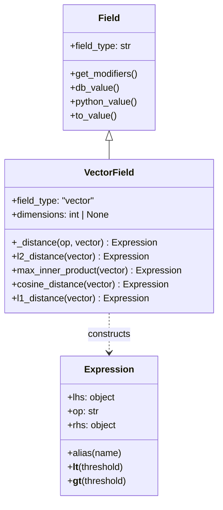
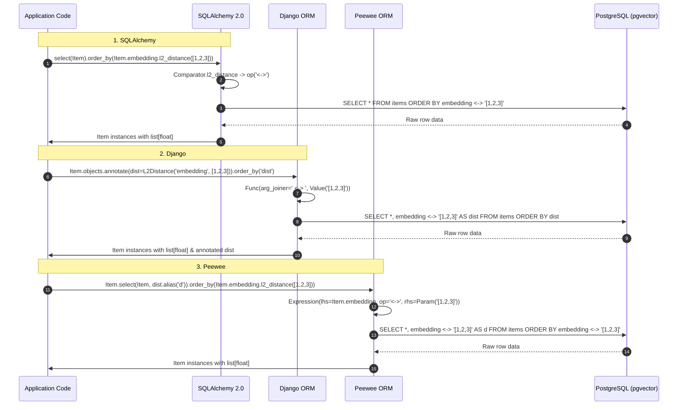

# pgvector-python: Peewee Integration & ORM Comparison Deep Dive

> **Document Version:** 1.0.0  
> **Target SDK:** `pgvector-python` (`pgvector.peewee`)  
> **Framework Compatibility:** Peewee 3.x+  
> **Driver Compatibility:** `psycopg2`, `psycopg` (v3) via `PostgresqlDatabase` / `PostgresqlExtDatabase`  
> **Source Files Inspected:**  
> - `pgvector/peewee/__init__.py`  
> - `pgvector/peewee/vector.py`  
> - `pgvector/peewee/halfvec.py`  
> - `pgvector/peewee/sparsevec.py`  
> - `pgvector/peewee/bit.py`  
> - `tests/test_peewee.py`  

---

## Table of Contents

1. [Executive Summary](#1-executive-summary)
2. [Peewee Architecture & Field Subsystem](#2-peewee-architecture--field-subsystem)
   - [2.1 Lightweight ORM Design Principles](#21-lightweight-orm-design-principles)
   - [2.2 Field Type Resolution & Schema Generation (`field_type`, `get_modifiers`)](#22-field-type-resolution--schema-generation-field_type-get_modifiers)
   - [2.3 Value Marshalling Lifecycle (`db_value`, `python_value`)](#23-value-marshalling-lifecycle-db_value-python_value)
3. [Field Implementations](#3-field-implementations)
   - [3.1 VectorField](#31-vectorfield)
   - [3.2 HalfVectorField](#32-halfvectorfield)
   - [3.3 SparseVectorField](#33-sparsevectorfield)
   - [3.4 FixedBitField](#34-fixedbitfield)
4. [Distance Operators & Query Expressions](#4-distance-operators--query-expressions)
   - [4.1 The `_distance` Helper & `peewee.Expression`](#41-the-_distance-helper--peeweeexpression)
   - [4.2 Concrete Distance Metrics & Infix Operators](#42-concrete-distance-metrics--infix-operators)
   - [4.3 Percent Sign Escaping in `FixedBitField.jaccard_distance`](#43-percent-sign-escaping-in-fixedbitfieldjaccard_distance)
5. [Index Management in Peewee](#5-index-management-in-peewee)
   - [5.1 Model `add_index()` API](#51-model-add_index-api)
   - [5.2 Model `Meta.indexes` Configuration](#52-model-metaindexes-configuration)
   - [5.3 Operator Class Specification (`vector_l2_ops`, `vector_cosine_ops`)](#53-operator-class-specification-vector_l2_ops-vector_cosine_ops)
6. [Query Patterns & Real-World Usage](#6-query-patterns--real-world-usage)
   - [6.1 Top-K Nearest Neighbor Retrieval with Alias](#61-top-k-nearest-neighbor-retrieval-with-alias)
   - [6.2 Threshold Filtering via `.where()`](#62-threshold-filtering-via-where)
   - [6.3 Vector Aggregates (`fn.avg`, `fn.sum`) & Type Coercion](#63-vector-aggregates-fnavg-fnsum--type-coercion)
   - [6.4 `get_or_create` and Value Resolution](#64-get_or_create-and-value-resolution)
   - [6.5 PostgresqlExtDatabase & Array of Vectors](#65-postgresqlextdatabase--array-of-vectors)
7. [Comprehensive ORM Comparison Matrix: SQLAlchemy vs Django vs Peewee](#7-comprehensive-orm-comparison-matrix-sqlalchemy-vs-django-vs-peewee)
8. [Architectural Diagrams](#8-architectural-diagrams)

---

## 1. Executive Summary

`pgvector.peewee` brings PostgreSQL vector operations into Peewee, Python’s leading minimalist, expressive ORM. Unlike monolithic frameworks that require complex migration graph nodes or multi-tiered type compilers, Peewee uses an explicit, streamlined metadata architecture.

Key features of the `pgvector.peewee` package:
- **Concise Field Definitions:** `VectorField`, `HalfVectorField`, `SparseVectorField`, and `FixedBitField` subclass `peewee.Field`, mapping clean DDL dimensions via Peewee's native `get_modifiers()` protocol.
- **Direct AST Infix Expressions:** Distance methods (`l2_distance`, `cosine_distance`, etc.) return native `peewee.Expression` objects that plug directly into `.select()`, `.where()`, and `.order_by()`.
- **Zero Overhead Marshalling:** Integrates directly with `pgvector.Vector._to_db` and `_from_db` without intermediate decorator proxies.
- **Natural Index Specification:** Hooks into Peewee's `Model.add_index()` to emit `CREATE INDEX ... USING hnsw (embedding vector_l2_ops)`.

---

## 2. Peewee Architecture & Field Subsystem

### 2.1 Lightweight ORM Design Principles

Peewee is designed around single-layer abstraction: models correspond directly to tables, fields to columns, and expressions to raw SQL AST nodes. It does not maintain an identity map or background unit of work, executing queries immediately when evaluated.

### 2.2 Field Type Resolution & Schema Generation (`field_type`, `get_modifiers`)

When Peewee generates table schemas (`CREATE TABLE ...`), it resolves a column's DDL data type by inspecting two attributes on the `Field` instance:
1. **`field_type` (str):** The base PostgreSQL type name (`'vector'`, `'halfvec'`, `'sparsevec'`, `'bit'`).
2. **`get_modifiers()` (method):** Returns a list of type constraints or dimensions (e.g. `[1536]`). If non-empty, Peewee formats the column type as `field_type(modifiers[0], ...)`. If `None`, it outputs the bare `field_type`.

```python
class VectorField(Field):
    field_type = 'vector'

    def __init__(self, dimensions: int | None = None, *args: Any, **kwargs: Any) -> None:
        self.dimensions = dimensions
        super().__init__(*args, **kwargs)

    def get_modifiers(self) -> list[int] | None:
        return [self.dimensions] if self.dimensions else None
```

This guarantees:
- `VectorField(dimensions=1536)` $\rightarrow$ Emits `vector(1536)`
- `VectorField()` $\rightarrow$ Emits unconstrained `vector`

### 2.3 Value Marshalling Lifecycle (`db_value`, `python_value`)

Peewee manages type conversion through two methods:
- **`db_value(self, value)`:** Invoked prior to SQL execution. Transforms Python lists, arrays, or vector objects into a string parameter.
- **`python_value(self, value)`:** Invoked upon reading a cursor row. Transforms the raw database string or DBAPI return value back into Python floats or `SparseVector`.

---

## 3. Field Implementations

### 3.1 VectorField

Defined in `pgvector/peewee/vector.py`:

```python
class VectorField(Field):
    field_type = 'vector'

    def __init__(self, dimensions: int | None = None, *args: Any, **kwargs: Any) -> None:
        self.dimensions = dimensions
        super().__init__(*args, **kwargs)

    def get_modifiers(self) -> list[int] | None:
        return [self.dimensions] if self.dimensions else None

    def db_value(self, value: Any) -> str | None:
        return Vector._to_db(value)

    def python_value(self, value: Any) -> list[float] | None:
        return Vector._from_db(value)
```

### 3.2 HalfVectorField

Defined in `pgvector/peewee/halfvec.py`:

```python
class HalfVectorField(Field):
    field_type = 'halfvec'

    def __init__(self, dimensions: int | None = None, *args: Any, **kwargs: Any) -> None:
        self.dimensions = dimensions
        super().__init__(*args, **kwargs)

    def get_modifiers(self) -> list[int] | None:
        return [self.dimensions] if self.dimensions else None

    def db_value(self, value: Any) -> str | None:
        return HalfVector._to_db(value)

    def python_value(self, value: Any) -> list[float] | None:
        return HalfVector._from_db(value)
```

### 3.3 SparseVectorField

Defined in `pgvector/peewee/sparsevec.py`:

```python
class SparseVectorField(Field):
    field_type = 'sparsevec'

    def __init__(self, dimensions: int | None = None, *args: Any, **kwargs: Any) -> None:
        self.dimensions = dimensions
        super().__init__(*args, **kwargs)

    def get_modifiers(self) -> list[int] | None:
        return [self.dimensions] if self.dimensions else None

    def db_value(self, value: Any) -> str | None:
        return SparseVector._to_db(value)

    def python_value(self, value: Any) -> SparseVector | None:
        return SparseVector._from_db(value)
```

Returns and accepts native `SparseVector` objects.

### 3.4 FixedBitField

Defined in `pgvector/peewee/bit.py`:

```python
class FixedBitField(Field):
    field_type = 'bit'

    def __init__(self, max_length: int | None = None, *args: Any, **kwargs: Any) -> None:
        self.max_length = max_length
        super().__init__(*args, **kwargs)

    def get_modifiers(self) -> list[int] | None:
        return [self.max_length] if self.max_length else None
```

Named `FixedBitField` to prevent naming collisions with Peewee's internal `BitField` (which is an integer bitmask abstraction). It maps to PostgreSQL's native `bit(n)` SQL type.

---

## 4. Distance Operators & Query Expressions

### 4.1 The `_distance` Helper & `peewee.Expression`

Peewee models SQL binary expressions via `peewee.Expression(lhs, op, rhs)`. Each field type implements a private `_distance` helper:

```python
def _distance(self, op: str, vector: object, /) -> Expression:
    return Expression(lhs=self, op=op, rhs=self.to_value(vector))
```

- **`lhs=self`**: Represents the column itself (e.g. `Item.embedding`).
- **`op=op`**: The SQL infix operator string (`'<->'`, `'<=>'`, etc.).
- **`rhs=self.to_value(vector)`**: Wraps the vector parameter in a Peewee `Param` or value container, ensuring it is passed as a parameterized bind variable.

### 4.2 Concrete Distance Metrics & Infix Operators

Every vector field implements:

```python
def l2_distance(self, vector: object, /) -> Expression:
    return self._distance('<->', vector)

def max_inner_product(self, vector: object, /) -> Expression:
    return self._distance('<#>', vector)

def cosine_distance(self, vector: object, /) -> Expression:
    return self._distance('<=>', vector)

def l1_distance(self, vector: object, /) -> Expression:
    return self._distance('<+>', vector)
```

### 4.3 Percent Sign Escaping in `FixedBitField.jaccard_distance`

In `pgvector/peewee/bit.py`:

```python
class FixedBitField(Field):
    ...
    def hamming_distance(self, vector: object, /) -> Expression:
        return self._distance('<~>', vector)

    def jaccard_distance(self, vector: object, /) -> Expression:
        return self._distance('<%%>', vector)
```

Similar to Django, Peewee's underlying DBAPI driver parameter formatting uses `%` placeholders. Escaping `<%>` as `<%%>` ensures Peewee safely passes the operator through query compilation without triggering Python string interpolation errors.

---

## 5. Index Management in Peewee

### 5.1 Model `add_index()` API

Peewee provides an explicit `Model.add_index()` method. This is the cleanest way to define HNSW or IVFFlat indexes with operator classes:

```python
# Create HNSW Index with L2 distance operator class
Item.add_index('embedding vector_l2_ops', using='hnsw')

# Create HNSW Index with Cosine distance operator class
Item.add_index('embedding vector_cosine_ops', using='hnsw')

# Create IVFFlat Index
Item.add_index('embedding vector_l2_ops', using='ivfflat')
```

This compiles to:
```sql
CREATE INDEX IF NOT EXISTS "peewee_item_embedding_vector_l2_ops" 
ON "peewee_item" USING hnsw (embedding vector_l2_ops);
```

### 5.2 Model `Meta.indexes` Configuration

Alternatively, define indexes statically within the model's `Meta` class:

```python
class Item(BaseModel):
    embedding = VectorField(dimensions=1536)

    class Meta:
        table_name = 'items'
        indexes = (
            (('embedding vector_cosine_ops',), 'hnsw'),
        )
```

### 5.3 Operator Class Specification (`vector_l2_ops`, `vector_cosine_ops`)

Because Peewee allows arbitrary string expressions in its index column list, specifying `'column_name operator_class'` works out of the box without requiring custom index classes.

---

## 6. Query Patterns & Real-World Usage

### 6.1 Top-K Nearest Neighbor Retrieval with Alias

Calculate distance, project it into the query result with `.alias()`, and order by distance:

```python
query_vec = [1.0, 2.0, 3.0]
distance_expr = Item.embedding.cosine_distance(query_vec)

items = (
    Item.select(Item.id, Item.content, distance_expr.alias('distance'))
    .order_by(distance_expr)
    .limit(5)
)

for item in items:
    print(f"ID: {item.id}, Distance: {item.distance:.4f}")
```

### 6.2 Threshold Filtering via `.where()`

Filter results by maximum allowable distance:

```python
# Select items within L2 distance < 0.5
items = (
    Item.select()
    .where(Item.embedding.l2_distance([1.0, 1.0, 1.0]) < 0.5)
    .order_by(Item.embedding.l2_distance([1.0, 1.0, 1.0]))
)
```

### 6.3 Vector Aggregates (`fn.avg`, `fn.sum`) & Type Coercion

Peewee exposes SQL functions through `peewee.fn`. When aggregating vector columns using `fn.avg()` or `fn.sum()`, passing `.coerce(True)` instructs Peewee to run the column's `python_value()` deserializer on the aggregate result:

```python
from peewee import fn

# Compute centroid (average) vector
avg_vector = Item.select(fn.avg(Item.embedding).coerce(True)).scalar()
# Returns: [2.5, 3.5, 4.5]

# Sum vector
sum_vector = Item.select(fn.sum(Item.embedding).coerce(True)).scalar()
# Returns: [5.0, 7.0, 9.0]
```

Without `.coerce(True)`, Peewee returns the raw database wire string (e.g. `"[2.5,3.5,4.5]"`).

### 6.4 `get_or_create` and Value Resolution

Peewee's `get_or_create` operates seamlessly with vector fields:

```python
# With raw list
Item.get_or_create(id=1, defaults={'embedding': [1, 2, 3]})

# With Vector object
Item.get_or_create(embedding=Vector([4, 5, 6]))

# With Peewee to_value
Item.get_or_create(embedding=Item.embedding.to_value([7, 8, 9]))
```

### 6.5 PostgresqlExtDatabase & Array of Vectors

For applications requiring arrays of vectors (multi-vector / ColBERT search), use Peewee's PostgreSQL extensions module (`playhouse.postgres_ext`):

```python
from playhouse.postgres_ext import PostgresqlExtDatabase, ArrayField

ext_db = PostgresqlExtDatabase('mydb')

class MultiVectorDocument(BaseModel):
    title = CharField()
    token_embeddings = ArrayField(VectorField, field_kwargs={'dimensions': 128})

    class Meta:
        database = ext_db
```

---

## 7. Comprehensive ORM Comparison Matrix: SQLAlchemy vs Django vs Peewee

| Feature / Dimension | SQLAlchemy 2.0 (`pgvector.sqlalchemy`) | Django ORM (`pgvector.django`) | Peewee (`pgvector.peewee`) |
|---|---|---|---|
| **Base Extension Class** | `UserDefinedType[Any]`, `TypeDecorator` | `django.db.models.Field` | `peewee.Field` |
| **Field Types Provided** | `VECTOR`, `HALFVEC`, `SPARSEVEC`, `BIT` | `VectorField`, `HalfVectorField`, `SparseVectorField`, `BitField` | `VectorField`, `HalfVectorField`, `SparseVectorField`, `FixedBitField` |
| **Infix Operator Design** | `TypeEngine.Comparator` returning `self.op(...)` | `Func` with `function=''` and `arg_joiner=' <op> '` | `peewee.Expression(lhs, op, rhs)` |
| **Inbound Conversion** | `bind_processor()` / `process_bind_param()` | `get_prep_value()` $\rightarrow$ `Vector._to_db` | `db_value()` $\rightarrow$ `Vector._to_db` |
| **Outbound Conversion** | `result_processor()` $\rightarrow$ `Vector._from_db` | `from_db_value()` $\rightarrow$ `Vector._from_db` | `python_value()` $\rightarrow$ `Vector._from_db` |
| **Statement Caching** | Explicit `cache_ok = True` on all types | Native Django QuerySet compilation cache | Native Peewee AST caching |
| **Index Definition** | `Index(..., postgresql_using='hnsw', postgresql_ops={...})` | `HnswIndex(...)`, `IvfflatIndex(...)` subclasses of `PostgresIndex` | `Item.add_index('col op_class', using='hnsw')` |
| **Index Parameters** | `postgresql_with={'m': 16, 'ef_construction': 64}` | Constructor kwargs `m=16, ef_construction=64` | Raw SQL or database GUC parameters |
| **Migration Support** | Alembic (auto-generates column DDL, custom index ops) | Built-in migrations (`VectorExtension`, `makemigrations`) | Peewee migrations (`playhouse.migrate`) or raw SQL |
| **Extension Enabler** | `session.execute(text('CREATE EXTENSION ...'))` | `pgvector.django.VectorExtension()` migration operation | `db.execute_sql('CREATE EXTENSION ...')` |
| **Async Support** | Native Async (`asyncpg`, `psycopg` async) | Synchronous only (Django ORM async is non-blocking wrapper) | Synchronous only (`peewee-async` exists externally) |
| **FastAPI / Pydantic** | First-class integration via SQLModel (`Field(sa_type=...)`) | Requires custom DRF serializer fields or Ninja schemas | Requires manual Pydantic schema mapping |
| **Admin / UI Forms** | External (SQLAlchemy-Admin, Starlette-Admin) | First-class `VectorFormField`, `SparseVectorWidget` in Admin | External (Flask-Admin) |
| **Schema Reflection** | Supported via `ischema_names` (`automap_base()`) | Supported via `inspectdb` management command | Supported via `pwiz` schema introspection |
| **ColBERT / Multi-Vector** | Native `ARRAY(VECTOR(dim))` | Native `ArrayField(VectorField(dim))` | Supported via `playhouse.postgres_ext.ArrayField` |

---

## 8. Architectural Diagrams

### 8.1 Peewee Expression Construction Pipeline



### 8.2 Lifecycle Comparison: Query Execution Across Frameworks


