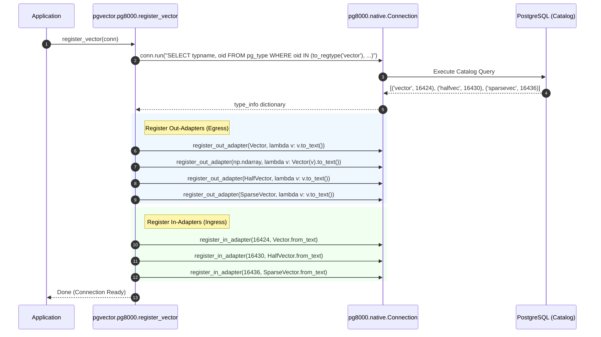
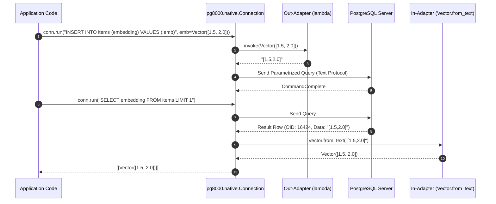

# pgvector-python: pg8000 Driver Adapter Deep Dive

> **Document Version:** 1.0.0  
> **Target SDK:** `pgvector-python` (`pgvector.pg8000`)  
> **Driver Compatibility:** `pg8000` (>= 1.30, `pg8000.native`)  
> **Source Files Inspected:**  
> - `pgvector/pg8000/__init__.py`  
> - `pgvector/pg8000/register.py`  
> - `tests/test_pg8000.py`  

---

## Table of Contents

1. [Executive Summary](#1-executive-summary)
2. [Driver Architecture & Environment Target](#2-driver-architecture--environment-target)
   - [2.1 Pure-Python Network Stack](#21-pure-python-network-stack)
   - [2.2 The `pg8000.native` Interface](#22-the-pg8000native-interface)
   - [2.3 Out-Adapter & In-Adapter System](#23-out-adapter--in-adapter-system)
3. [Registration Subsystem](#3-registration-subsystem)
   - [3.1 Function Signature](#31-function-signature)
   - [3.2 Catalog Introspection via `to_regtype`](#32-catalog-introspection-via-to_regtype)
   - [3.3 Exception Contract (`RuntimeError`)](#33-exception-contract-runtimeerror)
4. [Encoding Protocol (Python → PostgreSQL)](#4-encoding-protocol-python--postgresql)
   - [4.1 Out-Adapter Registration (`conn.register_out_adapter`)](#41-out-adapter-registration-connregister_out_adapter)
   - [4.2 Text Formatting Pipeline (`to_text`)](#42-text-formatting-pipeline-to_text)
   - [4.3 NumPy `ndarray` Handling](#43-numpy-ndarray-handling)
5. [Decoding Protocol (PostgreSQL → Python)](#5-decoding-protocol-postgresql--python)
   - [5.1 In-Adapter Registration (`conn.register_in_adapter`)](#51-in-adapter-registration-connregister_in_adapter)
   - [5.2 Text Parsing via `Vector.from_text`](#52-text-parsing-via-vectorfrom_text)
   - [5.3 Absence of Array Registration](#53-absence-of-array-registration)
6. [Architectural Sequence Diagrams](#6-architectural-sequence-diagrams)
   - [6.1 Type Registration Sequence](#61-type-registration-sequence)
   - [6.2 Named-Parameter Execution & Parsing Sequence](#62-named-parameter-execution--parsing-sequence)
7. [Driver Nuances, Pitfalls & Production Considerations](#7-driver-nuances-pitfalls--production-considerations)
   - [7.1 Named Parameters (`:param`) vs Positional (`%s`)](#71-named-parameters-param-vs-positional-s)
   - [7.2 Serverless & Constrained Runtime Execution](#72-serverless--constrained-runtime-execution)
   - [7.3 Lack of Binary Protocol Support](#73-lack-of-binary-protocol-support)
8. [Cross-Adapter Comparison Matrix](#8-cross-adapter-comparison-matrix)
9. [Usage Guide](#9-usage-guide)
   - [9.1 Minimal Native Connection Example](#91-minimal-native-connection-example)
   - [9.2 NumPy Integration Example](#92-numpy-integration-example)
10. [Annotated Source Code](#10-annotated-source-code)

---

## 1. Executive Summary

`pg8000` is a 100% pure-Python PostgreSQL client library with zero external dependencies and no requirement for PostgreSQL's C client library (`libpq`). It is widely used in environments where native C-extension compilation is impractical or unsupported, such as AWS Lambda containerless packages, Google Cloud Functions, restricted shared hosts, or PyPy runtimes.

The `pgvector.pg8000` adapter provides dedicated integration specifically for the modern `pg8000.native` connection interface:
- **Zero-Dependency Architecture:** Requires no compiled binaries on the host system.
- **Native Out/In Adapter Mechanism:** Utilizes `register_out_adapter` for Python-to-DB serialization and `register_in_adapter` for DB-to-Python deserialization.
- **Pure Text Serialization:** Transmits vector representations over the wire as standard PostgreSQL text literals (`'[1.5,2.0,3.0]'`).
- **Dynamic Introspection:** Employs `to_regtype()` queries against `pg_type` to resolve runtime OIDs.
- **Direct NumPy ndarray Support:** Registers an out-adapter for `np.ndarray` when NumPy is installed in the Python environment.

---

## 2. Driver Architecture & Environment Target

### 2.1 Pure-Python Network Stack

In contrast to `psycopg2` (which links against `libpq.so`) and `asyncpg` (which compiles high-performance Cython C-extensions), `pg8000` implements the PostgreSQL frontend/backend protocol using standard Python `socket` and `struct` modules:
- No shared C libraries required.
- Simplified deployment across diverse Linux, macOS, and Windows distributions.
- Lower peak throughput compared to C-accelerated drivers, but highly predictable in lightweight or serverless microservices.

### 2.2 The `pg8000.native` Interface

Historically, `pg8000` only exposed a standard DB-API 2.0 interface (`pg8000.dbapi`). Modern `pg8000` introduced `pg8000.native`, which discards DB-API boilerplate:
- Direct execution via `conn.run(sql, **params)`.
- Replaces positional parameter binding (`%s` or `$1`) with named parameters: `:param_name`.
- Results are returned directly as a list of lists (e.g. `[[col1, col2], [col1, col2]]`).

`pgvector.pg8000` is engineered specifically around `pg8000.native.Connection`.

### 2.3 Out-Adapter & In-Adapter System

`pg8000.native` decouples type conversion into two registries on the `Connection` instance:
1. **Out-Adapters (`register_out_adapter`):** Map a Python class (`type`) to a callable `func(obj) -> str`. When a named parameter matches the registered class, `pg8000` executes the callable to obtain the parameter's string representation.
2. **In-Adapters (`register_in_adapter`):** Map a PostgreSQL type OID (`int`) to a callable `func(str) -> obj`. When a result column carries that OID, `pg8000` passes the decoded string to the callable.

---

## 3. Registration Subsystem

### 3.1 Function Signature

```python
def register_vector(conn: Connection, /) -> None:
```

The function expects an active `pg8000.native.Connection` instance. Because adapters are registered directly onto the `conn` object, registration is scoped to that specific connection.

### 3.2 Catalog Introspection via `to_regtype`

To determine the dynamic OIDs assigned to the vector types, `register_vector` executes a query using `conn.run`:

```python
res = cast(list[tuple[str, int]], conn.run(
    "SELECT typname, oid FROM pg_type WHERE oid IN ("
    "to_regtype('vector'), to_regtype('halfvec'), to_regtype('sparsevec')"
    ")"
))
type_info = dict(res)
```

#### Notable Architectural Details:
1. **Target Types:** Queries `vector`, `halfvec`, and `sparsevec`.
2. **Array Types Omitted:** Unlike `psycopg2` and `psycopg3`, the `pg8000` adapter does **not** query or register array types (`_vector`, `_halfvec`, `_sparsevec`). Arrays of vectors are not supported natively by `pgvector.pg8000`.
3. **Safe Resolution:** Using `to_regtype()` ensures that if `halfvec` or `sparsevec` are not present in an older pgvector installation, they resolve to `NULL` without raising a database exception.

### 3.3 Exception Contract (`RuntimeError`)

If `vector` is not found in `type_info`:

```python
if 'vector' not in type_info:
    raise RuntimeError('vector type not found in the database')
```

> [!NOTE]
> Unlike `psycopg2` and `psycopg3` which raise driver-specific `ProgrammingError`, `pgvector.pg8000` raises standard Python `RuntimeError`.

---

## 4. Encoding Protocol (Python → PostgreSQL)

### 4.1 Out-Adapter Registration (`conn.register_out_adapter`)

For egress data (Python to database), `register_vector` configures conversion functions that output text representations:

```python
conn.register_out_adapter(Vector, lambda v: v.to_text())

try:
    import numpy as np
    conn.register_out_adapter(np.ndarray, lambda v: Vector(v).to_text())
except ImportError:
    pass

if 'halfvec' in type_info:
    conn.register_out_adapter(HalfVector, lambda v: v.to_text())

if 'sparsevec' in type_info:
    conn.register_out_adapter(SparseVector, lambda v: v.to_text())
```

### 4.2 Text Formatting Pipeline (`to_text`)

When an SQL statement is executed with named parameters:

```python
conn.run("INSERT INTO items (embedding) VALUES (:v)", v=Vector([1.5, 2.0, 3.0]))
```

1. `pg8000` checks its out-adapter map for `type(v)`.
2. Matches `Vector` and invokes `lambda v: v.to_text()`.
3. `v.to_text()` generates `'[1.5,2.0,3.0]'`.
4. `pg8000` quotes and transmits the string value across the wire inside the parameter packet.

### 4.3 NumPy `ndarray` Handling

If NumPy is present in the environment:
```python
conn.register_out_adapter(np.ndarray, lambda v: Vector(v).to_text())
```
When a NumPy array is passed:
1. The lambda wraps the array in `Vector(v)`.
2. `Vector.__init__` handles validation, ensuring 1D layout and extracting native floats.
3. It immediately calls `.to_text()` on the temporary vector instance.

---

## 5. Decoding Protocol (PostgreSQL → Python)

### 5.1 In-Adapter Registration (`conn.register_in_adapter`)

For ingress data (PostgreSQL to Python), `register_vector` binds the discovered OIDs to the class text decoders:

```python
conn.register_in_adapter(type_info['vector'], Vector.from_text)

if 'halfvec' in type_info:
    conn.register_in_adapter(type_info['halfvec'], HalfVector.from_text)

if 'sparsevec' in type_info:
    conn.register_in_adapter(type_info['sparsevec'], SparseVector.from_text)
```

### 5.2 Text Parsing via `Vector.from_text`

When PostgreSQL returns query rows:
1. `pg8000` reads the column metadata containing the type OID.
2. It looks up the OID in its in-adapter dictionary.
3. It passes the raw column string (e.g. `"[1.5,2,3]"`) directly to `Vector.from_text`.
4. `Vector.from_text` parses the brackets and comma-delimited numbers, returning a `Vector` object.

### 5.3 Absence of Array Registration

In `pg8000`, array parsing requires custom deserializers. Because `register_vector` does not register an in-adapter for array OIDs (`_vector`), executing `SELECT ARRAY[embedding, embedding]` will return raw string representations (e.g. `"{[1,2,3],[4,5,6]}"`) rather than a list of `Vector` instances.

---

## 6. Architectural Sequence Diagrams

### 6.1 Type Registration Sequence



### 6.2 Named-Parameter Execution & Parsing Sequence



---

## 7. Driver Nuances, Pitfalls & Production Considerations

### 7.1 Named Parameters (`:param`) vs Positional (`%s`)

A frequent source of errors when migrating code from `psycopg2` to `pg8000` is parameter syntax:
- `psycopg2` / `psycopg3`: `cur.execute("SELECT * FROM items WHERE embedding <=> %s", (v,))`
- `asyncpg`: `conn.fetch("SELECT * FROM items WHERE embedding <=> $1", v)`
- `pg8000.native`: `conn.run("SELECT * FROM items WHERE embedding <=> :v", v=v)`

Attempting to use `%s` with `conn.run()` will result in SQL syntax errors or unquoted literals.

### 7.2 Serverless & Constrained Runtime Execution

`pg8000` is optimal for AWS Lambda or serverless workers:
- Extremely fast cold starts because no native `.so` or `.dll` libraries require dynamic linking.
- Minimal bundle size compared to heavy packages.
- Since connections in serverless functions are created per container/invocation, calling `register_vector(conn)` immediately after `Connection(...)` provides predictable, self-contained initialization.

### 7.3 Lack of Binary Protocol Support

Because `pg8000` relies exclusively on text formatting:
- Floats are rendered into ASCII decimal representations in Python and parsed by PostgreSQL's `vector_in` function.
- In workloads querying millions of high-dimensional vectors (e.g. 1536-dimensional OpenAI embeddings), serialization and parsing overhead will be noticeably higher than in `asyncpg` or `psycopg` binary mode.

---

## 8. Cross-Adapter Comparison Matrix

| Feature | `psycopg2` | `psycopg` (v3) | `asyncpg` | `pg8000` |
| :--- | :--- | :--- | :--- | :--- |
| **Driver Engine** | C / `libpq` | C / `libpq` or pure Python | Cython / Async socket | Pure Python |
| **Async Support** | Cooperative / Coroutine (via select) | Native `asyncio` (`AsyncConnection`) | Native `asyncio` | None (Sync only) |
| **Registration Call** | `register_vector(conn_or_curs, globally=False)` | `register_vector(conn)` / `register_vector_async(conn)` | `await register_vector(conn, schema='public')` | `register_vector(conn)` |
| **OID Discovery** | SQL `to_regtype(...)` in `pg_type` | `TypeInfo.fetch(conn, 'vector')` | None (handled by internal asyncpg type cache) | SQL `to_regtype(...)` in `pg_type` |
| **Wire Protocol (Egress)** | Client-side text substitution (`getquoted`) | Both Text & High-speed Binary | Binary protocol exclusively | Text substitution |
| **Wire Protocol (Ingress)** | Text parsing via `new_type` | Text & Binary Loaders | Binary decoding (`from_binary`) | Text parsing via `from_text` |
| **Array Support** | Explicit `new_array_type` | Automatic via `info.register(context)` | Automatic via base codec | Not registered |
| **NumPy Support** | Adapter for `np.ndarray` registered if installed | Dumper registered for `'numpy.ndarray'` string | Duck-typed in lambda `Vector(v)` | Adapter for `np.ndarray` registered if installed |
| **COPY Support** | Standard text COPY | Text & Binary COPY (`copy.set_types`) | High-speed binary COPY | Basic |

---

## 9. Usage Guide

### 9.1 Minimal Native Connection Example

```python
from getpass import getuser
from pg8000.native import Connection
from pgvector.pg8000 import register_vector
from pgvector import Vector

# 1. Connect using pg8000.native
conn = Connection(user=getuser(), database="pgvector_python_test")

# 2. Register vector types
register_vector(conn)

# 3. Create table
conn.run("CREATE EXTENSION IF NOT EXISTS vector")
conn.run("DROP TABLE IF EXISTS items")
conn.run("CREATE TABLE items (id bigserial PRIMARY KEY, embedding vector(3))")

# 4. Insert vectors using named parameters
v1 = Vector([1.5, 2.0, 3.0])
conn.run("INSERT INTO items (embedding) VALUES (:v)", v=v1)

# 5. Query results
results = conn.run("SELECT id, embedding FROM items ORDER BY id")
for row in results:
    doc_id, emb = row[0], row[1]
    print(f"ID: {doc_id}, Embedding: {emb} (type: {type(emb).__name__})")
```

### 9.2 NumPy Integration Example

```python
from pg8000.native import Connection
from pgvector.pg8000 import register_vector
from pgvector import Vector
import numpy as np

conn = Connection(database="pgvector_python_test")
register_vector(conn)

# Directly pass NumPy ndarray into named parameters
target_vec = np.array([1.5, 2.0, 3.0], dtype=np.float32)
conn.run("INSERT INTO items (embedding) VALUES (:vec)", vec=target_vec)

# KNN search using L2 distance (<->)
rows = conn.run("SELECT id, embedding <-> :q AS distance FROM items ORDER BY distance LIMIT 3", q=target_vec)
for row in rows:
    print(f"Doc {row[0]} distance: {row[1]}")
```

---

## 10. Annotated Source Code

### `pgvector/pg8000/register.py`

```python
from pg8000.native import Connection
from typing import cast
from .. import Vector, HalfVector, SparseVector


def register_vector(conn: Connection, /) -> None:
    # use to_regtype to get first matching type in search path without throwing error
    res = cast(list[tuple[str, int]], conn.run(
        "SELECT typname, oid FROM pg_type WHERE oid IN ("
        "to_regtype('vector'), to_regtype('halfvec'), to_regtype('sparsevec')"
        ")"
    ))
    type_info = dict(res)

    # Validate vector type presence
    if 'vector' not in type_info:
        raise RuntimeError('vector type not found in the database')

    # Register out-adapter (Egress: Python -> DB text)
    conn.register_out_adapter(Vector, lambda v: v.to_text())
    # Register in-adapter (Ingress: DB text -> Python)
    conn.register_in_adapter(type_info['vector'], Vector.from_text)

    # Optional NumPy out-adapter registration
    try:
        import numpy as np
        conn.register_out_adapter(np.ndarray, lambda v: Vector(v).to_text())
    except ImportError:
        pass

    # Conditionally register halfvec if present in database
    if 'halfvec' in type_info:
        conn.register_out_adapter(HalfVector, lambda v: v.to_text())
        conn.register_in_adapter(type_info['halfvec'], HalfVector.from_text)

    # Conditionally register sparsevec if present in database
    if 'sparsevec' in type_info:
        conn.register_out_adapter(SparseVector, lambda v: v.to_text())
        conn.register_in_adapter(type_info['sparsevec'], SparseVector.from_text)
```
