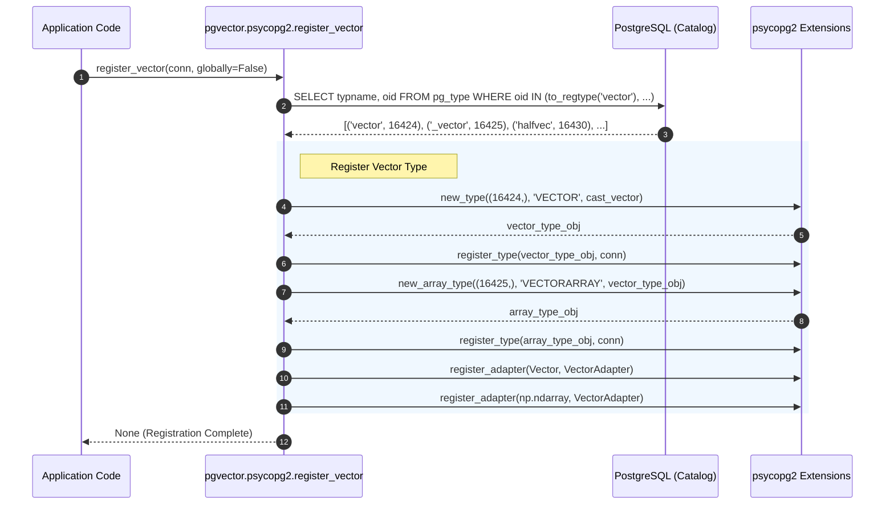
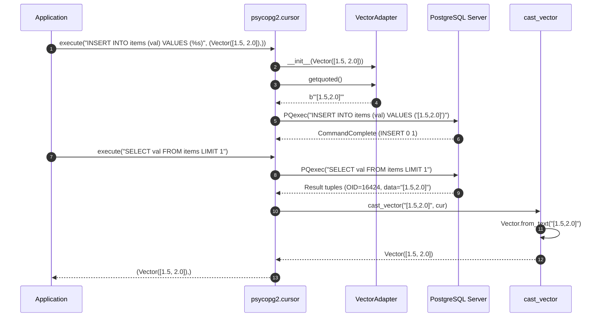

# pgvector-python: psycopg2 Driver Adapter Deep Dive

> **Document Version:** 1.0.0  
> **Target SDK:** `pgvector-python` (`pgvector.psycopg2`)  
> **Driver Compatibility:** `psycopg2` / `psycopg2-binary` (>= 2.9)  
> **Source Files Inspected:**  
> - `pgvector/psycopg2/__init__.py`  
> - `pgvector/psycopg2/register.py`  
> - `pgvector/psycopg2/vector.py`  
> - `pgvector/psycopg2/halfvec.py`  
> - `pgvector/psycopg2/sparsevec.py`  
> - `tests/test_psycopg2.py`  

---

## Table of Contents

1. [Executive Summary](#1-executive-summary)
2. [Driver Architecture & Design Rationale](#2-driver-architecture--design-rationale)
   - [2.1 libpq C-Extension Foundation](#21-libpq-c-extension-foundation)
   - [2.2 Adaptation Protocol Architecture in psycopg2](#22-adaptation-protocol-architecture-in-psycopg2)
3. [Registration Subsystem](#3-registration-subsystem)
   - [3.1 Function Signature and Parameters](#31-function-signature-and-parameters)
   - [3.2 Catalog Introspection via `to_regtype`](#32-catalog-introspection-via-to_regtype)
   - [3.3 Scope Rules: Local vs Global Registration](#33-scope-rules-local-vs-global-registration)
   - [3.4 Array Type Registration Mechanism](#34-array-type-registration-mechanism)
4. [Encoding Protocol (Python → PostgreSQL)](#4-encoding-protocol-python--postgresql)
   - [4.1 The `VectorAdapter` and `getquoted()` Protocol](#41-the-vectoradapter-and-getquoted-protocol)
   - [4.2 Text-Only Serialization Pipeline](#42-text-only-serialization-pipeline)
   - [4.3 Transparent NumPy ndarray Binding](#43-transparent-numpy-ndarray-binding)
   - [4.4 HalfVector and SparseVector Adapters](#44-halfvector-and-sparsevector-adapters)
5. [Decoding Protocol (PostgreSQL → Python)](#5-decoding-protocol-postgresql--python)
   - [5.1 `new_type` and Type Caster Functions](#51-new_type-and-type-caster-functions)
   - [5.2 Text Parser Execution (`Vector.from_text`)](#52-text-parser-execution-vectorfrom_text)
   - [5.3 Array Parser Orchestration (`new_array_type`)](#53-array-parser-orchestration-new_array_type)
6. [Architectural Sequence Diagrams](#6-architectural-sequence-diagrams)
   - [6.1 Type Registration Sequence](#61-type-registration-sequence)
   - [6.2 Query Execution & Roundtrip Sequence](#62-query-execution--roundtrip-sequence)
7. [Edge Cases, Pooling & Production Nuances](#7-edge-cases-pooling--production-nuances)
   - [7.1 Connection Pooling (`ThreadedConnectionPool`)](#71-connection-pooling-threadedconnectionpool)
   - [7.2 Custom Cursor Factories (`DictCursor`, `NamedTupleCursor`)](#72-custom-cursor-factories-dictcursor-namedtuplecursor)
   - [7.3 Missing Extension / Exception Handling](#73-missing-extension--exception-handling)
8. [Cross-Adapter Comparison Matrix](#8-cross-adapter-comparison-matrix)
9. [Usage Guide](#9-usage-guide)
   - [9.1 Minimal Working Example](#91-minimal-working-example)
   - [9.2 Production Multi-Threaded Pool Example](#92-production-multi-threaded-pool-example)
10. [Annotated Source Code](#10-annotated-source-code)

---

## 1. Executive Summary

The `pgvector.psycopg2` module provides PostgreSQL vector extension bindings for the legacy yet ubiquitous `psycopg2` database driver. Because `psycopg2` is a C extension wrapping PostgreSQL's C client library (`libpq`), it operates primarily around client-side parameter interpolation and a global/scoped type-casting dictionary based on PostgreSQL Object Identifiers (OIDs).

Key characteristics of the `pgvector.psycopg2` implementation:
- **Introspection-Driven:** Queries PostgreSQL's system catalog (`pg_type`) on registration using `to_regtype()` to dynamically retrieve runtime OIDs for `vector`, `halfvec`, `sparsevec`, and their array companions.
- **Client-Side Text Quoting:** Implements `psycopg2`'s `ISQLQuote` / `getquoted()` protocol via `VectorAdapter`. All vector types are formatted into PostgreSQL literal string representation (`'[1,2,3]'`) before wire transmission.
- **Bi-directional NumPy Integration:** Automatically registers an adapter for `numpy.ndarray` (if NumPy is imported), allowing arrays to be passed directly as query parameters without manual conversion.
- **Scoped Caster Registration:** Allows type decoders to be registered per-connection, per-cursor, or globally across the entire Python process.

---

## 2. Driver Architecture & Design Rationale

### 2.1 libpq C-Extension Foundation

`psycopg2` is built directly on top of the PostgreSQL C-API (`libpq`). In traditional `psycopg2` operations:
1. Parameter values in queries (`SELECT * FROM items WHERE embedding <=> %s`) are formatted, escaped, and quoted on the **client side**.
2. The complete text query is sent to PostgreSQL via `PQexec` or `PQexecParams` in text format.
3. The PostgreSQL server returns result tuples in **text format** (unless explicitly using low-level binary cursors, which standard `psycopg2` does not expose for custom user types).
4. Each column in the result set carries a type OID. `psycopg2` checks its type dictionary (`psycopg2.extensions.string_types`) to find a Python callable that casts the raw C string into a Python object.

### 2.2 Adaptation Protocol Architecture in psycopg2

`psycopg2` separates incoming data conversion (Python → PostgreSQL) from outgoing data conversion (PostgreSQL → Python):
- **Egress (Python → DB):** Managed by `psycopg2.extensions.register_adapter(Class, AdapterClass)`. When a query parameter of type `Class` is encountered, `AdapterClass(instance)` is instantiated, and its `.getquoted()` method is called to produce quoted SQL bytes. **Crucially, `register_adapter` is always global across the entire Python process.**
- **Ingress (DB → Python):** Managed by `psycopg2.extensions.new_type(oids, name, cast_function)` and `psycopg2.extensions.register_type(type_object, scope)`. When a column has an OID matching one in `type_object`, `cast_function(raw_string, cursor)` is called. Unlike adapters, type casters can be scoped to a specific connection, a specific cursor, or globally (`scope=None`).

---

## 3. Registration Subsystem

The registration entry point is `pgvector.psycopg2.register_vector`.

### 3.1 Function Signature and Parameters

```python
def register_vector(
    conn_or_curs: connection | cursor, 
    /, 
    *, 
    globally: bool = False, 
    arrays: bool = True
) -> None:
```

- `conn_or_curs`: Accepts either a `psycopg2.extensions.connection` or a `psycopg2.extensions.cursor`. If a cursor is passed, it extracts the underlying connection via `conn_or_curs.connection`.
- `globally`: Boolean flag. If `True`, decoders are registered with `scope=None`, affecting all connections and cursors in the process. If `False` (the default), decoders are scoped only to the passed `conn_or_curs`.
- `arrays`: Boolean flag (default `True`). If `True`, registers PostgreSQL array types (`vector[]`, `halfvec[]`, `sparsevec[]`).

### 3.2 Catalog Introspection via `to_regtype`

Because pgvector is an extension installed via `CREATE EXTENSION vector`, its types do not have fixed, hard-coded OIDs in PostgreSQL. OIDs are assigned dynamically from PostgreSQL's OID counter at extension creation time.

To resolve these OIDs safely, `register_vector` executes:

```python
cur.execute(
    "SELECT typname, oid FROM pg_type WHERE oid IN ("
    "to_regtype('vector'), to_regtype('_vector'), "
    "to_regtype('halfvec'), to_regtype('_halfvec'), "
    "to_regtype('sparsevec'), to_regtype('_sparsevec')"
    ")"
)
type_info = dict(cur.fetchall())
```

#### Why `to_regtype` is Crucial:
1. **Search Path Respect:** `to_regtype('vector')` looks up the type in the session's active `search_path`. If vector is installed in schema `myschema` and `myschema` is in `search_path`, it resolves correctly.
2. **Graceful NULL Handling:** Unlike casting `'vector'::regtype` (which throws an error if the type does not exist), `to_regtype('vector')` returns `NULL` when the type is absent.
3. **Single Roundtrip:** A single SQL query resolves the base types and their corresponding array types (`_vector`, `_halfvec`, `_sparsevec` denote arrays in PostgreSQL catalog convention).

### 3.3 Scope Rules: Local vs Global Registration

In `psycopg2`:
- `register_adapter` is **always global**. Once `register_vector` is called on *any* connection, `Vector` and `np.ndarray` can be passed to *all* psycopg2 connections.
- `register_type` obeys `scope`:
  - `scope = None` (when `globally=True`): Decoders are registered in `psycopg2.extensions.string_types` globally. Every connection in the process can decode vector columns.
  - `scope = conn_or_curs` (when `globally=False`): Decoders are attached to the specific connection or cursor object. Other connections will return vectors as raw unparsed strings (`"[1,2,3]"`).

### 3.4 Array Type Registration Mechanism

For array types (`vector[]`, `halfvec[]`, `sparsevec[]`), `psycopg2` requires a special type constructor:

```python
if array_oid is not None:
    vectorarray = new_array_type((array_oid,), 'VECTORARRAY', vector)
    register_type(vectorarray, scope)
```

`new_array_type` takes the base type caster `vector` and wraps it in PostgreSQL's standard array parser (which handles `{...}` delimiters, quotes, and nested arrays), dispatching each parsed element string to `cast_vector`.

---

## 4. Encoding Protocol (Python → PostgreSQL)

### 4.1 The `VectorAdapter` and `getquoted()` Protocol

When a Python object is passed as a query parameter in `cursor.execute("INSERT INTO items (v) VALUES (%s)", (val,))`, `psycopg2` looks up the adapter for `type(val)`:

```python
class VectorAdapter:
    def __init__(self, value: Vector | ndarray) -> None:
        if not isinstance(value, Vector):
            value = Vector(value)
        self._value = value

    def getquoted(self) -> Any:
        return adapt(self._value.to_text()).getquoted()
```

### 4.2 Text-Only Serialization Pipeline

The serialization process follows these exact steps:
1. `VectorAdapter` normalizes the incoming value (whether `Vector` or `np.ndarray`) into a `Vector` instance.
2. It invokes `self._value.to_text()`, which builds the Postgres text string:
   ```python
   # pgvector/vector.py
   def to_text(self) -> str:
       return f'[{",".join([str(v) for v in self._value])}]'
   ```
3. It passes this string to `psycopg2.extensions.adapt(str)`.
4. It calls `.getquoted()`, which returns the string surrounded by single quotes with necessary SQL-injection escaping: `b"'[1.5,2.0,3.0]'"` (or `psycopg2.extensions.QuotedString`).
5. When `psycopg2` prepares the SQL statement, `%s` is replaced directly with this quoted byte string.

### 4.3 Transparent NumPy ndarray Binding

During `register_vector_info`, the adapter registration dynamically handles NumPy:

```python
register_adapter(Vector, VectorAdapter)

try:
    import numpy as np
    register_adapter(np.ndarray, VectorAdapter)
except ImportError:
    pass
```

Because `VectorAdapter.__init__` checks `if not isinstance(value, Vector): value = Vector(value)`, a 1D NumPy array passed directly to `cur.execute(..., (np.array([1.0, 2.0, 3.0]),))` is automatically converted to `Vector`, then to text, and quoted seamlessly.

### 4.4 HalfVector and SparseVector Adapters

- **`HalfvecAdapter`:** Serializes `HalfVector` via `adapt(self._value.to_text()).getquoted()`.
- **`SparsevecAdapter`:** Serializes `SparseVector` via `adapt(self._value.to_text()).getquoted()`.
  Format produced: `"{1:1.5,2:2.0,3:3.0}/3"`.

---

## 5. Decoding Protocol (PostgreSQL → Python)

### 5.1 `new_type` and Type Caster Functions

When PostgreSQL returns query results, `libpq` provides each value as a null-terminated C string (`char*`) along with the column's type OID.

`psycopg2` creates custom type casters via `new_type`:

```python
def cast_vector(value: str | bytes | None, cur: cursor) -> Vector | None:
    if value is None:
        return None
    if isinstance(value, bytes):
        raise ValueError('expected str')
    return Vector.from_text(value)

vector = new_type((oid,), 'VECTOR', cast_vector)
register_type(vector, scope)
```

### 5.2 Text Parser Execution (`Vector.from_text`)

When `cast_vector` is invoked:
1. If `value is None` (SQL NULL), it immediately returns `None`.
2. It asserts that `value` is `str`.
3. Calls `Vector.from_text(value)`:
   ```python
   @classmethod
   def _from_text(cls, value: str, /) -> list[float]:
       if len(value) == 2:  # '[]'
           return []
       return [float(v) for v in value[1:-1].split(',')]
   ```
4. Constructs an internal `array('f', ...)` storing native 32-bit single-precision IEEE 754 floats.

### 5.3 Array Parser Orchestration (`new_array_type`)

When a query selects `vector[]` (e.g., `SELECT ARRAY[embedding, embedding] FROM items`):
1. Column OID matches `array_oid`.
2. `psycopg2`'s built-in array parser splits the PostgreSQL array string (e.g. `"{[1,2,3],[4,5,6]}"`) into individual element strings.
3. For each element string, it dispatches to `cast_vector`.
4. The resulting Python list of `Vector` instances is returned: `[Vector([1, 2, 3]), Vector([4, 5, 6])]`.

---

## 6. Architectural Sequence Diagrams

### 6.1 Type Registration Sequence



### 6.2 Query Execution & Roundtrip Sequence



---

## 7. Edge Cases, Pooling & Production Nuances

### 7.1 Connection Pooling (`ThreadedConnectionPool`)

A common pitfall with `psycopg2` is registering types in pooled environments:
- If `register_vector(conn)` is called with `globally=False` on one connection from a pool, **only that connection** receives the type casters.
- Subsequent connections fetched from `ThreadedConnectionPool` will NOT have the casters registered and will return raw unparsed strings!

#### The Solution:
Use `globally=True` on pool initialization:

```python
from psycopg2.pool import ThreadedConnectionPool
from pgvector.psycopg2 import register_vector

pool = ThreadedConnectionPool(1, 10, dbname="mydb")
conn = pool.getconn()
try:
    register_vector(conn, globally=True)
finally:
    pool.putconn(conn)
```

### 7.2 Custom Cursor Factories (`DictCursor`, `NamedTupleCursor`)

In `register.py`, notice how the internal cursor is created:

```python
conn = conn_or_curs if isinstance(conn_or_curs, connection) else conn_or_curs.connection
cur = conn.cursor(cursor_factory=cursor)
```

If the user created their connection with `cursor_factory=RealDictCursor`, querying `cur.fetchall()` would return `[{'typname': 'vector', 'oid': 16424}, ...]`. Attempting `dict(cur.fetchall())` would fail!
`register_vector` defensively overrides `cursor_factory=cursor` to guarantee standard tuple rows `('vector', 16424)` are returned.

### 7.3 Missing Extension / Exception Handling

If `vector` is not installed in the database:
`'vector' not in type_info` triggers:
```python
raise psycopg2.ProgrammingError('vector type not found in the database')
```
For `halfvec` and `sparsevec`, pgvector handles backwards compatibility: if pgvector version < 0.7.0 is installed, `halfvec` or `sparsevec` will simply not be present in `type_info` and their registration is skipped without raising an error.

---

## 8. Cross-Adapter Comparison Matrix

| Feature | `psycopg2` | `psycopg` (v3) | `asyncpg` | `pg8000` |
| :--- | :--- | :--- | :--- | :--- |
| **Driver Engine** | C / `libpq` | C / `libpq` or pure Python | Cython / Async socket | Pure Python |
| **Async Support** | Cooperative / Coroutine (via select) | Native `asyncio` (`AsyncConnection`) | Native `asyncio` | None (Sync only) |
| **Registration Call** | `register_vector(conn_or_curs, globally=False)` | `register_vector(conn)` / `register_vector_async(conn)` | `await register_vector(conn, schema='public')` | `register_vector(conn)` |
| **OID Discovery** | SQL `to_regtype(...)` in `pg_type` | `TypeInfo.fetch(conn, 'vector')` | None (handled by internal asyncpg type cache) | SQL `to_regtype(...)` in `pg_type` |
| **Wire Protocol (Egress)** | Client-side text substitution (`getquoted`) | Both Text & High-speed Binary | Binary protocol exclusively | Text substitution |
| **Wire Protocol (Ingress)** | Text parsing via `new_type` | Text & Binary Loaders | Binary decoding (`from_binary`) | Text parsing via `from_text` |
| **Array Support** | Explicit `new_array_type` | Automatic via `info.register(context)` | Automatic via base codec | Not registered |
| **NumPy Support** | Adapter for `np.ndarray` registered if installed | Dumper registered for `'numpy.ndarray'` string | Duck-typed in lambda `Vector(v)` | Adapter for `np.ndarray` registered if installed |
| **COPY Support** | Standard text COPY | Text & Binary COPY (`copy.set_types`) | High-speed binary COPY | Basic |

---

## 9. Usage Guide

### 9.1 Minimal Working Example

```python
import psycopg2
from pgvector.psycopg2 import register_vector
from pgvector import Vector

# 1. Connect to PostgreSQL
conn = psycopg2.connect(dbname="pgvector_python_test")
conn.autocommit = True

# 2. Register vector types for this connection
register_vector(conn)

cur = conn.cursor()

# 3. Create table with vector column
cur.execute("CREATE EXTENSION IF NOT EXISTS vector")
cur.execute("CREATE TABLE IF NOT EXISTS documents (id bigserial PRIMARY KEY, embedding vector(3))")

# 4. Insert vectors (Vector instance or Python list via adapter)
v = Vector([1.0, 2.0, 3.0])
cur.execute("INSERT INTO documents (embedding) VALUES (%s)", (v,))

# 5. Query nearest neighbors using cosine distance (<=>)
cur.execute("SELECT id, embedding, embedding <=> %s AS distance FROM documents ORDER BY distance LIMIT 5", (v,))
for row in cur.fetchall():
    print(f"ID: {row[0]}, Vector: {row[1]}, Distance: {row[2]}")
```

### 9.2 Production Multi-Threaded Pool Example

```python
from psycopg2.pool import ThreadedConnectionPool
from pgvector.psycopg2 import register_vector
from pgvector import Vector
import numpy as np

# Create pool
pool = ThreadedConnectionPool(minconn=2, maxconn=10, dbname="pgvector_python_test")

# Initialize global types once on startup
init_conn = pool.getconn()
try:
    register_vector(init_conn, globally=True)
finally:
    pool.putconn(init_conn)

# Any worker thread can now use Vector and NumPy seamlessly
def worker():
    conn = pool.getconn()
    try:
        with conn.cursor() as cur:
            # Pass numpy array directly!
            query_vec = np.array([0.1, 0.2, 0.3], dtype=np.float32)
            cur.execute("SELECT id, embedding FROM documents ORDER BY embedding <-> %s LIMIT 1", (query_vec,))
            row = cur.fetchone()
            print("Nearest doc:", row)
    finally:
        pool.putconn(conn)
```

---

## 10. Annotated Source Code

### `pgvector/psycopg2/register.py`

```python
import psycopg2
from psycopg2.extensions import connection, cursor
from .halfvec import register_halfvec_info
from .sparsevec import register_sparsevec_info
from .vector import register_vector_info


# note: register_adapter is always global
def register_vector(conn_or_curs: connection | cursor, /, *, globally: bool = False, arrays: bool = True) -> None:
    # Resolve connection even if user passed cursor
    conn = conn_or_curs if isinstance(conn_or_curs, connection) else conn_or_curs.connection
    # Defensively use standard cursor factory to avoid dict cursor conflicts
    cur = conn.cursor(cursor_factory=cursor)
    scope = None if globally else conn_or_curs

    # use to_regtype to get first matching type in search path without error if absent
    cur.execute(
        "SELECT typname, oid FROM pg_type WHERE oid IN ("
        "to_regtype('vector'), to_regtype('_vector'), "
        "to_regtype('halfvec'), to_regtype('_halfvec'), "
        "to_regtype('sparsevec'), to_regtype('_sparsevec')"
        ")"
    )
    type_info = dict(cur.fetchall())

    if 'vector' not in type_info:
        raise psycopg2.ProgrammingError('vector type not found in the database')

    register_vector_info(type_info['vector'], type_info['_vector'] if arrays else None, scope)

    if 'halfvec' in type_info:
        register_halfvec_info(type_info['halfvec'], type_info['_halfvec'] if arrays else None, scope)

    if 'sparsevec' in type_info:
        register_sparsevec_info(type_info['sparsevec'], type_info['_sparsevec'] if arrays else None, scope)
```

### `pgvector/psycopg2/vector.py`

```python
from __future__ import annotations
from psycopg2.extensions import adapt, connection, cursor, new_array_type, new_type, register_adapter, register_type
from typing import Any
from .. import Vector
from .._utils import ndarray


class VectorAdapter:
    def __init__(self, value: Vector | ndarray) -> None:
        if not isinstance(value, Vector):
            value = Vector(value)
        self._value = value

    def getquoted(self) -> Any:
        return adapt(self._value.to_text()).getquoted()


def cast_vector(value: str | bytes | None, cur: cursor) -> Vector | None:
    if value is None:
        return None
    if isinstance(value, bytes):
        raise ValueError('expected str')
    return Vector.from_text(value)


def register_vector_info(oid: int, array_oid: int | None, scope: connection | cursor | None, /) -> None:
    vector = new_type((oid,), 'VECTOR', cast_vector)
    register_type(vector, scope)

    if array_oid is not None:
        vectorarray = new_array_type((array_oid,), 'VECTORARRAY', vector)
        register_type(vectorarray, scope)

    register_adapter(Vector, VectorAdapter)

    try:
        import numpy as np
        register_adapter(np.ndarray, VectorAdapter)
    except ImportError:
        pass
```
