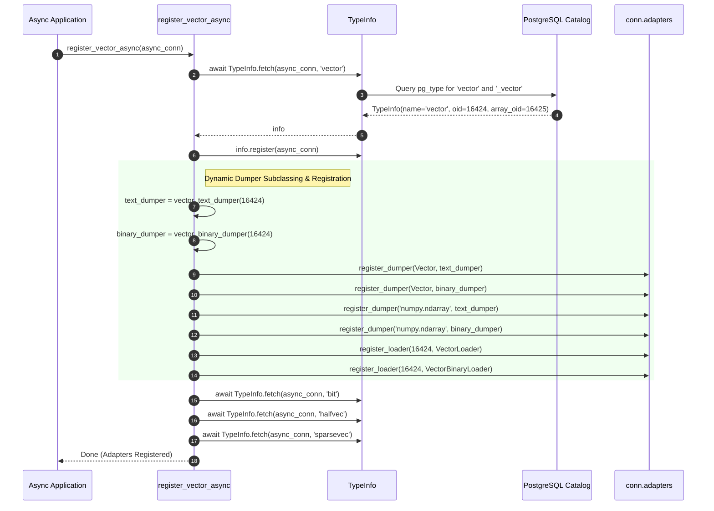
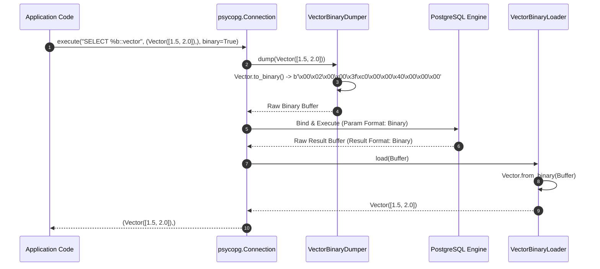

# pgvector-python: psycopg (v3) Driver Adapter Deep Dive

> **Document Version:** 1.0.0  
> **Target SDK:** `pgvector-python` (`pgvector.psycopg`)  
> **Driver Compatibility:** `psycopg` (v3) / `psycopg-c` / `psycopg-binary` (>= 3.1)  
> **Source Files Inspected:**  
> - `pgvector/psycopg/__init__.py`  
> - `pgvector/psycopg/register.py`  
> - `pgvector/psycopg/vector.py`  
> - `pgvector/psycopg/halfvec.py`  
> - `pgvector/psycopg/sparsevec.py`  
> - `pgvector/psycopg/bit.py`  
> - `tests/test_psycopg.py`  

---

## Table of Contents

1. [Executive Summary](#1-executive-summary)
2. [Driver Architecture & Redesign in psycopg 3](#2-driver-architecture--redesign-in-psycopg-3)
   - [2.1 Dual Engine Architecture (C-Extension vs Pure Python)](#21-dual-engine-architecture-c-extension-vs-pure-python)
   - [2.2 Modern Adaptation Protocol: Dumper & Loader Model](#22-modern-adaptation-protocol-dumper--loader-model)
   - [2.3 First-Class Dual-Format Architecture: Text vs Binary Protocol](#23-first-class-dual-format-architecture-text-vs-binary-protocol)
3. [Registration Subsystem](#3-registration-subsystem)
   - [3.1 Synchronous vs Asynchronous Registration](#31-synchronous-vs-asynchronous-registration)
   - [3.2 Type Discovery via `TypeInfo.fetch`](#32-type-discovery-via-typeinfofetch)
   - [3.3 Dynamic Dumper Specialization via `@cache` and Anonymous Subclassing](#33-dynamic-dumper-specialization-via-cache-and-anonymous-subclassing)
   - [3.4 Registration on `AdaptersMap`](#34-registration-on-adaptersmap)
4. [Encoding Protocol (Python → PostgreSQL)](#4-encoding-protocol-python--postgresql)
   - [4.1 `VectorDumper` (Text Protocol)](#41-vectordumper-text-protocol)
   - [4.2 `VectorBinaryDumper` (Binary Protocol)](#42-vectorbinarydumper-binary-protocol)
   - [4.3 Binary Wire Format Specification](#43-binary-wire-format-specification)
   - [4.4 Lazy NumPy Array Binding (`'numpy.ndarray'`)](#44-lazy-numpy-array-binding-numpyndarray)
   - [4.5 HalfVector, SparseVector, and Bit Dumpers](#45-halfvector-sparsevector-and-bit-dumpers)
5. [Decoding Protocol (PostgreSQL → Python)](#5-decoding-protocol-postgresql--python)
   - [5.1 `VectorLoader` (Text Protocol)](#51-vectorloader-text-protocol)
   - [5.2 `VectorBinaryLoader` (Binary Protocol)](#52-vectorbinaryloader-binary-protocol)
   - [5.3 Endianness and Zero-Copy Parsing](#53-endianness-and-zero-copy-parsing)
6. [Architectural Sequence Diagrams](#6-architectural-sequence-diagrams)
   - [6.1 Asynchronous Type Registration Sequence](#61-asynchronous-type-registration-sequence)
   - [6.2 Dual-Protocol Execution Sequence (Binary & Text)](#62-dual-protocol-execution-sequence-binary--text)
7. [Advanced Features & Production Integration](#7-advanced-features--production-integration)
   - [7.1 High-Speed Streaming with Binary `COPY`](#71-high-speed-streaming-with-binary-copy)
   - [7.2 Explicit Format Specifiers (`%b` and `%t`)](#72-explicit-format-specifiers-b-and-t)
   - [7.3 Connection Pooling with `psycopg_pool`](#73-connection-pooling-with-psycopg_pool)
   - [7.4 Non-Contiguous NumPy Memory Layouts](#74-non-contiguous-numpy-memory-layouts)
8. [Cross-Adapter Comparison Matrix](#8-cross-adapter-comparison-matrix)
9. [Usage Guide](#9-usage-guide)
   - [9.1 Synchronous Minimal Example](#91-synchronous-minimal-example)
   - [9.2 Asynchronous Streaming & Binary COPY Example](#92-asynchronous-streaming--binary-copy-example)
10. [Annotated Source Code](#10-annotated-source-code)

---

## 1. Executive Summary

`psycopg` (version 3) is a complete rewrite of Python's flagship PostgreSQL driver. Designed for modern Python (Python 3.8+), it embraces native `asyncio`, client/server format negotiation, binary wire protocol execution, and a decoupled adaptation hierarchy.

The `pgvector.psycopg` adapter leverages the full capabilities of psycopg 3:
- **Dual Format Support:** Implements both `Format.TEXT` and `Format.BINARY` loaders and dumpers for `Vector`, `HalfVector`, `SparseVector`, and `Bit`.
- **High-Speed Binary Protocol:** Direct serialization to PostgreSQL's native C wire format, eliminating string formatting and parsing overhead.
- **Unified Sync & Async API:** Provides `register_vector` for synchronous connections and `register_vector_async` for asynchronous connections.
- **Dynamic Dumper Subclassing:** Uses runtime class generation with `@cache` to bind dynamically discovered PostgreSQL type OIDs directly to dumper class definitions.
- **Bulk Loading Acceleration:** Unlocks ultra-fast vector ingestion via PostgreSQL binary `COPY FROM STDIN WITH (FORMAT BINARY)`.

---

## 2. Driver Architecture & Redesign in psycopg 3

### 2.1 Dual Engine Architecture (C-Extension vs Pure Python)

Unlike `psycopg2`, which strictly requires C compilation against `libpq`, psycopg 3 provides a dual-engine architecture:
- If `psycopg_c` is available, it uses optimized C-extensions.
- If not, it falls back to a pure-Python implementation using `ctypes` bindings to `libpq`.
The Python-facing adaptation interfaces (`Dumper`, `Loader`, `AdaptersMap`) remain identical in both configurations.

### 2.2 Modern Adaptation Protocol: Dumper & Loader Model

Psycopg 3 replaced the old `register_adapter` / `getquoted()` and `register_type` system with a cleaner architecture:
- **`Dumper`:** Responsible for transforming a Python object into raw wire bytes (`Buffer` / `bytes`).
- **`Loader`:** Responsible for parsing raw wire bytes (`Buffer` / `bytes`) into a Python object.
- **`AdaptersMap`:** Every `Connection`, `AsyncConnection`, or cursor maintains an `adapters` map. Dumpers are registered for specific Python classes, while Loaders are registered for specific PostgreSQL type OIDs.

### 2.3 First-Class Dual-Format Architecture: Text vs Binary Protocol

PostgreSQL supports two wire communication formats:
1. **Text Format (`Format.TEXT` / `0`):** Parameters and results are formatted as human-readable strings.
2. **Binary Format (`Format.BINARY` / `1`):** Parameters and results are transmitted as exact byte representations matching PostgreSQL's internal C structures.

Psycopg 3 negotiates format per parameter and column. `pgvector.psycopg` supplies dumpers and loaders for *both* formats, allowing the driver to select binary transmission automatically whenever prepared statements or binary copy modes are engaged.

---

## 3. Registration Subsystem

### 3.1 Synchronous vs Asynchronous Registration

`pgvector.psycopg` exposes two registration functions in `register.py`:

```python
def register_vector(context: Connection[Any], /) -> None:
    ...

async def register_vector_async(context: AsyncConnection[Any], /) -> None:
    ...
```

Both functions accept a connection context (or any object exposing an `adapters` attribute and catalog query capabilities).

### 3.2 Type Discovery via `TypeInfo.fetch`

Psycopg 3 provides `psycopg.types.TypeInfo.fetch(context, name)`, which inspects PostgreSQL catalogs (`pg_type` and `pg_range`) to gather full metadata about a type:
- The base type OID
- The array type OID (`_vector`)
- The type category and delimiter

```python
info = TypeInfo.fetch(context, 'vector')
if info is None:
    raise psycopg.ProgrammingError('vector type not found in the database')
info.register(context)
```

Calling `info.register(context)` registers the base type and its array counterpart automatically in the context's type registry!

### 3.3 Dynamic Dumper Specialization via `@cache` and Anonymous Subclassing

A key technical highlight of `pgvector.psycopg` is how it handles parameter OIDs:

```python
@cache
def vector_text_dumper(oid: int) -> type[VectorDumper]:
    return type('', (VectorDumper,), {'oid': oid})

@cache
def vector_binary_dumper(oid: int) -> type[VectorBinaryDumper]:
    return type('', (VectorBinaryDumper,), {'oid': oid})
```

#### Why Dynamic Subclassing?
In PostgreSQL's extended query protocol (`Parse` message), the client can tell PostgreSQL the exact OID of each bind parameter. Furthermore, in binary `COPY` with `copy.set_types(...)`, psycopg requires the Dumper class to have a class-level attribute `oid`.

Because pgvector's OID is determined at database runtime (`CREATE EXTENSION`), it cannot be hardcoded in Python source code. `vector_text_dumper` dynamically generates an anonymous class inheriting from `VectorDumper` with `oid = <discovered_oid>`, using Python's `@cache` decorator to ensure that classes are cached and reused per OID without memory leakage.

### 3.4 Registration on `AdaptersMap`

After discovering OIDs and creating specialized dumpers, `register_vector_info` registers them:

```python
adapters = context.adapters
adapters.register_dumper(Vector, text_dumper)
adapters.register_dumper(Vector, binary_dumper)
adapters.register_dumper('numpy.ndarray', text_dumper)
adapters.register_dumper('numpy.ndarray', binary_dumper)
adapters.register_loader(info.oid, VectorLoader)
adapters.register_loader(info.oid, VectorBinaryLoader)
```

---

## 4. Encoding Protocol (Python → PostgreSQL)

### 4.1 `VectorDumper` (Text Protocol)

```python
class VectorDumper(Dumper):
    format = Format.TEXT

    def dump(self, obj: Vector | ndarray) -> Buffer | None:
        if not isinstance(obj, Vector):
            obj = Vector(obj)
        return obj.to_text().encode('utf8')
```

Used in standard text queries or when explicitly requested via `%t::vector`. Returns UTF-8 encoded bytes: `b"[1.5,2.0,3.0]"`.

### 4.2 `VectorBinaryDumper` (Binary Protocol)

```python
class VectorBinaryDumper(VectorDumper):
    format = Format.BINARY

    def dump(self, obj: Vector | ndarray) -> Buffer | None:
        if not isinstance(obj, Vector):
            obj = Vector(obj)
        return obj.to_binary()
```

Used in prepared statements, binary copy operations, or when explicitly requested via `%b::vector`.

### 4.3 Binary Wire Format Specification

`Vector.to_binary()` encodes vectors directly matching PostgreSQL's internal C struct `Vector` defined in `src/vector.h`:

```c
typedef struct Vector
{
    int32       vl_len_;        /* varlena header (managed by Postgres) */
    int16       dim;            /* vector dimension */
    int16       unused;         /* reserved for future flags (must be 0) */
    float       x[FLEXIBLE_ARRAY_MEMBER];
} Vector;
```

On the PostgreSQL wire protocol (which omits the `vl_len_` varlena header):
- **Bytes 0–1:** `uint16` / `int16` dimension in network byte order (Big-Endian `>H`).
- **Bytes 2–3:** `uint16` / `int16` reserved unused field (must be `0`).
- **Bytes 4+:** `dim * 4` bytes containing IEEE 754 32-bit single-precision floats in network byte order (Big-Endian `>f`).

```python
# pgvector/vector.py
def to_binary(self) -> bytes:
    if sys.byteorder == 'big':
        value = self._value
    else:
        value = array('f', self._value)
        value.byteswap()
    return struct.pack('>HH', len(value), 0) + memoryview(value)
```

### 4.4 Lazy NumPy Array Binding (`'numpy.ndarray'`)

Notice:
```python
adapters.register_dumper('numpy.ndarray', text_dumper)
adapters.register_dumper('numpy.ndarray', binary_dumper)
```

Psycopg 3's `AdaptersMap` allows registering dumpers using the string name of a class (`'numpy.ndarray'`). If NumPy is not imported in the application, psycopg does not attempt to import it. When an actual NumPy ndarray is passed, psycopg matches the type string and invokes the dumper!

### 4.5 HalfVector, SparseVector, and Bit Dumpers

1. **`HalfVector`:**
   - Text format: `"[1.5,2.0,3.0]"`
   - Binary format: `>HH` (dim, unused=0) followed by `dim * 2` bytes (IEEE 754 16-bit half-precision floats).
2. **`SparseVector`:**
   - Text format: `"{1:1.5,2:2.0}/3"`
   - Binary format:
     `pack(f'>iii{nnz}i{nnz}f', dim, nnz, unused, *indices, *values)`
     - 4 bytes: `dim` (int32)
     - 4 bytes: `nnz` (number of non-zero elements, int32)
     - 4 bytes: `unused` (must be 0, int32)
     - `nnz * 4` bytes: 0-based indices (`int32` big-endian)
     - `nnz * 4` bytes: non-zero values (`float32` big-endian)
3. **`Bit`:**
   - Text format: `"10100001"`
   - Binary format: `pack('>i', length) + packed_bytes`
   - *Note:* Only dumpers are registered for `Bit`, because psycopg 3 already includes native loaders for PostgreSQL `bit` strings.

---

## 5. Decoding Protocol (PostgreSQL → Python)

### 5.1 `VectorLoader` (Text Protocol)

```python
class VectorLoader(Loader):
    format = Format.TEXT

    def load(self, data: Buffer) -> Vector | None:
        if isinstance(data, memoryview):
            data = data.tobytes()
        return Vector.from_text(data.decode('utf8'))
```

Converts PostgreSQL text data back into Python `Vector` via `Vector.from_text`.

### 5.2 `VectorBinaryLoader` (Binary Protocol)

```python
class VectorBinaryLoader(VectorLoader):
    format = Format.BINARY

    def load(self, data: Buffer) -> Vector | None:
        return Vector.from_binary(data)
```

Direct binary decoding without intermediate string construction or regex parsing:

```python
@classmethod
def from_binary(cls, value: bytes | bytearray | memoryview, /) -> Vector:
    dim, unused = struct.unpack_from('>hh', value)
    data = memoryview(value)[4:]

    if len(data) != 4 * dim:
        raise ValueError('invalid length')

    if unused != 0:
        raise ValueError('expected unused to be 0')

    arr = array('f')
    arr.frombytes(data)
    if sys.byteorder != 'big':
        arr.byteswap()

    vec = cls.__new__(cls)
    vec._value = arr
    return vec
```

### 5.3 Endianness and Zero-Copy Parsing

In `Vector.from_binary`:
- Uses Python `memoryview` slicing (`memoryview(value)[4:]`) to avoid copying buffer bytes.
- Populates Python `array('f')` via `frombytes()`.
- If the host system is little-endian (e.g., x86_64, aarch64), it calls `arr.byteswap()` in place to convert network big-endian bytes to host byte order.

---

## 6. Architectural Sequence Diagrams

### 6.1 Asynchronous Type Registration Sequence



### 6.2 Dual-Protocol Execution Sequence (Binary & Text)



---

## 7. Advanced Features & Production Integration

### 7.1 High-Speed Streaming with Binary `COPY`

One of the largest advantages of psycopg 3 over psycopg 2 is the ability to stream vectors into the database using PostgreSQL's binary `COPY` protocol:

```python
with cur.copy('COPY items (id, embedding) FROM STDIN WITH (FORMAT BINARY)') as copy:
    copy.set_types(['int8', 'vector'])
    for idx, vec in enumerate(vector_dataset):
        copy.write_row([idx, Vector(vec)])
```

Because `copy.set_types(['int8', 'vector'])` explicitly informs psycopg of the target column types, psycopg resolves the cached `vector_binary_dumper(oid)` and streams the raw binary floats directly into PostgreSQL.

### 7.2 Explicit Format Specifiers (`%b` and `%t`)

Psycopg 3 allows queries to explicitly force the wire format:
- `%t`: Forces text formatting (`SELECT %t::vector`).
- `%b`: Forces binary formatting (`SELECT %b::vector`).

### 7.3 Connection Pooling with `psycopg_pool`

In production, connection pools should configure every new connection using the `configure` hook:

```python
from psycopg_pool import ConnectionPool, AsyncConnectionPool
from pgvector.psycopg import register_vector, register_vector_async

# Synchronous Pool
def configure_sync(conn):
    register_vector(conn)

pool = ConnectionPool(conninfo="postgresql://localhost/mydb", configure=configure_sync)

# Asynchronous Pool
async def configure_async(conn):
    await register_vector_async(conn)

async_pool = AsyncConnectionPool(conninfo="postgresql://localhost/mydb", configure=configure_async)
```

### 7.4 Non-Contiguous NumPy Memory Layouts

In `Vector.__init__`:
```python
arr = array('f')
arr.frombytes(value.astype(np.float32, order='C', copy=False).data.cast('B'))
```
When passing non-contiguous NumPy arrays (e.g. results of `np.flipud` or matrix slicing), `.astype(np.float32, order='C')` guarantees a contiguous C-ordered memory buffer before binary serialization.

---

## 8. Cross-Adapter Comparison Matrix

| Feature | `psycopg2` | `psycopg` (v3) | `asyncpg` | `pg8000` |
| :--- | :--- | :--- | :--- | :--- |
| **Driver Engine** | C / `libpq` | C / `libpq` or pure Python | Cython / Async socket | Pure Python |
| **Async Support** | Cooperative / Coroutine (via select) | Native `asyncio` (`AsyncConnection`) | Native `asyncio` | None (Sync only) |
| **Registration Call** | `register_vector(conn_or_curs, globally=False)` | `register_vector(conn)` / `register_vector_async(conn)` | `await register_vector(conn, schema='public')` | `register_vector(conn)` |
| **OID Discovery** | SQL `to_regtype(...)` in `pg_type` | `TypeInfo.fetch(conn, 'vector')` | None (handled by internal asyncpg type cache) | SQL `to_regtype(...)` in `pg_type` |
| **Wire Protocol (Egress)** | Client-side text substitution (`getquoted`) | Both Text & High-speed Binary | Binary protocol exclusively | Text substitution |
| **Wire Protocol (Ingress)** | Text parsing via `new_type` | Text & Binary Loaders | Binary decoding (`from_binary`) | Text parsing via `from_text` |
| **Array Support** | Explicit `new_array_type` | Automatic via `info.register(context)` | Automatic via base codec | Not registered |
| **NumPy Support** | Adapter for `np.ndarray` registered if installed | Dumper registered for `'numpy.ndarray'` string | Duck-typed in lambda `Vector(v)` | Adapter for `np.ndarray` registered if installed |
| **COPY Support** | Standard text COPY | Text & Binary COPY (`copy.set_types`) | High-speed binary COPY | Basic |

---

## 9. Usage Guide

### 9.1 Synchronous Minimal Example

```python
import psycopg
from pgvector.psycopg import register_vector
from pgvector import Vector

with psycopg.connect("dbname=pgvector_python_test autocommit=true") as conn:
    register_vector(conn)
    conn.execute("CREATE EXTENSION IF NOT EXISTS vector")
    conn.execute("CREATE TABLE IF NOT EXISTS items (id bigserial PRIMARY KEY, embedding vector(3))")

    # Insert using Vector or Python list
    conn.execute("INSERT INTO items (embedding) VALUES (%s)", (Vector([1.0, 2.0, 3.0]),))

    # Query
    row = conn.execute("SELECT id, embedding FROM items LIMIT 1").fetchone()
    print("Found:", row[0], row[1])
```

### 9.2 Asynchronous Streaming & Binary COPY Example

```python
import asyncio
import psycopg
from pgvector.psycopg import register_vector_async
from pgvector import Vector

async def main():
    async with await psycopg.AsyncConnection.connect("dbname=pgvector_python_test autocommit=true") as conn:
        await register_vector_async(conn)

        async with conn.cursor() as cur:
            # High-speed binary ingestion
            async with cur.copy("COPY items (embedding) FROM STDIN WITH (FORMAT BINARY)") as copy:
                copy.set_types(["vector"])
                for i in range(1000):
                    await copy.write_row([Vector([float(i), 0.5, -0.5])])

            # Query results
            await cur.execute("SELECT embedding FROM items ORDER BY id DESC LIMIT 1")
            res = await cur.fetchone()
            print("Latest embedding:", res[0])

asyncio.run(main())
```

---

## 10. Annotated Source Code

### `pgvector/psycopg/register.py`

```python
from psycopg import AsyncConnection, Connection
from psycopg.types import TypeInfo
from typing import Any
from .bit import register_bit_info
from .halfvec import register_halfvec_info
from .sparsevec import register_sparsevec_info
from .vector import register_vector_info


def register_vector(context: Connection[Any], /) -> None:
    # Introspect catalog for vector metadata
    info = TypeInfo.fetch(context, 'vector')
    register_vector_info(context, info)

    # Introspect catalog for bit metadata
    info = TypeInfo.fetch(context, 'bit')
    register_bit_info(context, info)

    # Conditionally register optional halfvec and sparsevec types
    info = TypeInfo.fetch(context, 'halfvec')
    if info is not None:
        register_halfvec_info(context, info)

    info = TypeInfo.fetch(context, 'sparsevec')
    if info is not None:
        register_sparsevec_info(context, info)


async def register_vector_async(context: AsyncConnection[Any], /) -> None:
    # Asynchronous introspection
    info = await TypeInfo.fetch(context, 'vector')
    register_vector_info(context, info)

    info = await TypeInfo.fetch(context, 'bit')
    register_bit_info(context, info)

    info = await TypeInfo.fetch(context, 'halfvec')
    if info is not None:
        register_halfvec_info(context, info)

    info = await TypeInfo.fetch(context, 'sparsevec')
    if info is not None:
        register_sparsevec_info(context, info)
```

### `pgvector/psycopg/vector.py`

```python
from __future__ import annotations
from functools import cache
import psycopg
from psycopg import BaseConnection
from psycopg.abc import Buffer
from psycopg.adapt import Loader, Dumper
from psycopg.pq import Format
from psycopg.types import TypeInfo
from typing import Any
from .. import Vector
from .._utils import ndarray


class VectorDumper(Dumper):
    format = Format.TEXT

    def dump(self, obj: Vector | ndarray) -> Buffer | None:
        if not isinstance(obj, Vector):
            obj = Vector(obj)
        return obj.to_text().encode('utf8')


class VectorBinaryDumper(VectorDumper):
    format = Format.BINARY

    def dump(self, obj: Vector | ndarray) -> Buffer | None:
        if not isinstance(obj, Vector):
            obj = Vector(obj)
        return obj.to_binary()


class VectorLoader(Loader):
    format = Format.TEXT

    def load(self, data: Buffer) -> Vector | None:
        if isinstance(data, memoryview):
            data = data.tobytes()
        return Vector.from_text(data.decode('utf8'))


class VectorBinaryLoader(VectorLoader):
    format = Format.BINARY

    def load(self, data: Buffer) -> Vector | None:
        return Vector.from_binary(data)


def register_vector_info(context: BaseConnection[Any], info: TypeInfo | None, /) -> None:
    if info is None:
        raise psycopg.ProgrammingError('vector type not found in the database')
    info.register(context)

    # add oid to anonymous class for set_types
    text_dumper = vector_text_dumper(info.oid)
    binary_dumper = vector_binary_dumper(info.oid)

    adapters = context.adapters
    adapters.register_dumper(Vector, text_dumper)
    adapters.register_dumper(Vector, binary_dumper)
    adapters.register_dumper('numpy.ndarray', text_dumper)
    adapters.register_dumper('numpy.ndarray', binary_dumper)
    adapters.register_loader(info.oid, VectorLoader)
    adapters.register_loader(info.oid, VectorBinaryLoader)


@cache
def vector_text_dumper(oid: int) -> type[VectorDumper]:
    return type('', (VectorDumper,), {'oid': oid})


@cache
def vector_binary_dumper(oid: int) -> type[VectorBinaryDumper]:
    return type('', (VectorBinaryDumper,), {'oid': oid})
```
