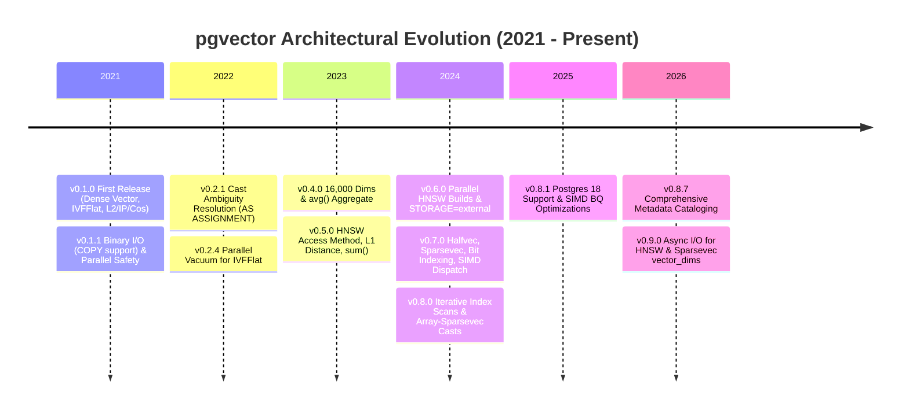
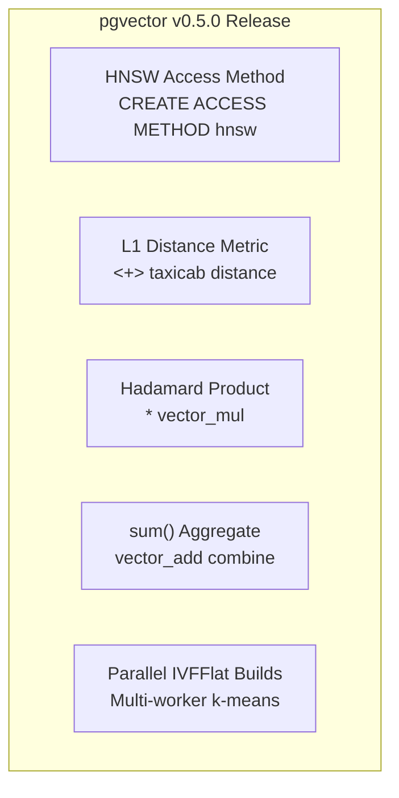
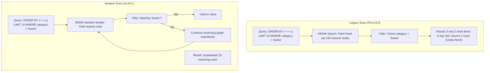

# pgvector Migration & Feature Evolution History (v0.1.0 to v0.9.0)

> Comprehensive architectural chronicle of pgvector's release history from initial conception in April 2021 through v0.9.0, analyzing feature introductions, schema migrations, performance milestones, and database engine upgrades.

---

## Table of Contents

1. [PostgreSQL Extension Upgrade Mechanics](#1-postgresql-extension-upgrade-mechanics)
2. [Timeline of Major Architectural Eras](#2-timeline-of-major-architectural-eras)
3. [Epoch 1: Foundations & Core Architecture (v0.1.0 – v0.2.7)](#3-epoch-1-foundations--core-architecture-v010--v027)
   - [v0.1.0: Initial Public Release](#v010-initial-public-release-2021-04-20)
   - [v0.1.1: Binary Protocol & Parallel Safety](#v011-binary-protocol--parallel-safety-2021-04-25)
   - [v0.1.2 – v0.1.8: SIMD Vectorization & Cast Extensions](#v012--v018-simd-vectorization--cast-extensions)
   - [v0.2.0 – v0.2.7: Cast Ambiguity Resolutions & Parallel Vacuum](#v020--v027-cast-ambiguity-resolutions--parallel-vacuum)
4. [Epoch 2: Scalability & TOAST Architecture (v0.3.0 – v0.4.4)](#4-epoch-2-scalability--toast-architecture-v030--v044)
   - [v0.3.0 – v0.3.2: Modern Postgres Support & Resilience](#v030--v032-modern-postgres-support--resilience)
   - [v0.4.0: The 16,000 Dimensions Milestone & Aggregations](#v040-the-16000-dimensions-milestone--aggregations-2023-01-11)
   - [v0.4.1 – v0.4.4: Hardening & Platform Portability](#v041--v044-hardening--platform-portability)
5. [Epoch 3: The HNSW & High-Throughput Era (v0.5.0 – v0.6.2)](#5-epoch-3-the-hnsw--high-throughput-era-v050--v062)
   - [v0.5.0: The HNSW Graph Access Method](#v050-the-hnsw-graph-access-method-2023-08-28)
   - [v0.5.1: Performance Tuning & Snapshot Verification](#v051-performance-tuning--snapshot-verification-2023-10-10)
   - [v0.6.0: Parallel HNSW Index Builds & Uncompressed Storage](#v060-parallel-hnsw-index-builds--uncompressed-storage-2024-01-29)
   - [v0.6.1 – v0.6.2: Subtraction Operator Fix & Lock Reduction](#v061--v062-subtraction-operator-fix--lock-reduction)
6. [Epoch 4: The Multi-Type & Quantization Revolution (v0.7.0 – v0.7.4)](#6-epoch-4-the-multi-type--quantization-revolution-v070--v074)
   - [v0.7.0: Halfvec, Sparsevec, Bit Indexing & SIMD Dispatch](#v070-halfvec-sparsevec-bit-indexing--simd-dispatch-2024-04-29)
   - [v0.7.1 – v0.7.4: On-Disk Graph Construction & Hardening](#v071--v074-on-disk-graph-construction--hardening)
7. [Epoch 5: Iterative Scans, Async I/O & Modern Maturation (v0.8.0 – v0.9.0)](#7-epoch-5-iterative-scans-async-io--modern-maturation-v080--v090)
   - [v0.8.0: Iterative Index Scans & Filtered Vector Search](#v080-iterative-index-scans--filtered-vector-search-2024-10-30)
   - [v0.8.1 – v0.8.7: Comprehensive Catalog Metadata & Stability](#v081--v087-comprehensive-catalog-metadata--stability)
   - [v0.9.0: Asynchronous I/O & Sparse Optimizations](#v090-asynchronous-io--sparse-optimizations-unreleased)
8. [Comprehensive Feature Evolution Matrix](#8-comprehensive-feature-evolution-matrix)
9. [Postgres Version Compatibility Lifecycle](#9-postgres-version-compatibility-lifecycle)

---

## 1. PostgreSQL Extension Upgrade Mechanics

PostgreSQL manages extensions using control files, base SQL installation scripts, and migration scripts:

```
pgvector/
├── vector.control               # Extension metadata (default_version, relocatable)
├── sql/
│   ├── vector.sql               # Base script used when installing current default version
│   ├── vector--0.1.0--0.1.1.sql # Incremental migration: 0.1.0 -> 0.1.1
│   ├── vector--0.4.4--0.5.0.sql # Incremental migration: 0.4.4 -> 0.5.0
│   └── vector--0.8.7--0.9.0.sql # Incremental migration: 0.8.7 -> 0.9.0
```

When an administrator executes:
```sql
ALTER EXTENSION vector UPDATE TO '0.8.0';
```
The PostgreSQL engine:
1. Inspects `pg_extension` to determine the currently installed version (e.g. `0.7.4`).
2. Discovers an upgrade path through migration files:
   $$\text{vector--0.7.4--0.8.0.sql}$$
   If upgrading across several minor versions (e.g., from `0.4.0` to `0.7.0`), PostgreSQL chains intermediate migration files sequentially inside a single transaction:
   $$0.4.0 \to 0.4.1 \to 0.4.2 \to 0.4.3 \to 0.4.4 \to 0.5.0 \to 0.5.1 \to 0.6.0 \to 0.6.1 \to 0.6.2 \to 0.7.0$$
3. Executes the DDL statements in the migration script, creating new catalog entries without dropping existing tables or indexes.

---

## 2. Timeline of Major Architectural Eras



---

## 3. Epoch 1: Foundations & Core Architecture (v0.1.0 – v0.2.7)

### v0.1.0: Initial Public Release (2021-04-20)
- **Dense `vector` Type**: Initial implementation supporting single-precision float vectors up to 1,024 dimensions.
- **Index Access Method**: `ivfflat` (Inverted File with Flat Quantization) using $k$-means clustering.
- **Distance Metrics**:
  - Euclidean distance (`<->`)
  - Negative inner product (`<#>`)
  - Cosine distance (`<=>`)
- **B-Tree Support**: Lexicographical comparison operators (`<`, `<=`, `=`, `<>`, `>=`, `>`) and `vector_ops` operator class.
- **Array Casts**: Initial casts between native arrays (`integer[]`, `real[]`, `double precision[]`) and `vector`.

### v0.1.1: Binary Protocol & Parallel Safety (2021-04-25)
Migration: [`vector--0.1.0--0.1.1.sql`](file:///mnt/Data/Coding/arkivector/pgvector/sql/vector--0.1.0--0.1.1.sql)
- **Binary Serialization**: Added `vector_recv` and `vector_send` functions, enabling native binary streaming during `COPY ... WITH (FORMAT BINARY)`.
- **Parallel Query Execution**: Marked all functions with `PARALLEL SAFE`, allowing vector calculations to run across PostgreSQL parallel worker threads.

### v0.1.2 – v0.1.8: SIMD Vectorization & Cast Extensions
- **v0.1.2 (2021-04-26)**: Vectorized distance functions; compiler loops unrolled and optimized for modern CPU SIMD registers. Cost estimation functions added to inform the PostgreSQL planner.
- **v0.1.6 (2021-06-09)**: Fixed segmentation fault when running `SELECT COUNT(v) FROM items`.
- **v0.1.7 (2021-06-13)**: Added cast for `numeric[]` to `vector`.
- **v0.1.8 (2021-09-07)**: Added reverse cast from `vector` to `real[]` (`vector_to_float4`).

### v0.2.0 – v0.2.7: Cast Ambiguity Resolutions & Parallel Vacuum
Migration: [`vector--0.2.0--0.2.1.sql`](file:///mnt/Data/Coding/arkivector/pgvector/sql/vector--0.2.0--0.2.1.sql)
- **v0.2.0 (2021-10-03)**: Added support for PostgreSQL 14.
- **v0.2.1 (2022-01-02)**: **Crucial Architecture Fix**: Dropped all implicit array-to-vector casts and recreated them `AS ASSIGNMENT`.
  ```sql
  DROP CAST (integer[] AS vector);
  CREATE CAST (integer[] AS vector)
      WITH FUNCTION array_to_vector(integer[], integer, boolean) AS ASSIGNMENT;
  ```
  *Technical Reason*: When casts were implicit, queries comparing native arrays (`WHERE arr1 = arr2`) failed with `operator is not unique` because the planner could not choose between array equality and vector equality.
- **v0.2.3 (2022-01-30)**: Integrated with PostgreSQL's progress reporting subsystem (`pg_stat_progress_create_index`) for Postgres 12+.
- **v0.2.4 (2022-02-06)**: Added support for parallel vacuuming on IVFFlat indexes.
- **v0.2.5 (2022-02-11)**: Reduced memory footprint during IVFFlat index builds to strictly adhere to `maintenance_work_mem`.

---

## 4. Epoch 2: Scalability & TOAST Architecture (v0.3.0 – v0.4.4)

### v0.3.0 – v0.3.2: Modern Postgres Support & Resilience
- **v0.3.0 (2022-10-15)**: Added support for PostgreSQL 15; dropped legacy PostgreSQL 9.6.
- **v0.3.1 (2022-11-02)**: Fixed a silent corruption bug during tuple insertions into IVFFlat indexes.

### v0.4.0: The 16,000 Dimensions Milestone & Aggregations (2023-01-11)
Migration: [`vector--0.3.2--0.4.0.sql`](file:///mnt/Data/Coding/arkivector/pgvector/sql/vector--0.3.2--0.4.0.sql)
- **Dimensionality Leap**:
  - Increased table column maximum dimensions from 1,024 to **16,000** (`VECTOR_MAX_DIM`).
  - Increased indexable dimensions from 1,024 to **2,000** (`IVFFLAT_MAX_DIM`).
- **TOAST Storage Transition**:
  ```sql
  ALTER TYPE vector SET (STORAGE = extended);
  ```
  Postgres pages are 8KB. A 16,000-dimension vector consumes $8 + 4 \times 16,000 = 64,008 \text{ bytes}$, exceeding the maximum in-page tuple size. Enabling `STORAGE = extended` allowed vectors to be compressed (pglz) and stored out-of-line in TOAST tables.
- **`avg(vector)` Aggregate**: Added parallel-safe average aggregation using double-precision accumulator arrays (`vector_accum`, `vector_avg`, `vector_combine`).
- **Windows Port**: Added experimental compilation support for MSVC on Windows.
- **Dropped Postgres 10**.

### v0.4.1 – v0.4.4: Hardening & Platform Portability
- **v0.4.1 (2023-03-21)**: Accelerated cosine distance by eliminating redundant square root passes.
- **v0.4.3 (2023-06-10)**: Hardened parser against `NaN` and `Infinity` in binary streams; resolved compilation issues on PowerPC.
- **v0.4.4 (2023-06-12)**: Hardened textual parser against malformed delimiters and whitespace sequences.

---

## 5. Epoch 3: The HNSW & High-Throughput Era (v0.5.0 – v0.6.2)

### v0.5.0: The HNSW Graph Access Method (2023-08-28)
Migration: [`vector--0.4.4--0.5.0.sql`](file:///mnt/Data/Coding/arkivector/pgvector/sql/vector--0.4.4--0.5.0.sql)



- **HNSW Index Access Method**: Introduced Hierarchical Navigable Small World graphs (`hnsw`), delivering orders-of-magnitude faster query throughput and high recall without requiring index training phases.
  - Registered operator classes: `vector_l2_ops`, `vector_ip_ops`, `vector_cosine_ops`.
- **Parallel IVFFlat Builds**: Enabled parallel workers during IVFFlat table scanning and $k$-means centroid updates.
- **L1 Distance**: Added Manhattan / Taxicab distance function `l1_distance`.
- **Element-Wise Multiplication**: Added `*` operator (`vector_mul`).
- **`sum(vector)` Aggregate**: Added parallel-safe sum aggregate.

### v0.5.1: Performance Tuning & Snapshot Verification (2023-10-10)
- Optimized HNSW entry point discovery and neighbor selection.
- Added MVCC-compliant snapshot verification to ensure index scans never return uncommitted or deleted tuples.

### v0.6.0: Parallel HNSW Index Builds & Uncompressed Storage (2024-01-29)
Migration: [`vector--0.5.1--0.6.0.sql`](file:///mnt/Data/Coding/arkivector/pgvector/sql/vector--0.5.1--0.6.0.sql)
- **Parallel HNSW Construction**: Enabled multi-worker parallel builds for HNSW indexes, utilizing `maintenance_work_mem` across shared worker graphs and slashing index build times on large datasets by up to 300%.
- **Storage Strategy Alteration**:
  ```sql
  ALTER TYPE vector SET (STORAGE = external);
  ```
  *Architecture Rationale*: Changed from `extended` to `external`. While `extended` compressed vectors in TOAST, the decompression step during vector queries severely throttled CPU distance calculations. Setting `external` disables pglz/lz4 compression while retaining out-of-line TOAST capabilities, vastly improving sequential and index scan throughput.
- **Dropped Postgres 11**.

### v0.6.1 – v0.6.2: Subtraction Operator Fix & Lock Reduction
Migration: [`vector--0.6.0--0.6.1.sql`](file:///mnt/Data/Coding/arkivector/pgvector/sql/vector--0.6.0--0.6.1.sql)
- **Commutator Fix**: Dropped and recreated `-` operator without `COMMUTATOR = -` (vector subtraction is non-commutative: $u - v \neq v - u$).
- **Selectivity Metadata**: Added `RESTRICT = scalarlesel, JOIN = scalarlejoinsel` to comparison operators.
- **Lock Contention**: Reduced heavyweight locking during parallel HNSW builds.

---

## 6. Epoch 4: The Multi-Type & Quantization Revolution (v0.7.0 – v0.7.4)

### v0.7.0: Halfvec, Sparsevec, Bit Indexing & SIMD Dispatch (2024-04-29)
Migration: [`vector--0.6.2--0.7.0.sql`](file:///mnt/Data/Coding/arkivector/pgvector/sql/vector--0.6.2--0.7.0.sql) (569 lines of DDL)

This release transformed pgvector from a dense float32 vector plugin into a multi-type vector indexing engine:

```
+-------------------------------------------------------------------------------+
|                            pgvector 0.7.0 Innovations                         |
+-------------------+-------------------+-------------------+-------------------+
| halfvec (FP16)    | sparsevec (10^9D) | bit Indexing      | Quantization/Ops  |
+-------------------+-------------------+-------------------+-------------------+
| 16-bit float      | Coordinate layout | Native bit type   | binary_quantize() |
| 50% memory saving | Up to 1B dims     | Hamming (<~>)     | l2_normalize()    |
| Index up to 4000D | Up to 16,000 NNZ  | Jaccard (<%>)     | subvector()       |
| HNSW & IVFFlat    | HNSW support      | HNSW & IVFFlat    | Concat (||)       |
+-------------------+-------------------+-------------------+-------------------+
```

1. **`halfvec` Type**:
   - 16-bit half-precision floating point.
   - Slashes RAM and disk consumption by 50% compared to `vector`.
   - Increases maximum indexable dimensions to 4,000 in HNSW and IVFFlat.
2. **`sparsevec` Type**:
   - Coordinate layout for high-dimensional, highly sparse embeddings (SPLADE, BM25).
   - Supports up to 1,000,000,000 dimensions and 16,000 non-zero elements.
   - Full HNSW indexing support (`sparsevec_l2_ops`, `sparsevec_ip_ops`, `sparsevec_cosine_ops`, `sparsevec_l1_ops`).
3. **`bit` Type Indexing**:
   - Enables HNSW and IVFFlat indexing for PostgreSQL's native `bit` type.
   - Hamming distance operator `<~>`.
   - Jaccard distance operator `<%>`.
4. **Quantization & Manipulation Functions**:
   - `binary_quantize(vector)`: Converts floating-point vectors to binary fingerprints.
   - `l2_normalize()`: Normalizes vectors in SQL before indexing.
   - `subvector()`: Extracts slices of vectors.
   - `||`: Concatenates vectors.
5. **Dynamic CPU SIMD Dispatching**:
   - Linux x86-64 builds automatically detect CPU capabilities at runtime, selecting between AVX-512, AVX2, and FMA kernels without requiring custom compiler flags.

### v0.7.1 – v0.7.4: On-Disk Graph Construction & Hardening
- **v0.7.1 (2024-06-03)**: Added on-disk HNSW index build support, allowing index builds to succeed when tables exceed available RAM.
- **v0.7.3 (2024-07-22)**: Fixed `failed to add index item` error when indexing sparse vectors with HNSW.
- **v0.7.4 (2024-08-05)**: Hardened parallel HNSW index locking mechanisms.

---

## 7. Epoch 5: Iterative Scans, Async I/O & Modern Maturation (v0.8.0 – v0.9.0)

### v0.8.0: Iterative Index Scans & Filtered Vector Search (2024-10-30)
Migration: [`vector--0.7.4--0.8.0.sql`](file:///mnt/Data/Coding/arkivector/pgvector/sql/vector--0.7.4--0.8.0.sql)



- **Iterative Index Scans**:
  - Solved the fundamental **filtered vector search challenge** in relational databases.
  - Previously, a query with `ORDER BY v <-> q WHERE condition LIMIT 10` fetched a fixed candidate list (proportional to `hnsw.ef_search`). If the filter discarded candidates, the query returned fewer rows than requested ("under-filtering").
  - With iterative scans, the HNSW iterator resumes traversal on demand, fetching additional graph neighbors until the `LIMIT` is fully satisfied.
- **Array Casts for `sparsevec`**:
  ```sql
  CREATE CAST (real[] AS sparsevec)
      WITH FUNCTION array_to_sparsevec(real[], integer, boolean) AS ASSIGNMENT;
  ```
  Added assignment casts from `integer[]`, `real[]`, `double precision[]`, and `numeric[]` directly to `sparsevec`.
- **Planner Cost Improvements**: Fine-tuned cost estimates for index scans combined with relational filters.
- **Dropped Postgres 12**.

### v0.8.1 – v0.8.7: Comprehensive Catalog Metadata & Stability
Migrations: `vector--0.8.0--0.8.1.sql` through `vector--0.8.6--0.8.7.sql`
- **v0.8.1 (2025-09-04)**: Added support for PostgreSQL 18; optimized SIMD vectorization of `binary_quantize`.
- **v0.8.6 (2026-07-29)**: Fixed buffer overflow during IVFFlat builds on 32-bit systems; enforced non-zero bounds on `array_to_sparsevec`.
- **v0.8.7 (2026-10-01)**:
  - Applied `COMMENT ON` metadata to all 117 functions, operators, types, and operator classes across `vector.sql`, making pgvector fully self-documenting inside `psql` (`\dT+`, `\df+`, `\do+`).
  - Fixed edge case with `avg` aggregate on empty result sets.

### v0.9.0: Asynchronous I/O & Sparse Optimizations (Unreleased)
Migration: [`vector--0.8.7--0.9.0.sql`](file:///mnt/Data/Coding/arkivector/pgvector/sql/vector--0.8.7--0.9.0.sql)
- **Asynchronous I/O for HNSW**: Implemented asynchronous page prefetching during HNSW graph traversal on PostgreSQL versions supporting AIO, hiding storage read latency behind distance computations.
- **`vector_dims` for `sparsevec`**:
  ```sql
  CREATE FUNCTION vector_dims(sparsevec) RETURNS integer
      AS 'MODULE_PATHNAME', 'sparsevec_vector_dims' LANGUAGE C IMMUTABLE STRICT PARALLEL SAFE;
  ```
- **HNSW Sparsevec Insertion Acceleration**: Optimized neighbor distance caching during insertions of sparse vectors into HNSW graphs.
- **Dropped Postgres 13 and 14**: Cleaned codebase of legacy PostgreSQL 13/14 compatibility wrappers.

---

## 8. Comprehensive Feature Evolution Matrix

| Version | Release Date | Key Features & Architectural Changes | Postgres Deprecations |
| :---: | :---: | :--- | :---: |
| **0.1.0** | 2021-04-20 | Initial release: `vector` (1,024D), IVFFlat, L2 (`<->`), Inner Product (`<#>`), Cosine (`<=>`), basic casts | — |
| **0.1.1** | 2021-04-25 | Added binary protocol (`vector_recv`, `vector_send`) for `COPY`, marked functions `PARALLEL SAFE` | — |
| **0.1.7** | 2021-06-13 | Added `numeric[]` to `vector` cast | — |
| **0.1.8** | 2021-09-07 | Added `vector` to `real[]` cast | — |
| **0.2.0** | 2021-10-03 | Added PostgreSQL 14 support | — |
| **0.2.1** | 2022-01-02 | Changed array-to-vector casts to `AS ASSIGNMENT` (fixed operator ambiguity) | — |
| **0.2.4** | 2022-02-06 | Added parallel vacuum support for IVFFlat | — |
| **0.3.0** | 2022-10-15 | Added PostgreSQL 15 support | Dropped PG 9.6 |
| **0.4.0** | 2023-01-11 | Increased max dims to 16,000 (table) / 2,000 (index); `STORAGE = extended`; `avg()` aggregate; Windows port | Dropped PG 10 |
| **0.5.0** | 2023-08-28 | Added `hnsw` access method; parallel IVFFlat builds; L1 distance (`<+>`); vector multiplication (`*`); `sum()` aggregate | — |
| **0.6.0** | 2024-01-29 | Parallel HNSW index builds; changed storage to `STORAGE = external` (disabled compression) | Dropped PG 11 |
| **0.6.1** | 2024-03-04 | Fixed vector subtraction commutator; added planner selectivity functions | — |
| **0.7.0** | 2024-04-29 | Added `halfvec` (FP16), `sparsevec` (1B dims), `bit` index support (Hamming `<~>`, Jaccard `<%>`), `binary_quantize()`, `l2_normalize()`, `subvector()`, `\|\|`, SIMD dispatch | — |
| **0.7.1** | 2024-06-03 | Added on-disk HNSW index build support | — |
| **0.8.0** | 2024-10-30 | Added iterative index scans for filtered vector search; array-to-sparsevec casts | Dropped PG 12 |
| **0.8.1** | 2025-09-04 | Added PostgreSQL 18 support; optimized SIMD `binary_quantize` | — |
| **0.8.7** | 2026-10-01 | Added comprehensive `COMMENT ON` metadata cataloging across all 117 SQL objects | — |
| **0.9.0** | Unreleased | Asynchronous I/O for HNSW; `vector_dims(sparsevec)`; sparsevec HNSW insert optimizations | Dropped PG 13, 14 |

---

## 9. Postgres Version Compatibility Lifecycle

pgvector maintains active support for current PostgreSQL releases while progressively deprecating End-Of-Life (EOL) PostgreSQL versions:

```
+--------------------+-----------------------------------------------------------------+
| pgvector Version   | Supported PostgreSQL Versions                                   |
+--------------------+-----------------------------------------------------------------+
| 0.1.0 - 0.2.7      | PostgreSQL 9.6, 10, 11, 12, 13, 14                              |
| 0.3.0 - 0.3.2      | PostgreSQL 10, 11, 12, 13, 14, 15                              |
| 0.4.0 - 0.5.1      | PostgreSQL 11, 12, 13, 14, 15                                  |
| 0.6.0 - 0.7.4      | PostgreSQL 12, 13, 14, 15, 16                                  |
| 0.8.0 - 0.8.7      | PostgreSQL 13, 14, 15, 16, 17, 18                             |
| 0.9.0 (current)    | PostgreSQL 15, 16, 17, 18                                      |
+--------------------+-----------------------------------------------------------------+
```

---

*Authored for the Arkivector Architecture & Code Research Series.*
