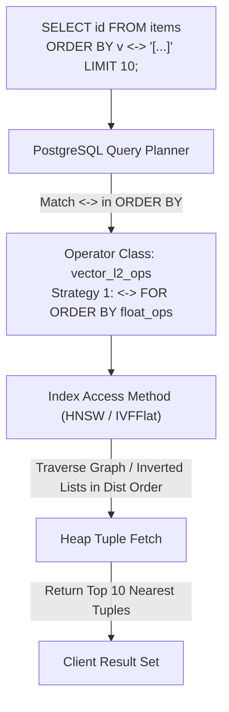
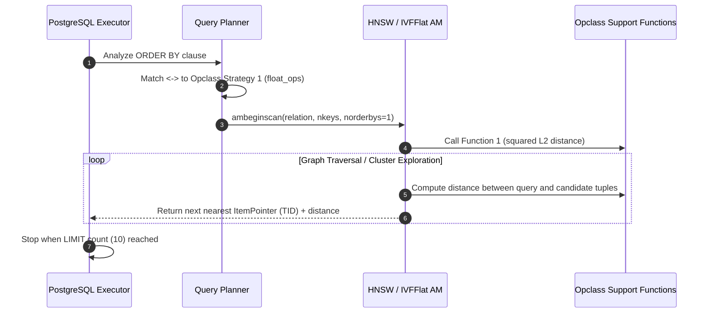

# Distance & Vector Operators Deep Dive

> In-depth mathematical, algorithmic, and catalog analysis of all distance, arithmetic, and relational operators in pgvector, covering operator semantics, index scan strategies, execution mechanics, and selection guidelines.

---

## Table of Contents

1. [The Operator-Driven Indexing Architecture in PostgreSQL](#1-the-operator-driven-indexing-architecture-in-postgresql)
2. [Deep Dive into Distance Operators](#2-deep-dive-into-distance-operators)
   - [`<->` Euclidean Distance (L2)](#-euclidean-distance-l2)
   - [`<#>` Negative Inner Product](#-negative-inner-product)
   - [`<=>` Cosine Distance](#-cosine-distance)
   - [`<+>` Taxicab / Manhattan Distance (L1)](#-taxicab--manhattan-distance-l1)
   - [`<~>` Hamming Distance (Binary Bits)](#-hamming-distance-binary-bits)
   - [`<%>` Jaccard Distance (Binary Bits)](#-jaccard-distance-binary-bits)
3. [The Negative Inner Product Paradox: Why `<#>`?](#3-the-negative-inner-product-paradox-why-)
4. [Vector Arithmetic & Concatenation Operators](#4-vector-arithmetic--concatenation-operators)
   - [`+` Vector Addition](#-vector-addition)
   - [`-` Vector Subtraction](#--vector-subtraction)
   - [`*` Element-Wise Multiplication (Hadamard Product)](#-element-wise-multiplication-hadamard-product)
   - [`||` Vector Concatenation](#-vector-concatenation)
5. [Relational Comparison Operators & Planner Selectivity](#5-relational-comparison-operators--planner-selectivity)
6. [Index Scan Strategies & `FOR ORDER BY float_ops`](#6-index-scan-strategies--for-order-by-float_ops)
   - [PostgreSQL KNN Index Scan Protocol](#postgresql-knn-index-scan-protocol)
   - [Strategy Numbers & Operator Class Mappings](#strategy-numbers--operator-class-mappings)
   - [Support Function Roles in HNSW & IVFFlat](#support-function-roles-in-hnsw--ivfflat)
7. [Comprehensive Operator Comparison & Decision Guide](#7-comprehensive-operator-comparison--decision-guide)

---

## 1. The Operator-Driven Indexing Architecture in PostgreSQL

In standard relational queries, indexes accelerate boolean filtering conditions (e.g. `WHERE x = 5` or `WHERE x > 10`). However, vector similarity search operates under a **ranking / nearest-neighbor paradigm** ($k$-NN):
```sql
SELECT * FROM items ORDER BY embedding <-> '[1,2,3]' LIMIT 5;
```

To support this natively in the SQL parser and query planner, PostgreSQL provides the **Ordering Operator** mechanism within index access methods. Rather than invoking procedural functions, queries express similarity using custom binary infix operators (`<->`, `<#>`, `<=>`, `<+>`, `<~>`, `<%>`).

The PostgreSQL query optimizer matches the operator in the `ORDER BY` clause to the operator class registered with the index access method (`ivfflat` or `hnsw`), generating an `IndexScan` plan that traverses the index in order of ascending distance without performing an expensive full-table sort (`Sort` node).



---

## 2. Deep Dive into Distance Operators

### `<->` Euclidean Distance (L2)

#### Mathematical Formula:
$$D_{L2}(u, v) = \|u - v\|_2 = \sqrt{\sum_{i=1}^d (u_i - v_i)^2}$$

#### Geometric Intuition:
Represents the shortest straight-line distance between two points in $d$-dimensional Euclidean space. 

#### Metric Properties:
- **Non-negativity**: $D_{L2}(u, v) \ge 0$
- **Identity of indiscernibles**: $D_{L2}(u, v) = 0 \iff u = v$
- **Symmetry**: $D_{L2}(u, v) = D_{L2}(v, u)$ (`COMMUTATOR = '<->'`)
- **Triangle inequality**: $D_{L2}(u, w) \le D_{L2}(u, v) + D_{L2}(v, w)$
- **Status**: **Strict Mathematical Metric**.

#### SQL Example:
```sql
SELECT id, content, embedding <-> '[0.2, 0.5, -0.1]'::vector AS l2_dist
FROM documents
ORDER BY embedding <-> '[0.2, 0.5, -0.1]'::vector
LIMIT 5;
```

#### When to Use:
- Computer vision embeddings (e.g. ResNet, CLIP visual features).
- Geospatial or physical coordinate embeddings.
- When vector magnitudes carry essential semantic information (e.g., confidence, energy).
- Normalized or unnormalized vectors where absolute displacement matters.

#### Index Support:
- **IVFFlat**: `vector_l2_ops`, `halfvec_l2_ops`
- **HNSW**: `vector_l2_ops`, `halfvec_l2_ops`, `sparsevec_l2_ops`

#### Performance Optimization (Squared Distance):
Computing $\sqrt{x}$ is computationally expensive. Because $\sqrt{x}$ is a strictly monotonically increasing function for $x \ge 0$:
$$\arg\min_v \sqrt{\sum (u_i - v_i)^2} \equiv \arg\min_v \sum (u_i - v_i)^2$$
pgvector registers `vector_l2_squared_distance` as **Function 1** in both IVFFlat and HNSW operator classes. The index scan computes only the sum of squared differences, eliminating millions of CPU square-root operations during graph/cluster traversals.

---

### `<#>` Negative Inner Product

#### Mathematical Formula:
$$D_{\text{NIP}}(u, v) = - \langle u, v \rangle = - \sum_{i=1}^d u_i v_i$$

#### Geometric Intuition:
Measures the projection of vector $u$ onto vector $v$, scaled by the length of $v$. Larger positive projections indicate greater alignment.

#### Metric Properties:
- Can be negative ($-\infty < D \le \infty$).
- Violates identity of indiscernibles ($\langle u, u \rangle = \|u\|^2 \neq 0$).
- Violates triangle inequality.
- **Status**: **Not a Metric (Similarity Projection Measure)**.

#### SQL Example:
```sql
-- Nearest neighbor by maximum dot product
SELECT id, title, (embedding <#> '[0.1, 0.8, 0.3]'::vector) * -1 AS dot_product
FROM articles
ORDER BY embedding <#> '[0.1, 0.8, 0.3]'::vector
LIMIT 5;
```

#### When to Use:
- Collaborative filtering and recommendation systems (matrix factorization, two-tower models where $\text{score} = u_{\text{user}} \cdot v_{\text{item}}$).
- Maximum Inner Product Search (MIPS).
- Learned sparse models (SPLADE, BGE-M3 lexical weights) where non-zero weights represent term importance.

#### Index Support:
- **IVFFlat**: `vector_ip_ops`, `halfvec_ip_ops`
- **HNSW**: `vector_ip_ops`, `halfvec_ip_ops`, `sparsevec_ip_ops`

---

### `<=>` Cosine Distance

#### Mathematical Formula:
$$D_{\cos}(u, v) = 1.0 - \cos(\theta) = 1.0 - \frac{\sum_{i=1}^d u_i v_i}{\sqrt{\sum_{i=1}^d u_i^2} \sqrt{\sum_{i=1}^d v_i^2}}$$

#### Geometric Intuition:
Measures the angle $\theta$ between two vectors, completely independent of their lengths:
- Vectors pointing in identical direction: $\cos\theta = 1 \implies D_{\cos} = 0.0$
- Orthogonal vectors: $\cos\theta = 0 \implies D_{\cos} = 1.0$
- Diametrically opposed vectors: $\cos\theta = -1 \implies D_{\cos} = 2.0$

#### Metric Properties:
- Range: $[0.0, 2.0]$ (or $[0.0, 1.0]$ for non-negative embeddings).
- Violates the triangle inequality.
- **Status**: **Semi-metric**. (Angular distance $\frac{\arccos(\cos\theta)}{\pi}$ is a metric, but cosine distance $1 - \cos\theta$ is not).

#### SQL Example:
```sql
SELECT id, document, embedding <=> '[0.05, 0.91, -0.32]'::vector AS cosine_dist
FROM knowledge_base
ORDER BY embedding <=> '[0.05, 0.91, -0.32]'::vector
LIMIT 10;
```

#### When to Use:
- Natural Language Processing (OpenAI `text-embedding-3`, Cohere `embed-v3`, sentence-transformers).
- Document and text classification where document length variations must not distort semantic similarity.

#### Index Support:
- **IVFFlat**: `vector_cosine_ops`, `halfvec_cosine_ops`
- **HNSW**: `vector_cosine_ops`, `halfvec_cosine_ops`, `sparsevec_cosine_ops`

#### Pro Optimization: Pre-Normalization
Calculating norms ($\sqrt{\sum u_i^2}$) during query execution adds CPU overhead. If vectors are pre-normalized upon insert (`l2_normalize(embedding)`), then:
$$\|u\| = 1, \quad \|v\| = 1 \implies D_{L2}^2(u, v) = 2(1 - \cos\theta) = 2 D_{\cos}(u, v)$$
$$\text{and } D_{\text{NIP}}(u, v) = - \cos\theta = D_{\cos}(u, v) - 1.0$$
Sorting by `<#>` or `<->` on pre-normalized vectors produces the **exact same ranking** as `<=>`, but executes up to **2x to 3x faster** by skipping norm calculations.

---

### `<+>` Taxicab / Manhattan Distance (L1)

#### Mathematical Formula:
$$D_{L1}(u, v) = \|u - v\|_1 = \sum_{i=1}^d |u_i - v_i|$$

#### Geometric Intuition:
Distance traversed along axes on a grid (like navigating city blocks in Manhattan).

#### Metric Properties:
- **Status**: **Strict Mathematical Metric**. Satisfies non-negativity, identity, symmetry, and triangle inequality.

#### SQL Example:
```sql
SELECT id, telemetry_vector <+> '[12.0, 4.2, 99.1]'::vector AS l1_dist
FROM sensor_readings
ORDER BY telemetry_vector <+> '[12.0, 4.2, 99.1]'::vector
LIMIT 5;
```

#### When to Use:
- Outlier-heavy datasets (L1 does not square errors, making it far more robust to extreme outlier coordinates than L2).
- Very high-dimensional spaces where the ratio between the distance to the nearest point and the distance to the farthest point degrades under L2 ("curse of dimensionality").
- Quantized or integer-coordinate spaces.

#### Index Support:
- **HNSW**: `vector_l1_ops`, `halfvec_l1_ops`, `sparsevec_l1_ops`
- **IVFFlat**: *Not supported* (IVFFlat $k$-means relies on Euclidean centroids).

---

### `<~>` Hamming Distance (Binary Bits)

#### Mathematical Formula:
$$D_{\text{Hamming}}(u, v) = \text{popcount}(u \oplus v) = \sum_{i=1}^b (u_i \oplus v_i)$$

#### Geometric Intuition:
Counts the number of bit positions in which two binary vectors differ.

#### Implementation:
Compiled with specialized CPU instructions:
- On x86-64: `POPCNT` instruction and AVX2/AVX-512 SIMD loops.
- On ARM64: `CNT` (population count) NEON instructions.

#### SQL Example:
```sql
-- Convert float vector to 1-bit representation and search
SELECT id, binary_signature <~> binary_quantize('[0.1, -0.4, 0.9, -0.2]'::vector) AS bit_diffs
FROM fingerprints
ORDER BY binary_signature <~> binary_quantize('[0.1, -0.4, 0.9, -0.2]'::vector)
LIMIT 10;
```

#### When to Use:
- 1-bit quantized vector search (Binary Quantization / BQ).
- Image perceptual hashing (pHash, dHash).
- MinHash / SimHash for near-duplicate web-page detection.
- Extreme scale retrieval where memory must be reduced by 32x vs `float32`.

#### Index Support:
- **IVFFlat**: `bit_hamming_ops`
- **HNSW**: `bit_hamming_ops`

---

### `<%>` Jaccard Distance (Binary Bits)

#### Mathematical Formula:
$$D_{\text{Jaccard}}(u, v) = 1.0 - J(u, v) = 1.0 - \frac{|u \cap v|}{|u \cup v|} = 1.0 - \frac{\text{popcount}(u \ \& \ v)}{\text{popcount}(u \ \| \ v)}$$

#### Geometric Intuition:
Measures the proportion of features that are not shared between two sets, ignoring joint absences ($0-0$ matches).

#### Metric Properties:
- Range: $[0.0, 1.0]$.
- **Status**: **Strict Mathematical Metric**.

#### SQL Example:
```sql
SELECT id, item_tags <%> B'1011001010' AS jaccard_dist
FROM catalogs
ORDER BY item_tags <%> B'1011001010'
LIMIT 5;
```

#### When to Use:
- Set similarity (e.g., matching users by sets of purchased product IDs or visited URLs).
- Lexical $n$-gram fingerprint matching.
- Biological genome k-mer presence/absence profiling.

#### Index Support:
- **HNSW**: `bit_jaccard_ops`
- **IVFFlat**: *Not supported*.

---

## 3. The Negative Inner Product Paradox: Why `<#>`?

A frequent point of confusion for PostgreSQL developers is why pgvector defines `<#>` as **negative** inner product rather than regular dot product:

```sql
SELECT '[1, 2]'::vector <#> '[3, 4]'::vector;
-- Returns -11 (not 11!)
```

### The Technical Reason in PostgreSQL Engine Architecture:

1. **Ascending Index Traversal**:
   In PostgreSQL's index AM framework, index scans are designed to return results in **ascending order** (`ASC`):
   $$\text{Tuple}_1 \le \text{Tuple}_2 \le \dots \le \text{Tuple}_k$$
2. **Minimization vs Maximization**:
   - Distance metrics (L1, L2, Cosine, Hamming) are naturally minimized ($0 = \text{identical}$).
   - Similarity metrics (Dot Product) are naturally maximized ($\infty = \text{most similar}$).
3. **The Index AM Conflict**:
   If `<#>` returned positive dot product:
   ```sql
   SELECT * FROM items ORDER BY v <#> q LIMIT 10;
   ```
   PostgreSQL's HNSW and IVFFlat index scans would prioritize the **smallest** dot products first (the most dissimilar items!), completely breaking approximate nearest neighbor graph search.
4. **The Mathematical Inversion**:
   $$\arg\max_v \langle u, v \rangle \equiv \arg\min_v (-\langle u, v \rangle)$$
   By negating the dot product inside `<#>`, the query `ORDER BY v <#> q LIMIT 10` causes the index scan to minimize the negative value, returning the vectors with the **highest positive dot products** first.

*Query Convention*:
To inspect the positive dot product in the `SELECT` list, simply negate the result:
```sql
SELECT id, (v <#> q) * -1 AS dot_product FROM items ORDER BY v <#> q LIMIT 10;
```
Or call the function directly:
```sql
SELECT id, inner_product(v, q) AS dot_product FROM items ORDER BY v <#> q LIMIT 10;
```

---

## 4. Vector Arithmetic & Concatenation Operators

pgvector supports vector algebra natively in SQL expressions:

### `+` Vector Addition
- **Procedure**: `vector_add` / `halfvec_add`
- **Commutator**: `+`
- **Semantics**: Component-wise addition $w_i = u_i + v_i$. Dimensions must match.
- **Example**:
  ```sql
  SELECT '[1, 2]'::vector + '[3, 4]'::vector; -- '[4, 6]'
  ```

### `-` Vector Subtraction
- **Procedure**: `vector_sub` / `halfvec_sub`
- **Commutator**: None ($u - v \neq v - u$).
- **Semantics**: Component-wise subtraction $w_i = u_i - v_i$.
- **Example**:
  ```sql
  SELECT '[5, 7]'::vector - '[2, 3]'::vector; -- '[3, 4]'
  ```

### `*` Element-Wise Multiplication (Hadamard Product)
- **Procedure**: `vector_mul` / `halfvec_mul`
- **Commutator**: `*`
- **Semantics**: Component-wise product $w_i = u_i \cdot v_i$ (introduced in v0.5.0).
- **Example**:
  ```sql
  -- Applying feature weights or attention masks
  SELECT '[1, 2, 3]'::vector * '[0.5, 1.0, 2.0]'::vector; -- '[0.5, 2, 6]'
  ```

### `||` Vector Concatenation
- **Procedure**: `vector_concat` / `halfvec_concat`
- **Commutator**: None
- **Semantics**: Concatenates vector of dimension $d_1$ and vector of dimension $d_2$ into a new vector of dimension $d_1 + d_2$ (introduced in v0.7.0). Enforces total dimension $\le 16000$.
- **Example**:
  ```sql
  -- Combining text embedding with image embedding
  SELECT '[1, 2]'::vector || '[3, 4, 5]'::vector; -- '[1, 2, 3, 4, 5]'
  ```

---

## 5. Relational Comparison Operators & Planner Selectivity

For `vector`, `halfvec`, and `sparsevec`, pgvector implements all standard B-tree comparison operators:

```sql
CREATE OPERATOR <  (LEFTARG = vector, RIGHTARG = vector, PROCEDURE = vector_lt,  COMMUTATOR = >,  NEGATOR = >=, RESTRICT = scalarltsel, JOIN = scalarltjoinsel);
CREATE OPERATOR <= (LEFTARG = vector, RIGHTARG = vector, PROCEDURE = vector_le,  COMMUTATOR = >=, NEGATOR = >,  RESTRICT = scalarlesel, JOIN = scalarlejoinsel);
CREATE OPERATOR =  (LEFTARG = vector, RIGHTARG = vector, PROCEDURE = vector_eq,  COMMUTATOR = =,  NEGATOR = <>, RESTRICT = eqsel,        JOIN = eqjoinsel);
CREATE OPERATOR <> (LEFTARG = vector, RIGHTARG = vector, PROCEDURE = vector_ne,  COMMUTATOR = <>, NEGATOR = =,  RESTRICT = eqsel,        JOIN = eqjoinsel);
CREATE OPERATOR >= (LEFTARG = vector, RIGHTARG = vector, PROCEDURE = vector_ge,  COMMUTATOR = <=, NEGATOR = <,  RESTRICT = scalargesel, JOIN = scalargejoinsel);
CREATE OPERATOR >  (LEFTARG = vector, RIGHTARG = vector, PROCEDURE = vector_gt,  COMMUTATOR = <,  NEGATOR = <=, RESTRICT = scalargtsel, JOIN = scalargtjoinsel);
```

### The Role of Planner Selectivity Functions:
- `RESTRICT = scalarltsel` / `JOIN = scalarltjoinsel`: Standard PostgreSQL scalar selectivity estimators.
- `RESTRICT = eqsel` / `JOIN = eqjoinsel`: Informs the query planner about the expected selectivity of equality clauses (`WHERE v = '[...]'`).
- Enables the optimizer to calculate accurate cost estimates for hash joins, merge joins, and index scans on B-tree vector columns.

---

## 6. Index Scan Strategies & `FOR ORDER BY float_ops`

### PostgreSQL KNN Index Scan Protocol

When a query executes:
```sql
SELECT id FROM items ORDER BY embedding <-> '[...]' LIMIT 10;
```
PostgreSQL's executor interacts with the index access method via the following lifecycle:



### Strategy Numbers & Operator Class Mappings

In PostgreSQL, each index access method associates operators with integer **Strategy Numbers**.
In pgvector:
- **Strategy 1**: Reserved exclusively for the nearest-neighbor ordering operator:
  ```sql
  OPERATOR 1 <-> (vector, vector) FOR ORDER BY float_ops
  ```
  The clause `FOR ORDER BY float_ops` is critical: it tells PostgreSQL that this operator does not filter rows (it does not return `boolean`), but rather provides a sort order based on `float8` distance values.

### Support Function Roles in HNSW & IVFFlat

Operator classes associate procedural C support functions with standard function numbers:

| Access Method | Function # | Internal Role in pgvector |
| :--- | :---: | :--- |
| **IVFFlat** | 1 | Distance function used to partition points and search lists. |
| **IVFFlat** | 2 | Vector norm function (used in `vector_cosine_ops` to normalize vectors). |
| **IVFFlat** | 3 | Centroid distance function used during $k$-means centroid convergence. |
| **IVFFlat** | 4 | Norm function. |
| **IVFFlat** | 5 | Access method support structure (`ivfflat_*_support`). |
| **HNSW** | 1 | Distance function used to evaluate nearest neighbors during graph routing. |
| **HNSW** | 2 | Vector norm function (used in `vector_cosine_ops` for normalization). |
| **HNSW** | 3 | Access method support structure (`hnsw_*_support`), providing dimensions, normalize callback, checkValue callback, and `useFsm` flag. |

---

## 7. Comprehensive Operator Comparison & Decision Guide

### Master Comparison Table

| Operator | Target Type | Distance Metric | Range | True Metric? | HNSW Opclass | IVFFlat Opclass |
| :---: | :---: | :---: | :---: | :---: | :---: | :---: |
| `<->` | `vector` | Euclidean (L2) | $[0, \infty)$ | Yes | `vector_l2_ops` | `vector_l2_ops` (DEFAULT) |
| `<#>` | `vector` | Negative Dot Product | $(-\infty, \infty)$ | No | `vector_ip_ops` | `vector_ip_ops` |
| `<=>` | `vector` | Cosine Distance | $[0, 2]$ | No (Semi-metric) | `vector_cosine_ops` | `vector_cosine_ops` |
| `<+>` | `vector` | Manhattan (L1) | $[0, \infty)$ | Yes | `vector_l1_ops` | *Unsupported* |
| `<->` | `halfvec` | Euclidean (L2) FP16 | $[0, \infty)$ | Yes | `halfvec_l2_ops` | `halfvec_l2_ops` |
| `<#>` | `halfvec` | Negative Dot Product FP16 | $(-\infty, \infty)$ | No | `halfvec_ip_ops` | `halfvec_ip_ops` |
| `<=>` | `halfvec` | Cosine Distance FP16 | $[0, 2]$ | No (Semi-metric) | `halfvec_cosine_ops` | `halfvec_cosine_ops` |
| `<+>` | `halfvec` | Manhattan (L1) FP16 | $[0, \infty)$ | Yes | `halfvec_l1_ops` | *Unsupported* |
| `<~>` | `bit` | Hamming Distance | $[0, \text{bits}]$ | Yes | `bit_hamming_ops` | `bit_hamming_ops` |
| `<%>` | `bit` | Jaccard Distance | $[0, 1]$ | Yes | `bit_jaccard_ops` | *Unsupported* |
| `<->` | `sparsevec` | Euclidean (L2) Sparse | $[0, \infty)$ | Yes | `sparsevec_l2_ops` | *Unsupported* |
| `<#>` | `sparsevec` | Negative Dot Product Sparse | $(-\infty, \infty)$ | No | `sparsevec_ip_ops` | *Unsupported* |
| `<=>` | `sparsevec` | Cosine Distance Sparse | $[0, 2]$ | No (Semi-metric) | `sparsevec_cosine_ops` | *Unsupported* |
| `<+>` | `sparsevec` | Manhattan (L1) Sparse | $[0, \infty)$ | Yes | `sparsevec_l1_ops` | *Unsupported* |

### Operator Selection Decision Tree

```
Are your vectors binary (bit/varbit)?
  ├── YES:
  │     ├── Comparing presence/absence sets ignoring mutual zeroes? ──> Use Jaccard (<%>) with HNSW
  │     └── Counting bit differences / binary quantization? ─────────> Use Hamming (<~>) with HNSW / IVFFlat
  └── NO (Floating-point vectors):
        ├── Are features sparse with high dimensions (>16,000 or SPLADE/BM25)?
        │     └── YES ───────────────────────────────────────────────> Use sparsevec with <#> (or <->, <=>) on HNSW
        └── Dense vectors (vector or halfvec):
              ├── Model trained specifically with dot-product loss (MIPS / Two-Tower)? ──> Use Negative Inner Product (<#>)
              ├── Text / Semantic embeddings where vector magnitude varies?
              │     ├── Vectors can be pre-normalized at insert? ────> Normalize on insert, then use <#> or <->
              │     └── Dynamic raw unnormalized vectors? ──────────> Use Cosine Distance (<=>)
              ├── Physical coordinates / vision features where scale matters? ───────────> Use Euclidean Distance (<->)
              └── Heavy outlier data / Laplacian noise? ─────────────> Use Manhattan Distance (<+>) on HNSW
```

---

*Authored for the Arkivector Architecture & Code Research Series.*
