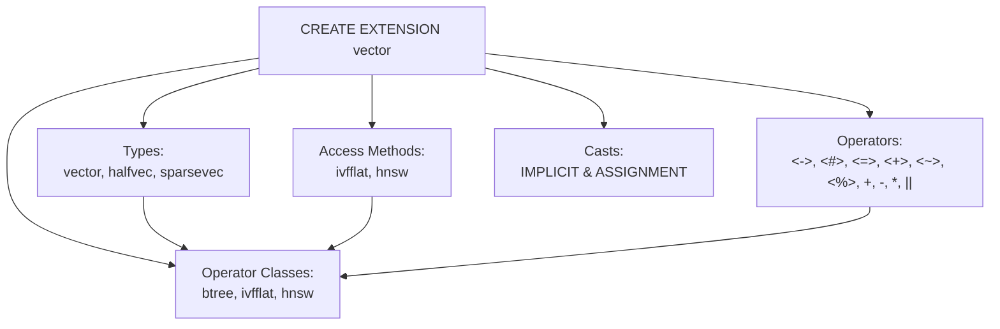

# PostgreSQL SQL Layer Definitions & Catalog Reference

> Complete technical catalog and architectural breakdown of every type, function, operator, operator class, cast, and aggregate defined in `sql/vector.sql` across pgvector's supported vector formats.

---

## Table of Contents

1. [Architecture of the SQL Layer](#1-architecture-of-the-sql-layer)
2. [Data Types (`CREATE TYPE`)](#2-data-types-create-type)
   - [`vector` Type](#the-vector-type)
   - [`halfvec` Type](#the-halfvec-type)
   - [`sparsevec` Type](#the-sparsevec-type)
   - [`bit` Integration](#the-bit-integration)
3. [Index Access Methods (`CREATE ACCESS METHOD`)](#3-index-access-methods-create-access-method)
   - [`ivfflat`](#ivfflat-access-method)
   - [`hnsw`](#hnsw-access-method)
4. [Exhaustive Function Catalog](#4-exhaustive-function-catalog)
   - [I/O & Lifecycle Functions](#io--lifecycle-functions)
   - [Distance Metrics & Mathematical Functions](#distance-metrics--mathematical-functions)
   - [Manipulation & Vector Arithmetic Functions](#manipulation--vector-arithmetic-functions)
   - [B-Tree Comparison Functions](#b-tree-comparison-functions)
   - [Aggregate Implementation Functions](#aggregate-implementation-functions)
   - [Type Conversion & Cast Functions](#type-conversion--cast-functions)
   - [Access Method Handlers & Support Functions](#access-method-handlers--support-functions)
5. [Aggregates (`CREATE AGGREGATE`)](#5-aggregates-create-aggregate)
6. [Type Casts (`CREATE CAST`)](#6-type-casts-create-cast)
   - [Cast Matrix & Coercion Rules](#cast-matrix--coercion-rules)
   - [Assignment vs Implicit Cast Semantics](#assignment-vs-implicit-cast-semantics)
7. [Operators (`CREATE OPERATOR`)](#7-operators-create-operator)
8. [Operator Classes (`CREATE OPERATOR CLASS`)](#8-operator-classes-create-operator-class)
   - [B-Tree Opclasses](#b-tree-opclasses)
   - [IVFFlat Opclasses & Support Functions](#ivfflat-opclasses--support-functions)
   - [HNSW Opclasses & Support Functions](#hnsw-opclasses--support-functions)
9. [Comprehensive Master Object Table](#9-comprehensive-master-object-table)

---

## 1. Architecture of the SQL Layer

pgvector is packaged as a standard PostgreSQL extension. The SQL entry point is defined in [`sql/vector.sql`](file:///mnt/Data/Coding/arkivector/pgvector/sql/vector.sql). When a user executes `CREATE EXTENSION vector;`, PostgreSQL executes this script within an active transaction, registering:
1. Shell types and completed varlena type definitions.
2. C-language bindings via `MODULE_PATHNAME` (resolved by PostgreSQL to `$libdir/vector.so`).
3. Custom index access methods (`ivfflat`, `hnsw`).
4. Distance and mathematical operators.
5. Index operator classes (`opclass`) linking data types, distance operators, and internal support routines.
6. Type casting rules connecting custom types with each other and PostgreSQL native arrays.
7. Aggregates for parallel and serial vector reduction (`avg`, `sum`).



All functions are explicitly decorated with PostgreSQL optimization attributes:
- `IMMUTABLE`: Functions cannot modify the database and are guaranteed to return identical results given identical arguments, allowing the query optimizer to pre-evaluate constant expressions.
- `STRICT`: Functions immediately return `NULL` if any input is `NULL` without invoking the underlying C function body.
- `PARALLEL SAFE`: Functions can safely execute within parallel query worker processes.

---

## 2. Data Types (`CREATE TYPE`)

### The `vector` Type
Single-precision IEEE 754 floating-point dense vector (4 bytes per dimension).

```sql
CREATE TYPE vector;

CREATE TYPE vector (
	INPUT     = vector_in,
	OUTPUT    = vector_out,
	TYPMOD_IN = vector_typmod_in,
	RECEIVE   = vector_recv,
	SEND      = vector_send,
	STORAGE   = external
);

COMMENT ON TYPE vector IS 'single-precision vector';
```
- **Storage Strategy**: `external`. Prevents TOAST compression (avoiding decompression CPU overhead during hot distance scan loops) while allowing out-of-line storage for vectors exceeding page thresholds.
- **Maximum Dimensions**: 16,000 dimensions (`VECTOR_MAX_DIM`). Indexable up to 2,000 dimensions for HNSW and IVFFlat.

### The `halfvec` Type
Half-precision IEEE 754 floating-point dense vector (2 bytes per dimension, introduced in v0.7.0).

```sql
CREATE TYPE halfvec;

CREATE TYPE halfvec (
	INPUT     = halfvec_in,
	OUTPUT    = halfvec_out,
	TYPMOD_IN = halfvec_typmod_in,
	RECEIVE   = halfvec_recv,
	SEND      = halfvec_send,
	STORAGE   = external
);

COMMENT ON TYPE halfvec IS 'half-precision vector';
```
- **Storage Strategy**: `external`.
- **Maximum Dimensions**: 16,000 dimensions (`HALFVEC_MAX_DIM`). Indexable up to 4,000 dimensions for HNSW and IVFFlat (double the dense vector dimension limit due to 50% smaller scalar size).

### The `sparsevec` Type
Coordinate format sparse vector storing only non-zero single-precision elements (introduced in v0.7.0).

```sql
CREATE TYPE sparsevec;

CREATE TYPE sparsevec (
	INPUT     = sparsevec_in,
	OUTPUT    = sparsevec_out,
	TYPMOD_IN = sparsevec_typmod_in,
	RECEIVE   = sparsevec_recv,
	SEND      = sparsevec_send,
	STORAGE   = external
);

COMMENT ON TYPE sparsevec IS 'single-precision sparse vector';
```
- **Storage Strategy**: `external`.
- **Maximum Dimensions**: 1,000,000,000 dimensions (`SPARSEVEC_MAX_DIM`).
- **Maximum Non-Zero Elements**: 16,000 NNZ (`SPARSEVEC_MAX_NNZ`) in tables, 1,000 NNZ (`HNSW_MAX_NNZ`) in HNSW indexes.

### The `bit` Integration
pgvector does not create the `bit` type (PostgreSQL's built-in `bit` and `varbit` types are provided by PostgreSQL core in `catalog/pg_type.h`), but pgvector defines distance metrics (`hamming_distance`, `jaccard_distance`), operators (`<~>`, `<%>`), and operator classes (`bit_hamming_ops`, `bit_jaccard_ops`) allowing native indexing of binary vector fingerprints up to 64,000 bits.

---

## 3. Index Access Methods (`CREATE ACCESS METHOD`)

pgvector registers two custom index access methods directly with the PostgreSQL catalog:

### `ivfflat` Access Method
Inverted File with Flat Quantization (IVFFlat), partitioning vector space into Voronoi cells via $k$-means clustering.

```sql
CREATE FUNCTION ivfflathandler(internal) RETURNS index_am_handler
	AS 'MODULE_PATHNAME' LANGUAGE C;

COMMENT ON FUNCTION ivfflathandler(internal) IS 'ivfflat index access method handler';

CREATE ACCESS METHOD ivfflat TYPE INDEX HANDLER ivfflathandler;

COMMENT ON ACCESS METHOD ivfflat IS 'ivfflat index access method';
```

### `hnsw` Access Method
Hierarchical Navigable Small World graphs (HNSW), building a multi-layer graph structure for approximate nearest neighbor retrieval (introduced in v0.5.0).

```sql
CREATE FUNCTION hnswhandler(internal) RETURNS index_am_handler
	AS 'MODULE_PATHNAME' LANGUAGE C;

COMMENT ON FUNCTION hnswhandler(internal) IS 'hnsw index access method handler';

CREATE ACCESS METHOD hnsw TYPE INDEX HANDLER hnswhandler;

COMMENT ON ACCESS METHOD hnsw IS 'hnsw index access method';
```

---

## 4. Exhaustive Function Catalog

### I/O & Lifecycle Functions

| Function Signature | Return Type | C Symbol | Behavior / Purpose |
| :--- | :--- | :--- | :--- |
| `vector_in(cstring, oid, integer)` | `vector` | `vector_in` | Parses text string `[1.0, 2.0, 3.0]` into internal `Vector` struct. |
| `vector_out(vector)` | `cstring` | `vector_out` | Serializes `Vector` to formatted text string. |
| `vector_typmod_in(cstring[])` | `integer` | `vector_typmod_in` | Validates type modifier e.g. `vector(1536)`. Enforces $1 \le \text{dim} \le 16000$. |
| `vector_recv(internal, oid, integer)`| `vector` | `vector_recv` | Binary deserialization from network/COPY stream. |
| `vector_send(vector)` | `bytea` | `vector_send` | Binary serialization to network/COPY stream. |
| `halfvec_in(cstring, oid, integer)` | `halfvec` | `halfvec_in` | Parses text string `[1.0, 2.0, 3.0]` into internal `HalfVector` (fp16). |
| `halfvec_out(halfvec)` | `cstring` | `halfvec_out` | Serializes `HalfVector` to text string. |
| `halfvec_typmod_in(cstring[])` | `integer` | `halfvec_typmod_in` | Validates type modifier e.g. `halfvec(3072)`. Enforces $1 \le \text{dim} \le 16000$. |
| `halfvec_recv(internal, oid, integer)`| `halfvec` | `halfvec_recv` | Binary deserialization for `halfvec`. |
| `halfvec_send(halfvec)` | `bytea` | `halfvec_send` | Binary serialization for `halfvec`. |
| `sparsevec_in(cstring, oid, integer)`| `sparsevec`| `sparsevec_in` | Parses sparse text `{1:1.5, 3:2.0}/5` into internal `SparseVector`. |
| `sparsevec_out(sparsevec)` | `cstring` | `sparsevec_out` | Serializes `SparseVector` to `{1:1.5,3:2}/5`. |
| `sparsevec_typmod_in(cstring[])` | `integer` | `sparsevec_typmod_in` | Validates type modifier e.g. `sparsevec(30522)`. Enforces $1 \le \text{dim} \le 10^9$. |
| `sparsevec_recv(internal, oid, integer)`| `sparsevec`| `sparsevec_recv` | Binary deserialization for `sparsevec`. |
| `sparsevec_send(sparsevec)` | `bytea` | `sparsevec_send` | Binary serialization for `sparsevec`. |

### Distance Metrics & Mathematical Functions

| Function Signature | Return Type | C Symbol | Mathematical Definition / Comments |
| :--- | :--- | :--- | :--- |
| `l2_distance(vector, vector)` | `float8` | `l2_distance` | Euclidean distance: $\sqrt{\sum (u_i - v_i)^2}$ |
| `inner_product(vector, vector)` | `float8` | `inner_product` | Dot product: $\sum u_i v_i$ |
| `cosine_distance(vector, vector)` | `float8` | `cosine_distance` | $1.0 - \frac{\sum u_i v_i}{\|u\|_2 \|v\|_2}$ |
| `l1_distance(vector, vector)` | `float8` | `l1_distance` | Manhattan distance: $\sum \|u_i - v_i\|$ |
| `vector_norm(vector)` | `float8` | `vector_norm` | Euclidean norm: $\sqrt{\sum u_i^2}$ |
| `vector_l2_squared_distance(vector, vector)`| `float8`| `vector_l2_squared_distance` | Squared Euclidean distance: $\sum (u_i - v_i)^2$ (index order-by function) |
| `vector_negative_inner_product(vector, vector)`| `float8`| `vector_negative_inner_product`| Negative dot product: $-\sum u_i v_i$ (for `<#>` operator) |
| `vector_spherical_distance(vector, vector)` | `float8`| `vector_spherical_distance`| Spherical distance for normalized vectors on unit hypersphere |
| `l2_distance(halfvec, halfvec)` | `float8` | `halfvec_l2_distance` | Euclidean distance for FP16 vectors |
| `inner_product(halfvec, halfvec)` | `float8` | `halfvec_inner_product` | Inner product for FP16 vectors |
| `cosine_distance(halfvec, halfvec)`| `float8` | `halfvec_cosine_distance`| Cosine distance for FP16 vectors |
| `l1_distance(halfvec, halfvec)` | `float8` | `halfvec_l1_distance` | Manhattan distance for FP16 vectors |
| `l2_norm(halfvec)` | `float8` | `halfvec_l2_norm` | Euclidean norm for FP16 vectors |
| `halfvec_l2_squared_distance(halfvec, halfvec)`| `float8`| `halfvec_l2_squared_distance`| Squared Euclidean distance for FP16 vectors |
| `halfvec_negative_inner_product(halfvec, halfvec)`| `float8`| `halfvec_negative_inner_product`| Negative inner product for FP16 vectors |
| `halfvec_spherical_distance(halfvec, halfvec)`| `float8`| `halfvec_spherical_distance`| Spherical distance for FP16 vectors |
| `l2_distance(sparsevec, sparsevec)`| `float8` | `sparsevec_l2_distance` | Euclidean distance over sparse vectors |
| `inner_product(sparsevec, sparsevec)`| `float8` | `sparsevec_inner_product`| Inner product over sparse intersection |
| `cosine_distance(sparsevec, sparsevec)`| `float8` | `sparsevec_cosine_distance`| Cosine distance over sparse vectors |
| `l1_distance(sparsevec, sparsevec)`| `float8` | `sparsevec_l1_distance` | Manhattan distance over sparse vectors |
| `l2_norm(sparsevec)` | `float8` | `sparsevec_l2_norm` | Euclidean norm for sparse vector |
| `sparsevec_l2_squared_distance(sparsevec, sparsevec)`| `float8`| `sparsevec_l2_squared_distance`| Squared Euclidean distance for sparse vectors |
| `sparsevec_negative_inner_product(sparsevec, sparsevec)`| `float8`| `sparsevec_negative_inner_product`| Negative inner product for sparse vectors |
| `hamming_distance(bit, bit)` | `float8` | `hamming_distance` | Number of differing bits via bitwise XOR and `popcount` |
| `jaccard_distance(bit, bit)` | `float8` | `jaccard_distance` | $1.0 - \frac{\text{popcount}(u \ \& \ v)}{\text{popcount}(u \ \| \ v)}$ |

### Manipulation & Vector Arithmetic Functions

| Function Signature | Return Type | C Symbol | Behavior / Purpose |
| :--- | :--- | :--- | :--- |
| `l2_normalize(vector)` | `vector` | `l2_normalize` | Normalizes vector to unit length ($\|u\|_2 = 1.0$) |
| `l2_normalize(halfvec)` | `halfvec` | `halfvec_l2_normalize` | Normalizes halfvec to unit length |
| `l2_normalize(sparsevec)` | `sparsevec`| `sparsevec_l2_normalize`| Normalizes sparsevec to unit length |
| `binary_quantize(vector)` | `bit` | `binary_quantize` | 1-bit quantization: bit $i$ is 1 if $u_i > 0$, else 0 |
| `binary_quantize(halfvec)` | `bit` | `halfvec_binary_quantize` | 1-bit quantization for halfvec |
| `subvector(vector, int, int)` | `vector` | `subvector` | Extracts slice `subvector(vec, start, count)` (1-based index) |
| `subvector(halfvec, int, int)` | `halfvec` | `halfvec_subvector` | Extracts slice for halfvec |
| `vector_dims(vector)` | `integer` | `vector_dims` | Returns dimension count |
| `vector_dims(halfvec)` | `integer` | `halfvec_vector_dims` | Returns dimension count |
| `vector_dims(sparsevec)` | `integer` | `sparsevec_vector_dims`| Returns dimension count (added in v0.9.0) |
| `vector_add(vector, vector)` | `vector` | `vector_add` | Element-wise vector addition ($u + v$) |
| `vector_sub(vector, vector)` | `vector` | `vector_sub` | Element-wise vector subtraction ($u - v$) |
| `vector_mul(vector, vector)` | `vector` | `vector_mul` | Element-wise vector multiplication ($u * v$) |
| `vector_concat(vector, vector)`| `vector` | `vector_concat` | Vector concatenation ($u \ \|\| \ v$) |
| `halfvec_add(halfvec, halfvec)` | `halfvec` | `halfvec_add` | Element-wise halfvec addition |
| `halfvec_sub(halfvec, halfvec)` | `halfvec` | `halfvec_sub` | Element-wise halfvec subtraction |
| `halfvec_mul(halfvec, halfvec)` | `halfvec` | `halfvec_mul` | Element-wise halfvec multiplication |
| `halfvec_concat(halfvec, halfvec)`| `halfvec` | `halfvec_concat` | Halfvec concatenation |

### B-Tree Comparison Functions

Used for sorting, grouping, `UNIQUE` constraints, and B-tree indexes:
- `vector_lt`, `vector_le`, `vector_eq`, `vector_ne`, `vector_ge`, `vector_gt`, `vector_cmp`
- `halfvec_lt`, `halfvec_le`, `halfvec_eq`, `halfvec_ne`, `halfvec_ge`, `halfvec_gt`, `halfvec_cmp`
- `sparsevec_lt`, `sparsevec_le`, `sparsevec_eq`, `sparsevec_ne`, `sparsevec_ge`, `sparsevec_gt`, `sparsevec_cmp`

### Aggregate Implementation Functions

- `vector_accum(double precision[], vector) RETURNS double precision[]`: State transition function accumulating component-wise sum and tuple count in 64-bit double precision.
- `vector_avg(double precision[]) RETURNS vector`: Final function dividing sums by count and packing into single-precision `vector`.
- `vector_combine(double precision[], double precision[]) RETURNS double precision[]`: Combines two partial parallel aggregation states.
- `halfvec_accum`, `halfvec_avg`, `halfvec_combine`: Identical aggregate transition pipeline for `halfvec`.

### Type Conversion & Cast Functions

- Typmod enforcement: `vector(vector, integer, boolean)`, `halfvec(halfvec, integer, boolean)`, `sparsevec(sparsevec, integer, boolean)`.
- Conversions between vector types:
  - `vector_to_halfvec`, `halfvec_to_vector`
  - `vector_to_sparsevec`, `sparsevec_to_vector`
  - `halfvec_to_sparsevec`, `sparsevec_to_halfvec`
- Array conversions:
  - `array_to_vector` (`integer[]`, `real[]`, `double precision[]`, `numeric[]`)
  - `vector_to_float4` (`vector` $\to$ `real[]`)
  - `array_to_halfvec` (`integer[]`, `real[]`, `double precision[]`, `numeric[]`)
  - `halfvec_to_float4` (`halfvec` $\to$ `real[]`)
  - `array_to_sparsevec` (`integer[]`, `real[]`, `double precision[]`, `numeric[]`)

### Access Method Handlers & Support Functions

- Handlers: `ivfflathandler(internal)`, `hnswhandler(internal)`.
- Support functions providing type metadata (dimensions, normalization callbacks, checkValue callbacks, FSM usage) to access methods:
  - `ivfflat_halfvec_support(internal)`
  - `ivfflat_bit_support(internal)`
  - `hnsw_halfvec_support(internal)`
  - `hnsw_bit_support(internal)`
  - `hnsw_sparsevec_support(internal)`

---

## 5. Aggregates (`CREATE AGGREGATE`)

pgvector defines four parallel-safe aggregates:

```sql
-- vector average
CREATE AGGREGATE avg(vector) (
	SFUNC = vector_accum,
	STYPE = double precision[],
	FINALFUNC = vector_avg,
	COMBINEFUNC = vector_combine,
	INITCOND = '{0}',
	PARALLEL = SAFE
);

-- vector sum
CREATE AGGREGATE sum(vector) (
	SFUNC = vector_add,
	STYPE = vector,
	COMBINEFUNC = vector_add,
	PARALLEL = SAFE
);

-- halfvec average
CREATE AGGREGATE avg(halfvec) (
	SFUNC = halfvec_accum,
	STYPE = double precision[],
	FINALFUNC = halfvec_avg,
	COMBINEFUNC = halfvec_combine,
	INITCOND = '{0}',
	PARALLEL = SAFE
);

-- halfvec sum
CREATE AGGREGATE sum(halfvec) (
	SFUNC = halfvec_add,
	STYPE = halfvec,
	COMBINEFUNC = halfvec_add,
	PARALLEL = SAFE
);
```

#### Parallel Aggregation Mechanics:
In parallel query plans (`max_parallel_workers_per_gather > 0`):
1. Each parallel worker initializes state to `{0}` and calls `vector_accum` / `halfvec_accum` on its local partition of rows.
2. The leader process merges worker transition arrays using `COMBINEFUNC = vector_combine`.
3. The leader calls `FINALFUNC = vector_avg` once to compute the final averaged vector.

---

## 6. Type Casts (`CREATE CAST`)

### Cast Matrix & Coercion Rules

| Source Type | Target Type | Conversion Function | Cast Context | Introduced |
| :--- | :--- | :--- | :--- | :--- |
| `vector` | `vector` | `vector(vector, int, bool)` | `IMPLICIT` | 0.1.0 |
| `vector` | `real[]` | `vector_to_float4(vector, int, bool)` | `IMPLICIT` | 0.1.8 |
| `integer[]` | `vector` | `array_to_vector(int4[], int, bool)` | `ASSIGNMENT` | 0.1.0 (fixed 0.2.1) |
| `real[]` | `vector` | `array_to_vector(real[], int, bool)` | `ASSIGNMENT` | 0.1.0 (fixed 0.2.1) |
| `double precision[]`| `vector` | `array_to_vector(float8[], int, bool)` | `ASSIGNMENT` | 0.1.0 (fixed 0.2.1) |
| `numeric[]` | `vector` | `array_to_vector(numeric[], int, bool)`| `ASSIGNMENT` | 0.1.7 (fixed 0.2.1) |
| `halfvec` | `halfvec` | `halfvec(halfvec, int, bool)` | `IMPLICIT` | 0.7.0 |
| `halfvec` | `vector` | `halfvec_to_vector(halfvec, int, bool)`| `ASSIGNMENT` | 0.7.0 |
| `vector` | `halfvec` | `vector_to_halfvec(vector, int, bool)`| `IMPLICIT` | 0.7.0 |
| `halfvec` | `real[]` | `halfvec_to_float4(halfvec, int, bool)`| `ASSIGNMENT` | 0.7.0 |
| `integer[]` | `halfvec` | `array_to_halfvec(int4[], int, bool)` | `ASSIGNMENT` | 0.7.0 |
| `real[]` | `halfvec` | `array_to_halfvec(real[], int, bool)` | `ASSIGNMENT` | 0.7.0 |
| `double precision[]`| `halfvec` | `array_to_halfvec(float8[], int, bool)`| `ASSIGNMENT` | 0.7.0 |
| `numeric[]` | `halfvec` | `array_to_halfvec(numeric[], int, bool)`| `ASSIGNMENT` | 0.7.0 |
| `sparsevec` | `sparsevec`| `sparsevec(sparsevec, int, bool)` | `IMPLICIT` | 0.7.0 |
| `sparsevec` | `vector` | `sparsevec_to_vector(svec, int, bool)` | `ASSIGNMENT` | 0.7.0 |
| `vector` | `sparsevec`| `vector_to_sparsevec(vec, int, bool)` | `IMPLICIT` | 0.7.0 |
| `sparsevec` | `halfvec` | `sparsevec_to_halfvec(svec, int, bool)`| `ASSIGNMENT` | 0.7.0 |
| `halfvec` | `sparsevec`| `halfvec_to_sparsevec(hvec, int, bool)`| `IMPLICIT` | 0.7.0 |
| `integer[]` | `sparsevec`| `array_to_sparsevec(int4[], int, bool)`| `ASSIGNMENT` | 0.8.0 |
| `real[]` | `sparsevec`| `array_to_sparsevec(real[], int, bool)`| `ASSIGNMENT` | 0.8.0 |
| `double precision[]`| `sparsevec`| `array_to_sparsevec(float8[], int, bool)`| `ASSIGNMENT` | 0.8.0 |
| `numeric[]` | `sparsevec`| `array_to_sparsevec(numeric[], int, bool)`| `ASSIGNMENT` | 0.8.0 |

### Assignment vs Implicit Cast Semantics

PostgreSQL supports three cast contexts:
1. `AS IMPLICIT`: Can be applied in any expression automatically by the parser without explicit syntax.
2. `AS ASSIGNMENT`: Applied automatically only when assigning to a column (e.g., `INSERT INTO tbl (vec_col) VALUES (ARRAY[1,2,3])`).
3. Explicit only (default): Requires explicit syntax `CAST(x AS type)` or `x::type`.

#### Why Are Array-to-Vector Casts `ASSIGNMENT` and NOT `IMPLICIT`?
In early releases (0.1.0), array-to-vector casts were implicit. This caused severe parser ambiguities:
- If a query executed `SELECT ARRAY[1,2] = ARRAY[1,2]`, Postgres saw two possible candidates: array equality `=` and vector equality `=`.
- This triggered PostgreSQL error `operator is not unique: integer[] = integer[]`.
- In **v0.2.1**, all array-to-vector casts were dropped and recreated `AS ASSIGNMENT`. This allows automatic conversions in `INSERT` and `UPDATE` statements while completely eliminating operator resolution conflicts in general expressions.

---

## 7. Operators (`CREATE OPERATOR`)

pgvector registers 34 distinct operator definitions across its supported types:

### Distance Operators

| Operator | Left / Right Type | Procedure | Commutator | Metric Represented |
| :---: | :---: | :--- | :---: | :--- |
| `<->` | `vector, vector` | `l2_distance` | `<->` | Euclidean (L2) distance |
| `<#>` | `vector, vector` | `vector_negative_inner_product` | `<#>` | Negative inner product |
| `<=>` | `vector, vector` | `cosine_distance` | `<=>` | Cosine distance |
| `<+>` | `vector, vector` | `l1_distance` | `<+>` | Taxicab (L1) distance |
| `<->` | `halfvec, halfvec` | `l2_distance` | `<->` | Euclidean (L2) distance (FP16) |
| `<#>` | `halfvec, halfvec` | `halfvec_negative_inner_product`| `<#>` | Negative inner product (FP16) |
| `<=>` | `halfvec, halfvec` | `cosine_distance` | `<=>` | Cosine distance (FP16) |
| `<+>` | `halfvec, halfvec` | `l1_distance` | `<+>` | Taxicab (L1) distance (FP16) |
| `<~>` | `bit, bit` | `hamming_distance` | `<~>` | Hamming distance |
| `<%>` | `bit, bit` | `jaccard_distance` | `<%>` | Jaccard distance |
| `<->` | `sparsevec, sparsevec`| `l2_distance` | `<->` | Euclidean (L2) distance (Sparse) |
| `<#>` | `sparsevec, sparsevec`| `sparsevec_negative_inner_product`| `<#>`| Negative inner product (Sparse) |
| `<=>` | `sparsevec, sparsevec`| `cosine_distance` | `<=>` | Cosine distance (Sparse) |
| `<+>` | `sparsevec, sparsevec`| `l1_distance` | `<+>` | Taxicab (L1) distance (Sparse) |

### Arithmetic Operators

| Operator | Left / Right Type | Procedure | Commutator | Description |
| :---: | :---: | :--- | :---: | :--- |
| `+` | `vector, vector` | `vector_add` | `+` | Element-wise vector addition |
| `-` | `vector, vector` | `vector_sub` | None | Element-wise vector subtraction |
| `*` | `vector, vector` | `vector_mul` | `*` | Element-wise vector multiplication |
| `\|\|` | `vector, vector` | `vector_concat` | None | Vector concatenation |
| `+` | `halfvec, halfvec` | `halfvec_add` | `+` | Element-wise halfvec addition |
| `-` | `halfvec, halfvec` | `halfvec_sub` | None | Element-wise halfvec subtraction |
| `*` | `halfvec, halfvec` | `halfvec_mul` | `*` | Element-wise halfvec multiplication |
| `\|\|` | `halfvec, halfvec` | `halfvec_concat` | None | Halfvec concatenation |

*Note on Commutator for Subtraction*: In v0.6.0, `-` was mistakenly registered with `COMMUTATOR = -`. Because $u - v \neq v - u$, v0.6.1 dropped and recreated the `-` operator without a commutator.

### Comparison Operators

Registered for `vector`, `halfvec`, and `sparsevec`:
- `<` (Commutator: `>`, Negator: `>=`, Restrict: `scalarltsel`, Join: `scalarltjoinsel`)
- `<=` (Commutator: `>=`, Negator: `>`, Restrict: `scalarlesel`, Join: `scalarlejoinsel`)
- `=` (Commutator: `=`, Negator: `<>`, Restrict: `eqsel`, Join: `eqjoinsel`)
- `<>` (Commutator: `<>`, Negator: `=`, Restrict: `eqsel`, Join: `eqjoinsel`)
- `>=` (Commutator: `<=`, Negator: `<`, Restrict: `scalargesel`, Join: `scalargejoinsel`)
- `>` (Commutator: `<`, Negator: `<=`, Restrict: `scalargtsel`, Join: `scalargtjoinsel`)

---

## 8. Operator Classes (`CREATE OPERATOR CLASS`)

Operator classes instruct PostgreSQL how to index data using specific access methods.

### B-Tree Opclasses
Enable standard B-Tree indexing (`USING btree`), uniqueness constraints, and scalar sorting:
- `vector_ops` (DEFAULT FOR TYPE `vector`)
- `halfvec_ops` (DEFAULT FOR TYPE `halfvec`)
- `sparsevec_ops` (DEFAULT FOR TYPE `sparsevec`)

All define Operators 1 (`<`), 2 (`<=`), 3 (`=`), 4 (`>=`), 5 (`>`), and Function 1 (`cmp`).

### IVFFlat Opclasses & Support Functions

IVFFlat opclasses require distance calculations, clustering centers, and support procedures:

```
+-----------------------------------------------------------------------------------------------+
|                               IVFFlat Opclass Definitions                                     |
+---------------------+---------+------------+------------+------------+------------+-----------+
| Opclass Name        | Type    | Operator 1 | Function 1 | Function 2 | Function 3 | Function 4/5
+---------------------+---------+------------+------------+------------+------------+-----------+
| vector_l2_ops (DEF) | vector  | <->        | l2_sq_dist | -          | l2_dist    | -         |
| vector_ip_ops       | vector  | <#>        | neg_ip     | -          | spher_dist | norm      |
| vector_cosine_ops   | vector  | <=>        | neg_ip     | norm       | spher_dist | norm      |
| halfvec_l2_ops      | halfvec | <->        | l2_sq_dist | -          | l2_dist    | support(5)|
| halfvec_ip_ops      | halfvec | <#>        | neg_ip     | -          | spher_dist | norm/sup(5)
| halfvec_cosine_ops  | halfvec | <=>        | neg_ip     | norm       | spher_dist | norm/sup(5)
| bit_hamming_ops     | bit     | <~>        | hamming    | -          | hamming    | support(5)|
+---------------------+---------+------------+------------+------------+------------+-----------+
```

#### Meaning of IVFFlat Function Slots:
- **Function 1**: Primary distance calculation used to partition points into inverted lists.
- **Function 2**: Vector norm calculation (used in cosine distance to pre-normalize centroids).
- **Function 3**: Spherical / centroid distance calculation used during $k$-means centroid updates.
- **Function 4**: Vector norm calculation.
- **Function 5**: Access method support struct (`ivfflat_*_support`), providing type metadata.

### HNSW Opclasses & Support Functions

HNSW opclasses configure graph-based nearest neighbor search using `FOR ORDER BY float_ops`:

```
+-----------------------------------------------------------------------------------------------+
|                                 HNSW Opclass Definitions                                      |
+---------------------+-----------+------------+------------+------------+----------------------+
| Opclass Name        | Type      | Operator 1 | Function 1 | Function 2 | Function 3           |
+---------------------+-----------+------------+------------+------------+----------------------+
| vector_l2_ops       | vector    | <->        | l2_sq_dist | -          | -                    |
| vector_ip_ops       | vector    | <#>        | neg_ip     | -          | -                    |
| vector_cosine_ops   | vector    | <=>        | neg_ip     | norm       | -                    |
| vector_l1_ops       | vector    | <+>        | l1_dist    | -          | -                    |
| halfvec_l2_ops      | halfvec   | <->        | l2_sq_dist | -          | hnsw_halfvec_support |
| halfvec_ip_ops      | halfvec   | <#>        | neg_ip     | -          | hnsw_halfvec_support |
| halfvec_cosine_ops  | halfvec   | <=>        | neg_ip     | norm       | hnsw_halfvec_support |
| halfvec_l1_ops      | halfvec   | <+>        | l1_dist    | -          | hnsw_halfvec_support |
| bit_hamming_ops     | bit       | <~>        | hamming    | -          | hnsw_bit_support     |
| bit_jaccard_ops     | bit       | <%>        | jaccard    | -          | hnsw_bit_support     |
| sparsevec_l2_ops    | sparsevec | <->        | l2_sq_dist | -          | hnsw_sparsevec_supp  |
| sparsevec_ip_ops    | sparsevec | <#>        | neg_ip     | -          | hnsw_sparsevec_supp  |
| sparsevec_cosine_ops| sparsevec | <=>        | neg_ip     | norm       | hnsw_sparsevec_supp  |
| sparsevec_l1_ops    | sparsevec | <+>        | l1_dist    | -          | hnsw_sparsevec_supp  |
+---------------------+-----------+------------+------------+------------+----------------------+
```

#### Meaning of `FOR ORDER BY float_ops`:
The clause `OPERATOR 1 <-> (vector, vector) FOR ORDER BY float_ops` specifies that `<->` is an **ordering operator** (rather than a boolean filtering operator). When a query executes `ORDER BY vec <-> '[...]' LIMIT k`, PostgreSQL executes a $k$-Nearest Neighbor (k-NN) index scan directly on the index tree/graph, returning tuples in increasing order of floating-point distance.

---

## 9. Comprehensive Master Object Table

Complete inventory of all 117 database objects registered by `sql/vector.sql`:

| # | Object Name | Object Kind | Target / Signature | Binding / Function | Introduced |
| :---: | :--- | :--- | :--- | :--- | :---: |
| 1 | `vector` | `TYPE` | Varlena, external storage | `vector_in/out/recv/send` | 0.1.0 |
| 2 | `vector_in` | `FUNCTION` | `(cstring, oid, int) -> vector` | `vector_in` | 0.1.0 |
| 3 | `vector_out` | `FUNCTION` | `(vector) -> cstring` | `vector_out` | 0.1.0 |
| 4 | `vector_typmod_in` | `FUNCTION` | `(cstring[]) -> int` | `vector_typmod_in` | 0.1.0 |
| 5 | `vector_recv` | `FUNCTION` | `(internal, oid, int) -> vector`| `vector_recv` | 0.1.1 |
| 6 | `vector_send` | `FUNCTION` | `(vector) -> bytea` | `vector_send` | 0.1.1 |
| 7 | `l2_distance` | `FUNCTION` | `(vector, vector) -> float8` | `l2_distance` | 0.1.0 |
| 8 | `inner_product` | `FUNCTION` | `(vector, vector) -> float8` | `inner_product` | 0.1.0 |
| 9 | `cosine_distance` | `FUNCTION` | `(vector, vector) -> float8` | `cosine_distance` | 0.1.0 |
| 10 | `l1_distance` | `FUNCTION` | `(vector, vector) -> float8` | `l1_distance` | 0.5.0 |
| 11 | `vector_dims` | `FUNCTION` | `(vector) -> int` | `vector_dims` | 0.1.0 |
| 12 | `vector_norm` | `FUNCTION` | `(vector) -> float8` | `vector_norm` | 0.1.0 |
| 13 | `l2_normalize` | `FUNCTION` | `(vector) -> vector` | `l2_normalize` | 0.7.0 |
| 14 | `binary_quantize` | `FUNCTION` | `(vector) -> bit` | `binary_quantize` | 0.7.0 |
| 15 | `subvector` | `FUNCTION` | `(vector, int, int) -> vector` | `subvector` | 0.7.0 |
| 16 | `vector_add` | `FUNCTION` | `(vector, vector) -> vector` | `vector_add` | 0.1.0 |
| 17 | `vector_sub` | `FUNCTION` | `(vector, vector) -> vector` | `vector_sub` | 0.1.0 |
| 18 | `vector_mul` | `FUNCTION` | `(vector, vector) -> vector` | `vector_mul` | 0.5.0 |
| 19 | `vector_concat` | `FUNCTION` | `(vector, vector) -> vector` | `vector_concat` | 0.7.0 |
| 20 | `vector_lt` | `FUNCTION` | `(vector, vector) -> bool` | `vector_lt` | 0.1.0 |
| 21 | `vector_le` | `FUNCTION` | `(vector, vector) -> bool` | `vector_le` | 0.1.0 |
| 22 | `vector_eq` | `FUNCTION` | `(vector, vector) -> bool` | `vector_eq` | 0.1.0 |
| 23 | `vector_ne` | `FUNCTION` | `(vector, vector) -> bool` | `vector_ne` | 0.1.0 |
| 24 | `vector_ge` | `FUNCTION` | `(vector, vector) -> bool` | `vector_ge` | 0.1.0 |
| 25 | `vector_gt` | `FUNCTION` | `(vector, vector) -> bool` | `vector_gt` | 0.1.0 |
| 26 | `vector_cmp` | `FUNCTION` | `(vector, vector) -> int4` | `vector_cmp` | 0.1.0 |
| 27 | `vector_l2_squared_distance`| `FUNCTION`| `(vector, vector) -> float8` | `vector_l2_squared_distance` | 0.1.0 |
| 28 | `vector_negative_inner_product`| `FUNCTION`| `(vector, vector) -> float8` | `vector_negative_inner_product`| 0.1.0 |
| 29 | `vector_spherical_distance`| `FUNCTION`| `(vector, vector) -> float8` | `vector_spherical_distance`| 0.1.0 |
| 30 | `vector_accum` | `FUNCTION` | `(float8[], vector) -> float8[]`| `vector_accum` | 0.4.0 |
| 31 | `vector_avg` | `FUNCTION` | `(float8[]) -> vector` | `vector_avg` | 0.4.0 |
| 32 | `vector_combine` | `FUNCTION` | `(float8[], float8[]) -> float8[]`| `vector_combine` | 0.4.0 |
| 33 | `avg` | `AGGREGATE`| `(vector) -> vector` | `vector_accum / avg` | 0.4.0 |
| 34 | `sum` | `AGGREGATE`| `(vector) -> vector` | `vector_add` | 0.5.0 |
| 35 | `vector` | `FUNCTION` | `(vector, int, bool) -> vector`| `vector` | 0.1.0 |
| 36 | `array_to_vector` | `FUNCTION` | `(int4[], int, bool) -> vector` | `array_to_vector` | 0.1.0 |
| 37 | `array_to_vector` | `FUNCTION` | `(real[], int, bool) -> vector` | `array_to_vector` | 0.1.0 |
| 38 | `array_to_vector` | `FUNCTION` | `(float8[], int, bool) -> vector`| `array_to_vector` | 0.1.0 |
| 39 | `array_to_vector` | `FUNCTION` | `(numeric[], int, bool) -> vector`| `array_to_vector` | 0.1.7 |
| 40 | `vector_to_float4` | `FUNCTION` | `(vector, int, bool) -> real[]` | `vector_to_float4` | 0.1.8 |
| 41 | `<->` | `OPERATOR` | `vector, vector -> float8` | `l2_distance` | 0.1.0 |
| 42 | `<#>` | `OPERATOR` | `vector, vector -> float8` | `vector_negative_inner_product`| 0.1.0 |
| 43 | `<=>` | `OPERATOR` | `vector, vector -> float8` | `cosine_distance` | 0.1.0 |
| 44 | `<+>` | `OPERATOR` | `vector, vector -> float8` | `l1_distance` | 0.7.0 |
| 45 | `+` | `OPERATOR` | `vector, vector -> vector` | `vector_add` | 0.1.0 |
| 46 | `-` | `OPERATOR` | `vector, vector -> vector` | `vector_sub` | 0.1.0 |
| 47 | `*` | `OPERATOR` | `vector, vector -> vector` | `vector_mul` | 0.5.0 |
| 48 | `\|\|` | `OPERATOR` | `vector, vector -> vector` | `vector_concat` | 0.7.0 |
| 49 | `<` | `OPERATOR` | `vector, vector -> bool` | `vector_lt` | 0.1.0 |
| 50 | `<=` | `OPERATOR` | `vector, vector -> bool` | `vector_le` | 0.1.0 |
| 51 | `=` | `OPERATOR` | `vector, vector -> bool` | `vector_eq` | 0.1.0 |
| 52 | `<>` | `OPERATOR` | `vector, vector -> bool` | `vector_ne` | 0.1.0 |
| 53 | `>=` | `OPERATOR` | `vector, vector -> bool` | `vector_ge` | 0.1.0 |
| 54 | `>` | `OPERATOR` | `vector, vector -> bool` | `vector_gt` | 0.1.0 |
| 55 | `ivfflathandler` | `FUNCTION` | `(internal) -> index_am_handler`| `ivfflathandler` | 0.1.0 |
| 56 | `ivfflat` | `ACCESS METHOD`| Index Handler | `ivfflathandler` | 0.1.0 |
| 57 | `hnswhandler` | `FUNCTION` | `(internal) -> index_am_handler`| `hnswhandler` | 0.5.0 |
| 58 | `hnsw` | `ACCESS METHOD`| Index Handler | `hnswhandler` | 0.5.0 |
| 59 | `ivfflat_halfvec_support` | `FUNCTION` | `(internal) -> internal` | `ivfflat_halfvec_support` | 0.7.0 |
| 60 | `ivfflat_bit_support` | `FUNCTION` | `(internal) -> internal` | `ivfflat_bit_support` | 0.7.0 |
| 61 | `hnsw_halfvec_support` | `FUNCTION` | `(internal) -> internal` | `hnsw_halfvec_support` | 0.7.0 |
| 62 | `hnsw_bit_support` | `FUNCTION` | `(internal) -> internal` | `hnsw_bit_support` | 0.7.0 |
| 63 | `hnsw_sparsevec_support` | `FUNCTION` | `(internal) -> internal` | `hnsw_sparsevec_support` | 0.7.0 |
| 64 | `vector_ops` | `OPCLASS` | `vector USING btree` | Default btree | 0.1.0 |
| 65 | `vector_l2_ops` | `OPCLASS` | `vector USING ivfflat` | Default ivfflat | 0.1.0 |
| 66 | `vector_ip_ops` | `OPCLASS` | `vector USING ivfflat` | Inner product ivfflat | 0.1.0 |
| 67 | `vector_cosine_ops` | `OPCLASS` | `vector USING ivfflat` | Cosine ivfflat | 0.1.0 |
| 68 | `vector_l2_ops` | `OPCLASS` | `vector USING hnsw` | L2 hnsw | 0.5.0 |
| 69 | `vector_ip_ops` | `OPCLASS` | `vector USING hnsw` | Inner product hnsw | 0.5.0 |
| 70 | `vector_cosine_ops` | `OPCLASS` | `vector USING hnsw` | Cosine hnsw | 0.5.0 |
| 71 | `vector_l1_ops` | `OPCLASS` | `vector USING hnsw` | L1 hnsw | 0.7.0 |
| 72 | `halfvec` | `TYPE` | Varlena, external storage | `halfvec_in/out/recv/send` | 0.7.0 |
| 73 | `halfvec_in` | `FUNCTION` | `(cstring, oid, int) -> halfvec`| `halfvec_in` | 0.7.0 |
| 74 | `halfvec_out` | `FUNCTION` | `(halfvec) -> cstring` | `halfvec_out` | 0.7.0 |
| 75 | `halfvec_typmod_in`| `FUNCTION` | `(cstring[]) -> int` | `halfvec_typmod_in` | 0.7.0 |
| 76 | `halfvec_recv` | `FUNCTION` | `(internal, oid, int) -> halfvec`| `halfvec_recv` | 0.7.0 |
| 77 | `halfvec_send` | `FUNCTION` | `(halfvec) -> bytea` | `halfvec_send` | 0.7.0 |
| 78 | `l2_distance` | `FUNCTION` | `(halfvec, halfvec) -> float8` | `halfvec_l2_distance` | 0.7.0 |
| 79 | `inner_product` | `FUNCTION` | `(halfvec, halfvec) -> float8` | `halfvec_inner_product` | 0.7.0 |
| 80 | `cosine_distance` | `FUNCTION` | `(halfvec, halfvec) -> float8` | `halfvec_cosine_distance`| 0.7.0 |
| 81 | `l1_distance` | `FUNCTION` | `(halfvec, halfvec) -> float8` | `halfvec_l1_distance` | 0.7.0 |
| 82 | `vector_dims` | `FUNCTION` | `(halfvec) -> int` | `halfvec_vector_dims` | 0.7.0 |
| 83 | `l2_norm` | `FUNCTION` | `(halfvec) -> float8` | `halfvec_l2_norm` | 0.7.0 |
| 84 | `l2_normalize` | `FUNCTION` | `(halfvec) -> halfvec` | `halfvec_l2_normalize` | 0.7.0 |
| 85 | `binary_quantize` | `FUNCTION` | `(halfvec) -> bit` | `halfvec_binary_quantize`| 0.7.0 |
| 86 | `subvector` | `FUNCTION` | `(halfvec, int, int) -> halfvec`| `halfvec_subvector` | 0.7.0 |
| 87 | `halfvec_add` | `FUNCTION` | `(halfvec, halfvec) -> halfvec` | `halfvec_add` | 0.7.0 |
| 88 | `halfvec_sub` | `FUNCTION` | `(halfvec, halfvec) -> halfvec` | `halfvec_sub` | 0.7.0 |
| 89 | `halfvec_mul` | `FUNCTION` | `(halfvec, halfvec) -> halfvec` | `halfvec_mul` | 0.7.0 |
| 90 | `halfvec_concat` | `FUNCTION` | `(halfvec, halfvec) -> halfvec` | `halfvec_concat` | 0.7.0 |
| 91 | `halfvec_lt..gt,cmp`| `FUNCTIONS`| `(halfvec, halfvec)` | `halfvec_lt..gt, cmp` | 0.7.0 |
| 92 | `avg` | `AGGREGATE`| `(halfvec) -> halfvec` | `halfvec_accum / avg` | 0.7.0 |
| 93 | `sum` | `AGGREGATE`| `(halfvec) -> halfvec` | `halfvec_add` | 0.7.0 |
| 94 | `halfvec_ops` | `OPCLASS` | `halfvec USING btree` | Default btree | 0.7.0 |
| 95 | `halfvec_l2/ip/cos_ops`| `OPCLASSES`| `halfvec USING ivfflat` | IVFFlat halfvec | 0.7.0 |
| 96 | `halfvec_l2/ip/cos/l1_ops`| `OPCLASSES`| `halfvec USING hnsw` | HNSW halfvec | 0.7.0 |
| 97 | `hamming_distance`| `FUNCTION` | `(bit, bit) -> float8` | `hamming_distance` | 0.7.0 |
| 98 | `jaccard_distance`| `FUNCTION` | `(bit, bit) -> float8` | `jaccard_distance` | 0.7.0 |
| 99 | `<~>` | `OPERATOR` | `bit, bit -> float8` | `hamming_distance` | 0.7.0 |
| 100| `<%>` | `OPERATOR` | `bit, bit -> float8` | `jaccard_distance` | 0.7.0 |
| 101| `bit_hamming_ops` | `OPCLASS` | `bit USING ivfflat` | Hamming ivfflat | 0.7.0 |
| 102| `bit_hamming_ops` | `OPCLASS` | `bit USING hnsw` | Hamming hnsw | 0.7.0 |
| 103| `bit_jaccard_ops` | `OPCLASS` | `bit USING hnsw` | Jaccard hnsw | 0.7.0 |
| 104| `sparsevec` | `TYPE` | Varlena, external storage | `sparsevec_in/out/recv/send` | 0.7.0 |
| 105| `sparsevec_in/out/recv/send/typmod`| `FUNCTIONS`| Sparsevec I/O | `sparsevec_*` | 0.7.0 |
| 106| `l2_distance` | `FUNCTION` | `(sparsevec, sparsevec) -> float8`| `sparsevec_l2_distance` | 0.7.0 |
| 107| `inner_product` | `FUNCTION` | `(sparsevec, sparsevec) -> float8`| `sparsevec_inner_product`| 0.7.0 |
| 108| `cosine_distance` | `FUNCTION` | `(sparsevec, sparsevec) -> float8`| `sparsevec_cosine_distance`| 0.7.0 |
| 109| `l1_distance` | `FUNCTION` | `(sparsevec, sparsevec) -> float8`| `sparsevec_l1_distance` | 0.7.0 |
| 110| `vector_dims` | `FUNCTION` | `(sparsevec) -> int` | `sparsevec_vector_dims`| 0.9.0 |
| 111| `l2_norm` | `FUNCTION` | `(sparsevec) -> float8` | `sparsevec_l2_norm` | 0.7.0 |
| 112| `l2_normalize` | `FUNCTION` | `(sparsevec) -> sparsevec` | `sparsevec_l2_normalize`| 0.7.0 |
| 113| `sparsevec_ops` | `OPCLASS` | `sparsevec USING btree` | Default btree | 0.7.0 |
| 114| `sparsevec_l2_ops`| `OPCLASS` | `sparsevec USING hnsw` | HNSW sparse L2 | 0.7.0 |
| 115| `sparsevec_ip_ops`| `OPCLASS` | `sparsevec USING hnsw` | HNSW sparse IP | 0.7.0 |
| 116| `sparsevec_cosine_ops`| `OPCLASS`| `sparsevec USING hnsw` | HNSW sparse Cosine | 0.7.0 |
| 117| `sparsevec_l1_ops`| `OPCLASS` | `sparsevec USING hnsw` | HNSW sparse L1 | 0.7.0 |

---

*Authored for the Arkivector Architecture & Code Research Series.*
