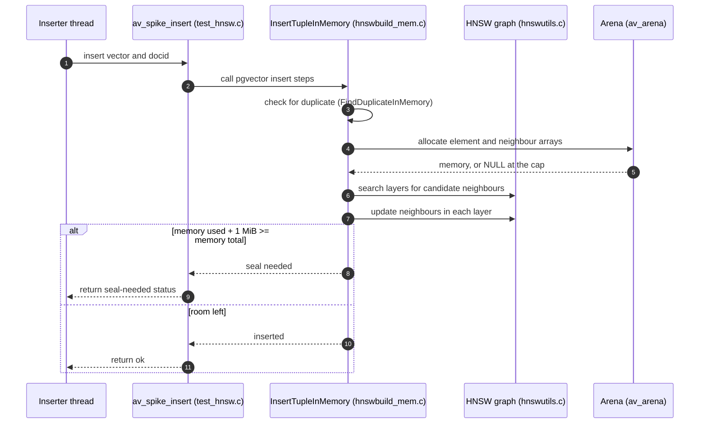
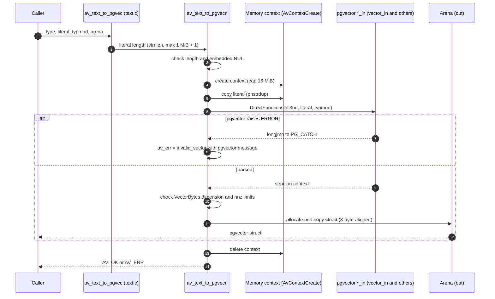
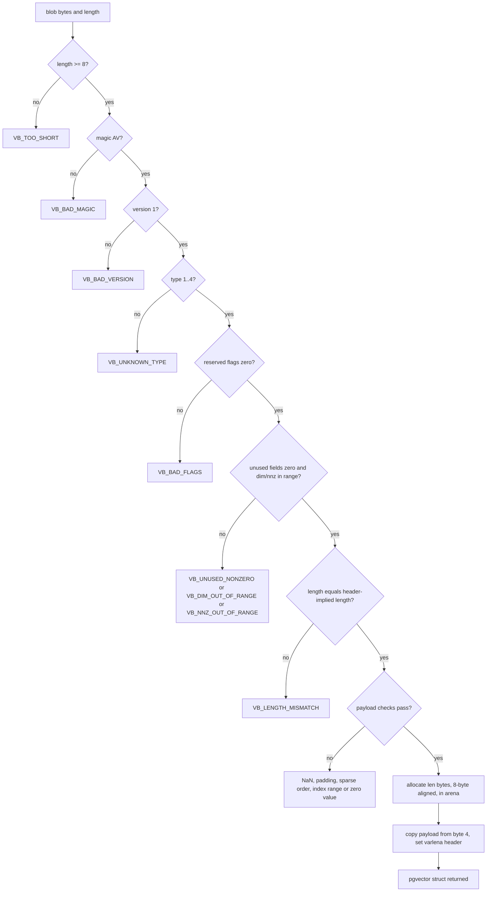
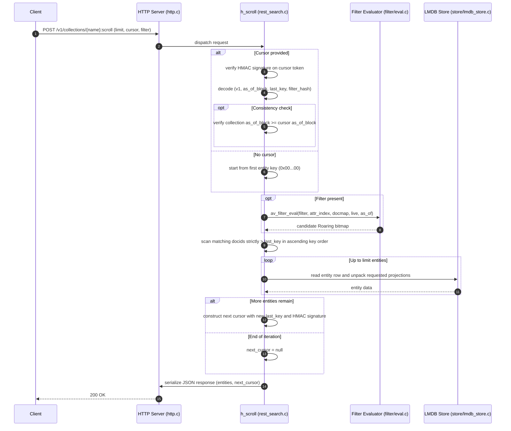
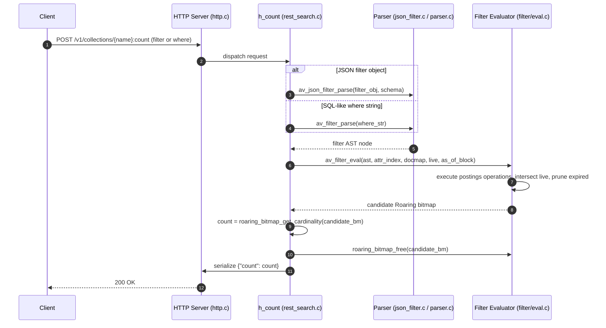
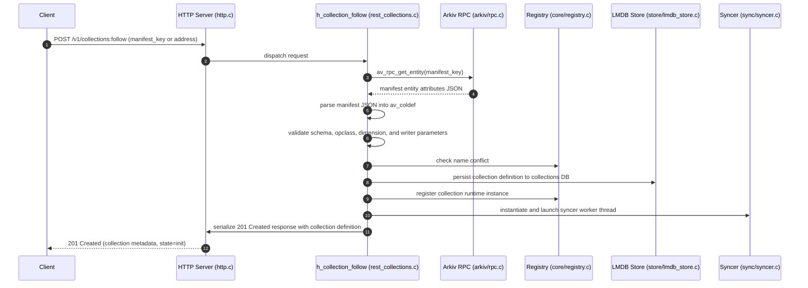

# Daemon flows (generated scenarios, D0 to D3)

Each scenario gives the call path. The diagrams follow the source. The HNSW scenario follows the spike notes in `src/pgvector/PROVENANCE.md`, because the spike code is not yet part of the daemon path.

## HNSW insert (spike)

Status: D0 spike. Run only by `test/unit/test_hnsw.c`.

Insert adds one vector to an in-memory pgvector HNSW graph. The graph lives in an arena, so it can be written to a file and mapped again.



Notes:
- An inserter takes pgvector's `entryWaitLock` and then `entryLock` exclusively. A searcher takes the same wait lock, releases it, then takes `entryLock` shared. Without this handshake, searchers starve inserters (D0 finding).
- "Seal needed" is the point where pgvector's memory-full condition is met. In the spike, the sealed graph still gives recall of at least 0.95.

## text literal → pgvector struct

Status: D1. Used by the text codec for every typed input.



Notes:
- The result is copied to the arena before the context is deleted.
- A literal that is too long, or contains a NUL, is rejected before pgvector runs.

## VectorBytes decode

Status: D1. Used for every on-chain vector.



Notes:
- `av_vb_decode` runs `av_vb_validate` first. A blob that fails validation never reaches the copy.
- Each failure sets `code = invalid_vector` and a `VB_*` sub-code.

## search request

Status: D3. Executed for `POST /v1/collections/{name}:search`.

Coordinates vector parsing, filter evaluation, flat vector scan, score derivation, and LMDB entity row hydration.

```mermaid
sequenceDiagram
    autonumber
    participant Client
    participant HTTP as HTTP Server (http.c / router.c)
    participant H as h_search (rest_search.c)
    participant F as Filter Evaluator (filter/eval.c)
    participant E as Query Executor (query/executor.c)
    participant S as Flat Scan (index/flat.c)
    participant LMDB as LMDB Store (store/lmdb_store.c)
    Client->>HTTP: POST /v1/collections/{name}:search (body JSON)
    HTTP->>H: dispatch request to query worker
    H->>H: decode query vector (array, literal, sparse, or VectorBytes)
    opt Cosine opclass
        H->>H: normalize query vector
    end
    opt Filter present (filter object or where string)
        H->>F: av_filter_eval(filter, attr_index, docmap, live, as_of)
        F->>F: evaluate AST nodes, intersect live, prune expired
        F-->>H: candidate Roaring bitmap
    end
    H->>E: av_execute_search(col, store, params, cand)
    E->>S: av_flat_scan(segment, docmap, query, opclass, cand, offset, k)
    S->>S: iterate candidates, compute distances, maintain max-heap
    S-->>E: top raw hits (docid, distance)
    loop Each raw hit
        E->>E: compute score (cosine: 1 - dist; other: -dist)
        opt Threshold checks
            E->>E: filter out if > max_distance or < min_score
        end
        opt Store provided & projections requested
            E->>LMDB: av_store_get_entity(def->name, key)
            LMDB-->>E: packed entity row
            E->>E: unpack attributes (av_attrs_unpack)
            E->>E: format projection (id, doc, vec, attributes)
        end
    end
    E->>E: attach query plan and elapsed ms
    E-->>H: av_search_result
    H->>HTTP: serialize JSON response with hits and plan
    HTTP-->>Client: 200 OK (Arkivector-As-Of-Block, X-Request-Id)
    H->>H: av_search_result_free()
```

Notes:
- Normalization occurs in-place before invoking distance kernels for cosine operator classes.
- Nearest neighbor ties are deterministically broken by ascending 32-byte entity key.
- Result memory (`av_search_result`) is freed with `av_search_result_free()` after JSON serialization.

## scroll

Status: D3. Executed for `POST /v1/collections/{name}:scroll`.

Implements stateless, deterministic cursor pagination over attribute-filtered entities, ordered by ascending entity key.



Notes:
- Scroll cursors are tamper-resistant using per-daemon-instance HMAC-SHA256 secrets.
- Paginates without holding locks or server-side cursor state across requests.

## count

Status: D3. Executed for `POST /v1/collections/{name}:count`.

Calculates the exact number of live, unexpired entities matching an arbitrary filter expression.



Notes:
- Filter evaluation short-circuits on empty subtrees.
- If no filter is specified, the count returns the cardinality of the collection's live bitmap minus expired entities.

## follow collection

Status: D3. Executed for `POST /v1/collections:follow`.

Discovers and synchronizes an existing collection published on the Arkiv chain via its manifest key.



Notes:
- The manifest entity contains the collection's authoritative configuration (vector column, metric, opclass, index hyperparameters, and membership rules).
- Following immediately triggers background bootstrap and sync catch-up routines.
