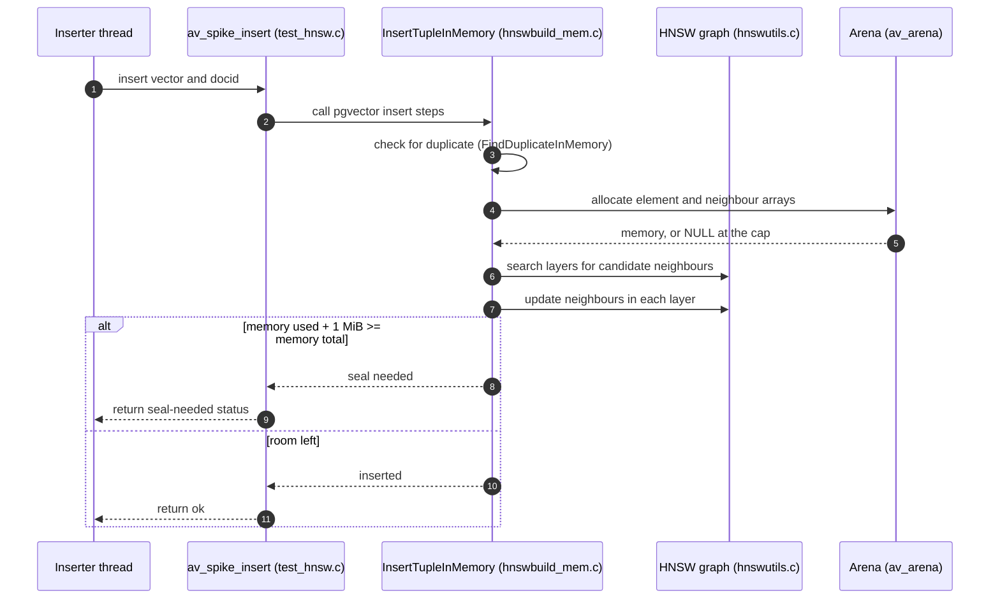
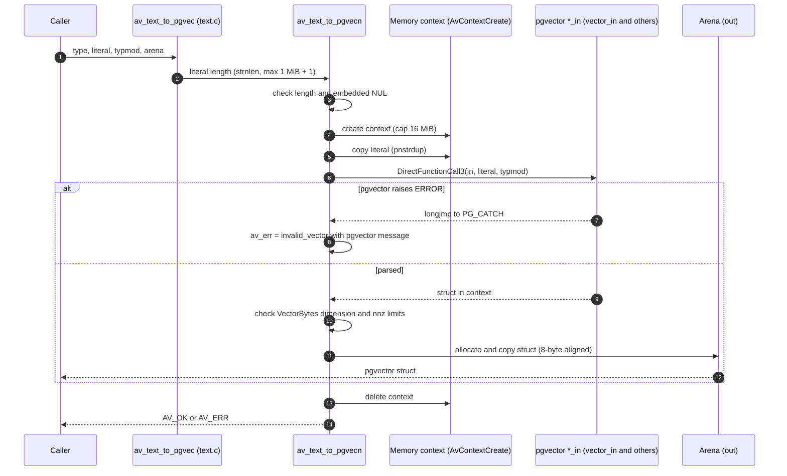
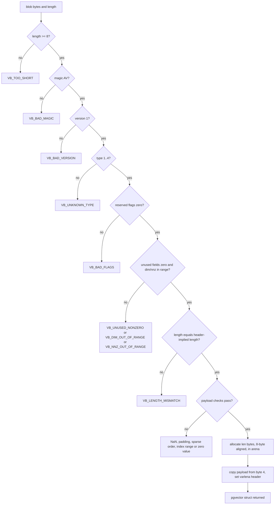

# Daemon flows (generated scenarios, D0 and D1)

Each scenario gives the call path. The diagrams follow the source. The HNSW scenario follows the spike notes in `src/pgvector/PROVENANCE.md`, because the spike code is not yet part of the daemon path.

## HNSW insert (spike)

Status: D0 spike. Run only by `test/unit/test_hnsw.c`.

Insert adds one vector to an in-memory pgvector HNSW graph. The graph lives in an arena, so it can be written to a file and mapped again.

Notes:
- An inserter takes pgvector's `entryWaitLock` and then `entryLock` exclusively. A searcher takes the same wait lock, releases it, then takes `entryLock` shared. Without this handshake, searchers starve inserters (D0 finding).
- "Seal needed" is the point where pgvector's memory-full condition is met. In the spike, the sealed graph still gives recall of at least 0.95.

## text literal → pgvector struct

Status: D1. Used by the text codec for every typed input.

Notes:
- The result is copied to the arena before the context is deleted.
- A literal that is too long, or contains a NUL, is rejected before pgvector runs.

## VectorBytes decode

Status: D1. Used for every on-chain vector.

Notes:
- `av_vb_decode` runs `av_vb_validate` first. A blob that fails validation never reaches the copy.
- Each failure sets `code = invalid_vector` and a `VB_*` sub-code.
