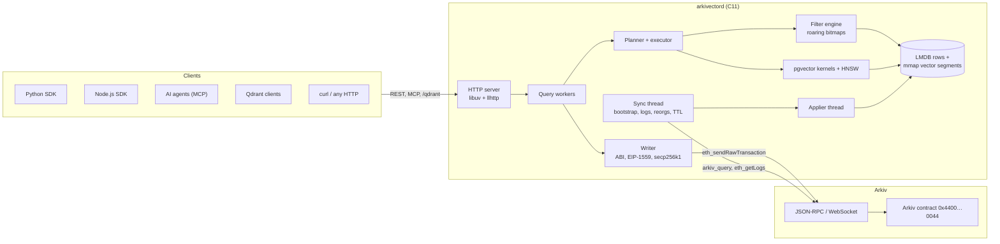

# Architecture

Arkivector is a co-processor next to the Arkiv chain. The chain stays the source of truth; the daemon keeps a local index it can always rebuild from Arkiv, and answers vector queries from it. SDKs are thin HTTP clients.

## Threads

| Thread | Work |
| :--- | :--- |
| Event loop (1) | HTTP accept, parse and respond (libuv + llhttp). Never blocks; hands requests to the workers |
| Query workers (N, default 4) | Parse, plan and run requests: filters, exact scans, HNSW searches, JSON encoding, writes |
| Sync (1) | Talks to Arkiv with blocking libcurl and a WebSocket doorbell: bootstrap, log replay, reorg detection, reconciliation |
| Applier (1) | The single writer of local state: decodes entities, updates segments, graph, attribute index and TTL, commits LMDB, publishes the new block |

Readers take a collection's read lock for a whole query, so every response reflects exactly one published block (`as_of_block`). The applier changes only private state until it publishes, which takes the write lock for a few microseconds.

## Modules

| Directory | Responsibility |
| :--- | :--- |
| `src/server/` | HTTP server, router, REST handlers, auth, rate limit, metrics, MCP, Qdrant |
| `src/query/` | Planner and executor |
| `src/index/` | Flat and HNSW segments, docids, live bitmap, attribute postings |
| `src/filter/` | `where` parser, JSON filter AST, bitmap evaluation |
| `src/sync/` | Bootstrap, catch-up, reorgs, reconciliation, TTL |
| `src/store/` | LMDB tables, memory-mapped arena files, checkpoints |
| `src/arkiv/` | JSON-RPC and WebSocket client, ABI, RLP, Keccak, transaction signing |
| `src/write/` | Managed writes: upsert-by-id, batching, nonces, receipts |
| `src/codec/` | VectorBytes, hex, base64, pgvector text I/O |
| `src/pgvector/` | pgvector 0.8.7 code, copied ([pgvector inside the daemon](pgvector.md)) |
| `src/pgcompat/` | The PostgreSQL APIs pgvector expects |

## Pages

- [Chain sync](sync.md): how the daemon mirrors Arkiv, survives reorgs and stays exact.
- [Storage](storage.md): LMDB, vector segments, docids, attribute index.
- [Search and HNSW](search.md): the planner, exact scans, the HNSW graph.
- [Write path](write-path.md): from an upsert request to an indexed entity.
- [pgvector inside the daemon](pgvector.md): reuse strategy and the compatibility layer.
- [VectorBytes](vectorbytes.md): the on-chain vector format.

The original design document, with the reasoning behind each choice, is [`ARCHITECTURE.md`](https://github.com/DikshitRJ/arkivector/blob/main/ARCHITECTURE.md).
