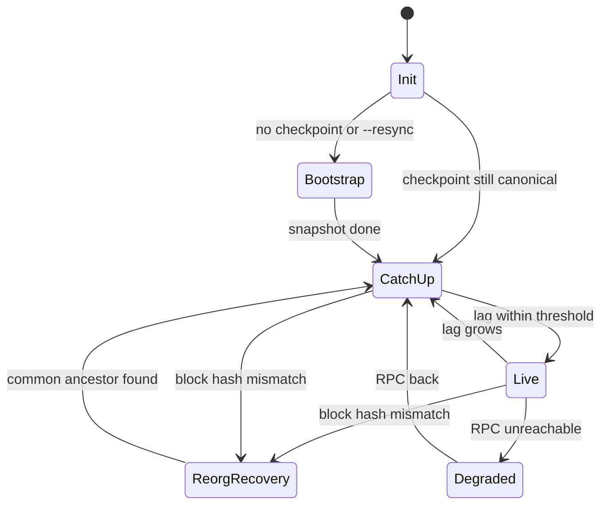

# Chain sync

The sync engine keeps, for every collection, an exact copy of the entities that belong to it at the last applied block. One sync thread serves all collections; it uses blocking libcurl calls with timeouts and a WebSocket for new-block notifications (HTTP polling when the socket is down).

## States

The state shows in [`GET /v1/sync`](../api/health.md#get-v1sync) and in every search response (`sync_state`).

## Bootstrap

A new collection is filled with a snapshot: `arkiv_query` with the membership predicate (`arkiv.schema = str('<tag>')` and the writers), paged by entity key, in parallel key ranges (`sync.bootstrap_parallelism`). The starting block is recorded first, and catch-up replays from it, so changes made during the snapshot are not lost. Stale pages never overwrite newer state because of the monotonic rule below.

## Catch-up and live

"The WebSocket is the doorbell, `eth_getLogs` is the ledger." On each new head the sync thread asks for the Arkiv contract's logs since the last applied block (chunked by `arkiv.max_log_range`), filtered to the collection's writers. Each log marks an entity key dirty; the current state of dirty keys is fetched in batches and handed to the applier as one batch per block range.

| Event | Action |
| :--- | :--- |
| `EntityCreated`, `EntityPatched` | Fetch state, insert or update (a changed vector gets a new docid) |
| `ExpiryExtended` | Update the expiry locally, no fetch |
| `OwnershipTransferred` | Update the owner, re-check owner-based membership |
| `EntityDeleted` | Tombstone, no fetch |
| natural expiry | Handled by liveness and the TTL sweep |

**Monotonic apply:** state for a key is applied only if its `updatedAt` is not older than what is stored, which makes replays and overlapping fetches safe. Entity rows and the cursor (block number and hash) commit in one LMDB transaction; the block is published after the commit. A crash resumes from the last cursor.

`arkiv.confirmations` keeps the daemon that many blocks behind head, trading freshness for fewer reorgs.

## Reorgs

The daemon keeps a ring of recent `(block, hash)` pairs with the keys touched in each (`sync.ring_size`, default 128) in LMDB. When a block's parent hash doesn't match, it walks back to the newest ring entry that is still canonical, re-fetches every key touched since, and re-applies. A reorg deeper than the ring triggers a fresh bootstrap.

## Reconciliation

Every `sync.reconcile_interval_s` (60 s) the daemon compares its live count with a count query on the chain. On a mismatch it runs a key sweep (keys and update blocks only), fetches what is missing, drops extras and refreshes stale entries. Divergence is a bug signal and is counted.

## TTL

An entity is live at block B when it exists, is not deleted and `expires_at_block > B`, the same rule as Arkiv. Every query applies this rule, so an expired entity disappears the moment its block passes, even before cleanup. A min-heap of expiry blocks then removes expired rows, postings and graph membership in bounded slices per block.

## RPC budget

Calls go through a token bucket (`arkiv.rpc_budget_per_sec`) with jittered retries for transport errors, 429 and 5xx, never for deterministic errors. Several `rpc_urls` give failover. The access key is sent as `X-API-KEY` and redacted from logs.
