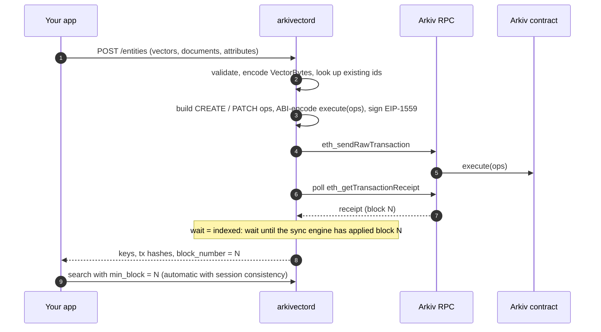

# Write path

The daemon never indexes a write optimistically. An entity appears in search only after it has been read back from the chain, so the index cannot drift from what Arkiv holds.

## Steps

1. **Validate.** Vector type and dimension, attribute names and types, the 128 KiB bytes budget, TTL range.
2. **Upsert by id.** For each entity, look up a live entity with the same `id`. Owned by the signer: build a `PATCH` with only the changed attributes, or skip (`noop`). Absent: `CREATE`. Owned by someone else: fail with `not_owner` before sending anything.
3. **Encode.** Attributes become Arkiv wire values (`arkiv.schema`, `av.id`, `av.vec` as [VectorBytes](vectorbytes.md), `av.doc`, user attributes). Ops are packed into as few `execute((uint8,bytes)[])` calls as the transaction size limit allows.
4. **Sign.** EIP-1559 transaction, chain id from config, nonce tracked per account. Env and keystore signers sign the Keccak-256 sighash with libsecp256k1; a remote signer receives the whole transaction (`eth_signTransaction`) and the daemon decodes its answer and checks every field and the recovered address before using it.
5. **Send and wait.** `eth_sendRawTransaction`, then receipts. A reverted transaction is reported as `tx_reverted` with the Solidity error name.
6. **Index.** The sync engine sees the contract's logs for block N like any other change and applies them. With `wait: "indexed"` the request returns only after that.

## Idempotency

With an `Idempotency-Key`, the request hash and the response are stored for 24 hours: a retry returns the stored response without sending a second transaction, and a concurrent duplicate waits for the first.

## Without a hot wallet

`entities:prepare` runs steps 1–3 for the user's address and returns unsigned transactions with nonce, gas limit and a fee suggestion. The user's wallet signs them (step 4 happens outside the daemon). [`entities:submit`](../api/entities-submit.md) then takes the raw signed transactions, decodes each one (canonical RLP, low-s signature, chain id, Arkiv contract, `execute` calldata), recovers the sender and checks it against the collection's `writers`, and only then broadcasts them in order (step 5). A wallet that broadcasts itself (MetaMask) passes the hashes instead. Receipts give the real keys, and `wait: "indexed"` waits for step 6. The daemon does not replace stuck client transactions, since it cannot re-sign them. See [Signing writes](../getting-started/signing.md).

## Entity keys

A create's key is `keccak256(chainId, contract, owner, entityNonce, salt)`. Before signing, the writer reads the wallet's `entityNonce` from the Arkiv contract (`eth_call` at `pending`) and keeps a local count of its own creates still in flight, so keys are right even when the same wallet also writes through another daemon, a script or the Arkiv SDK. Nonce reservation, signing and broadcast happen under one lock, so concurrent requests get keys in the order their transactions execute. With `wait: "receipt"` or `"indexed"` the response carries the keys from the `EntityCreated` logs of the receipts. With `wait: "none"` the keys are predictions; if `entityNonce` cannot be read the request fails with `arkiv_rpc_error` before anything is sent.

## Fees and gas

- **Fees:** `eth_feeHistory` over the last `write.fee_history_blocks` blocks: the tip is the median of the `write.priority_fee_percentile` reward, the max fee is twice the next base fee plus the tip. If the node has no fee history, `eth_gasPrice`; if that fails too, `write.max_fee_gwei` / `write.priority_fee_gwei`. Every quote is capped by `write.max_fee_cap_gwei`.
- **Gas limit:** `eth_estimateGas` plus `write.gas_margin_pct` (default 20%). If estimation fails, `write.fallback_gas_base` + 150,000 per operation; this is logged and counted in `arkivector_write_gas_estimate_fallback_total`.
- **Stuck transactions:** a transaction not mined after `write.replace_after_blocks` blocks is resent with the same nonce and both fees raised by at least 12.5%, up to `write.max_replacements` times. The response reports the hash that was mined.
- **Observability:** `arkivector_write_gas_used_total`, `_gas_reserved_total`, `_effective_gas_price_wei`, `_fee_quotes_total{source}`, `_tx_replacements_total`, and one log line per transaction with gas used, gas reserved and the fee source.
