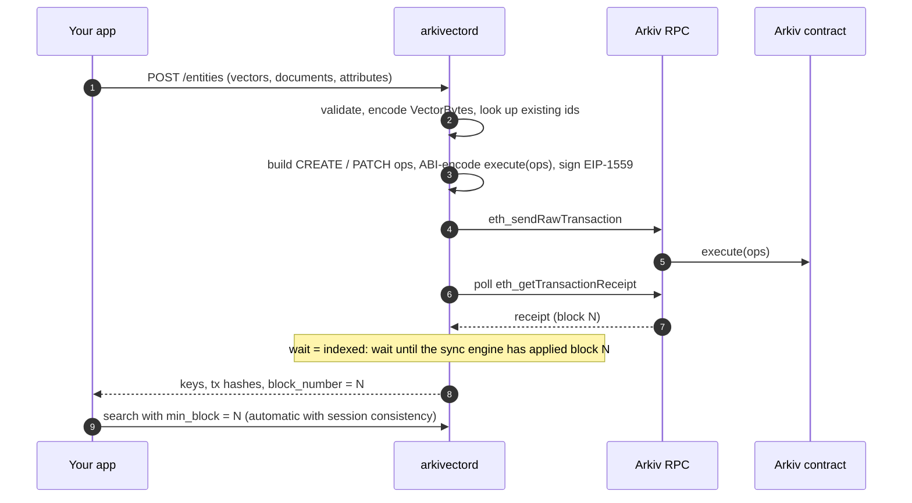

# Write path

The daemon never indexes a write optimistically. An entity appears in search only after it has been read back from the chain, so the index cannot drift from what Arkiv holds.

## Steps

1. **Validate.** Vector type and dimension, attribute names and types, the 128 KiB bytes budget, TTL range.
2. **Upsert by id.** For each entity, look up a live entity with the same `id`. Owned by the signer: build a `PATCH` with only the changed attributes, or skip (`noop`). Absent: `CREATE`. Owned by someone else: fail with `not_owner` before sending anything.
3. **Encode.** Attributes become Arkiv wire values (`arkiv.schema`, `av.id`, `av.vec` as [VectorBytes](vectorbytes.md), `av.doc`, user attributes). Ops are packed into as few `execute((uint8,bytes)[])` calls as the transaction size limit allows.
4. **Sign.** EIP-1559 transaction with secp256k1 (libsecp256k1) over Keccak-256, chain id from config, nonce tracked per account.
5. **Send and wait.** `eth_sendRawTransaction`, then receipts. A reverted transaction is reported as `tx_reverted` with the Solidity error name.
6. **Index.** The sync engine sees the contract's logs for block N like any other change and applies them. With `wait: "indexed"` the request returns only after that.

## Idempotency

With an `Idempotency-Key`, the request hash and the response are stored for 24 hours: a retry returns the stored response without sending a second transaction, and a concurrent duplicate waits for the first.

## Without a hot wallet

`entities:prepare` runs steps 1–3 and returns the unsigned transactions; the client's own wallet signs and sends them ([Prepare](../api/entities-prepare.md)).

## Known gaps

Gas uses a fixed limit (no `eth_estimateGas` yet), and predicted keys ignore the wallet's on-chain entity nonce, so keys returned for `wait: "none"` can differ if the wallet created entities elsewhere. The entities themselves are always correct after sync.
